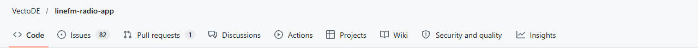
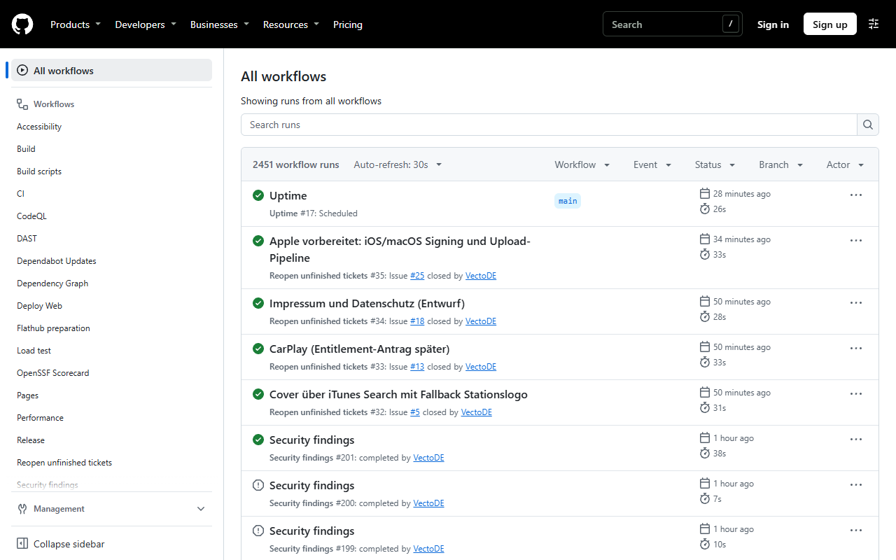
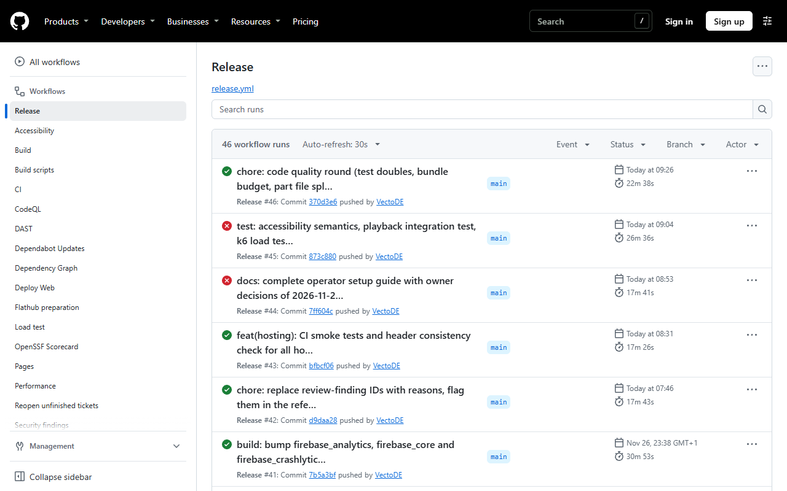
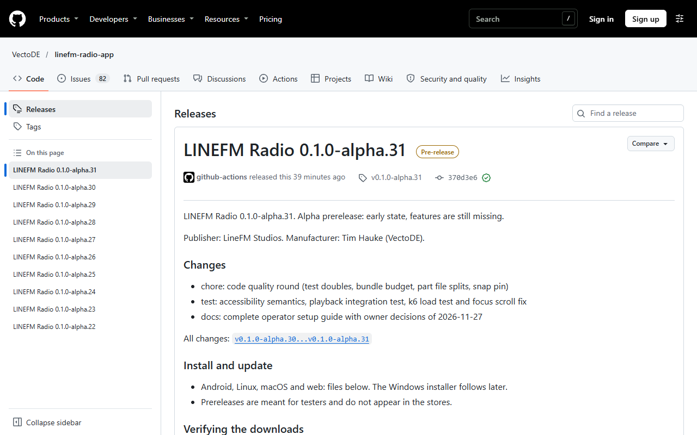
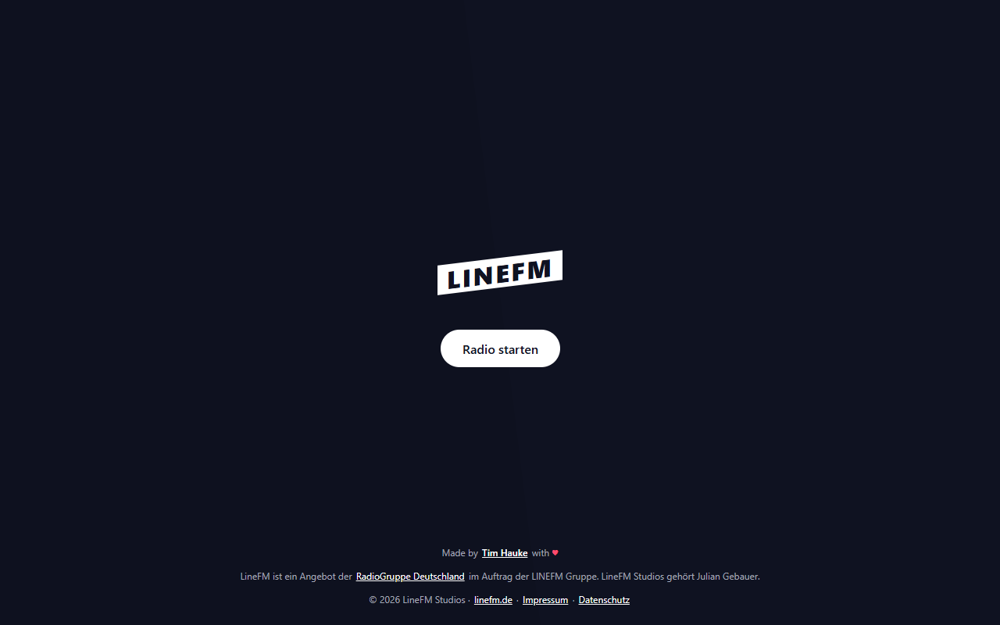

# Einrichtung für LineFM Studios

Diese Liste enthält alles, was du als Betreiber wissen, besorgen und eintragen musst, damit LINEFM Radio in den Stores und im Web erscheint und einwandfrei läuft. Alles andere ist vorbereitet. Du brauchst kein Programmierwissen. Wo ein Entwickler etwas tun muss, steht es dabei.

Die App selbst bauen, herunterladen und öffnen, ohne den Entwickler zu fragen: [BAUEN-UND-STARTEN.md](BAUEN-UND-STARTEN.md).

English summary of the introduction, the first day and the glossary additions: [docs/en/setup-guide.md](en/setup-guide.md).

Kurz gesagt:

- Du legst Konten an und klickst dich durch die Formulare der Stores.
- Du trägst Passwörter und Namen ein oder gibst sie an den Entwickler weiter. Wie, hängt vom Weg ab, den du wählst: Auf Weg A betreut Tim Hauke die Technik und du gibst ihm Zugangsdaten nur auf dem gesicherten Weg. Auf Weg B betreibst du alles selbst. Beide Wege stehen in der Tabelle "Weg A oder Weg B" weiter unten.
- Du holst schriftliche Zustimmungen ein.
- Alles, was Befehle braucht, macht auf Weg A der Entwickler und auf Weg B du selbst. Das steht gesammelt in Anhang G, in den Schritten bleibt dazu nur ein Verweis.

Fang bei Abschnitt 1 an und arbeite die Tabelle "Arbeitsreihenfolge" weiter unten von oben nach unten ab. Heute anfangen heißt: Schritt 1.1 (GitHub-Konto anlegen), dann 1.7 (Postfächer) und 1.2 (Passwortmanager).

GitHub ist die Webseite, auf der der Code der App liegt und automatisch gebaut wird. Das Repository (kurz Repo) ist der Projektordner der App dort: <https://github.com/VectoDE/linefm-radio-app>. Unbekannte Wörter stehen alphabetisch in Anhang F. Die Anhänge A bis D und F sind Nachschlagelisten für dich. Anhang G ist für den Entwickler. Anhang E steht ganz am Ende der Datei und belegt nur die Quellen.

## So liest du diese Liste

Jeder Schritt hat eine Nummer (zum Beispiel 6.4) und diese Angaben:

- Wer: wer handelt.
- Was: die Aufgabe.
- Wozu: was ohne den Schritt fehlt oder nicht geht.
- Wo eintragen: der genaue Ort, mit Link oder Menüpfad.
- Woher: wo du den Wert bekommst.
- Prüfschritt: woran du erkennst, dass es funktioniert.
- Wenn es nicht klappt: die häufigsten Ursachen und was du dann tust.
- Haken: am Ende des Schritts steht eine Zeile `- [ ] erledigt`. Wer sie abhakt, steht weiter unten unter "Haken".

Viele Schritte enden mit einer Zeile "Nur für Nachfragen". Sie nennt Quellen und die zugehörigen Store-Regeln für den Entwickler oder den Anwalt. Du kannst sie überspringen.

Was nur der Entwickler tut (Befehle, Dateien, technische Prüfungen), steht gesammelt in Anhang G. Im Schritt selbst bleibt ein Satz mit dem Verweis auf den Abschnitt dort.

Menüpfade schreiben wir so: Jeder Menüpunkt steht in Anführungszeichen, die Punkte sind durch " > " getrennt. `"Settings" > "Secrets and variables" > "Actions"` heißt: erst auf "Settings" klicken, dann links auf "Secrets and variables", dann auf "Actions".

Wir nennen den englischen Namen der Oberfläche, weil GitHub, Cloudflare, Microsoft und Google ihre Menüs oft auf Englisch zeigen, auch wenn du Deutsch eingestellt hast, und ihre Dokumentation nur diese Namen kennt. Den deutschen Namen setzen wir beim ersten Auftreten in einem Schritt in Klammern dahinter, wo wir ihn kennen. Findest du einen Menüpunkt nicht, stell die Oberfläche des Dienstes auf Englisch (meist im Profilmenü unter der Spracheinstellung) und such dann nach dem englischen Namen.

Hinweis zu Prüfschritten vor Version 1.0.0: Die Store-Abläufe und das Ausrollen der Webseite laufen erst ab Version 1.0.0 von selbst. Bis dahin gilt ein solcher Schritt als eingetragen, sobald alle Secrets und Variablen gesetzt sind, die der Schritt nennt (gesammelt in Anhang A). Welche Version gerade aktuell ist, siehst du ganz oben auf <https://github.com/VectoDE/linefm-radio-app/releases>. Steht dort ein Zusatz wie `-alpha`, bist du noch vor 1.0.0. Den Haken setzt du erst, wenn die Prüfung wirklich gelaufen ist.

Es gibt zwei Stände:

- "eingetragen": Alle Werte sind gesetzt. Das genügt, damit die Version vorankommt.
- "geprüft": Der Ablauf lief grün. Das kommt danach.

Steht ein Schritt nicht in deinem Umfang (zum Beispiel ein optionaler Dienst, den du bewusst nicht nutzt), schreibst du "entfällt" oder "übersprungen" daneben und hakst ihn ab. Für die Versionsnummer 1.0.0 zählen nur offene Aufgaben für dich. Nicht mitgezählt werden Apple-Schritte, "entfällt"-Schritte und Prüfungen, die erst nach 1.0.0 möglich sind.

Wann laufen die automatischen Abläufe? Jede Änderung auf dem Hauptzweig `main` (der Haupt-Entwicklungslinie des Codes) erzeugt automatisch eine neue Version auf GitHub (Ablauf "Release"). Trägt die Version einen Zusatz wie `-alpha`, `-beta` oder `-rc`, ist sie nur eine Vorabversion auf GitHub. Die Stores und das Ausrollen der Webseite starten automatisch erst ab Version 1.0.0.

Die Versionsnummer zählt der Ablauf bei jeder Änderung selbst hoch:

- `-beta`: Es sind keine Funktionswünsche mehr offen.
- `-rc`: Es sind nur noch Aufgaben für LineFM Studios offen.
- `1.0.0`: Es ist nichts mehr offen, wobei die Ausnahmen aus dem Absatz davor gelten (Apple, "entfällt" und Prüfungen, die erst nach 1.0.0 möglich sind).

Du löst die Version nicht aus. Du machst sie möglich, indem du deine offenen Aufgaben erledigst. "Offen" heißt: Es gibt noch Tickets im Repository, die diese Aufgaben beschreiben. Du findest sie auf der Startseite des Repositorys im Reiter „Issues“ (die Tickets, also die Liste der Aufgaben und Fehler), dem zweiten von links direkt neben "Code". Den aktuellen Stand erklärt dir der Entwickler. Apple zählt nicht zum ersten Umfang (Abschnitt 15).



So sieht die Leiste ohne Anmeldung aus. Mit Anmeldung und Rechten am Repository kommt rechts der Reiter "Settings" dazu.

Erste Veröffentlichung auslösen: Vor Version 1.0.0 läuft kein Store-Ablauf von selbst. Um deine Einträge trotzdem zu testen, startest du den jeweiligen Ablauf einmal von Hand (Schritt 1.5, Punkt 2, "Run workflow"). Ein roter Lauf ist dabei normal, wenn die Zusammenfassung des Laufs einen fehlenden Namen nennt: entweder einen Rechtsplatzhalter (eine noch leere Stelle in den Rechtstexten, zum Beispiel `{{BETREIBER_NAME}}`, siehe Schritt 3.1) oder ein fehlendes Secret (Schritt 1.3).

Nennt die Zusammenfassung nichts davon, schick den Lauf an den Entwickler. Wo du das jeweils prüfst:

- Google Play: Schritt 6.4.
- Microsoft: Schritt 7.7.
- Linux (Snap): Schritt 8.2.

Wichtig vorab:

- Passwörter, Schlüssel und Tokens (geheime Zugangscodes) gehören nie in eine E-Mail, einen Chat oder ein Ticket. Auf Weg B kommen sie als Secret in die GitHub-Einstellungen deiner Kopie des Repositorys (Schritt 1.3) oder in deinen Passwortmanager. Auf Weg A gibst du sie auf dem gesicherten Weg an Tim Hauke (siehe "Weg A oder Weg B" unten).
- Ein Secret ist ein geheimer Wert, den GitHub speichert und danach nie wieder anzeigt. Eine Variable ist ein nicht geheimer Wert, der lesbar bleibt. Beides legst du im Repo an (Schritt 1.3).
- CI (Continuous Integration) heißt hier: GitHub baut, prüft und lädt die App automatisch hoch. So ein automatischer Ablauf heißt in dieser Anleitung "Ablauf" (anderswo auch Pipeline oder Workflow, gemeint ist dasselbe). Ein Release ist eine veröffentlichte Version.
- Fehlt ein optionales Secret, wird der betroffene Schritt übersprungen oder baut unsigniert (ohne digitale Unterschrift, Windows warnt dann bei der Installation). Fehlen Pflichtangaben (zum Beispiel die Rechtstexte aus Schritt 3.1 oder die Signierschlüssel für die Stores), bricht der betroffene Ablauf mit einer klaren Meldung ab. Die Zusammenfassung des Laufs nennt den fehlenden Namen, nie den Wert.
- Vor jeder Veröffentlichung arbeitest du die [Freigabe-Checkliste](FREIGABE-CHECKLISTE.md) ab. Sie steht als eigene Phase in der Arbeitsreihenfolge (Phase 11a). Ihre Teile heißen dort "Teil A" bis "Teil E". Mit "Checkliste, Teil D" ist der Abschluss am Ende der Checkliste gemeint, nicht der Anhang D dieser Anleitung.
- Preise und Formulare der Anbieter ändern sich. Die Angaben stammen aus den Anbieter-Texten vom November 2026, einzelne Klickpfade sind noch nicht am echten Konto durchgeklickt. Im Zweifel gilt, was der Anbieter gerade anzeigt. Weicht der Bildschirm von der Beschreibung ab, mach ein Foto davon und schick es dem Entwickler, bevor du weitermachst.
- Anwalt: Alles Rechtliche in dieser Anleitung ist eine Vorprüfung und ersetzt weder Anwalt noch Steuerberater. Sammle die offenen Rechtsfragen und lass sie in einem Termin prüfen. Die Sammelliste steht in Anhang D, die Einzelthemen in Abschnitt 17. Wo ein Schritt davon abhängt, steht kurz "(Anwalt)".
- Einen passenden Anwalt findest du über die Rechtsanwaltskammer deines Bezirks oder über eine Empfehlung aus deinem Netzwerk. Achte auf Erfahrung mit IT-, Medien- und Datenschutzrecht. Kosten und Dauer nennt dir der Anwalt im Erstgespräch, frag beim Terminvereinbaren nach einem Kostenrahmen.
- Apple ist nicht Teil der ersten Veröffentlichung. Der Code ist vorbereitet, Abschnitt 15 beschreibt, was später nötig ist.

Haken: Verbindlich sind die Haken in der Datei im Repository, sie pflegt der Entwickler. Setze einen Haken erst, wenn der Schritt erledigt und geprüft ist. Am einfachsten schreibst du dem Entwickler gesammelt, was fertig ist ("6.4 und 7.1 erledigt"), er hakt dann ab. Willst du selbst den Überblick behalten, hakst du zusätzlich in einer eigenen Kopie dieser Datei ab:

1. Lade die Rohdatei herunter (<https://raw.githubusercontent.com/VectoDE/linefm-radio-app/main/docs/EINRICHTUNG.md>): Rechtsklick auf den Link, "Link speichern unter" (in Edge, Chrome und Firefox ähnlich benannt). Der Dateiname muss auf `.md` enden. Ein normaler Klick öffnet die Datei im Browser nur als Text.
2. Öffne die gespeicherte Datei mit dem Windows-Editor (Rechtsklick auf die Datei, "Öffnen mit", "Editor") und ersetze `[ ]` durch `[x]`. Beim Speichern ("Datei" > "Speichern unter") wähle als Dateityp "Alle Dateien", sonst hängt der Editor `.txt` an. Erfolgszeichen: Du siehst Text mit vielen Zeilen, die mit `- [ ]` oder `- [x]` enden.
3. Schick dem Entwickler gesammelt die erledigten Schritte ("6.4 erledigt"), per Mail oder auf dem Weg, den ihr für Kontakt nutzt. Er trägt die Haken im Repository nach.

Jeder Schritt hat genau einen Haken, `- [ ] erledigt`. Schritte, die nur der Entwickler ausführt, tragen `- [ ] vom Entwickler bestätigt`.

Dauerpflichten haben zwei Haken am Schritt selbst: "eingerichtet" und "regelmäßig erledigt". Das sind die Schritte 12.3, 19.1, 19.2, 19.3, 19.6, 19.7, 19.8, 20.2, 20.4 und 20.5.

Anhang D ist nur deine Kurzliste und enthält je Eintrag einen eigenen Haken. Maßgeblich bleibt der Haken im Schritt. Er gilt, wenn alles eingetragen und geprüft ist. Prüfungen, die erst ab Version 1.0.0 gehen, bleiben bis dahin offen.

Haken und Tickets, ein Beispiel: Schritt 6.4 hat zwei Teile, Dienstkonto anlegen (du) und Test-Upload (Pipeline). Hast du beides erledigt und der Entwurf liegt in der Test-Spur "internal" (siehe Schritt 6.4), setzt du den Haken bei 6.4. Tickets (die Aufgabenliste des Entwicklers auf GitHub) sind etwas anderes als deine Haken: Ein Ticket gilt erst als erledigt, wenn dein Haken gesetzt ist und die automatische Prüfung grün ist.

#### Rollen im Überblick

| Wort im Text | Wer das ist |
|---|---|
| du, Betreiber, Inhaber, Kunde | Du: LineFM Studios, die Person, die diese Anleitung abarbeitet. "Kunde" meint dein Unternehmen als Auftraggeber der App, also dich. Die Konten bei Google, Microsoft und weiteren Anbietern sind Organisationskonten deines Unternehmens. Name und Rechtsform des Konto-Inhabers trägst du in Schritt 1.6 ein. |
| Verantwortlicher | Im Sinne von Medienstaatsvertrag und Datenschutz-Grundverordnung die Person oder Firma, die du in Schritt 3.1 benennst, in der Regel du als Geschäftsführung. |
| Entwickler, Repo-Eigentümer, Tim | Eine Person: Tim Hauke (GitHub-Name VectoDE). "Repo-Eigentümer" heißt: Ihm gehört das Repository auf GitHub. Er legt Repository-Einstellungen und die Umgebung `production` an, führt die Befehle aus Anhang G aus und pflegt die Haken im Repository. |
| zweite Person, Zweitadmin, Vertretung | Jemand aus deinem Unternehmen, den du benennst (Schritt 18.2). |
| Account Holder, Admin, Globaler Administrator | Rollennamen in den Konten der Anbieter. Als Konto-Inhaber vergibst du sie selbst, die zweite Person bekommt dieselbe Rolle. |
| Prüfer, Reviewer, Person bei Google, Microsoft, Apple | Mitarbeitende oder automatische Prüfungen der Anbieter, die deine Einreichung freigeben oder ablehnen. Du sprichst mit ihnen nur über die Formulare und Antworten der Konsole. |
| LINEFM Gruppe, RadioGruppe | Sender-Partner im Umfeld von LineFM Studios. Ihre Zustimmung holst du selbst ein (Schritte 2.2, 2.3). |
| laut.fm | Die Vereinbarung mit laut.fm hast du bereits und behältst sie selbst (Schritte 2.1, 17.7). |

Fällt im Text eine andere Rolle, steht sie mit Namen dabei.

Kontakt zum Entwickler: Tim Hauke erreichst du per WhatsApp, Discord, Root (root.gg), E-Mail oder Telefon. Fehlen dir seine Daten, frag ihn auf dem Weg, auf dem ihr bisher Kontakt hattet. Trag sie in deiner Kopie dieser Datei ein: WhatsApp: ____________________; Discord: ____________________; Root: ____________________; E-Mail: ____________________; Telefon: ____________________.

Eine Bildschirmfreigabe, bei der er dir beim Klicken zusieht und erklärt, läuft über Discord, Root oder WhatsApp, je nachdem, was ihr beide installiert habt. Gibst du in einem Schritt ein Secret ein (zum Beispiel in 7.7 und 8.2), pausiere die Freigabe vorher, trag den geheimen Wert allein ein und setze die Freigabe danach fort.

Wer macht was: Jeder Schritt nennt in der Zeile "Wer", wer handelt. Steht dort der Entwickler, macht Tim das allein oder mit dir zusammen. Alles andere klickst du im Browser.

Eine Ausnahme sind wenige Prüfungen, die du als Befehl am eigenen Rechner tippst (zum Beispiel die Prüfsumme in Schritt 16.4). Dort steht die Windows-Schreibweise direkt dabei. Auf Weg B (du betreibst selbst) führst du alle Befehle aus Anhang G selbst aus. Welche Befehle es gibt (zum Beispiel `keytool`, `dig`, `curl`), steht in Anhang G.

Dateien: Der Entwickler liefert sie als Download oder per Mail. Zugangsdaten und Passwörter geben wir nur auf dem Weg weiter, den die Tabelle "Weg A oder Weg B" nennt.

Windows: Wo Anhang G einen Befehl mit `grep` oder `dig` zeigt, nimmst du unter Windows PowerShell: `curl.exe -sI <Adresse> | Select-String <Wort>` statt `curl ... | grep -i <Wort>` (`curl.exe` mit Endung, sonst startet PowerShell einen anderen Befehl), `Resolve-DnsName <Name>` statt `dig`. Im Browser gehen für Zertifikate <https://www.ssllabs.com/ssltest/> und für Antwort-Kopfzeilen die Entwicklerwerkzeuge des Browsers (Taste F12 drücken, Reiter "Netzwerk", Zeile anklicken, Reiter "Headers"). Das betrifft vor allem Weg B.

#### Weg A oder Weg B

Du entscheidest einmal, welchen Weg du gehst. Die Entscheidung steht in Schritt 1.6 (Punkt 5) und kommt vor dem Anlegen der Secrets in Schritt 1.3.

| | Weg A: der Entwickler betreut | Weg B: du betreibst selbst |
|---|---|---|
| Zugangsdaten | Du gibst sie auf dem gesicherten Weg (siehe unten) an Tim Hauke. | Sie bleiben bei dir. |
| Secrets eintragen | Tim Hauke legt sie als GitHub-Secrets im Repository ab. Wo ein Schritt sagt "trag das Secret ein", übergibst du den Wert an ihn. | Du trägst sie selbst in deiner Kopie des Repositorys ein (Schritt 1.3). |
| Updates und Wartung | Tim Hauke hält die App laufend aktuell. | Du übernimmst eine Kopie des Repositorys in dein eigenes GitHub-Konto und betreibst alles selbst, mit eigenen Dateien im Ordner `config/` des Repositorys (die Schritte dazu stehen in [KONFIGURATION.md](KONFIGURATION.md)). |
| Befehle | Tim Hauke führt sie aus. | Du führst sie aus, sie stehen in Anhang G. |

Für beide Wege gilt: Zugangsdaten stehen nie im öffentlichen Repository, in einer E-Mail oder im Chat. Gesicherter Übergabeweg bei Weg A: ein geteilter Eintrag im Passwortmanager (bei Bitwarden die Funktion "Send", im Tresor im Reiter "Send") oder ein passwortgeschütztes Archiv, dessen Passwort du dem Entwickler getrennt am Telefon durchgibst.

Unbekannte Wörter erklärt Anhang F (alphabetisch sortiert). Kommst du bei einem Schritt nicht weiter, steht in Schritt 16.3 ("Wenn etwas hakt"), wie du Hilfe holst. Schritte mit "Wer: Entwickler" und dem Haken "vom Entwickler bestätigt" (zum Beispiel 6.11, 12.1, 12.6, 16.2) sind für dich nur zum Nachlesen da, du musst dort nichts tun.

## Reihenfolge im Überblick

| Nr. | Abschnitt | Hängt ab von | Dauer, grob |
|---|---|---|---|
| 1 | Vorbereitung | nichts | 1 Tag |
| 2 | Verträge und Bestätigungen | 1 | Wochen (Dritte antworten) |
| 3 | Rechtstexte und Pflichtangaben | 2 teilweise | Tage |
| 4 | Domain, DNS, HTTPS, CDN, Mail-DNS | 1.6 (Hosting gewählt), 5.1 (Hosting-Ziel steht, in der Arbeitsreihenfolge kommt 5.1 vor 4.1) | Tage |
| 5 | Web-Hosting und automatisches Ausrollen | 1.6 | 1 Tag |
| 6 | Google Play | 1, 3, 4 und 5 (Datenschutz-URL muss live sein), 18.1 (D-U-N-S), 20.1 (Support-Postfach) | Tage plus 14 Tage Test (privates Konto) |
| 7 | Microsoft Store | 1, 3, 4 und 5, 18.1, 20.1, 7.2 (Lizenzklärung) | Tage |
| 8 | Linux: Flathub und Snap | 4, 5 | Tage bis Wochen |
| 9 | Statistik und Absturzberichte (optional) | 2 (AVV) | 1 Tag |
| 10 | Search Console, GA4 und GTM | 5 | 1 Tag |
| 11 | Vertrauens-Badges | 5 | je nach Anbieter |
| 12 | Signierte Releases (GPG optional), Scanner-Konten (optional) | 1 | 1 bis 2 Stunden |
| 13 | Datenschutzangaben je Store | 3, 6 bis 9 | 1 Tag |
| 14 | Bilder und Screenshots | früh anstoßen, die Stores in 6 bis 8 brauchen sie | Tage |
| 15 | Apple (später) | 1 | Wochen |
| 16 | Abnahme | alles | 1 Tag |
| 17 | Recht, Datenschutz, Jugendschutz, Verarbeitungsverzeichnis | 2, 3 | Tage, dann laufend |
| 18 | Konten, Kosten und Steuern | 1 | Wochen (D-U-N-S bis 30 Tage) |
| 19 | Technik und Betrieb | 4, 5 | 1 bis 2 Tage, dann laufend |
| 20 | Support und Pflege, Fristenkalender | 20.1 (Postfach) sofort, der Rest nach 16 | laufend |

Die Tabelle "Arbeitsreihenfolge" unten gibt die Reihenfolge vor. Die Verträge aus Abschnitt 2 und die D-U-N-S-Nummer (Schritt 18.1) stehen in Phase 3 ("Lange Wartezeiten anstoßen"). Sie brauchen Entscheidungen aus Phase 2 (Konto-Inhaber, Statistik ja oder nein) und dauern am längsten, weil Dritte antworten. Beginne Phase 3 deshalb direkt nach Phase 2. Danach gehst du die Phasen der Reihe nach durch. Wo du auf eine Antwort von Dritten wartest, arbeitest du in der Wartezeit an der nächsten Phase weiter.

Weitere Abhängigkeiten:

- Die Postfächer und das Google-Konto (Schritt 1.7) prüfst du schon in Phase 1.
- Entscheidest du dich gegen Statistik und Absturzberichte (Abschnitt 9, optional), entfallen mehrere Verträge und Rechtstexte.
- Die Abschnitte 6 bis 8 laufen parallel.
- Die Hosting-Wahl (Abschnitt 5) und die DNS-Einträge (Abschnitt 4) bedingen sich: Zuerst Hosting wählen, dann DNS auf dessen Zieladresse stellen, dann das Zertifikat.

## Arbeitsreihenfolge

Die Schrittnummern bleiben stabil. In dieser Reihenfolge arbeitest du sie ab, wenn du nichts überspringen willst:

| Phase | Schritte | Warum zuerst |
|---|---|---|
| 1. Grundlagen | 1.1, 1.7, 1.2 (für 1.7 vorab die zweite Person aus Schritt 18.2 benennen) | Zugang, Postfächer, Passwortmanager |
| 2. Entscheiden, dann Secrets | 1.6 (zuerst Punkt 5: Weg A oder Weg B), danach 1.3 und 1.5 (1.4 kommt in Phase 3, beim Anwaltstermin) | Der Weg bestimmt, wer die Secrets einträgt. Hosting, Telemetrie, Stores und Konto-Inhaber bestimmen den Rest |
| 3. Lange Wartezeiten anstoßen | 20.5 (gemeinsamen Kalender anlegen, Fristen eintragen, sobald sie anfallen), 18.1 (D-U-N-S), 2.1 bis 2.3 (Bestätigungen), 20.1 (nur das Postfach, die Support-Seite folgt nach der Web-Phase) und 18.2 (Konten-Regeln, die Haken je Konto erst am Ende von Phase 8), Anwaltstermin vereinbaren (Anhang D), dort auch Schritt 1.4 (Zustimmung zur Veröffentlichung des Quellcodes) klären | Dritte antworten spät, Konten brauchen Adressen, mehrere Schritte brauchen den Anwalt |
| 3a. Pflichtwerte | 3.1 (Werte und Platzhalter), 3.2, 3.5, 3.6 (Telemetrie-Entscheidung festlegen, danach 3.1 und 17.13 abschließen, der Dienst selbst folgt in 9.1 bis 9.3), 17.7, 17.8, 17.10, 17.13 | Der Release-Build bricht bei offenen Platzhaltern ab, Store-Formulare brauchen diese Antworten |
| 4. Web | 5.1, 5.2, 4.1, 4.2, 4.4, 19.1 (Verlängerung und Transfer-Sperre der Domain, vor 4.3), 4.3, 4.5 (SPF und DMARC, unabhängig vom Hosting, jederzeit möglich) | Datenschutz-URL und Domain müssen erreichbar sein. Gemeint ist: Die Web-App läuft unter `app.linefm.de`. Die Veröffentlichung der Apps in den Stores ist etwas anderes (Phase 6 bis 8) |
| 5. Rechtstexte | 3.3, 3.4, 3.1 abschließen (danach Web neu bauen, Schritt 1.5), 17.5a (Nutzungsbedingungen-Seite für den Händlerstatus aus 17.5, der Anwalt liefert den Text), 2.4, 2.5, 17.3, 17.1, 17.2, 17.4, 17.6, 17.9, 17.11, 17.12, 18.3, 18.4 | Stores verlangen die URLs und Texte |
| 6. Google | 14 (Bilder müssen jetzt bereitliegen), 6.1, 17.5, 6.2, 6.3 (Schlüsselsicherung sofort, Schritt 19.3), 6.4, 6.5 bis 6.13 (6.9 erst nach dem ersten Upload), 13.1 | |
| 7. Microsoft | 7.1 bis 7.3, 7.6, 7.7, danach 7.4 und 7.5 (sie trägst du erst nach dem ersten Pipeline-Lauf aus 7.7 final ein), 7.8. Schritt 13.2 kommt zwischen 7.3 und 7.4 | 7.2, 13.2 und 7.6 vor 7.7, Bilder aus 14 liegen bereit |
| 8. Linux | 8.2 (Anmeldedaten sofort sichern, Schritt 19.3), 13.3, dann 8.1 (Einreichung bei Flathub, Verifizierungsdatei erst nach Aufnahme) | |
| 9. Optional | 9 (Telemetrie), 10.1, 10.3, 10.2, 11, 12 | 10.3 vor 10.2 |
| 10. Bilder | Abschnitt 14 ist schon in Phase 6 eingeordnet, weil die Stores dort Bilder verlangen. Stoß die Bilder früh an, die Stores in Phase 6, 7 und 8 brauchen sie | |
| 11. Abnahme | 16, 19.4, 19.5, 19.9 | |
| 11a. Freigabe-Checkliste | [Freigabe-Checkliste](FREIGABE-CHECKLISTE.md), Teil A bis E, vor jeder Veröffentlichung. Teil D ("Zum Schluss") kommt zuletzt | Erst wenn die Checkliste vollständig ist, wird veröffentlicht |
| 12. Dauerbetrieb | 19.2, 19.3, 19.6 bis 19.8, 20.2 bis 20.7 | Einrichten, dann regelmäßig |
| später (Apple-Runde) | 15 | bewusst nicht Teil der ersten Veröffentlichung, Rollen dort jeweils im Schritt |

## Übersicht: Was kostet das?

| Dienst | Kosten | Wofür |
|---|---|---|
| Google Play Console | 25 US-Dollar einmalig (abgerufen 26.11.2026) | Android |
| Microsoft Partner Center | 0 Euro, wenn du über <https://storedeveloper.microsoft.com> einsteigst (Quelle: <https://learn.microsoft.com/en-us/windows/apps/publish/partner-center/open-a-developer-account>, Stand 27.11.2026). Nimm genau diesen Einstieg. Andere Einstiege zeigen den alten Ablauf, dessen Gebühr nicht belegt ist: Zahle dort nichts, ohne vorher den Entwickler zu fragen | Windows-Store |
| Flathub, Snap Store | kostenlos | Linux |
| GitHub Releases | kostenlos | Installer für Windows, Linux, macOS, Android-APK |
| Apple Developer Program | 99 US-Dollar pro Mitgliedsjahr, Preis in Landeswährung (abgerufen 26.11.2026) | iOS, macOS-Store, CarPlay |
| D-U-N-S-Nummer | kostenlos bei Dun & Bradstreet, bis zu 30 Tage (laut Google, abgerufen 27.11.2026, Schritt 18.1) | Organisationskonten Google, Apple, Microsoft |
| Domain `linefm.de` | laut Registrar-Rechnung | Web, App-Links, Flathub-Bestätigung |
| Sentry, Firebase, Umami | je nach Tarif, kostenlose Stufen vorhanden | Statistik und Absturzberichte nach Einwilligung |
| Server für Umami oder Sentry (GlitchTip), nur wenn Telemetrie gewählt wird | Der Plesk-Server von linefm.de ist vorhanden. Ob er Docker kann (ein Programm, das Dienste in abgeschotteten Containern laufen lässt, siehe Anhang F), steht noch nicht fest. Ein zusätzlicher Server kostet nach dem Tarif des Anbieters, der Preis ist offen. Telemetrie ist optional (Schritt 1.6, Abschnitt 9) und kostet ohne sie nichts | selbst gehostete Statistik und Absturzberichte (Abschnitt 9) |
| Cloudflare Pages | kostenlos | Web, Alternative zum Hauptweg Plesk |
| Windows-Signierzertifikat | entfällt vorerst, Installer wird unsigniert ausgeliefert, Windows zeigt dann beim Installieren eine Warnung (Schritt 7.8) | Signatur des Windows-Installers |
| Microsoft-Entra-Verzeichnis (Tenant) für die Pipeline | Ein Entra-Verzeichnis ist die Firmenanmeldung bei Microsoft, über die die Pipeline an das Partner Center kommt. Hat dein Unternehmen schon eines (zum Beispiel durch Microsoft 365), kostet es nichts. Ein weiteres dürfen laut Microsoft nur zahlende Kunden anlegen (Stand 21.08.2026: <https://learn.microsoft.com/en-us/entra/fundamentals/create-new-tenant>). Ein Azure-Gratiskonto braucht eine Kredit- oder Debitkarte und bringt 200 US-Dollar Guthaben für 30 Tage (<https://azure.microsoft.com/en-us/free/>, abgerufen 27.11.2026). Ob ein Verzeichnis ohne Kosten entsteht, belegt Microsoft nicht. Was du hinterlegen willst, trägst du in Anhang D ein, Details in Schritt 7.6 | Pipeline-Zugang zum Partner Center |
| Google-Cloud-Projekt | kostenlos laut Anbieter für diese Nutzung (Schritt 6.4) | Pipeline-Zugang zu Google Play |
| Trustpilot | kostenloses Konto, nur das kostenlose Widget, kein bezahlter Tarif (Schritt 11.2) | Bewertungsanzeige |
| SonarCloud, Snyk | je ein kostenloser Tarif (Schritt 12.6) | Code-Qualität und Abhängigkeiten, Konten legt der Repo-Eigentümer an, Abläufe liegen bereit |
| Markenanmeldung | Gebühren nennt der Anwalt (Schritt 17.6) | falls gewünscht |
| Anwalt, Steuerberater | nach Aufwand | Rechts- und Steuerfragen |
| Summe erste Runde | mindestens 25 US-Dollar einmalig (Google Play), dazu der Anwalt nach Aufwand und die laufende Domain-Rechnung. Apple (99 US-Dollar pro Jahr) kommt später | |
| Sigstore, GitHub-Attestierung | kostenlos | Signatur der Releases (Abschnitt 12) |
| Google Analytics 4, Tag Manager, Search Console | kostenlos | Reichweitenmessung Web (Abschnitt 10) |

---

## 1. Vorbereitung

### 1.1 Zugang zum Repository

- Wer: Betreiber (Konto anlegen, Benutzernamen an den Entwickler mailen), Repo-Eigentümer (lädt ein).
- Was: Du brauchst ein GitHub-Konto und die Einladung zum Repository. Drei Teilschritte:
  1. Konto anlegen (kostenlos, <https://github.com/signup>). Danach die Zwei-Faktor-Anmeldung einschalten (beim Einloggen fragt GitHub zusätzlich nach einem Code aus einer App auf deinem Handy): oben rechts auf dein Profilbild klicken, dann "Settings" > "Password and authentication".
  2. Schick Tim Hauke vorab deinen GitHub-Benutzernamen (oder die Mail-Adresse des Kontos), sonst kann er dich nicht einladen. Die Einladung geht an die Mail-Adresse dieses Kontos.
  3. Die Einladung zum Repository `VectoDE/linefm-radio-app` nimmst du an: Mail öffnen, auf den Link klicken, dann auf "Accept invitation". Deine Rolle heißt Collaborator (Mitarbeiter). Sie genügt, damit du Secrets und Variablen anlegen darfst: Laut GitHub-Doku muss man dafür bei einem persönlichen Repository Collaborator sein. Außerdem darfst du damit Abläufe von Hand starten.
- Wozu: Ohne Schreibrecht kannst du keine Secrets eintragen und keinen Ablauf von Hand starten (Schritte 1.3 und 1.5).
- Wo eintragen: nichts. Die Einladung kommt per E-Mail von GitHub.
- Woher: Tim Hauke (VectoDE) verschickt sie.
- Prüfschritt: Du erkennst dein Schreibrecht daran, dass im Reiter "Actions" bei einem Ablauf der Knopf "Run workflow" erscheint (Schritt 1.5). Tim Hauke sieht unter "Settings" > "Collaborators" deinen Namen mit Schreibrecht. Ob du Secrets anlegen darfst, zeigst du dir selbst in Schritt 1.3.
- Wenn es nicht klappt: Keine E-Mail da: Spam-Ordner prüfen, dann <https://github.com/VectoDE/linefm-radio-app/invitations> öffnen, dort liegt die Einladung auch. Findest du sie nicht, bitte Tim Hauke, sie neu zu schicken. Er legt sie unter "Settings" > "Collaborators" > "Add people" an.
- Nur für Nachfragen: Quelle <https://docs.github.com/en/account-and-profile/how-tos/setting-up-and-managing-your-personal-account-on-github/managing-access-to-your-personal-repositories/inviting-collaborators-to-a-personal-repository> (abgerufen 26.11.2026).
- [ ] erledigt

### 1.2 Passwortmanager und Namen

- Wer: Betreiber.
- Was: Drei Teilschritte.
  1. Einen Passwortmanager bereithalten, also ein Programm, das Passwörter und Schlüssel verschlüsselt speichert. Kostenlos sind Bitwarden Free (<https://bitwarden.com/pricing/>) und KeePassXC (<https://keepassxc.org/>). Bitwarden Free ist ein Konto für Einzelpersonen mit unbegrenzten Passwörtern und Geräten, laut Anbieter immer kostenlos. Empfehlung: Bitwarden Free, weil du damit auf Weg A geheime Werte über die Funktion "Send" sicher an den Entwickler weitergeben kannst. KeePassXC ist quelloffen unter GPLv3, die Datenbank ist eine verschlüsselte Datei auf deinem Rechner (beide abgerufen 27.11.2026).
  2. Eine Offline-Kopie anlegen: Exportiere den Tresor verschlüsselt (bei Bitwarden "Tools" > "Export vault", Format "Encrypted") und lege die Datei auf einen USB-Stick. Drucke außerdem die Notfall-Codes aus (Ersatz-Codes, mit denen du dich anmeldest, wenn dein Handy fehlt). In Bitwarden richtest du zuerst die zweite Anmeldestufe ein, dann findest du den Code im Web-Tresor unter "Settings" > "Security" > "Two-step login" > "View recovery code" (Master-Passwort eingeben, "Continue"; Quelle: <https://bitwarden.com/help/two-step-recovery-code/>). Bewahre beides an einem zweiten Ort auf, zum Beispiel im Tresor oder in einer abschließbaren Schublade.
  3. Dem App-Namen "LINEFM Radio" und der Paket-ID `de.linefm.app` zustimmen. Die Paket-ID ist die technische Kennung der App, wie eine Hausnummer: Nutzer sehen sie nie, sie lässt sich aber nicht mehr ändern. Du stimmst gegenüber dem Entwickler zu: Setze in der Freigabe-Checkliste bei Teil A2 den Haken und trag das Datum ein, er sieht das dort.
- Wozu: Die Paket-ID lässt sich im Play Store später nicht mehr ändern. Schlüssel und Passwörter brauchen einen sicheren Ort.
- Wo eintragen: Zustimmung schriftlich in der [Freigabe-Checkliste](FREIGABE-CHECKLISTE.md), Teil A2.
- Woher: eigene Entscheidung.
- Prüfschritt: Teil A2 der Freigabe-Checkliste ist mit Datum abgehakt.
- Wenn es nicht klappt: Unsicher beim Namen: Nichts eintragen und zuerst nachfragen. Die Paket-ID ist nach dem ersten Play-Upload endgültig.
- [ ] erledigt

### 1.3 So legst du Secrets und Variablen an

- Wer: Auf Weg B trägt der Betreiber Secrets und Variablen selbst ein, auf Weg A übergibt er die Werte auf dem gesicherten Weg an den Entwickler, der sie einträgt. Der Entwickler liefert lange Textzeilen nur auf dem sicheren Weg, nie per offener Mail. Der Repo-Eigentümer legt die Umgebung `production` an. Eine Umgebung ist ein Schutzraum in GitHub, in dem ein Ablauf erst nach einer Freigabe läuft. Weil nur der Eigentümer sie anlegen darf, macht Tim das.
- Was: Du lernst hier, wie ein geheimer oder normaler Wert in GitHub eingetragen wird. Das brauchst du in fast allen späteren Schritten. Den Befehl für Base64 (eine Datei als lange Textzeile) gibt der Entwickler ein, Details in Anhang G, Abschnitt 1.3. Bekommst du eine lange Textzeile, kopierst du sie unverändert in das Feld "Secret" (ohne Leerzeichen davor oder dahinter).
- Wozu: Die automatischen Abläufe (Bauen, Signieren, Hochladen) lesen ihre Zugangsdaten nur von dort.
- Wo eintragen:
  1. Öffne <https://github.com/VectoDE/linefm-radio-app> (angemeldet). Dann oben auf den Reiter "Settings" klicken, links auf "Secrets and variables", dann auf "Actions". Siehst du "Settings" nicht, steht es im Menü "..." oder "More" neben den Reitern.
  2. Reiter "Secrets" > "New repository secret" für geheime Werte. Reiter "Variables" > "New repository variable" für nicht geheime.
  3. Name exakt übernehmen (Groß- und Kleinschreibung beachten), Wert einfügen, "Add secret" bzw. "Add variable" klicken.
  4. Wer darf was: Repository-Secrets und -Variablen darf bei einem persönlichen Konto ein Collaborator anlegen (laut GitHub-Doku, abgerufen 27.11.2026). Environments (zum Beispiel `production`) und deren Secrets darf in einem Repo eines persönlichen Kontos nur der Eigentümer anlegen, das ist Tim Hauke.
- Woher:
  1. Die Bezugsquelle jedes Werts steht im jeweiligen Schritt und gesammelt in Anhang A. Die Umgebungen, die die Abläufe nutzen, erklärt Anhang G, Abschnitt 1.3 (Sache des Entwicklers).
  2. Dateien (Schlüssel, Zertifikate) gehören als Base64-Text in ein Secret. Auf Weg A wandelt der Entwickler sie um. Auf Weg B (du betreibst selbst) stehen die Befehle in Anhang G, Abschnitt 1.3.
- Prüfschritt: Der Name erscheint in der Liste. Der Wert eines Secrets wird danach nicht mehr angezeigt, du kannst ihn nur überschreiben.
- Details und die Spalte "Wer" (LineFM Studios oder Entwickler) stehen in [secrets.md](secrets.md). Den Zusammenhang der Abläufe erklärt [stores-pipelines.md](stores-pipelines.md).
- Wenn es nicht klappt:
  1. Du siehst unter "Settings" den Punkt "Secrets and variables" nicht: Dir fehlt die Rolle am Repository (Schritt 1.1 nicht angenommen oder nicht ausreichend). Bitte Tim Hauke, dir den Zugriff zu geben oder den Wert für dich einzutragen.
  2. Meldung, der Name sei ungültig: Er enthält ein Leerzeichen oder einen Bindestrich oder beginnt mit einer Ziffer.
  3. Falsch geschriebener Name: Ein Ablauf liest ihn nicht. Lösch ihn (Mülleimer-Symbol) und leg ihn neu an.
  4. Der Wert ist länger als 48 KB (das ist sehr lang, meist eine ganze Datei): dem Entwickler melden.
- Nur für Nachfragen: Quellen <https://docs.github.com/en/actions/how-tos/write-workflows/choose-what-workflows-do/use-secrets>, <https://docs.github.com/en/actions/how-tos/deploy/configure-and-manage-deployments/manage-environments> (abgerufen 26.11.2026).
- [ ] erledigt

### 1.4 Schriftliche Zustimmung zur Veröffentlichung des Quellcodes

- Wer: Betreiber bestätigt, Repo-Eigentümer ist Empfänger. Die Bestätigung bleibt außerhalb des Repositorys.
- Was: Das Repository ist seit dem 19.11.2026 öffentlich. Die Lizenz bleibt proprietär (alle Rechte vorbehalten, der Code ist also lesbar, aber nicht frei nutzbar). Du bestätigst schriftlich, dass der Quellcode öffentlich sichtbar sein darf.
- Wozu: Jeder kann den Code lesen, aber nicht frei nutzen. Das muss mit den Rechteinhabern der Marke und der App geklärt sein. Wer das ist, klärt der Anwalt (Anhang D, Fragen 1 und 13).
- Wo eintragen: schriftlich: Schick Tim Hauke eine kurze E-Mail mit der Bestätigung. Danach Teil A7 der [Freigabe-Checkliste](FREIGABE-CHECKLISTE.md) abhaken.
- Woher: deine Entscheidung. Den Wortlaut und die Frage, was "sichtbar, aber nicht frei nutzbar" für Weitergabe und Weiterentwicklung bedeutet, lässt du anwaltlich prüfen.
- Prüfschritt: Die Zustimmung liegt schriftlich vor und die anwaltliche Prüfung ist vermerkt.
- Wenn es nicht klappt: Unklar, was die Freigabe bedeutet: erst klären, dann zustimmen. Bis dahin bleibt der Punkt offen.
- [ ] erledigt

### 1.5 Einen Ablauf starten und das Ergebnis lesen

- Wer: Betreiber (Ablauf starten und Ergebnis lesen). Bei Fehlern schickt er den roten Schritt an den Entwickler.
- Was: So siehst du nach, ob deine Einträge wirken.
- Wozu: Jeder Schritt mit einem Secret oder einer Variable endet mit "Lauf wird grün". Hier steht, wo du das siehst.
- Wo eintragen: nichts. Du schaust unter <https://github.com/VectoDE/linefm-radio-app/actions> nach (Repository öffnen, oben auf den Reiter "Actions" klicken).
  1. Links steht die Liste der Abläufe, zum Beispiel "Release", "Store Google Play", "Deploy Web". Welcher Ablauf welches Secret liest, steht in Anhang C. Wie du das erste Release auslöst, steht oben unter "Erste Veröffentlichung auslösen".
  2. Von Hand starten (nur wenn du Schreibrecht hast): Ablauf links anklicken, über der Lauf-Liste "Run workflow" aufklappen, den Branch (Zweig) `main` lassen, einen Tag (Versionsmarke) nur dann eintragen, wenn der Ablauf danach fragt (nimm die neueste Nummer von <https://github.com/VectoDE/linefm-radio-app/releases>), dann den grünen Knopf "Run workflow" drücken. Fehlt der Knopf, startet dieser Ablauf nur automatisch.
  3. Ergebnis: Ein grüner Haken heißt erfolgreich, ein rotes X heißt fehlgeschlagen, ein grauer Kreis mit Strich heißt übersprungen. Lauf anklicken, dann steht unten die "Summary" (Zusammenfassung). Fehlt ein Secret, nennt die Zusammenfassung dort seinen Namen, nie den Wert. Einen Job anklicken zeigt das Protokoll, fehlgeschlagene Schritte sind aufgeklappt. Quellen: <https://docs.github.com/en/actions/how-tos/manage-workflow-runs/manually-run-a-workflow>, <https://docs.github.com/en/actions/how-tos/monitor-workflows/use-workflow-run-logs> (abgerufen 26.11.2026).
  4. Web neu bauen und ausrollen: Viele Fehlerhinweise in dieser Anleitung sagen "Web-Version neu bauen und ausrollen". Das heißt: Bei jeder Änderung auf `main` baut der Ablauf "Release" die Web-Version mit. Ausgerollt wird sie vom Ablauf "Deploy Web".
     - "Deploy Web" und "Pages" nicht verwechseln: "Pages" misst die Qualität der Web-Version und veröffentlicht die Entwicklerseite auf GitHub Pages. "Deploy Web" rollt die echte Web-App aus.
     - Vor Version 1.0.0 startest du "Deploy Web" von Hand (Punkt 2), danach läuft er automatisch. Er wartet auf eine Freigabe in der Umgebung `production`. Freigeben darf nur, wer dort als Prüfer eingetragen ist, frag Tim Hauke, ob du das bist (siehe Wenn es nicht klappt).
     - Hast du einen Wert in den Secrets oder Variablen geändert, der die Web-Version betrifft (zum Beispiel `LEGAL_VALUES_JSON`), schreib dem Entwickler auf dem Kontaktweg von oben. Er stößt den Neubau an, und du siehst im Reiter "Actions" einen neuen Lauf "Deploy Web".
  So sieht die Übersicht aus (Stand 27.11.2026, ohne Anmeldung aufgenommen, daher ohne Knopf "Run workflow"; mit Schreibrecht erscheint er über der Lauf-Liste):

  

  Ein einzelner Ablauf, hier "Release". Jede Zeile ist ein Lauf, Haken oder Kreuz stehen links, Dauer und Zeitpunkt rechts:

  

  Die fertigen Versionen stehen unter Releases. Die obere ist die neueste, "Pre-release" bedeutet Vorabversion (nur zum Testen):

  

  Die Entwicklerseite auf GitHub Pages (<https://vectode.github.io/linefm-radio-app/>) sieht so aus. Sie wird vom Ablauf "Pages" veröffentlicht:

  

  Nicht abgebildet: Die Seiten "Settings" > "Secrets and variables" und "Settings" > "Environments" sowie die Freigabe "Review deployments" sind nur mit Anmeldung und Rechten am Repository sichtbar. Ein Bild könnte Secret-Namen oder Konten zeigen, deshalb sind sie nur als Text beschrieben (Schritt 1.3). Das gilt auch für die Konsolen von Google, Microsoft, Apple, Cloudflare, Flathub und Snap.
- Woher: entfällt.
- Prüfschritt: Du findest den letzten Lauf von "Release" und kannst seine Zusammenfassung öffnen.
- Wenn es nicht klappt: Rotes X ohne Hinweis auf ein Secret: Den roten Job anklicken, die rot markierte Zeile kopieren und dem Entwickler schicken, mit Link zum Lauf. Keine Werte von Secrets mitschicken. Ein Lauf wartet mit "Waiting for review": Lauf öffnen > "Review deployments" > Umgebung anhaken > "Approve and deploy" (oder "Reject"). Fehlt der Knopf "Run workflow": Der Ablauf startet nur automatisch oder dir fehlt das Schreibrecht, frag Tim Hauke.
- [ ] erledigt

### 1.6 Fünf Entscheidungen vorab

- Wer: Betreiber entscheidet, Entwickler berät.
- Was: Entscheide diese fünf Dinge, bevor du Abschnitt 2 bis 5 und 9 abarbeitest. Sie bestimmen, welche Verträge, Rechtstexte und Konten du brauchst.
  1. Hosting der Web-App (Schritt 5.1). Das ist der Ort im Internet, an dem die Web-Version der App liegt. Der Hoster steht später im Impressum und in der Datenschutzerklärung. Hauptweg und Erwartung: Plesk (die Verwaltungsoberfläche deines Webhosters, in der du Webseiten, Subdomains und Postfächer anlegst). Alternative: Cloudflare Pages.
     - Befund vom 27.11.2026: `linefm.de`, `www.linefm.de`, `cdn.linefm.de` und `webmail.linefm.de` liegen alle auf demselben Plesk-Server in Frankfurt am Main. Der Hoster ist synlinq.de bzw. aarisno.de. Die Messwerte stehen in Anhang G, Abschnitt 1.6.
     - Begründung: Der Server ist vorhanden. Du legst `app.linefm.de` dort als Subdomain an (Schritt 5.1, [hosting-plesk.md](hosting-plesk.md), `deploy/plesk/`). Du brauchst keinen zweiten Anbieter und keinen DNS-Umzug.
     - Alternative: Cloudflare Pages ist kostenlos und bleibt vollständig beschrieben. Dafür bräuchte es nur einen zusätzlichen Eintrag beim Hoster (Schritt 4.1).
     - Drei Fragen kannst nur du beantworten (die Antworten trägst du bei Anhang D ein): Wo hast du `linefm.de` gekauft (steht auf der Rechnung)? Hast du Zugang zum Plesk-Konto, ja oder nein? Wer betreut die Mails der Domain technisch?
     - Plesk ist der Hauptweg. Bestätige das mit dem Entwickler, bevor Schritt 5.1 beginnt. Cloudflare Pages bleibt als Alternative.
  2. Statistik und Absturzberichte (Abschnitt 9, zusammen "Telemetrie" genannt: anonyme Nutzungszahlen und Berichte über Abstürze der App), optional. Empfehlung: nein. Die App funktioniert voll ohne, und die Entscheidung lässt sich später ändern.
     - Ohne Telemetrie (der Fall "ohne", Fall A in [STORE-DATENSCHUTZANGABEN.md](STORE-DATENSCHUTZANGABEN.md)) entfallen die Auftragsverarbeitung für Telemetrie (Schritt 2.4), mehrere Platzhalter und viele Angaben in den Store-Formularen.
     - Willst du sie doch, wählst du einen Anbieter. Gehostete Dienste (Sentry, Firebase) brauchen keinen eigenen Server. Selbst gehostete Dienste (Umami, Sentry in der Variante GlitchTip) brauchen einen eigenen Server mit Docker, den Cloudflare Pages nicht bietet. Ob der Plesk-Server von `linefm.de` das kann, ist noch nicht geklärt.
  3. Welche Stores zuerst: Google Play, Microsoft, Flathub und Snap sind der erste Umfang, Apple später (Abschnitt 15). Jeder Store zusätzlich heißt: ein Konto, ein Formularsatz, eine Prüfung.
  4. Registrar und DNS-Anbieter von `linefm.de`. Der Registrar ist die Firma, bei der du die Domain gekauft hast. Der DNS-Anbieter verwaltet die Adress-Einträge der Domain. Beide können dieselbe Firma sein, müssen aber nicht. Die Adress-Einträge beantwortet derzeit der Server des Hosters, nicht Cloudflare. Wo du die Domain gekauft hast, steht auf der Rechnung oder im Registrar-Konto. Du brauchst es für 4.1, 8.1 und 19.1. Weißt du es nicht, frag den Entwickler.
  5. Weg für Zugangsdaten und Betrieb: Weg A (der Entwickler legt alles als GitHub-Secrets ab und betreut Updates und Wartung) oder Weg B (du übernimmst eine Kopie des Repositorys und betreibst alles selbst), siehe die Tabelle "Weg A oder Weg B" am Anfang dieser Anleitung. Entscheide diesen Punkt zuerst, er bestimmt Schritt 1.3.
- Wozu: Ohne diese Entscheidungen drehen sich Schritte im Kreis: Der Vertrag in 2.4 braucht den Telemetrie-Anbieter aus 9.1, die DNS-Einträge in 4.1 brauchen das Hosting aus 5.1.
- Wo eintragen:
  1. Schick die Antworten per Mail an den Entwickler und lege sie in deinen Unterlagen ab.
  2. Konto-Inhaber (du trägst ein): Name der Firma laut Handelsregister bzw. Gewerbeanmeldung: ____________________; Rechtsform: ____________________. Diese Angaben stehen später unverändert in Google Play, Microsoft, D-U-N-S und im Impressum.
  3. Wer betreut deine Webseite technisch (du trägst ein)? Gemeint ist die Firma oder Person, die die Adress-Einträge (DNS) von `linefm.de` und das Auslieferungsnetz (CDN) für `cdn.linefm.de` verwaltet. Laut Messung läuft beides beim Hoster des Plesk-Servers, bestätige oder korrigiere das. Name der Firma oder Person: ____________________; Konto-E-Mail dort: ____________________.
  4. Zweite Person mit Admin-Recht (du trägst ein, siehe Schritt 18.2). Wähle jemanden aus deinem Unternehmen, dem du vertraust und der dauerhaft erreichbar ist. Sie bekommt in den Konten dieselbe Rolle wie du. Name: ____________________; E-Mail: ____________________.
- Woher: eigene Entscheidung, Kosten siehe Übersicht oben.
- Prüfschritt: Alle fünf sind schriftlich festgehalten.
- Wenn es nicht klappt: Du kannst dich nicht entscheiden: Nimm Plesk (der Server ist vorhanden), keine Telemetrie, vier Stores (Google, Microsoft, Flathub, Snap). Das ist die kleinste Variante und lässt sich später erweitern.
- [ ] erledigt

### 1.7 Google-Konto und Postfächer für das Projekt

- Wer: Betreiber, der Entwickler sieht bei Bedarf per Bildschirmfreigabe zu.
- Was: Das Google-Konto deines Unternehmens und die Postfächer `support@linefm.de`, `apps@linefm.de` und `betrieb@linefm.de` gibt es bereits, du legst sie nicht neu an. Fehlt eine Adresse, legst du sie in Plesk an (Ablauf unter "Woher"). Du ordnest die Adressen nur dem Projekt zu.
  1. Entscheide, welches Google-Konto für Google Play, Search Console, Analytics und Tag Manager gilt. Nimm ein Konto, das auf Dauer der Firma gehört, kein privates. Es kann ein normales kostenloses Google-Konto sein, das nur der Firma dient (zum Beispiel angelegt mit einer Adresse bei `linefm.de`). Google Workspace brauchst du dafür nicht. Die Schritte 6.1, 10.1, 10.3 und 12.4 setzen genau dieses voraus.
  2. Lege fest, wofür jede Adresse dient. `apps@linefm.de` ist die Adresse aller Store-Konten (Google, Microsoft, Snap, später Apple). `support@linefm.de` gehört nur dem Support (Schritt 20.1). `betrieb@linefm.de` empfängt Alarme und automatische Mails (Schritt 19.6).
  3. Schick je eine Testmail an alle drei Adressen und prüfe, dass du und die zweite Person mit Admin-Recht (Schritt 18.2) sie lesen können. Hast du noch niemanden für die zweite Person, lege sie zuerst in Schritt 18.2 fest.
  4. Schalte beim Google-Konto die Bestätigung in zwei Schritten ein (Zwei-Faktor-Anmeldung) und lege die Notfall-Codes im Passwortmanager ab. Menüpfad: "Manage your Google Account" (Google-Konto verwalten) > "Security" (Sicherheit) > "2-Step Verification" (Bestätigung in zwei Schritten). Erfolgszeichen: Dort steht "On" (Ein).
- Wozu: Jedes Store-Konto hängt an diesen Adressen. Eine private oder fehlende Adresse lässt sich bei Google und Apple später nur mit einer Übertragung des Kontos ändern.
- Wo eintragen: Passwortmanager (Konto, Adresse, Zweitadmin). Die Zuordnung der Adressen zeigt auch die Konten-Übersicht in Schritt 18.2.
- Woher: Das Google-Konto hast du. Dein Mail-Anbieter ist der Plesk-Server von `linefm.de`, es ist also weder Google Workspace noch Microsoft 365 (Messwerte in Anhang G, Abschnitt 1.6). So verwaltest du Postfächer dort:
  1. In Plesk anmelden. Die Login-Adresse und die Zugangsdaten nennt dir dein Hoster (laut Messung synlinq.de bzw. aarisno.de, siehe Schritt 1.6) oder der Entwickler. Trag sie in deiner Kopie ein: Plesk-Adresse: ____________________; Ansprechpartner beim Hoster: ____________________.
  2. "Mail" > "Create Email Address".
  3. Den Teil vor dem @ eintragen (bei mehreren Domains die Domain wählen) und eine externe E-Mail-Adresse für das Zurücksetzen des Passworts angeben.
  4. Das Häkchen "Mailbox" angeschaltet lassen (nur für eine reine Weiterleitung abschalten), Postfachgröße wählen und ein Passwort setzen (mindestens fünf lateinische Zeichen), dann OK.
  5. Webmail rufst du über `webmail.<Domain>` mit der vollen Adresse auf, Standard ist Roundcube.
- Prüfschritt: Jede der drei Adressen hat ihre Testmail erhalten, und die Anmeldung am Google-Konto verlangt einen zweiten Faktor.
- Wenn es nicht klappt:
  1. Eine Testmail kommt nicht an: Spam-Ordner prüfen, dann in Plesk unter "Mail" nachsehen, ob Postfach oder Weiterleitung aktiv ist.
  2. Mails landen beim Empfänger im Spam: Für `linefm.de` fehlt eine Absender-Prüfung gegen gefälschte Mails (die Einträge heißen SPF, DMARC und DKIM, siehe Anhang F). Der Entwickler oder der Hoster legt sie an (Schritt 4.5).
  3. Du kommst nicht an das Google-Konto: Wiederherstellung über die Google-Kontohilfe, sonst den Entwickler fragen.
- Zeitpunkt: Dieser Schritt gehört direkt hinter Schritt 1.1, auch wenn seine Nummer später folgt.
- Nur für Nachfragen: Quelle <https://docs.plesk.com/en-US/obsidian/customer-guide/quick-start-with-plesk/set-up-mail-accounts/1-create-mail-account.69277/> (abgerufen 27.11.2026).
- [ ] erledigt

---

## 2. Verträge und Bestätigungen

Alle Punkte hier sind Vorprüfung, keine Rechtsberatung. Lass Wortlaut und Folgen von einem Anwalt prüfen. Die Antworten gehören schriftlich in die [Freigabe-Checkliste](FREIGABE-CHECKLISTE.md), Teil A.

### 2.1 laut.fm, GEMA und GVL

- Wer: Betreiber (hat die Vereinbarung und behält sie selbst).
- Was: Schriftlich klären, ob die Musikrechte für die Wiedergabe über eine eigene App abgedeckt sind und ob für die Sender eine Lizenz über laut.fm besteht. GEMA und GVL sind die Verwertungsgesellschaften, die Musikrechte verwalten. Du schickst die Mustermail unten an laut.fm und legst die Antwort ab.
- Wozu: Die App nutzt die öffentliche laut.fm-Schnittstelle (Titel, Hörerzahl, Streams). Ohne Bestätigung bleibt ein Rechtsrisiko.
- Wo eintragen: Antwort in Teil A4 und A5 der Freigabe-Checkliste. Im Impressum steht bewusst keine Aussage wie "eigene Lizenz".
- Mustermail (an die Adresse unter "Woher", Absender: LineFM Studios; Betreff: "Anfrage zur Wiedergabe der laut.fm-Streams in einer eigenen App"):

  > Guten Tag, wir sind LineFM Studios und betreiben die App "LINEFM Radio" (Android, Windows, Linux, Web). Die App spielt die öffentlichen laut.fm-Streams unserer Sender ab und zeigt Titel, Hörerzahl und Sendeplan aus der öffentlichen laut.fm-Schnittstelle. Bitte bestätigen Sie uns schriftlich, ob die Wiedergabe der Streams in einer eigenen App eines Dritten durch Ihre Lizenzverträge mit GEMA und GVL abgedeckt ist, und ob Sie der Nutzung der Schnittstelle in dieser Form zustimmen. Falls Bedingungen gelten (Namensnennung, Logos), nennen Sie uns diese bitte. Vielen Dank und freundliche Grüße, [Name, Funktion, Telefon]

  Die Mail ist ein Vorschlag und ersetzt keine Rechtsberatung. Prüfe sie vor dem Versand und lege die Antwort mit Datum ab.
- Woher: Du holst die schriftliche Bestätigung zu GEMA und GVL bei laut.fm ein, weil die Vereinbarung bei dir liegt (Adresse laut Freigabe-Checkliste: `team@laut.fm`. Prüfe sie vor dem Versand im Impressum auf <https://laut.fm>. Weicht sie ab, nimm die Adresse aus dem Impressum und sag es dem Entwickler). Gefragt wird, ob die Wiedergabe der Streams in einer eigenen App eines Dritten unter die Lizenzverträge von laut.fm mit GEMA und GVL fällt.
- Prüfschritt: Es liegt eine schriftliche Antwort vor, die zur Aussage im Impressum passt.
- Wenn es nicht klappt: Keine Antwort nach zwei Wochen: freundlich nachfassen und das Datum notieren. Ohne Antwort bleibt die Freigabesperre bestehen (eine Regel in der Freigabe-Checkliste: Solange eine Voraussetzung fehlt, wird nichts veröffentlicht): Telemetrie und Store-Einreichung bleiben gesperrt. Hast du auch nach dem Nachfassen keine Antwort, sag es dem Entwickler und bring die Frage zum Anwaltstermin (Anhang D).
- [ ] erledigt

### 2.2 Radio3FM und FobFM

- Wer: Betreiber holt die Bestätigungen ein und legt die Dateien selbst ab (Schritt 17.8).
- Was: Bestätigen lassen, dass Namen, Logos und Streams dieser beiden Sender in der App laufen dürfen. Die Texte nennen sie "Partnersender".
- Wozu: Nach unserer Recherche sind sie keine LINEFM-Sender bei laut.fm. Die Nutzung braucht eine ausdrückliche Freigabe.
- Wo eintragen: Teil A1 und A5 der Freigabe-Checkliste.
- Mustermail (je Sender; Betreff: "Freigabe zur Nutzung von Name, Logo und Stream in der LINEFM-App"):

  > Guten Tag, LineFM Studios betreibt die App "LINEFM Radio". Wir möchten Ihren Sender [Name] als Partnersender in der App zeigen: Sendername, Logo und Stream-Adresse, Wiedergabe über die App und die Web-App `app.linefm.de`. Bitte bestätigen Sie uns schriftlich, dass wir Name, Logo und Stream in dieser Form in der App und in den Store-Einträgen (Google Play, Microsoft Store, Flathub, Snap Store) nutzen dürfen, und ob dafür Bedingungen gelten. Eine Antwort per E-Mail genügt. Freundliche Grüße, [Name, Funktion]

  Die Antwort legst du mit Datum ab (Schritt 17.8).
- Woher: Ansprechpartner bei den beiden Sendern (Sender-Betreiber). Eine Adresse liegt dem Entwickler nicht vor. Du findest sie im Impressum der Sender-Webseite, findest du dort keine, frag den Entwickler.
- Prüfschritt: Schriftliche Freigabe je Sender liegt vor. Ohne sie nehmen wir die Sender aus der App.
- Wenn es nicht klappt: Ein Sender lehnt ab oder antwortet nicht: Dem Entwickler Bescheid geben, er nimmt den Sender aus der App.
- [ ] erledigt

### 2.3 radiogruppe.de

- Wer: Betreiber.
- Was: Nutzung des RadioGruppe-Logos bestätigen. Es ist unverändert in der App gebündelt (kein Abruf bei radiogruppe.de). Der Hinweis "LINEFM ist ein Angebot der RadioGruppe Deutschland im Auftrag der LINEFM Gruppe" bleibt, die Formulierung "offizielle App der RadioGruppe" nicht, solange du sie nicht bestätigst.
- Wozu: Markenrecht und wahrheitsgemäße Aussage in den Stores.
- Wo eintragen: Teil A1 und C der Freigabe-Checkliste.
- Mustermail (an die RadioGruppe; Betreff: "Nutzung des RadioGruppe-Logos in der LINEFM-App"):

  > Guten Tag, in der App "LINEFM Radio" von LineFM Studios wird das Logo der RadioGruppe Deutschland unverändert als gebündelte Datei verwendet und mit dem Hinweis "LINEFM ist ein Angebot der RadioGruppe Deutschland im Auftrag der LINEFM Gruppe" angezeigt. Bitte bestätigen Sie uns schriftlich, dass wir das Logo in dieser Form nutzen dürfen. Freundliche Grüße, [Name, Funktion]
- Woher: Die Bestätigung schickt dir die RadioGruppe. Die Mail geht an den Ansprechpartner aus dem Impressum von <https://radiogruppe.de>. Findest du dort keinen, frag den Entwickler.
- Prüfschritt: Die Bestätigung liegt vor. Der Datenschutzabschnitt zu den Logos (Schritt 3.4) ist vom Anwalt oder von dir gelesen und freigegeben.
- Wenn es nicht klappt: Keine Bestätigung: Der Hinweis auf die RadioGruppe bleibt neutral formuliert, das Logo nimmt der Entwickler heraus.
- [ ] erledigt

### 2.4 Auftragsverarbeitung (AVV) für die Telemetrie

- Wer: Betreiber schließt den Vertrag, Entwickler nennt die Anbieter.
- Was: Vorher in Schritt 1.6 entscheiden, ob Telemetrie genutzt wird. Telemetrie ist optional. Entfällt sie, schreibst du "übersprungen" daneben und hakst den Schritt ab. Sonst schließt du den Auftragsverarbeitungsvertrag (AVV) mit dem Server-Anbieter der Statistik- oder Fehlerberichte-Instanz ab. Was ein AVV ist, welche Dienste einen brauchen und wo du ihn findest, steht in Schritt 17.3. Dieser Schritt ist der frühe Teil vor der Freigabe der Telemetrie, 17.3 die vollständige Prüfung.
- Wozu: Telemetrie bleibt aus, solange kein unterschriebener Vertrag vorliegt (Freigabesperre, Einzelheiten in 17.3).
- Wo eintragen: Im Abschnitt "Harte Freigabesperren" der [Freigabe-Checkliste](FREIGABE-CHECKLISTE.md) trägst du mit Datum ein, dass der Vertrag vorliegt. Erst danach setzt du die Telemetrie-Variablen (Abschnitt 9). Die Ablage der Verträge beschreibt Schritt 17.3.
- Woher: Anbieter und Fundorte der Verträge stehen vollständig in Schritt 17.3.
- Prüfschritt: Unterschriebener Vertrag liegt vor, der Status im Data Privacy Framework (DPF, die Regelung für Datenübermittlung in die USA) ist mit Datum notiert (Schritt 17.3).
- Wenn es nicht klappt: Bietet der Anbieter keinen AVV an, nutzt du diesen Anbieter nicht und lässt die Telemetrie aus. Die App läuft ohne sie.
- [ ] erledigt

### 2.5 Nutzungsrechtevertrag

- Wer: Betreiber und Repo-Eigentümer schließen den Vertrag, ein Anwalt prüft.
- Was: Ein Vertrag, der schriftlich regelt, wer die Rechte am Code hat und was LineFM Studios damit tun darf (Weiterentwicklung durch Dritte, Weitergabe, Übergabe des Repos). Er hat vier Teile:
  1. Rechte: Tim Hauke (VectoDE) hat die App unentgeltlich für LineFM Studios entwickelt. Das Urheberrecht am Code bleibt beim Entwickler, die Nutzungsrechte sind übertragbar. Wer genau Rechteinhaber ist, bestätigt der Anwalt.
  2. Marke: Marke, Logos und App-Icon gehören nach unserem Stand LineFM Studios. Das ist eine Annahme, bis die Markenrecherche in Schritt 17.6 vorliegt.
  3. Wartung: Dieselbe Vereinbarung regelt die Wartung nach dem Start, also wer auf Fehler, Store-Rückfragen und Abhängigkeits-Vorschläge (Schritt 19.8) reagiert und binnen welcher Frist.
  4. Anwalt: Ein Muster gibt es nicht, der Anwalt setzt den Vertrag auf. Kosten und Dauer nennt er im Erstgespräch, den Suchweg beschreibt der Punkt "Anwalt" am Anfang dieser Anleitung.
- Wozu: Der Code steht unter "Alle Rechte vorbehalten". Ohne Vertrag bleibt unklar, wer ihn nutzen darf. Flathub und andere Stores verlangen außerdem eine ausdrückliche Erlaubnis zur Weitergabe (Schritt 8.1).
- Wo eintragen: Teil A6 der Freigabe-Checkliste.
- Woher: Vertrag zwischen LineFM Studios und Tim Hauke, anwaltlich geprüft.
- Prüfschritt: Unterschriebener Vertrag liegt vor. Wartung nach dem Start (wer reagiert auf Fehler und Store-Rückfragen) ist benannt.
- Wenn es nicht klappt: Uneinigkeit über den Inhalt: Bis zur Einigung keine Store-Einreichung, die eine Weitergabeerlaubnis verlangt (Flathub).
- [ ] erledigt

---

## 3. Rechtstexte und Pflichtangaben

Die Rechtstexte liegen als Entwurf in der App und als Webseiten vor. Die Betreiberdaten werden aus `https://linefm.de/impressum` übernommen. Du bestätigst und ergänzt sie. Nach dem Ausrollen liegen die Seiten unter `https://app.linefm.de/impressum/` und `https://app.linefm.de/datenschutz/`. Die Adresse der Datenschutzerklärung (`https://app.linefm.de/datenschutz/`) brauchst du in allen Stores. Sie wird erst erreichbar, wenn die Web-App läuft (Phase 4), und gilt dann für Google Play, Microsoft Store, Flathub und Snap.

### 3.1 Pflicht-Platzhalter ausfüllen

- Wer: Betreiber liefert die Werte. Auf Weg A legt der Entwickler die Datei `legal_values.json` an und trägt sie ein. Du gibst ihm die Werte auf dem gesicherten Weg (Punkt 1 unter "Wo eintragen"). Auf Weg B legst du die Datei selbst an oder trägst den Inhalt direkt in die Variable `LEGAL_VALUES_JSON` ein, dann ist der Entwickler nicht beteiligt.
- Was: Platzhalter sind Stellen in den Rechtstexten wie `{{BETREIBER_NAME}}`, die mit deinen echten Angaben ersetzt werden. Die vollständige Tabelle mit Ort und Zweck steht in Anhang B. Der Schritt hat zwei Teile, der Haken gilt erst, wenn beide fertig sind:
  1. Teil a, jetzt in Phase 3a: Betreiber-, Hoster-, Kontakt- und Telemetrie-Angaben (Name, Anschrift, E-Mail, Telefon, Register, Hoster, CDN-Anbieter, Telemetrie-Werte aus Schritt 3.6).
  2. Teil b, nach dem Anwaltstermin in Phase 5: Medienanstalt (die Landesbehörde, die Rundfunk beaufsichtigt), Verantwortlicher nach dem Medienstaatsvertrag, Datenschutzbeauftragter und zuständige Datenschutzbehörde.
- Wozu: Impressum und Datenschutz sind Pflicht (§ 5 DDG, DSGVO). Solange etwas offen ist, bleibt die Webseite für Google unsichtbar (technisch `noindex`), und der Release-Lauf bricht mit einer Meldung ab.
- Wo eintragen:
  1. Auf Weg A, Übergabe an den Entwickler: Schick die Datei verschlüsselt (zum Beispiel als passwortgeschütztes Archiv, das Passwort über einen zweiten Weg).
  2. Auf Weg B trägst du den Inhalt selbst in die Variable `LEGAL_VALUES_JSON` ein (Schritt 1.3: "Settings" > "Secrets and variables" > "Actions" > Tab "Variables" > "New repository variable", Name `LEGAL_VALUES_JSON`, das Wertfeld nimmt mehrzeiligen Text). Für die automatischen Abläufe gehört der Inhalt in diese Variable.
  3. Format: eine Datei `legal_values.json`, Schlüssel = Platzhalter ohne Klammern, Wert = Text. Gilt eine Angabe für dich nicht (zum Beispiel keine Registernummer, weil du nicht im Handelsregister stehst), trägst du `"Nicht zutreffend."` ein. Lass kein Feld leer. Die Datei lädst du nicht ins Repository hoch.
  4. Alle Pflichtwerte aus Anhang B müssen vorkommen. Medienanstalt und Verantwortlichen klärt der Anwalt, Hoster und CDN-Betreiber nennt dir, wer sie verwaltet.
  5. Die Datei ist reiner Text im Format JSON (eine feste Schreibweise für Namen und Werte). Lege sie mit dem Windows-Editor oder VS Code an, speichere sie als UTF-8 mit der Endung `.json` und gib sie dem Entwickler nur auf dem gesicherten Weg, nie per normaler Mail an Dritte. Beispiel mit erfundenen Werten (die Registerwerte gelten für eine eingetragene Firma, ohne Eintragung steht dort "Nicht zutreffend."):

```json
{
  "BETREIBER_NAME": "Beispiel Medien GmbH",
  "BETREIBER_RECHTSFORM": "GmbH",
  "BETREIBER_STRASSE": "Musterstraße 1",
  "BETREIBER_PLZ_ORT": "12345 Musterstadt",
  "BETREIBER_VERTRETER": "Erika Beispiel, Geschäftsführerin",
  "BETREIBER_EMAIL": "kontakt@beispiel.example",
  "BETREIBER_TELEFON": "+49 123 4567890",
  "REGISTERGERICHT": "Amtsgericht Musterstadt",
  "REGISTERNUMMER": "HRB 12345",
  "USTID": "DE123456789",
  "AUFSICHTSBEHOERDE_MEDIEN": "Name der zuständigen Landesmedienanstalt",
  "VERANTWORTLICHER_MSTV": "Erika Beispiel",
  "DATENSCHUTZBEAUFTRAGTER": "Nicht benannt, nach Prüfung nicht erforderlich.",
  "AUFSICHTSBEHOERDE_DATENSCHUTZ": "Landesdatenschutzbehörde des Bundeslandes, in dem der Sitz liegt",
  "HOSTING_ANBIETER": "Name deines Hosters",
  "CDN_ANBIETER": "Name des Betreibers von cdn.linefm.de",
  "LOG_AUFBEWAHRUNG": "7 Tage"
}
```

  Jede Zeile außer der letzten endet mit einem Komma, Texte stehen in geraden Anführungszeichen. Die Werte im Beispiel sind frei erfunden, nimm deine echten. `LOG_AUFBEWAHRUNG` ist die Zeit, die dein Hoster Server-Protokolle speichert. Den echten Wert nennt dir der Hoster, die 7 Tage im Beispiel sind erfunden.
- Woher: Aus deinen Unterlagen. Hosting-Anbieter und CDN-Betreiber nennt dir, wer sie verwaltet. Laut DNS-Befund (Anhang G, Abschnitt 1.6) liegen `linefm.de` und `cdn.linefm.de` auf dem Plesk-Server, der Hoster ist synlinq.de bzw. aarisno.de. Der Name im Vertrag kann abweichen, nimm den Vertragspartner aus deinen Unterlagen. Die zuständige Datenschutzbehörde richtet sich nach dem Sitz des Betreibers.
- Prüfschritt: Der Entwickler lässt den Generator laufen (ein Programm, das die Rechtstexte aus deinen Werten erzeugt und Lücken meldet, Befehl in Anhang G, Abschnitt 3.1) und meldet dir, dass kein Pflicht-Platzhalter mehr offen ist. Du siehst es selbst daran, dass der Lauf "Release" (Schritt 1.5) keinen fehlenden Platzhalter in der Zusammenfassung nennt.
- Wenn es nicht klappt:
  1. Der Generator meldet einen offenen Platzhalter: Der Name in der Meldung fehlt in deiner Datei oder ist leer. Ergänze ihn.
  2. Du kennst Medienanstalt oder Verantwortlichen noch nicht: Trag nichts ein, auch keinen Hilfetext, er würde im Impressum erscheinen. Das Feld bleibt offen, der Generator meldet es, und du veröffentlichst erst, wenn der Anwalt beides geklärt hat.
  3. Meldung zu ungültigem JSON: Meist fehlt ein Komma oder ein Anführungszeichen. Prüfe die Datei auf <https://jsonlint.com>, am besten mit Beispielwerten statt echten Daten.
- [ ] erledigt

### 3.2 Platzhalter außerhalb der Rechtstexte

- Wer: Betreiber liefert die Werte per Mail, Entwickler trägt sie in `docs/BARRIEREFREIHEIT.md` ein.
- Was: Drei Angaben stehen nicht in `legal_values.json`, sondern direkt in `docs/BARRIEREFREIHEIT.md`: `{{BARRIEREFREIHEIT_KONTAKT}}` (eine E-Mail-Adresse für Rückmeldungen zur Barrierefreiheit, zum Beispiel `support@linefm.de`), `{{BARRIEREFREIHEIT_ANTWORTFRIST}}` (in wie vielen Werktagen du antwortest, die Frist legst du fest) und `{{SCHLICHTUNGS_BZW_MARKTUEBERWACHUNGSSTELLE}}` (die Behörde, an die sich Nutzer beschweren können).
- Wozu: Die Erklärung zur Barrierefreiheit braucht einen Kontakt, eine Antwortfrist und die zuständige Beschwerdestelle. Der Generator (das Programm des Entwicklers, das die Rechtstexte erzeugt) prüft die Datei im Strengmodus `--strict` auf offene Platzhalter.
- Wo eintragen: Direkt in `docs/BARRIEREFREIHEIT.md`, Abschnitt "Feedback und Kontakt". Das trägt der Entwickler ein, du schickst ihm die Werte per Mail.
- Woher: Du lieferst Kontakt und Frist. Welche Stelle als Beschwerdestelle einzutragen ist und ob die Erklärung für dein Angebot Pflicht ist (BFSG), klärt der Anwalt (Anhang D, Frage 4).
- Prüfschritt: In der Datei steht kein `{{` mehr.
- Wenn es nicht klappt: Du weißt die Beschwerdestelle nicht: Den Platzhalter nicht mit einem geratenen Wert füllen, sondern den Anwalt fragen.
- [ ] erledigt

### 3.3 Sicherheitskontakt (erledigt)

- Wer: Entwickler (bereits erledigt).
- Was: `{{SECURITY_KONTAKT}}` in `SECURITY.md`, `CODE_OF_CONDUCT.md` und `web/.well-known/security.txt` ist durch das GitHub-Meldeformular <https://github.com/VectoDE/linefm-radio-app/security/advisories/new> ersetzt. Es ist keine E-Mail nötig.
- Wozu: Sicherheitslücken lassen sich vertraulich melden.
- Wo eintragen: nichts zu tun.
- Woher: entfällt.
- Prüfschritt: Im Strengmodus meldet der Generator für diese Dateien keinen offenen Platzhalter mehr. Der Punkt gilt als erledigt.
- Wenn es nicht klappt: Der Generator meldet trotzdem einen offenen Platzhalter: In den drei Dateien steht noch `{{SECURITY_KONTAKT}}`, den Entwickler fragen. Das Meldeformular lässt sich nicht öffnen: In GitHub angemeldet sein und beim Entwickler nachfragen, ob "Private vulnerability reporting" im Repository aktiv ist.
- [x] vom Entwickler bestätigt

### 3.4 Texte lesen und abstimmen

- Wer: Betreiber mit Anwalt.
- Was: Impressum und Datenschutzerklärung lesen und mit einem Anwalt abstimmen.
- Wozu: Die Texte sind ein Entwurf nach Stand November 2026. Offen sind das Rundfunkrecht (im Medienstaatsvertrag, MStV, geht es darum, ob ein Angebot wie deins als Rundfunk gilt oder unter die Bagatellgrenze fällt), der Speicher-Hinweis in den installierten Apps (ein Hinweisfenster statt eines Banners wie auf Webseiten) und der Wortlaut des Einwilligungsdialogs (Teil A4 der Freigabe-Checkliste).
- Wo eintragen: Teil A4 und C der Freigabe-Checkliste.
- Woher: Anwalt.
- Prüfschritt: `https://app.linefm.de/impressum/` und `https://app.linefm.de/datenschutz/` sind im Browser erreichbar, zeigen keinen Platzhalter in doppelten geschweiften Klammern mehr und tragen kein `noindex` (Letzteres bestätigt dir der Entwickler, bevor du den Haken setzt).
- Wenn es nicht klappt: Seite zeigt noch `{{`: Schritt 3.1 ist nicht vollständig oder die Web-Version wurde danach nicht neu gebaut.
- [ ] erledigt

### 3.5 Einwilligungstext in der App

- Wer: Betreiber prüft, Entwickler ändert den Text in der App.
- Was: Der Dialog für Statistik und Fehlerberichte nennt den Empfänger, also den Server-Anbieter der Umami- bzw. Sentry-Instanz (GlitchTip). Eine Instanz ist der laufende Dienst auf einem Server. Der Dialog sagt außerdem, dass technisch die IP-Adresse übertragen wird. Prüfe, ob das zu deiner Konfiguration passt.
- Wozu: Die Einwilligung muss informiert sein (DSGVO, TDDDG).
- Wo eintragen: Der Text liegt in den Sprachdateien der App (`lib/l10n/`), nicht in `assets/legal/`. Änderungen macht der Entwickler.
- Woher: Abstimmung mit der Datenschutzerklärung.
- Prüfschritt: Ohne Telemetrie (Fall A) gibt es den Dialog nicht, dann entfällt die Prüfung. Mit Telemetrie lässt du ihn dir vom Entwickler beim ersten Start der App am Bildschirm zeigen (Bildschirmfreigabe) und liest ihn.
- Wenn es nicht klappt: Text passt nicht: dem Entwickler den gewünschten Wortlaut schicken. Den Text in den Sprachdateien änderst du nicht selbst.
- [ ] erledigt

### 3.6 Telemetrie-Entscheidung in die Pflichtwerte übertragen

- Wer: Betreiber entscheidet (Schritt 1.6), Entwickler trägt die Werte ein.
- Was: Hast du in Schritt 1.6 Telemetrie gewählt, brauchen drei Stellen dieselben Antworten: Schritt 3.1 (Anbieterliste und Betreiber-Platzhalter wie `{{UMAMI_BETREIBER}}`), Schritt 17.13 (Speicherdauer `{{TELEMETRIE_AUFBEWAHRUNG}}`) und Abschnitt 9 (Dienst einrichten). Lege hier einmal fest:
  1. Anbieter (Umami, Sentry oder Firebase).
  2. Server-Anbieter.
  3. Speicherdauer (Vorschlag 90 Tage).

  Erst danach schließt der Entwickler 3.1 und 17.13 ab. Hast du Telemetrie ausgeschlossen oder Abschnitt 9 übersprungen, schreibst du bei diesem Schritt "übersprungen" daneben und hakst ihn ab. Dann lässt du die Telemetrie-Platzhalter (`{{TELEMETRIE_AUFBEWAHRUNG}}`, `{{UMAMI_BETREIBER}}`, `{{SENTRY_BETREIBER}}`) bei 3.1 weg, sie sind keine Pflicht, und überspringst 17.13 für diese Zeile.
- Wozu: Der Release-Build bricht bei offenen Telemetrie-Platzhaltern ab, der Dienst selbst entsteht aber erst in Abschnitt 9. Ohne diese Festlegung widersprechen sich Rechtstexte und Dienst. Die Festlegung geht jetzt. Den Haken setzt du erst, wenn der Dienst in Abschnitt 9 mit derselben Speicherdauer läuft (Schritt 9.3).
- Wo eintragen: In der Datei aus Schritt 3.1 (`legal_values.json`) und später im Dienst (Schritt 9.3).
- Woher: Deine Entscheidung aus Schritt 1.6, der Vertrag aus Schritt 2.4.
- Prüfschritt: Anbieter, Server-Anbieter und Speicherdauer stehen in der Datei aus 3.1 und sind in 17.13 und 9.3 gleich. Du prüfst das, indem du die drei Stellen nebeneinander liest.
- Wenn es nicht klappt: Du weißt den Server-Anbieter noch nicht: Telemetrie zunächst ausgeschlossen lassen und später nachziehen.
- [ ] erledigt

---

## 4. Domain, DNS, HTTPS, CDN, Mail-DNS

### 4.1 DNS für app.linefm.de

- Wer: Betreiber (Zugang zu Plesk bzw. zum DNS beim Hoster), Entwickler sagt dir die Einträge.
- Was: Voraussetzung ist die Hosting-Entscheidung aus Schritt 1.6. Den Namen `app.linefm.de` auf den gewählten Hosting-Ort zeigen lassen. Stand 27.11.2026: `app.linefm.de` gibt es im öffentlichen DNS noch nicht, der Eintrag muss neu angelegt werden. Die Domain `linefm.de` liegt nicht bei Cloudflare.
- Wozu: Unter dieser Adresse läuft die Web-App. Auch die Links `https://app.linefm.de/?station=...` und die Bestätigungsdateien für Android und iOS hängen daran.
- Wo eintragen: Der naheliegende Weg ist Plesk, weil `linefm.de` bereits auf einem Plesk-Server liegt (37.114.59.23). Die Alternativen stehen dahinter.
  1. Plesk (Hauptweg):
     - Subdomain anlegen: "Websites & Domains" > "Add Subdomain" > bei "Subdomain name" `app` eintragen, bei "Document root" den Vorschlag von Plesk übernehmen und dem Entwickler den angezeigten Pfad nennen (er trägt ihn in Schritt 5.2 als `PLESK_DOCROOT` ein) > OK (Quelle: <https://docs.plesk.com/en-US/obsidian/customer-guide/websites-and-domains/domains-and-dns/adding-subdomains.65180/>, abgerufen 27.11.2026).
     - DNS-Eintrag: "Websites & Domains" > "DNS Settings" > "Add Record". Subdomain-Einträge liegen standardmäßig in der DNS-Zone der Hauptdomain.
     - Liegt die DNS-Zone von `linefm.de` in diesem Plesk, legst du einen A-Eintrag an (ein Adress-Eintrag, der einen Namen auf eine Zahlenadresse zeigen lässt): Name `app`, Typ `A`, Wert 37.114.59.23. Die DNS-Zone ist die Sammlung aller Einträge einer Domain. Liegt sie bei den Nameservern des Hosters, bittest du den Hoster darum. Welcher Fall es ist, erfährst du vom Hoster. Frag ihn: "Wer verwaltet die DNS-Einträge von linefm.de?"
  2. Cloudflare Pages (Alternative, kostenlos):
     - Zuerst im Pages-Projekt unter "Workers & Pages" > Projekt > "Custom domains" > "Set up a domain" `app.linefm.de` eintragen und bestätigen.
     - Dann beim Hoster, wo das DNS von `linefm.de` liegt, einen CNAME für `app` auf `<projekt>.pages.dev` anlegen. Ein CNAME ist eine Weiterleitung im Domain-System: `app.linefm.de` zeigt auf eine andere Adresse. Den CNAME nicht vor dem Eintrag im Pages-Dashboard anlegen, sonst gibt es Fehler 522. Ein Nameserver-Wechsel zu Cloudflare ist für eine Subdomain nicht nötig (Quelle: <https://developers.cloudflare.com/pages/configuration/custom-domains/>, abgerufen 27.11.2026).
     - Liegt `linefm.de` später bei Cloudflare, geht es im Dashboard über <https://dash.cloudflare.com> > Domain `linefm.de` > "DNS" > "Records" > "Add record" > Typ wählen > "Save". Cloudflare legt den CNAME dann nach dem Eintrag unter "Custom domains" selbst an.
  3. Eigener Server: A- und AAAA-Eintrag auf die IP des Servers.
- Woher: Zieladresse nennt das gewählte Hosting (Abschnitt 5). Bei Plesk ist es die Serveradresse 37.114.59.23 laut DNS-Abfrage.
- Prüfschritt: Öffne <https://app.linefm.de> im Browser: Die App lädt und zeigt die Radio-Oberfläche. Vor dem ersten Ausrollen siehst du stattdessen eine Standardseite von Plesk, auch das zeigt, dass der Eintrag wirkt. Lädt gar nichts, kann der Eintrag fehlen oder noch nicht verteilt sein. Der Entwickler prüft den Eintrag selbst mit `nslookup` (Anhang G, Abschnitt 4.1).
- Wenn es nicht klappt:
  1. Die Seite lädt nicht, weil der Eintrag fehlt oder noch nicht verteilt ist: Bis zu 24 Stunden warten, dann den Eintrag beim DNS-Anbieter prüfen.
  2. Fehler 522 bei Cloudflare: Der CNAME wurde angelegt, bevor die Domain im Pages-Projekt unter "Custom domains" eingetragen war. Dort eintragen, nach kurzer Zeit geht es.
  3. Kein Zertifikat bei Cloudflare: Dem Entwickler melden, er prüft die Zertifikatsstellen-Einträge der Domain (Anhang G, Abschnitt 4.1).
- Nur für Nachfragen: Plesk-Quelle <https://docs.plesk.com/en-US/obsidian/customer-guide/websites-and-domains/domains-and-dns/adding-subdomains.65180/> (abgerufen 27.11.2026). Der Menüpunkt "DNS Settings" > "Add Record" kann in deinem Plesk anders heißen.
- [ ] erledigt

### 4.2 HTTPS-Zertifikat

- Wer: Betreiber und Entwickler gemeinsam, je nach Hosting.
- Was: Ein gültiges Zertifikat für `app.linefm.de` einrichten (Let's Encrypt oder Cloudflare). Das Zertifikat ist der digitale Ausweis der Webseite, durch ihn erscheint das Schloss im Browser. Bei Cloudflare Pages passiert das von selbst, du musst dann nichts tun.
- Wozu: Ohne HTTPS lässt sich die Web-App nicht als App installieren, und Browser warnen.
- Wo eintragen: Beim Hoster. Erledige vorher Schritt 4.1, die Domain muss auf den Server zeigen.
  1. Plesk (Hauptweg): "Websites & Domains" > Domain bzw. Subdomain `app.linefm.de` > "SSL/TLS Certificates" > unter "More options" "Install" > Umfang wählen > "Get it free". Für `app.linefm.de` genügt die Option, die nur die Domain selbst absichert (englisch etwa "Secure the domain name", die Beschriftung kann je Plesk-Version abweichen). Die anderen Optionen (Wildcard, www, Webmail, Mail) brauchst du nicht. Das ist ein Vorschlag, stimm ihn mit dem Entwickler ab. Ausstellung und Installation laufen automatisch. Plesk erneuert das Zertifikat 30 Tage vor Ablauf von selbst (Quelle: <https://docs.plesk.com/en-US/obsidian/customer-guide/websites-and-domains/securing-connections-with-ssltls-certificates/securing-connections-with-the-ssl-it%21-extension.65160/>, abgerufen 27.11.2026).
  2. In Plesk müssen die Erweiterungen für Let's Encrypt und DigiCert installiert und aktuell sein. Prüfe das unter "Extensions" > "My Extensions". Fehlen sie, bitte den Hoster oder den Entwickler darum.
  3. Cloudflare: automatisch.
  4. Eigener Server: per Certbot nach <https://certbot.eff.org/instructions>.
  5. Let's-Encrypt-Zertifikate gelten 90 Tage, die Erneuerung muss automatisch laufen (<https://letsencrypt.org/docs/faq/>, abgerufen 26.11.2026).
- Woher: kostenlos über Let's Encrypt oder Cloudflare.
- Prüfschritt: Das Schloss in der Adressleiste des Browsers erscheint ohne Warnseite. Auf <https://www.ssllabs.com/ssltest/> die Adresse `app.linefm.de` eingeben: Das Ergebnis zeigt eine Note (Ziel: A oder besser) und keine rote Warnung zum Zertifikat.
- Wenn es nicht klappt:
  1. Browser warnt vor dem Zertifikat: Es ist für einen anderen Namen ausgestellt oder abgelaufen. Beim Hoster neu ausstellen lassen.
  2. Let's Encrypt meldet einen Fehler: Es braucht den DNS-Eintrag aus Schritt 4.1 und einen von außen erreichbaren Port 80.
  3. Die Ausstellung scheitert wiederholt: Dem Entwickler melden. Er übt mit der Staging-Umgebung von Let's Encrypt, die echte hat Grenzen (<https://letsencrypt.org/docs/rate-limits/>).
- [ ] erledigt

### 4.3 HSTS

- Wer: Entwickler setzt um, Betreiber entscheidet über Preload.
- Was: Der HSTS-Header ist eine Zusatzangabe, die der Server jeder Seite mitschickt und die Browser zu HTTPS zwingt. Er kommt aus den mitgelieferten Server-Konfigurationen, du musst ihn nicht selbst setzen (Anhang G, Abschnitt 4.3). Deine Entscheidung ist nur: Soll die Domain zusätzlich bei <https://hstspreload.org> angemeldet werden (`preload`)? Empfehlung: nein, auch hstspreload.org rät ohne besonderen Grund davon ab. Die Anmeldung ist ein eigener, freiwilliger Schritt.
- Wozu: HSTS zwingt Browser zu HTTPS. `preload` trägt die Domain in die Browser-Liste ein. Das gilt dann für `linefm.de` samt allen Subdomains und lässt sich nur langsam zurücknehmen.
- Wo eintragen: Header: in der Hosting-Konfiguration (`deploy/`), nichts von Hand. Preload: auf hstspreload.org, nur wenn alle Subdomains dauerhaft HTTPS haben. Das entscheidest du als Betreiber von `linefm.de`, zusammen mit dem Entwickler. Die Anmeldung gilt für die Basisdomain `linefm.de`, der Header muss dort kommen (nicht nur auf `app`). Die Bedingungen stehen in Anhang G, Abschnitt 4.3.
- Woher: [hosting-uebersicht.md](hosting-uebersicht.md), Abschnitt "Security-Header".
- Prüfschritt: Der Entwickler prüft den Header (Befehl in Anhang G, Abschnitt 4.3). Du kannst ihn im Browser sehen: <https://app.linefm.de/> öffnen, F12 drücken, Reiter "Netzwerk", Seite neu laden, die erste Zeile anklicken, dann Reiter "Headers". Bei den Antwort-Headern (Response Headers) steht `strict-transport-security`.
- Wenn es nicht klappt: Header fehlt: Die mitgelieferte Server-Konfiguration ist nicht aktiv. Abschnitt "Security-Header" in hosting-uebersicht.md nachlesen oder den Entwickler fragen. Preload nie beantragen, solange eine Subdomain von `linefm.de` noch ohne HTTPS läuft. Meldet hstspreload.org einen Fehler: Header auf `linefm.de`, Weiterleitung und alle Subdomains prüfen. Die Aufnahme dauert Monate, die Rücknahme ebenfalls.
- [ ] erledigt

### 4.4 CORS für cdn.linefm.de

- Wer: Entwickler, bei fehlendem Zugriff Betreiber über den CDN-Anbieter.
- Was: CORS ist eine Browser-Regel, die erlaubt, dass eine Webseite Bilder von einer anderen Adresse lädt. Der Server hinter `cdn.linefm.de` muss für `/images/icons/` eine bestimmte Zusatzangabe mitschicken (Wortlaut in Anhang G, Abschnitt 4.4). `cdn.linefm.de` liegt auf demselben Plesk-Server wie `linefm.de` (Anhang G, Abschnitt 4.4).
- Wozu: Ohne ihn kann die Web-Version das Senderlogo nicht als Cover im Wiedergabefenster des Browsers zeigen (das kleine Fenster, das Chrome und Edge bei laufender Musik anbieten, bei Chrome über das Musiknoten-Symbol neben der Adressleiste). Die App läuft trotzdem.
- Wo eintragen: In der Server- oder CDN-Konfiguration von `cdn.linefm.de`.
- Woher: Wer das CDN betreibt, also der Betreiber des Plesk-Servers (derselbe Name steht als `{{CDN_ANBIETER}}` in der Datenschutzerklärung).
- Prüfschritt: Der Entwickler prüft den Header (Befehl in Anhang G, Abschnitt 4.4). Du siehst das Ergebnis daran, dass die Web-App das Senderlogo als Cover im Wiedergabefenster des Browsers zeigt (siehe Wozu).
- Wenn es nicht klappt: Header fehlt: Du (Betreiber) schreibst dem CDN-Anbieter von `cdn.linefm.de` (die Adresse steht in deinem Vertrag oder im Hosting-Konto): "Bitte setzt für `https://cdn.linefm.de/images/icons/` den Antwort-Header `Access-Control-Allow-Origin: *` (oder `https://app.linefm.de`) und bestätigt mir die Änderung." Danach prüft der Entwickler den Header. Die App funktioniert bis dahin, nur ohne Cover im Browser.
- [ ] erledigt

### 4.5 SPF und DMARC für Mails von linefm.de

- Wer: Entwickler legt die Einträge an, wenn er Zugang zum DNS hat. Sonst bittet der Betreiber den Hoster darum (Plesk-Zugang und Ansprechpartner stehen in Schritt 1.7).
- Was: Zwei Einträge im DNS von `linefm.de` anlegen. Sie sagen Empfängern, welcher Server Mails für `@linefm.de` senden darf und was sie mit unechten Mails tun sollen. Stand 27.11.2026: Es gibt weder einen TXT-Eintrag für die Hauptdomain noch `_dmarc.linefm.de`. DKIM ist offen (Plesk-Mail-Einstellungen, siehe unten).
  1. SPF: Typ TXT, Name `@` (die Domain selbst, `linefm.de`), Wert: `v=spf1 mx a ip4:37.114.59.23 ~all`. Das heißt: Erlaubt sind die Mailserver aus dem MX-Eintrag (der Eintrag, der sagt, welcher Server die Post der Domain annimmt, hier `webmail.linefm.de`), die Adresse von `linefm.de` und die IP 37.114.59.23. Alles andere gilt als verdächtig, wird aber nicht abgewiesen (`~all`).
  2. DMARC: Typ TXT, Name `_dmarc`, Wert: `v=DMARC1; p=none; rua=mailto:betrieb@linefm.de`. Das heißt: Noch keine Maßnahmen gegen unechte Mails, aber Berichte an `betrieb@linefm.de`.
  3. Es darf nur einen SPF-Eintrag je Domain geben. Findet der Entwickler später schon einen, führt er beide zu einem zusammen, sonst ist SPF ungültig.
  4. Verschärfen kommt später und nur nach Auswertung der Berichte: erst `p=quarantine`, dann `p=reject`, bei SPF `-all` statt `~all`. Das Auswerten ist ein eigener Termin, nicht Teil dieses Schritts.
- Wozu: Ohne SPF und DMARC landen Mails von `support@linefm.de`, `apps@linefm.de` und `betrieb@linefm.de` leichter im Spam, und Dritte können leichter in deinem Namen Mails fälschen. Store-Konten und Support hängen an diesen Adressen.
- Wo eintragen: Plesk, "Websites & Domains" > `linefm.de` > "DNS Settings" > "Add Record". Liegt die Zone bei den Nameservern des Hosters (ns14.net), trägt der Hoster die Einträge ein (Menüpfad vor Ort prüfen). Die Vorlage von Plesk selbst ist strenger (`-all`, `p=quarantine`). Wir starten bewusst weicher, damit keine echte Mail verloren geht.
- Woher: Die Syntax kommt aus RFC 7208 (<https://www.rfc-editor.org/rfc/rfc7208>) und der SPF-Beschreibung auf open-spf.org (<http://www.open-spf.org/SPF_Record_Syntax/>, am 27.11.2026 nicht erreichbar, Syntax deshalb gegen den RFC geprüft). Plesk-Vorlagen und Menüs: <https://docs.plesk.com/en-US/obsidian/administrator-guide/mail/antispam-tools/dkim-spf-and-dmarc-protection.59433/>. Alle abgerufen am 27.11.2026. Die IP 37.114.59.23 stammt aus der DNS-Abfrage vom selben Tag.
- Prüfschritt: Der Entwickler fragt beide Einträge ab (Befehle in Anhang G, Abschnitt 4.5) und sieht die oben genannten Werte. Für dich als Betreiber gilt: Du schickst eine Testmail an eine private Adresse, in den Mail-Details steht bei SPF "pass". Die Berichte an `betrieb@linefm.de` treffen erst nach ein bis zwei Tagen ein.
- Wenn es nicht klappt: Eintrag nicht sichtbar: Bis zu 24 Stunden warten, dann prüfen, ob er in der richtigen Zone (beim Hoster) steht. Der Wert wurde mit Anführungszeichen oder Zeilenumbruch gespeichert: neu anlegen. Mails kommen trotzdem im Spam an: DKIM fehlt vermutlich. Ob DKIM (eine digitale Unterschrift der Mails) für `linefm.de` aktiv ist, steht noch nicht fest. Der Entwickler oder der Hoster prüft das in Plesk unter "Tools & Settings" > "Mail Server Settings" und je Domain (Menüpfad vor Ort prüfen).
- [ ] erledigt

---

## 5. Web-Hosting und automatisches Ausrollen

Die Web-App besteht nur aus Dateien. Der Hauptweg ist Plesk (Schritt 1.6). Jede Anleitung enthält fertige Konfigurationen, ein Überblick steht in [hosting-uebersicht.md](hosting-uebersicht.md).

### 5.1 Hosting wählen und einrichten

- Wer: Entwickler richtet ein, Betreiber legt die Konten beim Hoster an.
- Was: Bestätige den Weg aus Schritt 1.6 und richte ihn ein. Hauptweg ist Plesk, Cloudflare Pages und die beiden Server-Wege sind Alternativen.
  1. [Plesk](hosting-plesk.md) (`deploy/plesk/`): Hauptweg. `linefm.de` liegt auf einem Plesk-Server, `app.linefm.de` wird dort als Subdomain angelegt (Schritt 4.1, Befund in Anhang G, Abschnitt 1.6).
  2. [Cloudflare Pages](hosting-cloudflare.md) (`deploy/cloudflare/`): Alternative, kostenlos und ohne eigenen Server, Konto: <https://dash.cloudflare.com/sign-up>. Die Domain liegt nicht bei Cloudflare, es braucht nur einen CNAME beim Hoster.
  3. [nginx auf eigenem Server](hosting-nginx.md) (`deploy/nginx/`).
  4. [Docker mit Traefik](hosting-traefik.md) (`deploy/traefik/`).
- Wozu: Hier läuft die Web-Version. Der Hoster steht als `{{HOSTING_ANBIETER}}` im Impressum und in der Datenschutzerklärung.
- Wo eintragen: Je nach Weg in der jeweiligen Anleitung.
- Woher: Dein Plesk-Server (die Zugangsdaten nennt dein Hoster, siehe Schritt 1.7), dein Cloudflare-Konto oder dein eigener Server.
- Prüfschritt: Das Ausrollen braucht die Secrets aus Schritt 5.2, deshalb kommt die Prüfung nach 5.2. Der Entwickler führt nach dem ersten Ausrollen die Befehle am Ende von `hosting-uebersicht.md` aus (technische Prüfungen, Anhang G, Abschnitt 5.1). Du siehst: Die Seite lädt unter `https://app.linefm.de/` ohne Fehler.
- Wenn es nicht klappt: Seite lädt nicht oder zeigt einen Fehler: Den Abschnitt "Fehlersuche" der gewählten Hosting-Anleitung durchgehen. Bei Plesk oder eigenem Server meldest du dich beim Entwickler, er liest die Protokolle des Webservers.
- [ ] erledigt

### 5.2 Secrets für das Ausrollen

- Wer: Betreiber trägt ein (auf Weg A übergibt er die Werte), Entwickler nennt die Namen.
- Was: Zugangsdaten für das gewählte Ziel eintragen.
- Wozu: Der Ablauf "Deploy Web" rollt damit bei jedem Release (nur Endversionen) oder manuellem Start aus.
- Wo eintragen: Jeden Wert trägst du wie in Schritt 1.3 ein (Repository > "Settings" > "Secrets and variables" > "Actions").
  1. Die Umgebung `production` mit Genehmigern legt Tim Hauke als Repository-Eigentümer an, ein Collaborator darf das nicht (Klickweg in Anhang G, Abschnitt 5.2).
  2. Du bist als Prüfer eingetragen, "Prevent self-review" bleibt aus. Du startest das Ausrollen und gibst es selbst frei, eine zweite Person ist dafür nicht nötig.
  3. Dann wartet jedes Ausrollen auf deine Freigabe, pro gewähltem Ziel (Cloudflare, SSH, Plesk) eine.
- Woher: Je Ziel. Mit dem Hauptweg Plesk brauchst du nur die Punkte 5 bis 7, die Punkte 1 bis 4 gelten nur für die Alternativen Cloudflare Pages und eigener Server:
  1. Cloudflare Pages, Secret `CLOUDFLARE_API_TOKEN`:
     - Dashboard > "My Profile" > "API Tokens" legt einen Benutzer-Token an (<https://dash.cloudflare.com/profile/api-tokens>), "Manage Account" > "API Tokens" einen Account-Token, der nicht an eine Person gebunden ist. Für die Automatik ist der Account-Token besser.
     - "Create Token" > Namen vergeben > ohne Vorlage beginnen > Berechtigung "Account" > "Cloudflare Pages" > "Edit" > optional Ablaufdatum und IP-Filter > "Continue to summary" > "Create Token".
     - Cloudflare zeigt das Secret nur einmal, sofort kopieren. Die Berechtigung "Account" > "Cloudflare Pages" > "Edit" bestätigt die Seite zu Direct Upload mit CI. Quellen: <https://developers.cloudflare.com/fundamentals/api/get-started/create-token/>, <https://developers.cloudflare.com/pages/how-to/use-direct-upload-with-continuous-integration/> (abgerufen 27.11.2026).
  2. Cloudflare Pages, Secret `CLOUDFLARE_ACCOUNT_ID`: Die Cloudflare-Doku nennt drei Wege, nimm den ersten, der bei dir geht (<https://developers.cloudflare.com/fundamentals/account/find-account-and-zone-ids/>, abgerufen 27.11.2026):
     - Dashboard > Suche (oder Strg+K bzw. Cmd+K) > "Copy account ID" eingeben und auswählen.
     - "Workers & Pages" > Bereich "Account Details" > Kopierknopf neben "Account ID".
     - Domains > eine Domain wählen > Overview > nach unten zum Bereich "API" > Kopierknopf neben "Account ID". Das geht nur, wenn eine Domain im Cloudflare-Konto liegt, `linefm.de` liegt dort nicht.
  3. Cloudflare Pages, Variable `CLOUDFLARE_PAGES_PROJECT` (`linefm-app`): Das Pages-Projekt muss vorher existieren, der Entwickler legt es mit dir an.
     - Dashboard: "Workers & Pages" > "Create application" > "Get started" > "Drag and drop your files" > Projektnamen eingeben, die Dateien der Web-App hineinziehen (den Ordner mit den fertigen Web-Dateien bekommst du vom Entwickler) > "Deploy site" (<https://developers.cloudflare.com/pages/get-started/direct-upload/>, abgerufen 27.11.2026).
     - Ein Projekt mit Direct Upload lässt sich später nicht auf Git-Anbindung umstellen. Der Weg über die Kommandozeile steht in Anhang G, Abschnitt 5.2.
  4. Eigener Server (SSH): `DEPLOY_HOST`, `DEPLOY_USER`, `DEPLOY_SSH_KEY`, `DEPLOY_KNOWN_HOSTS`, Variablen `DEPLOY_PATH`, `DEPLOY_PORT`, `DEPLOY_RELOAD_COMMAND`. Die Werte liefert dir der Entwickler oder dein Hoster, du kopierst sie nur. Befehle für Schlüssel und Host-Fingerabdruck stehen in [secrets.md](secrets.md).
  5. Plesk (SSH): `PLESK_SSH_HOST`, `PLESK_SSH_USER`, `PLESK_SSH_KEY`, `PLESK_SSH_KNOWN_HOSTS`, Variablen `PLESK_DOCROOT`, `PLESK_SSH_PORT`. Voraussetzung ist, dass dein Hoster SSH-Zugang für das Abonnement anbietet, frag ihn danach. Den Zugang richtet der Hoster ein, die Werte gibt er dir oder dem Entwickler. Der Host ist der Plesk-Server von `linefm.de`, den Systembenutzer des Abonnements (in Plesk heißt ein Hosting-Paket "Abonnement") nennt der Hoster.
  6. Alle Ziele: Variable `WEB_DEPLOY_TARGETS` auf `cloudflare`, `ssh` oder `plesk` (kommagetrennt, auch mehrere). Für den Hauptweg Plesk trägst du `plesk` ein. Ohne diese Variable rollt nichts aus.
  7. Variable `WEB_BASE_URL` auf `https://app.linefm.de`.
- Prüfschritt: "Actions" > "Deploy Web" läuft grün durch, die Zusammenfassung nennt kein fehlendes Secret. Öffne danach <https://app.linefm.de>: Die App lädt. Vor Version 1.0.0 startest du den Ablauf dafür von Hand (siehe oben "Erste Veröffentlichung auslösen" und Schritt 1.5).
- Wenn es nicht klappt:
  - Cloudflare meldet "Authentication error": Token falsch kopiert, ohne die Berechtigung "Cloudflare Pages" > "Edit" oder falsche Konto-ID. Neuen Token erzeugen und das Secret überschreiben.
  - Lauf hängt bei "Waiting for review": Er wartet auf deine Freigabe für `production`. Lauf öffnen > "Review deployments" > `production` anhaken > "Approve and deploy". Fehlt der Knopf, bist du nicht als Prüfer eingetragen, bitte Tim Hauke. Ist "Prevent self-review" an und du hast den Lauf selbst gestartet, kannst du ihn nicht freigeben.
  - Umgebung `production` lässt sich nicht anlegen: Das darf nur der Eigentümer.
  - Fehler bei SSH ("Permission denied (publickey)", "Host key verification failed"): Das klärt der Entwickler, Anhang G, Abschnitt 5.2.
- [ ] erledigt

### 5.3 Web-Variablen für Google-Dienste, Telemetrie und Vertrauen

- Wer: Betreiber trägt die Werte später ein, Entwickler nennt die Namen.
- Was: Hier musst du nichts tun. Welche Werte du eintragen musst, steht in den Abschnitten 9, 10 und 11, dort trägst du sie ein. Sie werden in die fertige Web-App übernommen und sind für jeden Besucher lesbar, deshalb legst du sie nur als Variable an, nie als Secret.
- Wozu: Die Web-App kennt so ihre Mess- und Vertrauensdienste.
- Wo eintragen: Schritt 1.3, in den Abschnitten 9, 10 und 11 je Wert.
- Woher: Abschnitte 9, 10 und 11.
- Ausnahme: `FIREBASE_CONFIG_JSON`. Die Abläufe unter `.github/workflows/` lesen es ausschließlich als Secret (`secrets.FIREBASE_CONFIG_JSON`), eine Variable liest dort niemand. Der Inhalt ist zwar kein Geheimnis, muss aber trotzdem als Secret angelegt werden, damit der Ablauf ihn findet.
- Prüfschritt: Du hast nichts einzutragen, solange du Abschnitt 9, 10 und 11 nicht nutzt. Sonst gilt der Prüfschritt des jeweiligen Abschnitts.
- Wenn es nicht klappt: Ein Wert fehlt im Build: Name in Anhang A suchen und in Schritt 1.3 anlegen.
- [ ] erledigt

---

## 6. Google Play (Android)

Quellen: [Play Console](https://play.google.com/console), Signierung in [packaging/android/SIGNING.md](../packaging/android/SIGNING.md).

### 6.1 Entwicklerkonto

- Wer: Betreiber (Konto), Repo-Eigentümer wird als Nutzer eingeladen.
- Was: Vorher klären: Wer ist Konto-Inhaber und welche Rechtsform hat er (Schritt 1.6)? Neue Konten müssen den Händlerstatus nach dem Digital Services Act (DSA, ein EU-Gesetz) sofort erklären: Google fragt, ob du als Unternehmer auftrittst (Schritt 17.5).
  1. Ein Organisationskonto (ein Konto auf die Firma, nicht auf dich privat) von LineFM Studios anlegen.
  2. 25 US-Dollar einmalig zahlen.
  3. Die Organisation bestätigen: D-U-N-S-Nummer aus Schritt 18.1, Website, offizielle Telefonnummer und E-Mail der Organisation.
  4. Tim Hauke als Nutzer einladen ("Users and permissions" (Nutzer und Berechtigungen) > "Invite new users" (Neue Nutzer einladen), mit App-Rechten für Veröffentlichung).
- Wozu: Ohne Konto keine Veröffentlichung. Google verlangt ab 2027 die Identität des Entwicklers auch für APK-Dateien, die direkt installiert werden, zum Beispiel von GitHub (Entwicklerverifizierung).
- Wo eintragen:
  1. <https://play.google.com/console/signup> öffnen und mit dem Google-Konto der Firma anmelden.
  2. Den Seiten der Anmeldung folgen: Kontotyp "Organization" wählen, Firmendaten und D-U-N-S-Nummer (Schritt 18.1) eintragen, 25 US-Dollar zahlen, Identität bestätigen (die Einmalcodes siehe unter "Woher"). Quelle: <https://support.google.com/googleplay/android-developer/answer/6112435> (abgerufen 26.11.2026).
- Woher:
  1. Zahlung: Kreditkarte (Mastercard, Visa oder American Express, keine Prepaid-Karte) und D-U-N-S-Nummer. Name und Anschrift müssen exakt dem Eintrag bei Dun & Bradstreet entsprechen. Quelle: <https://support.google.com/googleplay/android-developer/answer/13628312> (abgerufen 26.11.2026).
  2. Einmalcodes: Laut Google werden vier Kanäle bestätigt: Kontakt-E-Mail, Kontakt-Telefon, Entwickler-E-Mail und Entwickler-Telefon. Sie müssen für die Lebensdauer des Kontos erreichbar bleiben. Nimm als E-Mail `apps@linefm.de` (Schritt 1.7) und als Telefonnummer die öffentliche Geschäftsnummer von LineFM Studios (dieselbe wie `BETREIBER_TELEFON` in Schritt 3.1).
  3. Tim Hauke einladen:
     - "Users and permissions" > "Invite new users", seine E-Mail eintragen.
     - Rechte je App: "Release apps to testing tracks" und "Release to production, exclude devices, and use Play App Signing", dann "Invite user".
     - Er muss sich mit genau der Adresse anmelden, an die die Einladung ging. Sie läuft nach 30 Tagen ab (<https://support.google.com/googleplay/android-developer/answer/2528691>, abgerufen 26.11.2026).
     - Die Rollen auf Kontoebene heißen laut Google Account owner, Admin und User (<https://support.google.com/googleplay/android-developer/answer/9844686>, abgerufen 27.11.2026).
  4. Eine Website brauchst du für die Bestätigung der Organisation (siehe Was, Punkt 3). Verstöße gegen Richtlinien können zur Entfernung von App oder Konto führen.
  5. Zum Vergleich: Ein privates Konto braucht für die Erstveröffentlichung einen geschlossenen Test mit mindestens 12 Testern über mindestens 14 Tage (Schritt 6.8). Ein Organisationskonto mit D-U-N-S-Nummer braucht das nicht. Die Regel ändert Google gelegentlich, vor dem Start prüfen.
- Prüfschritt: Die Console zeigt keinen Hinweis zur Verifizierung mehr, und unter "Manage account" > "Account details" stehen die Organisationsdaten korrekt. Der eingeladene Nutzer steht auf "Active".
- Wenn es nicht klappt:
  1. Zahlung abgelehnt: Prepaid-Karten nimmt Google nicht an, nimm eine normale Karte von Mastercard, Visa oder American Express. Bei ungültigen Angaben erstattet Google die Gebühr nicht.
  2. Zahlungsmethode zeigt "Verifications pending": "Verify" klicken und die Einzahlungsprüfung abschließen oder Bankunterlagen hochladen. Das kann bis zu fünf Tage dauern.
  3. Banner "Your organization name or address is no longer verified": Name und Anschrift müssen exakt dem Dun-&-Bradstreet-Eintrag entsprechen (Schritt 18.1). Im Banner "View details" > "How to fix" > "Review details" (nur der Kontoinhaber), im Zahlungscenter "Review updates" > "Confirm".
  4. Einladung kommt nicht an oder 403 bei einer App: Der Kontoinhaber muss dem Nutzer Rechte für die App geben.
- Nur für Nachfragen: Store-Regeln [G-10](STORE-RICHTLINIEN.md#g-10), [G-25](STORE-RICHTLINIEN.md#g-25), [G-27](STORE-RICHTLINIEN.md#g-27), [G-53](STORE-RICHTLINIEN.md#g-53), [D-02](STORE-RICHTLINIEN.md#d-02)
- [ ] erledigt

### 6.2 App anlegen

- Wer: Betreiber.
- Was: In der Play Console "Create app" (App erstellen) wählen und Feld für Feld ausfüllen:
  1. Name `LINEFM Radio`, Paketname `de.linefm.app` (dauerhaft, lässt sich nicht löschen oder wiederverwenden), Standardsprache Deutsch.
  2. Typ "App", kostenlos, Kontakt-E-Mail für Nutzer.
  3. Unter "Declarations" die Erklärungen zu den Richtlinien und zu US-Exportgesetzen bestätigen und die Bedingungen für Play App Signing akzeptieren.
  4. Erneut "Create app" klicken (<https://support.google.com/googleplay/android-developer/answer/9859152>, abgerufen 26.11.2026).
- Wozu: Legt den Eintrag mit der Paket-ID an.
- Wo eintragen: Play Console (<https://play.google.com/console>) > oben rechts "Create app" (deutsch: "App erstellen"). Der Paketname ist die technische Kennung der App, sie bleibt für immer gleich.
- Woher: Kontakt-E-Mail: eine Funktionsadresse von LineFM Studios (zum Beispiel `support@linefm.de`, Schritt 20.1).
- Prüfschritt: Die App erscheint in der Console. Erfolgszeichen: Die App steht in der App-Liste der Console, du kannst sie anklicken und siehst ihr Dashboard. Ist der Paketname schon vergeben, verlangt die Console einen anderen.
- Wenn es nicht klappt: Paketname ist schon vergeben: Dann gibt es bereits eine App mit `de.linefm.app`, vermutlich in einem anderen Konto. Kläre das mit dem Entwickler.
- [ ] erledigt

### 6.3 Upload-Schlüssel und Secrets

- Wer: Entwickler erzeugt den Schlüssel, Betreiber sichert Datei und Passwörter und trägt die Secrets ein.
- Was: Der Upload-Schlüssel ist eine Datei, mit der die Pipeline beweist, dass ein Upload von euch kommt. Ohne ihn lädt niemand etwas in den Play Store hoch.
  1. Der Entwickler erzeugt die Schlüsseldatei einmalig (Details in Anhang G, Abschnitt 6.3), du sicherst Datei und Passwörter (Schritt 19.3).
  2. Play App Signing aktiviert lassen (Standard). Google verwaltet dann den eigentlichen App-Schlüssel (Seite "Protected with Play" > "Play Store protection" > "Manage Play app signing", <https://support.google.com/googleplay/android-developer/answer/9842756>, abgerufen 26.11.2026).
- Wozu: Mit dem Upload-Schlüssel signiert die Pipeline jeden Upload. Geht er verloren, setzt du ihn zurück (siehe "Wenn es nicht klappt").
- Wo eintragen: Datei `upload-keystore.jks` und Passwörter in den Passwortmanager. Als Secrets (Schritt 1.3) trägst du ein: `ANDROID_KEYSTORE_BASE64` (die Datei als Base64, die Textzeile liefert dir der Entwickler), `ANDROID_KEYSTORE_PASSWORD`, `ANDROID_KEY_ALIAS` (zum Beispiel `upload`), `ANDROID_KEY_PASSWORD`.
- Woher: Der Entwickler übergibt dir die Schlüsseldatei zur Sicherung.
- Prüfschritt: Der Release-Lauf baut ein signiertes AAB (die Android-Datei für den Play Store). Fehlt der Schlüssel, bricht `store-google.yml` mit klarer Meldung ab.
- Wenn es nicht klappt:
  1. Lauf rot mit "Keystore was tampered with, or password was incorrect": Das Passwort in `ANDROID_KEYSTORE_PASSWORD` passt nicht zur Datei.
  2. Meldung zu einem fehlenden Alias: `ANDROID_KEY_ALIAS` prüfen, der Entwickler liest den Alias aus der Datei (Anhang G, Abschnitt 6.3).
  3. Upload-Schlüssel verloren:
     - Der Entwickler erzeugt einen neuen Schlüssel und exportiert sein Zertifikat als PEM-Datei `upload_certificate.pem` (Anhang G, Abschnitt 6.3).
     - Du öffnest in der Play Console "Manage Play app signing", klickst im Abschnitt "Upload key certificate" auf "Request upload key reset", gibst einen Grund an und lädst die PEM-Datei hoch.
- [ ] erledigt

### 6.4 Dienstkonto für den automatischen Upload

- Wer: Betreiber (Cloud-Projekt, Dienstkonto samt JSON-Schlüssel und erster Upload, mit dem Organisationskonto aus Schritt 6.1), Entwickler begleitet.
- Was: Ein Dienstkonto ist ein technisches Konto für ein Programm, kein Mensch. Ein Cloud-Projekt ist ein Arbeitsbereich in der Google Cloud, in dem es angelegt wird. Ablauf in Kurzform:
  1. Cloud-Projekt anlegen.
  2. Ersten Upload von Hand in der Play Console machen.
  3. "Google Play Android Developer API" aktivieren.
  4. Dienstkonto samt JSON-Schlüssel anlegen.
  5. Das Dienstkonto in der Play Console einladen (Nutzer und Berechtigungen, Recht für Veröffentlichung auf Test- und Produktionsspuren).
  6. Den JSON-Inhalt als Secret eintragen.
  Die Klickwege stehen unter "Woher". Die AAB-Datei für den ersten Upload lädst du aus dem Release auf GitHub herunter (Datei mit der Endung `.aab` unter Assets, der Entwickler zeigt, welche). Die Echtheitsprüfung nach Schritt 16.4 macht der Entwickler vorher für dich.
- Wozu: Die Pipeline lädt damit jedes Release als Entwurf in die Spur "internal".
- Wo eintragen: Gesamter Inhalt der JSON-Datei als Secret `PLAY_SERVICE_ACCOUNT_JSON` (Datei mit dem Windows-Editor öffnen, alles markieren, kopieren, im Secret-Feld einfügen, Schritt 1.3). Optional die Variable `BUILD_NUMBER_OFFSET` (Zähler für die Versionsnummer, Standard 100), nur wenn Play eine höhere Versionsnummer verlangt (Anhang G, Abschnitt 6.4).
- Woher:
  1. Cloud-Projekt: Hast du noch keins, öffne <https://console.cloud.google.com/projectcreate>, vergib einen Namen (zum Beispiel "LINEFM Store") und klicke "Create". Das Projekt ist kostenlos und braucht keine Zahlungsdaten für diese Nutzung.
  2. Erster Upload: Der erste App-Upload in die Play Console muss von Hand erfolgen. Öffne die App, dann links "Testing" > "Internal testing" > "Create new release", lade die AAB-Datei aus dem Release hoch und speichere (die Menünamen können in deiner Console abweichen). "internal" ist die Test-Spur für interne Tester, ein Kanal der Play Console. Die Pipeline lädt erst danach hoch, der Entwickler begleitet das.
  3. API aktivieren: Im Cloud-Projekt die "Google Play Android Developer API" aktivieren ("Enable", <https://developers.google.com/android-publisher/getting_started>).
  4. Dienstkonto anlegen: Google Cloud Console > "IAM & Admin" > "Service accounts" (<https://console.cloud.google.com/iam-admin/serviceaccounts>), Projekt wählen > "Create service account" > Name eingeben > "Done".
  5. JSON-Schlüssel erzeugen: die E-Mail-Adresse des Dienstkontos anklicken > Reiter "Keys" > "Add key" > "Create new key" > Typ "JSON" > "Create". Die JSON-Datei wird einmal heruntergeladen und lässt sich nicht erneut laden. Sicher ablegen (Passwortmanager), nicht ins Repository hochladen. Quellen: <https://docs.cloud.google.com/iam/docs/service-accounts-create>, <https://docs.cloud.google.com/iam/docs/keys-create-delete> (abgerufen 26.11.2026).
  6. In der Play Console einladen: "Users and permissions" > "Invite new users", die E-Mail-Adresse des Dienstkontos (endet auf `iam.gserviceaccount.com`) eintragen, Rechte "Release apps to testing tracks" und "Release to production, exclude devices, and use Play App Signing", "Invite user". Das Konto steht dann als "Active" in der Liste.
  7. Rechte: Die beiden Rechte oben sind der Stand dieser Anleitung. Bis die Rechte wirken, kann es dauern (siehe "Wenn es nicht klappt", Punkt 1).
- Prüfschritt: Starte zuerst den Ablauf "Store Google Play" von Hand (siehe oben "Erste Veröffentlichung auslösen", Schritt 1.5). Danach erscheint ein Entwurf in der Spur "internal". Das Dienstkonto steht in der Nutzerliste als "Active".
- Wenn es nicht klappt:
  1. Lauf rot mit "The caller does not have permission": Das Dienstkonto ist in der Play Console nicht eingeladen oder hat für diese App keine Veröffentlichungsrechte. Rechte prüfen, nach Änderungen bis zu 24 Stunden warten.
  2. "Create new key" ist gesperrt: Eine Organisationsrichtlinie (`iam.disableServiceAccountKeyCreation`) verbietet Schlüssel. Ein Administrator der Google-Organisation (das bist du mit dem Konto aus Schritt 6.1, sonst frag den Entwickler) muss das Projekt davon ausnehmen: in der Google Cloud Console unter "IAM & Admin" > "Organization Policies" die Richtlinie "Disable service account key creation" für das Projekt ausschalten (der Menüname kann abweichen). Ziehe dabei den Entwickler hinzu.
  3. Meldung "Package not found": Die App ist in der Console noch nicht angelegt oder es wurde noch nie ein Build von Hand hochgeladen. Du lädst das erste App-Paket (AAB, die Android-Datei für den Play Store) einmal von Hand hoch, der Entwickler begleitet dich.
  4. Meldung zur Versionsnummer: Setze `BUILD_NUMBER_OFFSET` höher, zum Beispiel 200 (Anhang G, Abschnitt 6.4).
- [ ] erledigt

### 6.5 Datenschutz und App-Inhalte

- Wer: Betreiber trägt ein. Die Prüfung der Werbe-ID führt der Entwickler aus (Anhang G, Abschnitt 6.5).
- Was: In der Play Console zuerst die App `LINEFM Radio` anklicken, dann im Menü links "Monitor and improve" > "Policy and programs" > "App content". Die Seite hat zwei Reiter: "Needs attention" für offene Erklärungen und "Actioned" für erledigte. Du gibst diese Erklärungen ab:
  1. Datenschutzerklärung: Die Adresse `https://app.linefm.de/datenschutz/` steht oben in Abschnitt 3 und gilt für alle Stores.
  2. Werbung: "nein". Die App selbst bindet keine Werbung ein, Werbespots im Programm kommen von den Sendern. Zur Werbung zählen laut Google auch Anzeigen aus SDKs von Dritten, falsche Angaben können zur Sperre führen (<https://support.google.com/googleplay/android-developer/answer/9859455>, abgerufen 27.11.2026). 
  3. Zielgruppe: "13 und älter" (keine Kinder).
  4. Altersfreigabe über den IARC-Fragebogen (Fragen zu Gewalt, Sprache und Ähnlichem, aus denen Google die Altersfreigabe berechnet). Der Antwortvorschlag steht unten. Ein festes Ziel wie 13+ wählst du im Fragebogen nicht, die Einstufung ergibt sich aus deinen Antworten. Empfehlung: 13+ ist gewollt, und die Antwort zu "Derbe Sprache" bleibt wahrheitsgemäß "Ja, gelegentlich" (Tabelle unten). Das bestätigst du mit dem Anwalt (Schritt 17.10). Ohne Altersfreigabe kann Google die App entfernen.
  5. App-Zugriff: "keine Anmeldung nötig" (kein Testkonto). Zu "Sign-in details" erlaubt Google bis zu fünf Anleitungen.
  6. Werbe-ID-Erklärung: "nein". Das stimmt nur, wenn der Entwickler es geprüft hat, bitte ihn vor deiner Antwort um Bestätigung.
  7. Nachrichten-App "nein" (Medien-Streaming-Apps fallen laut Google nicht darunter, <https://support.google.com/googleplay/android-developer/answer/10523915>), Behörden-App "nein", Finanzfunktionen "nein", Gesundheit "nein".
  8. Jede Erklärung öffnest du über "Start declaration" (oder "Manage"). Erledigte wandern vom Reiter "Needs attention" nach "Actioned". Eine "Permissions declaration form" gibt es nur bei sensiblen Berechtigungen, Google wertet sie beim Hinzufügen des Bundles aus. Welche weiteren Erklärungen die Console abfragt, zeigt sie selbst. Laut Google-Doku sind Privacy policy, Ads, Sign-in details, Target audience and content und Content ratings Pflicht.
  9. Antwortvorschlag für den Altersfragebogen (IARC), abgeleitet aus [STORE-RICHTLINIEN.md](STORE-RICHTLINIEN.md) und [STORE-DATENSCHUTZANGABEN.md](STORE-DATENSCHUTZANGABEN.md). Die Themenbereiche sind die üblichen:

     | Thema | Antwort | Grund |
     |---|---|---|
     | App-Art | Musik- und Audio-App, kein Spiel | Radiostreams |
     | Gewalt, Blut | Nein | nicht in der App |
     | Sexuelle Inhalte, Nacktheit | Nein | nicht in der App |
     | Derbe Sprache | Ja, gelegentlich | Die abgespielten Streams anderer können Kraftausdrücke in Liedern enthalten, vor allem +RAP (siehe Woher, Punkt 1). Ziel-Einstufung 13+, Betreiber und Anwalt entscheiden (Schritt 17.10) |
     | Drogen, Alkohol, Tabak | Nein | nicht in der App |
     | Glücksspiel | Nein | nicht in der App |
     | Nutzer können miteinander interagieren oder Inhalte teilen | Nein | kein Chat, keine Kommentare |
     | Standort wird geteilt | Nein | keine Standortabfrage |
     | Digitale Käufe, Werbung | Nein | beides gibt es nicht |
     | Zielgruppe | 13 und älter, nicht an Kinder gerichtet | offen, Entscheidung des Inhabers, siehe Schritt 17.10 |

     Antworte nach tatsächlichem Verhalten. Kommt eine höhere Einstufung heraus, entscheidest du mit dem Anwalt (Schritt 17.10).
- Wozu: Alles muss ausgefüllt sein, sonst blockiert Google die Veröffentlichung.
- Wo eintragen: Play Console, App-Inhalte.
- Woher: Hinweise für deine Antworten:
  1. +RAP ist einer der vier LineFM-Sender (neben +MAIN, +GAMING und +LOFI) und kann Kraftausdrücke in Liedern senden. Gib das im Fragebogen wahrheitsgemäß an.
  2. Die Werbe-ID wird nicht verwendet. Der Entwickler bestätigt das nach dem Release-Build (Anhang G, Abschnitt 6.5). Sonst müsste "Werbe-ID: ja" stehen.
  3. Die Antworten zu Datensicherheit stehen in Abschnitt 13.
- Prüfschritt:
  1. Du siehst: Alle Erklärungen stehen im Reiter "Actioned", der Reiter "Needs attention" ist leer, außer der Datensicherheit, die du in Schritt 13.1 ausfüllst.
  2. Prüfstatus nach "Send for review": Die Seite "Publishing overview" der App zeigt drei Zustände:
     - "Changes not yet sent for review": Nichts wird geprüft, bevor du "Send for review" klickst. "Save for later" ist möglich.
     - "Changes in review": Google prüft ("We're reviewing your update.").
     - "Changes ready to publish": von Google genehmigt. Bei Managed publishing gehen genehmigte Änderungen erst live, wenn du selbst "Publish changes" klickst.
     Quellen: <https://support.google.com/googleplay/android-developer/answer/9859654>, <https://support.google.com/googleplay/android-developer/answer/9859751> (abgerufen 27.11.2026).
  3. Dauer: Laut Google dauert die Prüfung für bestimmte Entwicklerkonten bis zu sieben Tage oder länger in Ausnahmefällen.
  4. Bei aktivem Managed publishing steht auf der Seite ein grüner Haken mit "Managed publishing is turned on". Manche Änderungen, etwa eine erneute Einreichung nach einer Ablehnung, gehen nicht automatisch raus, dort "Send for review" klicken.
  5. Spuren: Interne Tests sind nur über eine URL für interne Tester erreichbar, nicht in Google Play auffindbar. Geschlossene Tests sind in Google Play auffindbar, installieren dürfen nur ausgewählte Tester. Produktion ist in den gewählten Ländern verfügbar.
  6. Neue Einstufung: Ändern sich Inhalte oder Funktionen so, dass der IARC-Fragebogen betroffen ist (zum Beispiel neue Sender), reichst du ihn neu ein.
- Wenn es nicht klappt: Ein Punkt bleibt im Reiter "Needs attention": Ihn öffnen, Google nennt das fehlende Feld. Datenschutz-URL abgelehnt: siehe Schritt 13.2. Eine Erklärung wurde abgelehnt: Unter "Manage" korrigieren, "Save", dann in "Publishing overview" bei "Changes ready to send for review" "Send for review" klicken. Bei der Werbe-ID-Frage den Entwickler fragen, bevor du "ja" angibst.
- Nur für Nachfragen: Store-Regeln [G-05](STORE-RICHTLINIEN.md#g-05), [G-12](STORE-RICHTLINIEN.md#g-12), [G-13](STORE-RICHTLINIEN.md#g-13), [G-19](STORE-RICHTLINIEN.md#g-19), [G-20](STORE-RICHTLINIEN.md#g-20), [G-24](STORE-RICHTLINIEN.md#g-24), [G-30](STORE-RICHTLINIEN.md#g-30), [G-35](STORE-RICHTLINIEN.md#g-35), [G-36](STORE-RICHTLINIEN.md#g-36), [G-37](STORE-RICHTLINIEN.md#g-37), [G-38](STORE-RICHTLINIEN.md#g-38), [G-39](STORE-RICHTLINIEN.md#g-39), [G-40](STORE-RICHTLINIEN.md#g-40), [G-49](STORE-RICHTLINIEN.md#g-49)
- [ ] erledigt

### 6.6 Deklarationen: Vordergrunddienst und Vollbild-Benachrichtigung

- Wer: Betreiber, Entwickler liefert die Antworttexte.
- Was: Google fragt, warum die App im Hintergrund Ton spielen darf (Radio) und warum der Wecker den Bildschirm einschalten darf. Dafür gibst du zwei Erklärungen in der Play Console ab:
  1. Vordergrunddienst-Typ "Medienwiedergabe" (`mediaPlayback`).
  2. Vollbild-Benachrichtigung für den Radiowecker.
  Die Namen der Android-Berechtigungen dahinter und die Alarm-Einstellung des Weckers stehen in Anhang G, Abschnitt 6.6.
- Wozu: Google lässt Apps, die für Android 14 oder neuer gebaut sind, ohne diese Erklärung nicht durch. Die Vollbild-Berechtigung (der Wecker schaltet den Bildschirm ein) bekommen standardmäßig nur Anruf- und Wecker-Apps. Risiko: Bei einer Radio-App kann Google die Erklärung ablehnen. Dann entfernt der Entwickler die Berechtigung, und der Wecker meldet sich ohne Vollbild. Laut Google ist als Alternative auch die Nutzerabfrage mit sinnvollem Weiterlaufen ohne Erlaubnis möglich, das stimmst du mit dem Entwickler ab (<https://support.google.com/googleplay/android-developer/answer/13392821>, abgerufen 27.11.2026).
- Wo eintragen: Play Console > "Monitor and improve" > "Policy and programs" > "App content", dort die Erklärungen zu Vordergrunddiensten und Vollbild-Benachrichtigungen. Die Vordergrunddienst-Deklaration gilt laut Google für Apps mit Ziel Android 14 und höher.
- Woher: Fertige Texte auf Deutsch und Englisch, die Felder der Console und das Skript für das Demo-Video stehen in [STORE-TEXTE.md](STORE-TEXTE.md), Abschnitt "Play-Console-Deklarationen". Das Video nimmst du selbst auf, zum Beispiel mit der Bildschirmaufnahme deines Android-Handys (Hinweise dort). Lade es bei YouTube hoch (<https://studio.youtube.com> > "Create" > "Upload videos"), stell die Sichtbarkeit auf "Unlisted" (nicht gelistet) und kopiere den Link.
- Inhalt der Vordergrunddienst-Erklärung: je Typ der Anwendungsfall, was der Nutzer merkt, wenn das System den Dienst beendet, und ein Video. Bei der Vollbild-Benachrichtigung fragt die App den Nutzer um Erlaubnis, weil die Berechtigung seit 22.01.2025 nur Anruf- und Wecker-Apps standardmäßig bekommen.
- Video für die Deklaration: Das ist ein anderes Video als das Promo-Video im Store-Eintrag (Schritt 6.7).
  1. Verlangt wird ein Link zu einem Video, kein Datei-Upload ("Include a link to a video demonstrating each foreground service feature", <https://support.google.com/googleplay/android-developer/answer/13392821>, abgerufen 27.11.2026).
  2. Das Video zeigt die Schritte, die der Nutzer in der App ausführt, um die Funktion auszulösen. Bei Medienwiedergabe muss der Nutzer sie selbst starten, eine automatische Wiedergabe beim Start der App zählt nicht.
  3. Länge, Format und Untertitel nennt Google in den Artikeln nicht. Empfehlung: ein kurzes Video als YouTube-Link mit der Sichtbarkeit "nicht gelistet". Nennt das Formular andere Vorgaben, gelten diese.
  4. Der Link muss für Prüfer ohne Anmeldung aufrufbar sein. "Nicht gelistet" geht technisch ohne Login. Zeigt das Formular einen Fehler, wähle "öffentlich" und sag es dem Entwickler.
  5. Zum Vergleich, nicht ohne Bestätigung übertragbar: Für die Deklaration zum Hintergrund-Standort bevorzugt Google einen YouTube-Link (<https://support.google.com/googleplay/android-developer/answer/9799150>, abgerufen 27.11.2026).
- Prüfschritt: Du siehst beide Erklärungen unter "App content" im Reiter "Actioned". Nach dem Abschicken zeigt "Publishing overview" die Prüfung (Schritt 6.5, Prüfstatus). Die Entscheidung zum Umgang mit einer Ablehnung ist festgehalten (Freigabe-Checkliste, Teil C).
- Wenn es nicht klappt: Google lehnt den Vordergrunddienst ab: Das Video muss zeigen, wie der Nutzer die Wiedergabe selbst startet, automatisch startende Wiedergabe zählt nicht. Neu aufnehmen. Google lehnt die Vollbild-Erklärung ab: an den Entwickler weitergeben, er entfernt die Berechtigung oder baut die Nutzerabfrage mit Rückfall, danach neu einreichen. Video wird abgelehnt: Es muss den Wecker in der echten App zeigen, Hinweise in STORE-TEXTE.md. Plan B: Lehnt Google die Vollbild-Erklärung am Ende ab, entfällt der Vollbild-Wecker (siehe Wozu), und der Wecker meldet sich als normale Benachrichtigung.
- Nur für Nachfragen: Store-Regeln [G-14](STORE-RICHTLINIEN.md#g-14), [G-15](STORE-RICHTLINIEN.md#g-15), [G-16](STORE-RICHTLINIEN.md#g-16), [G-17](STORE-RICHTLINIEN.md#g-17), [G-43](STORE-RICHTLINIEN.md#g-43), [G-44](STORE-RICHTLINIEN.md#g-44)
- [ ] erledigt

### 6.7 Store-Eintrag

- Wer: Betreiber trägt ein, Entwickler liefert Texte und Bilder.
- Was: Kurz- (80 Zeichen) und Langbeschreibung auf Deutsch und Englisch, Grafiken, Kategorie "Musik & Audio".
- Wozu: Das sieht jeder im Store.
- Wo eintragen: Play Console > "Grow users" > "Store presence" > "Main store listing" (<https://support.google.com/googleplay/android-developer/answer/9859152>, <https://support.google.com/googleplay/android-developer/answer/9866151>, abgerufen 27.11.2026; Kategorie und Tags unter "Store settings"). Texte aus [STORE-TEXTE.md](STORE-TEXTE.md). Zum Veröffentlichen sind Pflicht:
  1. Mindestens zwei Screenshots über alle Gerätetypen. Telefon: 2 bis 8 Screenshots, PNG oder JPEG (24 Bit, ohne Alpha), je höchstens 8 MB, Kantenlänge 320 bis 3840 px, die lange Seite höchstens 2,3-mal so lang wie die kurze. Die fertigen Bilder liefert der Entwickler nach Abschnitt 14 (Seitenverhältnis 16:9 bis 9:16), du lädst sie nur hoch, dann stimmen die Maße.
  2. Eine Feature-Grafik 1024 x 500 (das große Bild oben auf der Store-Seite; JPEG oder 24-Bit-PNG ohne Alpha, also ohne Transparenz, mit Alternativtext).
  3. Icon 512 x 512 (32-Bit-PNG mit Alpha, höchstens 1024 KB), liegt in `assets/branding/play_store_512.png`. Weiteres in Abschnitt 14.
- Promo-Video (optional), Feld "preview video" (nicht zu verwechseln mit dem Video der Deklaration in Schritt 6.6):
  1. Eingetragen wird die YouTube-URL eines einzelnen Videos, keine Playlist und kein Kanal, ohne Zusätze wie Zeitmarken.
  2. Sichtbarkeit: öffentlich oder "nicht gelistet", nicht privat. Keine Altersbeschränkung, Werbung muss deaktiviert sein (in YouTube Studio beim Video unter "Monetization" auf "Off"), das Video muss auf Google Play einbettbar sein. Quer- und Hochformat sind möglich, bei Hochformat ohne schwarze Seitenbalken.
  3. Ein Maximum für die Länge nennt Google nicht. Nur die ersten 30 Sekunden spielen automatisch und stumm, je nach Gerät und Verbindung. Empfehlung, keine Pflicht: ein echtes In-App-Erlebnis in den ersten 10 Sekunden, mindestens 80 Prozent Nutzererlebnis, Video lokalisieren und Untertitel hinzufügen.
- Woher: STORE-TEXTE.md, Abschnitt "Google Play".
- Prüfschritt: Die Vorschau der Store-Seite (in der Play Console auf der Seite "Main store listing") zeigt alle Felder ohne Fehler.
- Wenn es nicht klappt: Eine Grafik wird abgelehnt: Maße, Dateiformat und Alphakanal prüfen (Icon mit Alpha, Feature-Grafik ohne Alpha). Kurzbeschreibung zu lang: höchstens 80 Zeichen, keine Emojis oder Symbole. Änderungen an Kategorie und Tags können bis zu 24 Stunden brauchen. Ein Preview-Video muss eine einzelne öffentliche oder nicht gelistete YouTube-URL sein.
- Nur für Nachfragen: Store-Regeln [G-06](STORE-RICHTLINIEN.md#g-06), [G-29](STORE-RICHTLINIEN.md#g-29)
- [ ] erledigt

### 6.8 Geschlossener Test (Pflicht nur für private Konten)

- Wer: Betreiber.
- Was: Mit dem Firmenkonto brauchst du das nur, wenn die Play Console es verlangt. Sonst schreibe "entfällt" daneben (Regel aus der Einleitung). Verlangt die Console ihn:
  1. Testspur "Geschlossener Test" anlegen und einen Release hochladen.
  2. Mindestens 12 Tester per E-Mail-Liste oder Google-Gruppe eintragen.
  3. 14 Tage laufen lassen.
  4. Auf dem Dashboard "Apply for production" (deutsch "Zugriff auf Produktion beantragen") klicken und die drei Abschnitte "About your closed test", "About your app/game" und "About your production readiness" ausfüllen. Nicht ohne "Next" oder "Apply" verlassen, sonst gehen die Eingaben verloren.
  Für Android Auto brauchst du ohnehin eine Testspur (Schritt 6.10).
- Wozu: Google verlangt das für private Konten vor der ersten Veröffentlichung. Die Pflicht gilt für persönliche Entwicklerkonten, die nach dem 13.11.2023 angelegt wurden: mindestens 12 Tester, je 14 Tage durchgehend angemeldet (<https://support.google.com/googleplay/android-developer/answer/14151465>, abgerufen 27.11.2026). LineFM Studios nutzt ein Organisationskonto, für das die Seite keine solche Pflicht nennt. Zeigt die Console trotzdem den Hinweis, gilt die Console.
- Wo eintragen: Play Console > "Test and release" (Test und Veröffentlichung) > "Testing" > "Closed testing" (Geschlossener Test). Einladungstext und Testerliste-Vorlage in [STORE-TEXTE.md](STORE-TEXTE.md). Tester-E-Mail-Adressen nur solange speichern, wie der Test läuft. Rückmeldungen der Tester findest du unter "Monitor and improve" > "Ratings and reviews" > "Testing feedback".
- Woher: Deine Kontakte.
- Prüfschritt:
  1. Du erkennst die Pflicht daran, dass "Production" ("Test and release" > "Production") und "Pre-registration" ("Test and release" > "Testing" > "Pre-registration") deaktiviert bleiben, bis die Testanforderungen erfüllt sind. Der offene Test liegt unter "Test and release" > "Testing" > "Open testing".
  2. Nach Tag 14 mit mindestens 12 durchgehenden Testern ist "Production" nicht mehr deaktiviert und "Apply for production" erscheint auf dem Dashboard. Einen Zähler für Tester und Tage zeigt die Console eventuell nicht. Zähle die Tage dann selbst im Kalender und schick dem Entwickler ein Foto des Dashboards.
  3. Die Prüfung des Antrags dauert laut Google in der Regel höchstens sieben Tage, gelegentlich länger. Bei zu wenig Engagement oder Abmeldungen kann Google weiteres Testen verlangen.
- Wenn es nicht klappt: Zähler steht still: Ein Tester hat sich abgemeldet oder die App nicht installiert. Die 14 Tage zählen nur mit mindestens 12 durchgehend angemeldeten Testern. Ersatz einladen und weiterlaufen lassen. Maßgeblich ist der offizielle Artikel: 14 durchgehende Tage.
- [ ] erledigt

### 6.9 App-Links für Android (assetlinks.json)

- Wer: Betreiber trägt die Variable ein. Der Entwickler prüft die Verknüpfung und stellt sie im Manifest scharf (Anhang G, Abschnitt 6.9).
- Was: Erst nach dem ersten Upload möglich (Schritt 6.4). Die SHA-256-Fingerabdrücke (Prüfsummen, an denen Android die echte App erkennt) als Variable `ANDROID_CERT_SHA256` eintragen. Welche das sind, steht unter "Woher". In der Datei `web/.well-known/assetlinks.json` steht dafür der Platzhalter `{{ANDROID_CERT_SHA256}}`, den der Web-Postbuild beim Build aus der Variable füllt.
- Wozu: Links `https://app.linefm.de/?station=...` öffnen dann direkt in der App statt im Browser.
- Wo eintragen: Repository-Variable `ANDROID_CERT_SHA256`, kommagetrennt (`AA:BB:…,CC:DD:…`, je 32 Byte). Schreibe die Datei nicht von Hand.
- Woher:
  1. App-Signaturschlüssel (gilt für Installationen aus Google Play): Play Console > "Protected with Play" > "Play Store protection" > "Manage Play app signing" > Abschnitt "App signing key". Dort die Fingerprints kopieren. Die Seite zeigt MD5, SHA-1 und SHA-256, du brauchst SHA-256. Für App Links ist laut Google der Fingerabdruck des von Google gehaltenen App-Signaturschlüssels maßgeblich, nicht der des lokalen Upload-Schlüssels (<https://support.google.com/googleplay/android-developer/answer/9842756>, <https://developer.android.com/training/app-links/troubleshoot>, abgerufen 27.11.2026). Regel laut Google (<https://developer.android.com/training/app-links/configure-assetlinks>, abgerufen 27.11.2026): Bei Play App Signing passt der Fingerabdruck, den `keytool` lokal zeigt, meist nicht zu dem auf den Geräten der Nutzer. Maßgeblich ist der Fingerabdruck des App-Signaturschlüssels. Den fertigen Ausschnitt für `assetlinks.json` zeigt die Play Console auf derselben Seite "App signing". Trag in `ANDROID_CERT_SHA256` genau die SHA-256-Fingerabdrücke aus diesem Ausschnitt ein. Offen: Ob die Seite für dein Konto mehr als einen Fingerabdruck nennt, siehst du vor Ort. Trag dann alle ein, die der Ausschnitt nennt, und sag es dem Entwickler.
  2. Upload-Schlüssel (nur optional): Die APK aus den GitHub-Releases ist mit dem Upload-Schlüssel signiert. Sollen auch dort Links die App öffnen, kommt dessen Fingerabdruck zusätzlich in die Variable, denn die Doku erlaubt mehrere Fingerabdrücke je App. Du findest ihn im Abschnitt "Upload key certificate" auf derselben Seite, oder der Entwickler liest ihn aus der Schlüsseldatei (Anhang G, Abschnitt 6.9). Frag den Entwickler, ob das gewollt ist.
  3. SHA-256 sind immer 32 Byte, also 64 Hexzeichen, die Doppelpunktform ist die übliche Form von keytool. Ältere Pfade ("Test and release" > "App integrity") können abweichen.
- Prüfschritt: Nach dem nächsten Web-Deploy muss die Datei unter `https://app.linefm.de/.well-known/assetlinks.json` liegen.
  1. Du öffnest die Adresse im Browser: Es erscheint reiner Text mit den Fingerabdrücken, und die Adresszeile bleibt gleich (keine Weiterleitung).
  2. Die Datei enthält alle Fingerabdrücke, die du eingetragen hast.
  3. Status und Dateityp prüft der Entwickler (Anhang G, Abschnitt 6.9).
  4. Danach bittest du den Entwickler, im Manifest `autoVerify` auf `true` zu setzen und neu zu veröffentlichen.
- Wenn es nicht klappt:
  1. Datei zeigt noch `{{ANDROID_CERT_SHA256}}` oder fehlt: Variable falsch geschrieben oder die Web-Version wurde danach nicht neu gebaut und ausgerollt.
  2. Links öffnen weiter im Browser: Android liest die Datei bei Installation oder App-Update, ab Android 15 prüft das System periodisch nach. Änderungen brauchen bis zu sieben Tage. Zum Testen die App deinstallieren und neu installieren.
  3. Pro Gerät kann nur eine App je Domain zugeordnet sein. Die Zuordnung testet auch das Werkzeug <https://developers.google.com/digital-asset-links/tools/generator>.
- [ ] erledigt

### 6.10 Android Auto

- Wer: Betreiber klickt in der Play Console, Entwickler macht die Tests mit dem DHU (Desktop Head Unit, ein Auto-Bildschirm-Simulator am Computer).
- Was:
  1. Play Console > "Advanced settings" > Bereich "Form factors" (Gerätearten) > "Add form factor" > "Android Auto".
  2. Ein App-Bundle mit Auto-Unterstützung zuerst in einer Testspur (zum Beispiel "internal") veröffentlichen.
  3. Die Auto-Prüfung einplanen: Für offene Tests und Produktion blockiert sie die Veröffentlichung, für geschlossene Tests ist sie nur ein Hinweis. Das Ergebnis kommt per E-Mail.
  4. Wird ein Bundle abgelehnt: das abgelehnte Bundle aus der Spur entfernen, bevor du eine neue Version hochlädst.
  5. Vorher mit der Desktop Head Unit (DHU) prüfen (Freigabe-Checkliste B2).
- Wozu: Ohne Formfaktor erscheint die App nicht im Auto. Google prüft Auto-Apps gesondert nach der Qualitätsliste für Medien-Apps.
- Wo eintragen: Play Console. Ein Testkonto für die Prüfung ist nicht nötig, die App hat keine Anmeldung.
- Woher: Der Entwickler erklärt die DHU.
- Prüfschritt: Die Auto-Prüfung meldet per E-Mail "genehmigt", meist an die Adresse des Entwicklerkontos (`apps@linefm.de`). Die Prüfung dauert länger als bei Telefon-Apps.
- Wenn es nicht klappt: Ein Bundle wird abgelehnt: Die Ablehnungsmail nennt die Mängel, entferne das Bundle aus der Spur (Punkt 4 oben). Interne Tests werden nicht geprüft, geschlossene nur mit Hinweis, offene und Produktion blockierend. Die Prüfung dauert länger als bei Telefon-Apps.
- Nur für Nachfragen: Quelle <https://developer.android.com/training/cars/distribute> (abgerufen 26.11.2026), Store-Regeln [G-21](STORE-RICHTLINIEN.md#g-21)
- [ ] erledigt

### 6.11 16-KB-Speicherseiten

- Wer: Entwickler.
- Was: Vor jedem Release prüfen, dass die nativen Bibliotheken auf 16-KB-Seiten ausgerichtet sind. Das macht der Entwickler bzw. die CI, Details in Anhang G, Abschnitt 6.11.
- Wozu: Laut Google müssen Apps mit Zielversion Android 15 und höher auf 64-Bit-Geräten 16-KB-Seiten unterstützen, ab 1. Februar 2027 lassen sich Updates ohne diese Unterstützung nicht mehr veröffentlichen (<https://developer.android.com/guide/practices/page-sizes>, abgerufen 26.11.2026).
- Wo eintragen: nichts, du musst hier nichts tun. Die Play Console zeigt eine Kompatibilitätswarnung.
- Woher: Entwickler.
- Prüfschritt: Der Entwickler meldet dir das Ergebnis, die Console zeigt keine Warnung.
- Wenn es nicht klappt: Das ist Sache des Entwicklers (Anhang G, Abschnitt 6.11).
- Nur für Nachfragen: Store-Regeln [G-22](STORE-RICHTLINIEN.md#g-22)
- [ ] vom Entwickler bestätigt

### 6.12 Entwicklerverifizierung für die APK außerhalb von Google Play

- Wer: Betreiber registriert die App bei Google, Entwickler liefert Paketname und Schlüsselabdruck.
- Was: Kurz: Google will wissen, wer hinter einer App steht. Für die Version aus dem Play Store läuft das meist automatisch, hier geht es um die APK-Datei von GitHub. Die APK auf GitHub Releases bleibt bestehen. Dafür registriert LineFM Studios die App bei Googles Android-Entwicklerverifizierung. Wer auch über Play vertreibt, macht das in der Play Console. Laut Google registriert Play 99 Prozent der Apps automatisch, übrige Apps und solche außerhalb von Play meldest du von Hand an, in der Play Console auf der Seite "Android developer verification" (siehe Wo eintragen).
- Wozu: Ab 30.09.2026 schützen zertifizierte Android-Geräte in Brasilien, Indonesien, Singapur und Thailand vor Apps unbestätigter Entwickler, 2027 folgt die weltweite Ausweitung. Für dich heißt das: Registriere die App, bevor die Pflicht dich trifft. Bei direkt installierten APKs setzt Google sie in dieser ersten Phase laut FAQ noch nicht durch. Nicht registrierte Apps lassen sich später nur umständlich installieren. FAQ: <https://developer.android.com/developer-verification/guides/faq.md.txt> (abgerufen 26.11.2026). Quelle: <https://developer.android.com/developer-verification> (abgerufen 26.11.2026).
- Wo eintragen: Play Console, Seite "Android developer verification", dort steht der Status je App (<https://developer.android.com/developer-verification/guides/google-play-console.md.txt>). Registriert wird der Paketname, was den Nachweis der privaten Signaturschlüssel einschließen kann. Bei Play App Signing erfolgt die Zuordnung automatisch. Welcher Schlüssel für die GitHub-APK registriert wird, klärt der Entwickler, er liefert den Schlüsselabdruck (siehe Wer).
- Woher: Organisationskonto, Upload-Schlüssel. Zahlst du noch einmal 25 US-Dollar? Nein, solange du die App über dein bestehendes Play-Konto registrierst: Die Play-Seite nennt dafür keine zusätzliche Gebühr. Ja, nur wenn du für den Vertrieb ganz außerhalb von Play ein Konto in der separaten Android Developer Console anlegst (laut FAQ).
- Prüfschritt: Die Console zeigt die App als registriert, auch für den Vertrieb außerhalb von Play.
- Wenn es nicht klappt: Der Paketname ist schon bei einem anderen Entwickler registriert: Die Paket-ID bleibt fest (Schritt 6.2). Dann beantragst du die Registrierung bei Google als zusätzliche Prüfung. Das Formular zeigt dir die Console, der Entwickler begleitet dich. Ein Signaturschlüssel ist verloren: Dann lässt sich das Paket nicht registrieren, Schlüssel sicher verwahren (Schritt 19.3).
- Nur für Nachfragen: Store-Regeln [G-41](STORE-RICHTLINIEN.md#g-41), [G-52](STORE-RICHTLINIEN.md#g-52)
- [ ] erledigt

### 6.13 Hinweise für die Prüfung

- Wer: Betreiber trägt ein, Entwickler liefert den Text.
- Was: Im Feld für Prüfhinweise schreiben: keine Anmeldung nötig; wo der Wecker gestellt wird; wie Chromecast und Android Auto getestet werden; Herkunft der Inhalte (laut.fm-Vereinbarung, Schritt 17.7).
- Wozu: Prüfer, die eine Funktion nicht finden, lehnen ab.
- Wo eintragen: Play Console > "Monitor and improve" > "Policy and programs" > "App content" > "Sign-in details" (Feld "Any other instructions" für Hinweise). Microsoft: Partner Center > die App > Einreichung > "Submission options" > "Notes for certification" (Hinweise für die Zertifizierung, Schritt 7.5).
- Woher: Textvorschläge in [STORE-TEXTE.md](STORE-TEXTE.md).
- Prüfschritt: Das Google-Feld ist ausgefüllt. Das Microsoft-Feld folgt in Schritt 7.5.
- Wenn es nicht klappt: Die Angaben werden abgelehnt: Unter "Manage" korrigieren, "Save", dann in "Publishing overview" bei "Changes ready to send for review" "Send for review" klicken (Prüfstatus: Schritt 6.5). Der Inhalt der Prüfhinweise ist unsere Empfehlung, keine Google-Vorgabe. Die Microsoft-Hinweise stehen in Schritt 7.5.
- Nur für Nachfragen: Store-Regeln [G-30](STORE-RICHTLINIEN.md#g-30), [M-03](STORE-RICHTLINIEN.md#m-03), [M-22](STORE-RICHTLINIEN.md#m-22)
- [ ] erledigt

---

## 7. Microsoft Partner Center (Windows-Store)

Quelle: [packaging/windows/README.md](../packaging/windows/README.md).

### 7.1 Konto und App-Name

- Wer: Betreiber.
- Was: Firmenkonto (Company account) anlegen und den App-Namen reservieren.
  1. Öffne <https://storedeveloper.microsoft.com>, klicke "Get started" und dann "Company account (free)". Nur dieser Einstieg führt in den kostenlosen Ablauf, andere Wege zeigen den alten. Das Konto ist kostenlos (abgerufen 26.11.2026). Den alten Link `partner.microsoft.com/dashboard/registration` nutzt du nicht.
  2. Trage Firma und "Email for verification" ein, nimm dafür `apps@linefm.de` (Schritt 1.7). Die Adresse muss zur Domain der Firma passen (Arbeitsadresse), Gmail und Yahoo gehen nicht. Passt die Domain nicht zur Firma, verlangt Microsoft einen Domainnachweis.
  3. Bestätige die Firma per D-U-N-S-Nummer (9 Ziffern, schneller, Schritt 18.1) oder mit amtlichen Firmendokumenten (Handelsregisterauszug, Gewerbeanmeldung, manuelle Prüfung, 2 bis 5 Werktage).
  4. Nach der Prüfung "Publish to Store" wählen. Es öffnet sich "Apps & Games overview" (Direktlink <https://aka.ms/submitwindowsapp>).
  5. Reserviere dort den Namen "LINEFM Radio" (Anleitung: <https://learn.microsoft.com/en-us/windows/apps/publish/publish-your-app/msix/reserve-your-apps-name>).
  Ein Einzelkonto lässt sich später nicht in ein Firmenkonto umwandeln. Quelle: <https://learn.microsoft.com/en-us/windows/apps/publish/partner-center/open-a-developer-account> (abgerufen 26.11.2026).
- Wozu: Ohne Konto kein Store-Eintrag.
- Wo eintragen: Im Formular der Anmeldung (siehe Was).
- Woher: Ausweis, Kontaktdaten, D-U-N-S-Nummer aus Schritt 18.1 oder Firmendokumente.
- Prüfschritt:
  1. Du siehst: Die "Verification summary" zeigt die Prüfungen (mandatory due diligence, also die Pflichtprüfung, business verification, die Firmenprüfung, und employment verification, die Prüfung, dass du für die Firma handelst) als abgeschlossen.
  2. Nach der Namensreservierung erscheint die App im Partner Center unter "Apps & Games". Es kann bis zu 5 Minuten (Kachel) und bis zu 30 Minuten (Prüfstatus) dauern.
- Wenn es nicht klappt:
  - Die Prüfung läuft nicht automatisch durch: Sie geht in die manuelle Prüfung (2 bis 5 Werktage, Mail kommt). Verlangt Microsoft Unterlagen, steht die Aufgabe auf der "Verification summary". Pro Prüfart sind höchstens drei Widersprüche möglich, deshalb nur aktuelle, richtige Dokumente hochladen.
  - Falsche Firmenangabe: Du kannst sie ändern, die Prüfung startet dann von vorn.
  - Du siehst "Apps & Games" nicht: Ein Kollege hat womöglich das Microsoft-Verzeichnis (den Tenant) schon eingerichtet. Dann muss ein Owner oder Manager dir unter "Account settings" > "User management" eine Rolle geben.
  - Aus Versehen als Einzelperson registriert: Es braucht ein neues Firmenkonto, eine Umwandlung gibt es nicht.
  - Name "LINEFM Radio" schon vergeben: Mit dem Entwickler klären.
- Nur für Nachfragen: Store-Regeln [M-12](STORE-RICHTLINIEN.md#m-12), [M-20](STORE-RICHTLINIEN.md#m-20), [D-02](STORE-RICHTLINIEN.md#d-02)
- [ ] erledigt

### 7.2 Lizenz der Windows-Abspielbibliothek

- Wer: Betreiber mit Anwalt, Entwickler liefert die technischen Angaben.
- Was: Die Windows-Version spielt den Ton über die fertig gebaute Bibliothek libmpv ab (ein Baustein eines Dritten, der Audio abspielt). Deren Lizenz (eine Open-Source-Lizenz mit Pflichten, GPL oder LGPL je nach Bauweise, siehe Anhang F) muss vor dem Microsoft Store geklärt sein. Der technische Teil ist erledigt: Die mitgelieferte Windows-Datei ist als LGPL gebaut, die Belege stehen in [LIZENZEN-DRITTE.md](LIZENZEN-DRITTE.md), Abschnitt "Windows: Prüfung der libmpv". Offen bleibt nur die rechtliche Bewertung durch den Anwalt.
- Wozu: Je nach Lizenz gelten Pflichten, zum Beispiel Quelltext oder Lizenztext mitzuliefern. Das kann mit der proprietären App kollidieren.
- Wo eintragen: Ergebnis in die [Freigabe-Checkliste](FREIGABE-CHECKLISTE.md), Teil C.
- Woher: Anwalt, mit der Lizenzliste aus [LIZENZEN-DRITTE.md](LIZENZEN-DRITTE.md).
- Prüfschritt: Die technische Prüfung ist abgeschlossen (siehe oben). Für den Haken fehlt die schriftliche Einschätzung des Anwalts.
- Wenn es nicht klappt: Ist die Lizenz nicht vereinbar, sucht der Entwickler einen anderen Weg. Bis dahin keine Einreichung im Microsoft Store.
- [ ] erledigt

### 7.3 Produktidentität

- Wer: Betreiber kopiert die Werte und trägt sie als Variablen selbst ein, Entwickler nennt die Namen.
- Was: Vier Angaben kopieren und eintragen (Name, Herausgeber, Anzeigename des Herausgebers, Store-ID).
  1. Im Partner Center die App öffnen, links "Product management" aufklappen und "Product identity" wählen (<https://learn.microsoft.com/en-us/windows/apps/publish/view-app-identity-details>, abgerufen 26.11.2026).
  2. Die vier Werte kopieren (siehe Wo eintragen).
  3. Jeden Wert als Variable eintragen (Schritt 1.3, Tab "Variables" > "New repository variable").
- Wozu: Der Build trägt sie in das Paket ein, sonst lehnt der Store es ab.
- Wo eintragen: Je eine Variable pro Wert:
  1. `MS_STORE_IDENTITY_NAME` (Feld `Package/Identity/Name`).
  2. `MS_STORE_PUBLISHER` (Feld `Package/Identity/Publisher`, Form `CN=…`).
  3. `MS_STORE_PUBLISHER_DISPLAY_NAME` (Feld `Package/Properties/PublisherDisplayName`).
  4. `MS_STORE_PRODUCT_ID` (die Store-ID auf derselben Seite, 12 Zeichen aus Ziffern und Buchstaben, Beispiel von Microsoft: `9NBLGGH69M0B`).
- Woher: Partner Center > "Product management" (Produktverwaltung) > "Product identity". Package Family Name und Package SID stehen auch dort, werden hier nicht gebraucht.
- Prüfschritt: Du siehst alle vier Variablen in der Liste. Der Lauf "Release" (Schritt 1.5) nennt in seiner Zusammenfassung keinen fehlenden Wert. Die Entwickler-Prüfung des Manifests steht in Anhang G, Abschnitt 7.3.
- Wenn es nicht klappt: Das Paket wird abgelehnt: Name, Publisher oder PublisherDisplayName im Paket weichen von "Product identity" ab. Genau neu von dort kopieren, ohne Leerzeichen am Ende.
- [ ] erledigt

### 7.4 Store-Eintrag

- Wer: Betreiber trägt ein, Entwickler liefert Texte und Bilder.
- Was: Im Partner Center (<https://aka.ms/submitwindowsapp>) `LINEFM Radio` anklicken und die Einreichung öffnen. Dort diese Punkte ausfüllen:
  1. Beschreibung und 300 x 300-Logo, mindestens ein Screenshot. Texte aus [STORE-TEXTE.md](STORE-TEXTE.md), Abschnitt "Microsoft Store". Screenshots müssen echte PNG-Dateien sein und die aktuelle Version zeigen. Auch sichtbare Songtitel in Screenshots prüfen, sie müssen zur Einstufung ab 13 passen.
  2. Altersfreigabe: Seite "Age ratings", den IARC-Fragebogen beantworten (derselbe Fragenkatalog wie bei Google, übernimm die Antworten aus Schritt 6.5), dann "Save and generate". Die Einstufung ergibt sich aus den Antworten, ein festes 13+ wählst du nicht. Gewünscht ist die Einstufung ab 13 wie in allen Stores. Ob sie so herauskommt, prüfst du danach und entscheidest mit dem Anwalt (Schritt 17.10, offen).
  3. Datenschutz-URL: Seite "Properties", Abschnitt "Privacy policy". Bei Desktop-Apps ist sie laut Microsoft immer Pflicht. Die Adresse `https://app.linefm.de/datenschutz/` steht oben in Abschnitt 3.
  4. Support-Kontakt: Properties, "Support info", Adresse aus Schritt 20.1.
  5. "Notes for certification" (Hinweise für die Zertifizierung): Schritt 7.5.
  6. Werbung: In den Produkteigenschaften "nein" (kein Werbe-SDK, Spots kommen von den Sendern).
  7. Bestätige außerdem deine E-Mail unter <https://partner.microsoft.com/dashboard/actioncenter/mypreferences>, damit Mails von Microsoft ankommen.
  Quellen: <https://learn.microsoft.com/en-us/windows/apps/publish/publish-your-app/msix/age-ratings>, <https://learn.microsoft.com/en-us/windows/apps/publish/publish-your-app/msix/enter-app-properties>, <https://learn.microsoft.com/en-us/windows/apps/publish/publish-your-app/msix/manage-submission-options> (abgerufen 26.11.2026).
- Wozu: Das ist sichtbar im Store. Ohne die Pflichtfelder gibt es keine Zertifizierung.
- Wo eintragen: Partner Center, Einreichung (siehe Was).
- Woher: [STORE-TEXTE.md](STORE-TEXTE.md) und Schritt 6.5 (Fragebogen).
- Prüfschritt: Du siehst keine offenen Pflichtfelder und keine roten Felder in der Einreichung.
- Erreichbarkeit prüfen: Öffne vor dem Einreichen <https://laut.fm> und <https://app.linefm.de> im Browser, beide müssen laden. Nicht einreichen, während eine Störung bekannt ist.
- Wenn es nicht klappt:
  1. Zertifizierung scheitert: Häufige Gründe sind eine fehlende Datenschutz-URL, eine fehlende Testanleitung in den Zertifizierungshinweisen oder ein Dienst (laut.fm), der während der Prüfung offline ist.
  2. Screenshots abgelehnt: Sie müssen echte PNG-Dateien sein und die aktuelle Version zeigen.
  3. Altersfreigabe in einem Land ausgeschlossen: In der Mail von IARC steht ein Widerspruchslink.
  4. Rote Felder in der Einreichung: Jedes anklicken, Microsoft nennt den fehlenden Wert.
  5. Vor dem Einreichen lässt der Entwickler das Windows App Certification Kit (ein Prüfwerkzeug von Microsoft) laufen.
- Nur für Nachfragen: Store-Regeln [M-05](STORE-RICHTLINIEN.md#m-05), [M-07](STORE-RICHTLINIEN.md#m-07), [M-18](STORE-RICHTLINIEN.md#m-18), [M-22](STORE-RICHTLINIEN.md#m-22), [M-26](STORE-RICHTLINIEN.md#m-26), [M-27](STORE-RICHTLINIEN.md#m-27), [M-29](STORE-RICHTLINIEN.md#m-29)
- [ ] erledigt

### 7.5 Hinweise für die Zertifizierung (Microsoft)

- Wer: Betreiber trägt ein, Entwickler liefert den Text.
- Was: Im Partner Center beim Einreichen erklären, wie Prüfer die App testen: keine Anmeldung nötig; wo der Wecker gestellt wird; dass die Streams von laut.fm kommen und woher die Rechte stammen (Schritt 17.7); dass die App eine Internetverbindung braucht.
- Wozu: Prüfer, die eine Funktion nicht finden oder die Quelle der Inhalte nicht kennen, lehnen ab.
- Wo eintragen: Partner Center > die App > Einreichung > "Submission options" > "Notes for certification" (Hinweise für die Zertifizierung). Quelle: <https://learn.microsoft.com/en-us/windows/apps/publish/publish-your-app/msix/manage-submission-options> (abgerufen 26.11.2026).
- Woher: Textvorschläge in [STORE-TEXTE.md](STORE-TEXTE.md).
- Prüfschritt: Du siehst: Das Feld "Notes for certification" ist ausgefüllt, die Einreichung zeigt dort keine roten Felder. Nach "Submit for certification" zeigt der Status der Einreichung "In Certification". Die Zertifizierung dauert laut Microsoft bis zu drei Werktage, danach braucht die App etwa 15 Minuten, bis sie im Store sichtbar ist. Die Status heißen "In Certification", "Publishing" und "In the Store" (Quelle: <https://learn.microsoft.com/en-us/windows/apps/publish/publish-your-app/msix/app-certification-process>, abgerufen 27.11.2026).
- Wenn es nicht klappt: Die Zertifizierung scheitert mit Rückfrage zu Funktionen: Den Wortlaut der Rückmeldung lesen, den fehlenden Hinweis ergänzen und neu einreichen. Das Feld ist nur in einer offenen Einreichung bearbeitbar.
- [ ] erledigt

### 7.6 Entra-Verzeichnis und Anwendung für die Pipeline anlegen

- Wer: Betreiber klickt, Entwickler schaut per Bildschirmfreigabe zu und erklärt.
- Was: Für Schritt 7.7 brauchst du ein Microsoft-Entra-Verzeichnis (Tenant, die Firmenanmeldung bei Microsoft) und darin eine registrierte Anwendung. Verzeichnis, Tenant und Mandant sind in dieser Anleitung dasselbe. Die Verbindung des Verzeichnisses mit dem Partner Center und die Rolle "Manager" folgen in Schritt 7.7. Zuerst die Kostenfrage, mit den belegten Fakten:
  - Hat dein Unternehmen schon ein Verzeichnis (zum Beispiel durch Microsoft 365), kostet es nichts. Nimm dieses.
  - Ein weiteres Verzeichnis können laut Microsoft nur zahlende Kunden anlegen, ein Gratis- oder Testkonto nicht (Stand 21.08.2026, <https://learn.microsoft.com/en-us/entra/fundamentals/create-new-tenant>).
  - Ein Azure-Gratiskonto verlangt eine Kredit- oder Debitkarte und gibt 200 US-Dollar Guthaben für 30 Tage (<https://azure.microsoft.com/en-us/free/>, abgerufen 27.11.2026). Ob damit ein Verzeichnis ohne laufende Kosten entsteht, belegt Microsoft nicht.
  - Das ist ein Wert, den du liefern musst: Hat dein Unternehmen schon ein Verzeichnis, und willst du sonst eine Karte hinterlegen? Trag die Antwort in Anhang D ein ("Welches Microsoft-Entra-Verzeichnis die Pipeline nutzt"). Rate nicht, und hinterlege keine Karte, ohne vorher mit dem Entwickler zu sprechen.

  Die Schritte:
  1. Prüfen, ob das Partner-Center-Konto schon einen Tenant hat: Partner Center > Zahnrad-Symbol oben rechts > "Account settings" > "Tenants".
  2. Hat dein Unternehmen schon ein Microsoft-365- oder Azure-Verzeichnis, nimm dieses und spar dir das Anlegen.
  3. Gibt es keines und hast du dich nach der Kostenfrage oben entschieden, legst du eines an: <https://portal.azure.com> > "Microsoft Entra ID" > "Overview" > "Manage tenants" > "Create" > Typ "Microsoft Entra ID" > "Organization name", "Initial domain name", Land > "Review + Create" > "Create" (Quelle: <https://learn.microsoft.com/en-us/entra/fundamentals/create-new-tenant>, abgerufen 26.11.2026).
  4. Hast du kein Verzeichnis und zahlst nicht, kannst du dich bei Microsoft für ein Azure-Konto anmelden, das ein Verzeichnis mitbringt. Das braucht eine Karte (siehe Kostenfrage). Die Kosten bleiben bis zur Klärung am echten Konto offen, deshalb entscheide nicht allein, sondern mit dem Entwickler.
  5. Dann die Anwendung anlegen: <https://entra.microsoft.com> > "Entra ID" > "App registrations" > "New registration", Name zum Beispiel "LINEFM Store Pipeline", nur dieser Verzeichnis-Mandant, "Register". Quelle für den Menüpfad: <https://learn.microsoft.com/en-us/windows/apps/publish/msstore-dev-cli/github-actions>.
- Wozu: Die Pipeline meldet sich mit dieser Anwendung beim Partner Center an. Ohne sie kein automatischer Upload.
- Wo eintragen: Die vier Werte landen als Secrets (Schritt 7.7).
- Woher: Entra admin center und Partner Center. Der Entwickler macht das mit dir per Bildschirmfreigabe.
- Prüfschritt: Du siehst unter "App registrations" die Anwendung. Der Eintrag im Partner Center mit der Rolle "Manager" folgt erst in Schritt 7.7 und wird dort geprüft.
- Wenn es nicht klappt: "Create" ist grau oder "Microsoft Entra ID" nicht wählbar: Dein Konto ist nicht zahlend oder hat die Rolle "Tenant Creator" nicht (Microsoft-Hinweis). Dann den Weg über das Azure-Konto gehen (Punkt 4) oder den Entwickler fragen.
- [ ] erledigt

### 7.7 Anwendung im Partner Center eintragen und Secrets setzen

- Wer: Betreiber klickt im Partner Center und in Entra, Entwickler schaut per Bildschirmfreigabe zu und nennt die Namen. Auf Weg A gibst du die vier Werte auf dem gesicherten Weg an den Entwickler. Auf Weg B trägst du sie selbst ein, aber nicht während der Freigabe: Pausiere sie vorher und setze sie danach fort.
- Was: Damit GitHub später selbst Updates im Microsoft Store einreichen darf, bekommt es einen eigenen Zugang (eine "Anwendung" in deinem Microsoft-Verzeichnis). Ablauf:
  1. Die App einmal von Hand im Partner Center veröffentlichen: Das Paket lädst du aus einem Release herunter, der Entwickler zeigt dir wie. Dann Name reservieren, erste Einreichung samt Altersfragebogen abschicken, Veröffentlichung abwarten. Die Pipeline nutzt die Store-CLI `msstore`, und die kann laut Microsoft keine App anlegen und nicht die erste Veröffentlichung machen. Updates per CLI gehen derzeit nur für kostenlose Produkte (<https://learn.microsoft.com/en-us/windows/apps/publish/msstore-dev-cli/overview>, abgerufen 26.11.2026).
  2. Einen Entra-Tenant mit dem Partner-Center-Konto verbinden: "Account settings" > "Tenants" > "Associate Microsoft Entra ID with your Partner Center account", mit Entra-Zugangsdaten anmelden, "Confirm" (<https://learn.microsoft.com/en-us/windows/apps/publish/partner-center/associate-existing-azure-ad-tenant-with-partner-center-account>). Ein privates Microsoft-Konto reicht für die CLI nicht, sie braucht Entra-Zugangsdaten.
  3. Die Anwendung hinzufügen: Partner Center > Zahnrad-Symbol oben rechts > "Account settings" > "User management" > Reiter "Microsoft Entra applications" > Anwendung hinzufügen, Rolle "Manager". "Microsoft Entra ID" heißt früher Azure AD, Verzeichnis, Tenant und Mandant sind in dieser Anleitung dasselbe.
  4. Die vier Werte als Secrets eintragen (siehe Wo eintragen).
  Der Entwickler macht diesen Schritt mit dir per Bildschirmfreigabe. Details zur Store-CLI in Anhang G, Abschnitt 7.7.
- Wozu: Der Ablauf "Store Microsoft" reicht damit den Entwurf ein. Die Einreichung bleibt im Entwurf, abgeschickt wird im Partner Center. Die Reihenfolge:
  1. Erst die Handveröffentlichung (Punkt 1 oben).
  2. Dann die Pipeline einmal laufen lassen.
  3. Danach Beschreibung, Bilder, Altersfreigabe (Schritt 7.4) und Zertifizierungshinweise (Schritt 7.5) im Entwurf prüfen und ergänzen.
  Ergänze erst nach dem Lauf: Ein erneutes `publish` der Pipeline verwirft einen vorhandenen Entwurf. Die Einträge aus der Handveröffentlichung bleiben für die erste Einreichung erhalten.
- Wo eintragen: Vier Secrets (Schritt 1.3). Wo du die Werte findest, steht jeweils dabei:
  1. `MS_STORE_TENANT_ID`: Entra admin center (<https://entra.microsoft.com/>) > "Identity" > "Overview" > "Tenant ID".
  2. `MS_STORE_CLIENT_ID`: Entra admin center > "Identity" > "Applications" > "App registrations" > die Anwendung > "Application (client) ID".
  3. `MS_STORE_CLIENT_SECRET`: "App registrations" > die Anwendung > "Certificates & secrets" > "Client secrets" > "New client secret", Beschreibung und Ablauf wählen, "Add", den Wert sofort kopieren. Er wird nur einmal angezeigt.
  4. `MS_STORE_SELLER_ID`: Zuerst "Settings" > "Account settings" > "Organization profile" > "Identifiers" > "Publisher" öffnen und dort die Seller ID kopieren. Steht dort nichts, "Legal info" > "Developer" öffnen.
  Quelle: <https://learn.microsoft.com/en-us/windows/apps/publish/msstore-dev-cli/github-actions> (abgerufen 27.11.2026).
- Woher: Partner Center und Entra admin center. Das Client-Secret hat ein Ablaufdatum: höchstens 24 Monate, Microsoft empfiehlt unter 12. Notiere es im Fristenkalender (Schritt 20.5, den du schon in Phase 3 anlegst). Um die Anwendung in Entra anzulegen, kann ein Globaler Administrator des Verzeichnisses nötig sein.
- Prüfschritt: Starte zuerst den Ablauf "Store Microsoft" von Hand (siehe oben "Erste Veröffentlichung auslösen", Schritt 1.5). Danach siehst du im Partner Center bei der App "LINEFM Radio" eine neue Einreichung im Entwurf. Beschreibung und Bilder aus der Handveröffentlichung sind noch da.
- Wenn es nicht klappt: Lauf rot mit "AADSTS7000215" oder "invalid client secret": Das Client-Secret ist falsch oder abgelaufen. Unter "Certificates & secrets" ein neues erzeugen und `MS_STORE_CLIENT_SECRET` überschreiben. Meldung "Unauthorized": Die Anwendung hat im Partner Center nicht die Rolle "Manager" oder der Tenant ist nicht mit dem Konto verbunden. Die Einreichung bricht ab, weil die App noch nie veröffentlicht war: erste Veröffentlichung von Hand nachholen (siehe oben).
- [ ] erledigt

### 7.8 Zertifikat für den Installer (optional)

- Wer: entfällt vorerst. Später kauft der Betreiber das Zertifikat, und der Entwickler richtet die Signatur ein.
- Was: Der Windows-Installer wird vorerst ohne Signatur ausgeliefert, du kaufst jetzt kein Zertifikat.
  1. Du musst hier nichts tun: Schreibe "entfällt" daneben und hake den Schritt ab (Regel aus der Einleitung). Der Schritt bleibt für später, falls du ein Codesigning-Zertifikat (eine digitale Unterschrift für Programme) für den Installer auf GitHub willst.
  2. Ohne Zertifikat zeigt Windows SmartScreen beim ersten Start des Installers die Meldung "Der Computer wurde durch Windows geschützt". Nutzer klicken "Weitere Informationen" und dann "Trotzdem ausführen". Diesen Hinweis legst du mit dem Entwickler auf die Release-Seite (<https://github.com/VectoDE/linefm-radio-app/releases>) und in die Release-Beschreibung.
  3. Der Store-Weg (Schritt 7.1 bis 7.7) ist nicht betroffen, Microsoft signiert dort selbst.
- Wozu: Der Store braucht keins, Microsoft signiert selbst (<https://learn.microsoft.com/en-us/windows/apps/publish/store-readiness-checklist>, abgerufen 26.11.2026). Optionen für Signierung: <https://learn.microsoft.com/en-us/windows/apps/package-and-deploy/code-signing-options>.
- Wo eintragen: Secrets `WINDOWS_CERT_PFX_BASE64` und `WINDOWS_CERT_PASSWORD`. Das Zertifikat sollte auf den Hersteller "LineFM Studios" lauten, so steht er auch in den Dateieigenschaften und unter "Installierte Apps". Welche Dateien signiert werden und wie die CI die Signatur prüft, steht in Anhang G, Abschnitt 7.8. Bedienung des Installers: [BAUEN-UND-STARTEN.md](BAUEN-UND-STARTEN.md), Abschnitt "Windows: Installer benutzen".
- Woher: Ein Zertifikatsanbieter (kostenpflichtig, kostenlose Wege prüfen).
- Prüfschritt: Ohne Zertifikat entfällt die Prüfung. Mit Zertifikat siehst du in den Dateieigenschaften des Installers den Reiter "Digitale Signaturen".
- Wenn es nicht klappt: Windows warnt trotz Zertifikat: Neue Zertifikate brauchen eine Weile, bis SmartScreen ihnen vertraut. Lauf rot bei der Signatur: Passwort in `WINDOWS_CERT_PASSWORD` prüfen und die Datei neu als Base64 eintragen (Schritt 1.3).
- Nur für Nachfragen: Store-Regeln [D-09](STORE-RICHTLINIEN.md#d-09)
- [ ] erledigt

---

## 8. Linux: Flathub und Snap Store

### 8.1 Flathub

Quelle: [packaging/flathub/README.md](../packaging/flathub/README.md).

- Wer: Entwickler reicht bei Flathub ein. Betreiber stimmt vorab zu und legt später die Verifizierungsdatei auf der Hauptdomain `linefm.de` ab (die Datei liefert der Entwickler, sobald Flathub den Inhalt nennt).
- Was: Flathub ist der große App-Laden für Linux. Die Einreichung macht der Entwickler. Deine Aufgaben sind, vorab per Mail zuzustimmen und später eine Textdatei auf `linefm.de` abzulegen. Reihenfolge:
  1. Zuerst Schritt 13.3 (Altersangabe in der Metainfo, das ist die Beschreibungsdatei der App).
  2. Dann reicht der Entwickler ein (Anhang G, Abschnitt 8.1).
  3. Erst nach der Aufnahme legst du die Verifizierungsdatei ab (Punkt 1 unter "Wo eintragen").
- Wozu: Flathub prüft, dass `de.linefm.app` dir gehört, und braucht die Erlaubnis zur Weiterverteilung. LINEFM Radio ist proprietär (nicht frei nutzbar, alle Rechte vorbehalten). Das ist bei Flathub erlaubt, wenn du die Weitergabe ausdrücklich erlaubst. Schriftlich bestätigen (Nutzungsrechtevertrag, Schritt 2.5).
- Wo eintragen:
  1. Datei `https://linefm.de/.well-known/org.flathub.VerifiedApps.txt` auf der Hauptdomain bereitstellen, nach der Aufnahme der App bei Flathub. Die Verifizierung geht erst, wenn du Zugriff auf das Flathub-Repository der App hast, die Einladung kommt bei Aufnahme. Der Ablauf: erst einreichen, nach der Aufnahme das Portal öffnen, dann die Datei ablegen (Quelle: <https://docs.flathub.org/docs/for-app-authors/verification>, abgerufen 26.11.2026).
  2. Den Inhalt zeigt dir das Flathub Developer Portal: auf <https://flathub.org> anmelden, "Developer Portal" suchen, App wählen, "Verification". Findest du das Portal nicht, zeigt es dir der Entwickler. HTTPS ist Pflicht, Weiterleitungen werden befolgt.
  3. Ablegen über die Plesk-Dateiverwaltung (Zugang: Schritt 1.7). Stand 27.11.2026 liefert `https://linefm.de/.well-known/org.flathub.VerifiedApps.txt` Status 404, die Datei fehlt also noch.
     - In Plesk anmelden, "Websites & Domains" > Domain `linefm.de` > "Files" öffnen.
     - Im Document root (laut Plesk-Doku meist `httpdocs`) den Ordner `.well-known` anlegen, falls er fehlt. Lässt die Dateiverwaltung keinen Ordnernamen mit Punkt am Anfang zu, bitte den Hoster, den Ordner anzulegen.
     - "Upload File" (oder "Upload Directory") wählen und die Datei in den Ordner `.well-known` laden. Bei einem ZIP-Archiv geht "Extract Files".
     - Quelle: <https://docs.plesk.com/en-US/obsidian/customer-guide/websites-and-domains/website-content/uploading-content-with-file-manager.74105/> (abgerufen 27.11.2026). Plesk steht hier als Hauptweg, weil dort die Hauptdomain liegt.
  4. Altersangabe, Screenshots und die Einreichung selbst macht der Entwickler (Anhang G, Abschnitt 8.1). Du stimmst vorab per Mail zu. Nach der Aufnahme lädt Flathub den Maintainer (die betreuende Person) in ein neues Repo ein. Das betrifft Tim Hauke, nicht dich: Er aktiviert die Zwei-Faktor-Anmeldung bei GitHub und nimmt die Einladung innerhalb einer Woche an.
- Woher: Inhalt der Verifizierungsdatei von Flathub.
- Prüfschritt: Du öffnest `https://linefm.de/.well-known/org.flathub.VerifiedApps.txt` im Browser und siehst den Inhalt aus dem Portal als reinen Text. Vor dem Ablegen siehst du den Status 404, das ist der Ausgangsstand. Flathub bestätigt die Verifizierung. Der Entwickler prüft mit `curl` (Anhang G, Abschnitt 8.1).
- Hinweis zur Binärdatei:
  1. Unser Flathub-Paket enthält eine fertig gebaute Datei statt des Quelltexts. Flathub verlangt bei offenen Programmen einen Bau aus dem Quelltext und lässt für fremde, nicht weitergebbare Inhalte nur besondere Wege zu. Ausnahmen gibt es nur fallweise für bekannte Hersteller (<https://docs.flathub.org/docs/for-app-authors/requirements>, abgerufen 27.11.2026).
  2. Ob Flathub unsere Variante akzeptiert, steht in der offiziellen Doku nicht. Flathub kann ablehnen oder eine Ausnahme verlangen. Das klärt der Entwickler durch Nachfragen bei den Flathub-Betreuern, du musst nichts entscheiden.
  3. Wird die Einreichung abgelehnt, hast du nichts falsch gemacht: Melde dich bei Tim Hauke. Es bleiben der Snap Store und der Tarball auf GitHub.
- Wer macht was bei Flathub: Du stimmst vorab per Mail zu und legst die Verifizierungsdatei ab. Tim Hauke reicht ein und pflegt nach der Aufnahme das Flathub-Repo für das Manifest. Flathub verlangt dafür einen Menschen (LineFM Studios oder in deinem Auftrag Tim Hauke) und verbietet KI-erzeugte Inhalte in Manifesten sowie Einreichungen und Antworten durch KI. Den Anteil von KI an der App legt der Entwickler gegenüber Flathub offen, und nur dort. Du musst dazu nichts entscheiden.
- Pflege sichtbar halten: Flathub achtet auf nachvollziehbare Historie, echte Nutzung und sichtbare Pflege. Releases mit Datum in der Metainfo, Fragen der Betreuer zügig beantworten.
- Verifizierungsweg: Die Verifizierung läuft über die Datei unter `/.well-known/` auf `linefm.de`, nicht über einen DNS-TXT-Eintrag. Die Datei muss ohne Weiterleitung auf der Hauptdomain liegen, also dort, wo der Web-Server von `linefm.de` sie ausliefert. Der Entwickler prüft, dass die Hosting-Konfiguration `/.well-known/` durchreicht.
- Wenn es nicht klappt:
  1. Flathub meldet "verification failed": Die Datei ist nicht unter genau dieser Adresse erreichbar oder enthält Leerzeichen. Mit dem Browser prüfen.
  2. Die App taucht im Portal nicht auf: Dort "Refresh" drücken.
  3. Der Linter (die automatische Formprüfung von Flathub) meldet Fehler: Die Meldung an den Entwickler schicken, er korrigiert die Metainfo (typische Meldungen in Anhang G, Abschnitt 8.1).
  4. Die Betreuer verlangen einen Bau aus dem Quelltext: Siehe "Hinweis zur Binärdatei" oben, dann mit dem Entwickler entscheiden.
  5. Die Einreichung kann bei übermäßig KI-erzeugten Inhalten geschlossen werden.
- Nur für Nachfragen: Store-Regeln [F-04](STORE-RICHTLINIEN.md#f-04), [F-12](STORE-RICHTLINIEN.md#f-12), [F-15](STORE-RICHTLINIEN.md#f-15), [F-16](STORE-RICHTLINIEN.md#f-16), [F-20](STORE-RICHTLINIEN.md#f-20)
- [ ] erledigt

### 8.2 Snap Store

- Wer: Entwickler führt die Befehle aus. Das Snap-Konto legt der Betreiber an und meldet sich bei der Anmeldung selbst an. Das Secret trägst du auf Weg B selbst ein, auf Weg A gibst du den Wert an den Entwickler. Pausiere die Bildschirmfreigabe vor jeder Passwort- oder Secret-Eingabe.
- Was: Der Snap Store ist der App-Laden für Linux von Canonical (Ubuntu). Deine Aufgaben:
  1. Konto von LineFM Studios anlegen.
  2. Snap-Namen `linefm-radio` mit diesem Konto registrieren (nicht mit einem Entwicklerkonto). Die Befehle führt der Entwickler aus (Details in Anhang G, Abschnitt 8.2).
  3. Zugangsdaten für die Pipeline erzeugen lassen (der Entwickler führt den Befehl aus).
  4. Im Snap-Dashboard (<https://dashboard.snapcraft.io>) unter "Website and contact links" Kontakt `support@linefm.de` und Website eintragen (<https://forum.snapcraft.io/t/store-listing-and-branding/16397>). Gibt es dort auch ein Feld für die Datenschutz-URL, trag sie ein. Die Doku nennt keins, sieh im Dashboard nach.
  Das Hochstufen von "edge" (Testkanal, jede neue Version) auf "candidate" und "stable" (für Endnutzer) macht der Entwickler nach deiner Freigabe.
- Wozu: `store-snap.yml` lädt jedes Release in den Kanal "edge".
- Wo eintragen: Secret `SNAPCRAFT_STORE_CREDENTIALS`.
- Woher: Konto auf <https://snapcraft.io/> (über Ubuntu One, das Anmeldesystem von Canonical: dort oben rechts anmelden bzw. registrieren). Der Name `linefm-radio` lässt sich nach der Registrierung nicht ändern, erlaubt sind höchstens 40 Zeichen aus Kleinbuchstaben, Ziffern und Bindestrichen (<https://ubuntu.com/docs/snapcraft/stable/how-to/publishing/register-a-snap/>, abgerufen 26.11.2026). Die Zugangsdaten erzeugt der Entwickler (Befehle in Anhang G, Abschnitt 8.2). Der Inhalt der Datei kommt ins Secret. Quelle: <https://ubuntu.com/docs/snapcraft/stable/how-to/publishing/authenticate/>.
- Prüfschritt: Starte zuerst den Ablauf "Store Snap" von Hand (siehe oben "Erste Veröffentlichung auslösen", Schritt 1.5). Danach erscheint die Version im Kanal "edge". Das Hochstufen auf "candidate" und "stable" macht der Entwickler nach deiner Freigabe. Ob die Tray-Funktion (das Symbol im Infobereich) unter der strikten Snap-Absicherung läuft, testet er.
- Wenn es nicht klappt: Lauf rot mit "credentials expired" oder "invalid macaroon": Die Zugangsdaten lässt du vom Entwickler neu erzeugen (Anhang G, Abschnitt 8.2), dann überschreibst du das Secret. Name schon vergeben: Den Namensstreit im Snap-Forum melden. Die Datei von `export-login` existiert schon: Der Befehl bricht ab, anderen Dateinamen wählen. Mit Snapcraft 7 erzeugte Daten gehen nur mit Snapcraft 7 oder neuer. Der Name in der `snapcraft.yaml` muss zum registrierten passen (Entwickler).
- Nur für Nachfragen: Store-Regeln [S-03](STORE-RICHTLINIEN.md#s-03), [S-06](STORE-RICHTLINIEN.md#s-06), [S-07](STORE-RICHTLINIEN.md#s-07), [S-08](STORE-RICHTLINIEN.md#s-08), [S-09](STORE-RICHTLINIEN.md#s-09)
- [ ] erledigt

---

## 9. Statistik und Absturzberichte (optional)

Ohne Konfiguration sendet die App nichts und fragt nicht nach Einwilligung. Technische Details: [telemetry.md](telemetry.md). Telemetrie heißt hier, wie in Schritt 1.6: anonyme Nutzungszahlen (Statistik) und Absturzberichte.

Dieser Abschnitt ist optional. Die App funktioniert voll ohne Telemetrie, du darfst ihn komplett überspringen. Ob du sie willst, entscheidest du in Schritt 1.6. Überspringst du Abschnitt 9, schreibst du bei jedem Schritt 9.1 bis 9.3 "übersprungen" daneben und hakst ihn ab, wie bei "entfällt" oben. Schritt 9.4 gehört nicht zur Telemetrie und gilt weiter.

### 9.1 Anbieter wählen und betreiben

- Wer: Entwickler richtet ein. Betreiber entscheidet, zahlt den Server und schließt den AVV ab (Schritt 2.4, vollständig in 17.3).
- Was: Eine Software für Nutzungsstatistik und Absturzberichte in Betrieb nehmen. Der Entwickler richtet sie ein, du zahlst den Server. Zur Auswahl stehen: Umami (Nutzungsstatistik), GlitchTip oder Sentry (Absturzberichte) und Firebase (beides, ein Dienst von Google). "Selbst hosten" heißt: Die Software läuft auf einem Server, den du mietest. Ob der vorhandene Plesk-Server von `linefm.de` Docker kann (siehe Anhang F), steht noch nicht fest. Anbieter und Serverkosten sind deine Entscheidung. Die technische Einrichtung steht in Anhang G, Abschnitt 9.1.
- Wozu: Du siehst, wie die App genutzt wird und wo sie abstürzt. Erfasst wird erst, wenn der Nutzer in der App zugestimmt hat.
- Wo eintragen: Auf dem Server, nicht in GitHub. Das macht der Entwickler. Dein Teil:
  1. Zuerst das Passwort: Bevor Umami aus dem Internet erreichbar ist, bittest du den Entwickler, die Seite zu sperren, bis das Passwort gewechselt ist. Ab Umami 3.5.0 erzwingt Umami den Wechsel selbst (<https://docs.umami.is/docs/install>, abgerufen 26.11.2026).
  2. Sobald dir der Entwickler die Adresse der Umami-Seite nennt, öffnest du sie im Browser und meldest dich mit dem Anfangs-Zugang an, den dir der Entwickler auf dem gesicherten Weg nennt (Tabelle "Weg A oder Weg B", etwa als Bitwarden-Send; Umami legt ihn beim ersten Start selbst an, Näheres in [telemetry.md](telemetry.md)).
  3. Ändere das Passwort sofort in den Profil- bzw. Kontoeinstellungen. Das neue Passwort kommt in den Passwortmanager (Schritt 1.2).
  4. GlitchTip hat die Registrierung aus, das erste Konto legt der Entwickler auf der Kommandozeile an (Ablauf in telemetry.md).
- Woher: Eigene Installation auf einem gemieteten Server oder ein Cloud-Konto beim Anbieter. Der AVV (Vertrag, der dem Anbieter erlaubt, in deinem Auftrag Daten zu verarbeiten, Schritt 17.3) kommt zuerst.
- Prüfschritt: Du meldest dich mit dem neuen Passwort an, das Anfangspasswort wird abgelehnt.
- Wenn es nicht klappt: Das Meiste klärt der Entwickler, du gibst nur Bescheid und schickst ihm die Fehlermeldung.
  1. Umami startet nicht: Die Datei `deploy/telemetry/.env` mit `UMAMI_APP_SECRET=` fehlt oder ist leer (Sache des Entwicklers).
  2. Die Anmeldung mit dem Anfangspasswort klappt noch: Sofort das Passwort ändern und Umami so lange vom Internet trennen lassen.
  3. Ein anderer Dienst startet nicht: Der Entwickler sieht das Protokoll ein.
  4. GlitchTip: Das erste Konto legt der Entwickler an (Anhang G, Abschnitt 9.1).
- [ ] erledigt

### 9.2 Werte eintragen

- Wer: Betreiber trägt ein, Entwickler nennt die Werte.
- Was: Die Kennungen der Dienste (Adressen und IDs) in GitHub hinterlegen, damit der nächste Build die Dienste kennt. Der Entwickler nennt dir die Werte.
- Wozu: Ohne diese Werte bleibt die Telemetrie aus. Es sind keine Geheimnisse, sie stehen später im fertigen Programm. Ausnahme: `FIREBASE_CONFIG_JSON` legst du aus technischen Gründen als Secret an (siehe Schritt 5.3).
- Wo eintragen: In GitHub: Repository > "Settings" > "Secrets and variables" > "Actions" (ausführlich in Schritt 1.3).
  1. Reiter "Variables" > "New repository variable", Name und Wert eintragen, "Add variable". Diese Variablen gibt es:
     - `UMAMI_URL`: Adresse deiner Umami-Seite.
     - `UMAMI_WEBSITE_ID`: Kennung der Website in Umami.
     - `SENTRY_DSN`: die Adresse, an die die App Absturzberichte schickt, "DSN" genannt, gilt auch für GlitchTip.
     - `SENTRY_ENVIRONMENT`: Name der Umgebung, den der Entwickler vorgibt.
  2. Für Firebase: Reiter "Secrets" > "New repository secret", Name `FIREBASE_CONFIG_JSON`. Der Inhalt ist ein JSON-Text mit den Firebase-Schlüsseln, den der Entwickler aus [telemetry.md](telemetry.md) und der Firebase-Konsole zusammenstellt (Schlüsselnamen in Anhang G, Abschnitt 9.2).
- Woher: Aus den Oberflächen der Dienste, oder der Entwickler nennt dir die Werte. Je Dienst:
  1. Umami: Website-ID bei der Website in den Umami-Einstellungen (Website bearbeiten, Bereich "Tracking code").
  2. Sentry: Projekt > Einstellungen > "Client Keys (DSN)" (<https://docs.sentry.io/concepts/key-terms/dsn-explainer/>).
  3. GlitchTip: Die DSN steht auf der Seite mit der Fehlerliste direkt nach dem Anlegen des Projekts, später in den Projekteinstellungen.
  4. Firebase: Projektübersicht > Web-Symbol > "App registrieren" (Register app), das angezeigte `firebaseConfig`-Objekt als JSON eintragen. Gibt es schon eine App, zuerst "Add app" (<https://firebase.google.com/docs/web/setup>).
- Prüfschritt: Öffne die Web-Version und stimme der Statistik bzw. den Absturzberichten zu, wenn die App fragt. Kurz darauf erscheint ein Ereignis in Umami (links unter "Realtime"). Einen Testabsturz in Sentry (GlitchTip) löst der Entwickler aus. Ohne Zustimmung geht nichts raus. Nach jeder Änderung der Werte sag dem Entwickler Bescheid: Er baut die Web-Version neu und rollt sie samt Server-Einstellungen aus, sonst blockiert die Seite die neuen Adressen.
- Wenn es nicht klappt: Kein Ereignis kommt an: Erst prüfen, ob du in der App zugestimmt hast. Dann prüfen, ob die Web-Version neu gebaut und die Header neu ausgerollt sind. Meldet die Browser-Konsole "Content Security Policy" (Browser mit F12 öffnen, Reiter "Konsole"), sind die Header veraltet: Entwickler Bescheid geben.
- [ ] erledigt

### 9.3 Datenschutzangaben ergänzen

- Wer: Betreiber liefert die Angaben, Entwickler trägt sie in die Dateien ein.
- Was: Name des Betreibers der Dienste und die Speicherdauer in die Datenschutzerklärung eintragen lassen.
- Wozu: Mit aktiver Telemetrie muss die Datenschutzerklärung sagen, wer die Daten verarbeitet und wie lange sie bleiben. Leere Werte zählen als offen und stoppen den Release-Build.
- Wo eintragen: Du schickst die Angaben dem Entwickler. Er trägt sie in die Datei `legal_values.json` bzw. die Variable `LEGAL_VALUES_JSON` ein (Schritt 3.1), bei den Platzhaltern `{{TELEMETRIE_AUFBEWAHRUNG}}` (wie lange Daten bleiben), `{{UMAMI_BETREIBER}}` (wer Umami betreibt) und `{{SENTRY_BETREIBER}}` (wer Sentry bzw. GlitchTip betreibt).
- Woher: Betreiber der Instanz: Name und Anschrift deines Server-Anbieters, bei eigenem Betrieb deine Firma. Speicherdauer: deine Entscheidung, zum Beispiel "90 Tage". Stimme sie mit dem Entwickler ab, damit die Software dieselbe Frist einhält, und lass sie vom Anwalt bestätigen.
- Prüfschritt: Der Entwickler startet den Generator (das Programm, das aus den Vorlagen die Rechtstexte erzeugt) im Strengmodus (Befehl in Anhang G, Abschnitt 3.1). Er läuft ohne Fehler durch.
- Wenn es nicht klappt: Das klärt der Entwickler. Generator meldet den Platzhalter weiter als offen: `--providers` passt nicht zu den gesetzten Diensten, oder der Wert ist leer.
- [ ] erledigt

### 9.4 Funktionsschalter (optional)

- Wer: Entwickler.
- Was: Variable `FEATURES_JSON` für Funktionen, die standardmäßig aus sind. Zurzeit gibt es einen Schalter: Die App zeigt bei jedem Sender, wie viele Menschen gerade zuhören (Hörerzahl).
- Wozu: Ohne Variable bleibt alles aus, die App läuft trotzdem vollständig.
- Wo eintragen: GitHub-Variable `FEATURES_JSON` anlegen (Weg: Schritt 1.3, Reiter "Variables"). Der Entwickler fügt als Wert genau diesen Text ein: `{"showListenerCount": true}`.
- Woher: deine Entscheidung. Details in [Konfiguration](KONFIGURATION.md).
- Prüfschritt: Starte den nächsten Build (Ablauf "Pages" für die Web-Version oder "Release", Schritt 1.5) und öffne danach die App. Sie zeigt die Hörerzahl.
- Wenn es nicht klappt: Build rot mit einem JSON-Fehler: Anführungszeichen müssen gerade sein (`"`), nicht typografisch. Am besten den Wert von hier kopieren.
- [ ] vom Entwickler bestätigt

---

## 10. Search Console, GA4 und GTM

Das gilt nur für die Web-Version. Alles ist aus, solange du keine Werte einträgst.

### 10.1 Search Console

- Wer: Betreiber (Google-Konto und DNS), Entwickler bei der Meta-Tag-Variante.
- Was: Google Search Console ist Googles kostenloses Werkzeug, das zeigt, wie die Seite in der Google-Suche abschneidet. Du beweist Google, dass die Domain dir gehört (Bestätigung), und reichst die Sitemap ein (eine Liste aller Seiten, damit Google sie findet). Das geht erst, wenn die Web-App erreichbar ist (Phase 4).
- Wozu: Du siehst Suchanfragen, Indexierung und Fehler.
- Wo eintragen: <https://search.google.com/search-console>, angemeldet mit dem Google-Konto, das die Seite verwalten soll. Empfohlen ist die Domain-Property (ein Eintrag für `linefm.de` samt allen Unteradressen). Dafür brauchst du Zugang zum DNS. Die URL-Präfix-Variante weiter unten nimmst du nur, wenn du keinen DNS-Zugang hast. Den TXT-Eintrag (ein Text-Eintrag im DNS, mit dem du Google zeigst, dass die Domain dir gehört) legst du in Plesk ("Websites & Domains" > `linefm.de` > "DNS Settings" > "Add Record") oder beim Hoster an, falls die Zone dort liegt (Schritt 4.1).
  1. Oben links im Eigenschaftsmenü "Add property" wählen, dann "Website property" > "Domain property (example.com)".
  2. Nur die Root-Domain eintragen, ohne Protokoll, Pfad und www: `linefm.de`, weiter.
  3. Methode "Domain name provider", Typ "TXT": Search Console zeigt einen Text. Kopieren.
  4. Beim DNS-Anbieter einen neuen TXT-Eintrag anlegen: Name leer oder `@` (je nach Anbieter), Wert = der kopierte Text, genau wie angezeigt. Speichern.
  5. Zurück in Search Console "Verify" klicken. Klappt es nicht sofort, siehe unten.
  6. Den TXT-Eintrag danach nicht löschen, sonst geht die Bestätigung verloren. Du siehst ihn später in den Property-Einstellungen über "Details" neben "DNS TXT record".
  Alternative nur für die Web-Version: eine URL-Präfix-Property `https://app.linefm.de/` mit Meta-Tag (ein unsichtbarer Code im Seitenkopf):
  1. "Add property" > "URL prefix", `https://app.linefm.de/` eintragen, Methode "HTML tag".
  2. Aus dem angezeigten Tag nur den Code im Feld `content` kopieren (der lange Wert zwischen den Anführungszeichen).
  3. Den Code als GitHub-Variable `GSC_VERIFICATION` anlegen (Weg: Schritt 1.3).
  4. Der Entwickler baut die Web-App neu und rollt sie aus (Schritt 1.5, Punkt 4). Der Web-Build setzt dann das Meta-Tag `google-site-verification` ein, ohne Wert entfernt er es.
  5. Erst danach in Search Console "Verify" klicken, sonst findet Google den Tag nicht.
  Sitemap einreichen (bei beiden Wegen):
  1. In der linken Menüleiste "Sitemaps" öffnen.
  2. Im Feld "Add a new sitemap" die Adresse `https://app.linefm.de/sitemap.xml` eintragen, "Submit" klicken. Die Adresse muss zur Property passen. Du brauchst Inhaberrechte an der Property.
- Woher: Search Console zeigt den TXT-Wert bzw. den Tag-Code. Der TXT-Wert hat das Format `google-site-verification=<Zeichenfolge>`, die Zeichenfolge ist je Konto einmalig, immer genau den angezeigten Wert kopieren. Quellen: <https://support.google.com/webmasters/answer/9008080> und <https://support.google.com/webmasters/answer/7451001> (abgerufen 27.11.2026).
- Prüfschritt: Du siehst: Search Console meldet die Inhaberschaft als bestätigt. Die Sitemap zeigt den Status "Erfolgreich" (englisch "Success"). Bei manuellem DNS-Eintrag kann die Bestätigung bis zu drei Tage dauern.
- Wenn es nicht klappt:
  - "TXT-Eintrag nicht gefunden" (verification DNS TXT record was not found): bis zu drei Tage warten, dann erneut "Verify".
  - "Eintrag stimmt nicht überein" (did not match): Das Namensfeld muss leer oder `@` sein, der Text steht im Wertfeld, genau wie angezeigt.
  - Meta-Tag nicht gefunden: Die live ausgelieferte Startseite im Browser öffnen, Rechtsklick > "Seitenquelltext anzeigen", mit Strg+F nach `google-site-verification` suchen. Der Tag muss im `<head>` stehen und der Code exakt der angezeigte sein.
  - Sitemap "Konnte nicht abgerufen werden" (Could not fetch): Prüfen, ob `https://app.linefm.de/sitemap.xml` im Browser lädt, ob `robots.txt` (Datei, die Suchmaschinen Sperren mitteilt) sie sperrt und ob die Seite noch `noindex` setzt (eine Anweisung, die Google bittet, die Seite nicht aufzunehmen, Schritt 3.1).
- [ ] erledigt

### 10.2 GA4 und Tag Manager

- Wer: Betreiber, Entwickler baut die Web-App neu.
- Was: Optional: Reichweitenmessung mit Google Analytics 4 (GA4, Googles Besucherstatistik), direkt oder über den Google Tag Manager (GTM, ein Container, in dem Messcodes verwaltet werden). Du trägst die IDs als Variablen ein und stellst GA4 datenschutzfreundlich ein. Empfehlung: GA4 direkt, ohne Tag Manager. Gibt es noch kein GA4-Konto, lege es vorher mit Schritt 10.3 an.
- Wozu: Du siehst, wie viele Menschen die Web-Version nutzen und welche Bereiche sie aufrufen. Die App fragt separat nach "Reichweitenmessung mit Google". Standard ist abgelehnt, erst nach Zustimmung lädt die App Google. Die Technik dahinter (Consent Mode, Sicherheitsrichtlinie, Übermittlung in die USA) steht in Anhang G, Abschnitt 10.2. Die rechtliche Einordnung klärt der Anwalt (Anhang D, Frage 9).
- Wo eintragen: GitHub-Variablen (Weg: Schritt 1.3) `GTM_ID` (Form `GTM-XXXXXXX`) und/oder `GA4_MEASUREMENT_ID` (Form `G-XXXXXXXXXX`). Eine von beiden reicht. Danach muss der Entwickler neu bauen und ausrollen.
- Woher:
  1. GTM-ID: <https://tagmanager.google.com> > Container öffnen, Tab "Workspace". Die ID steht dort als Link der Form `GTM-XXXXX` (Quelle: <https://support.google.com/tagmanager/answer/14842866>, abgerufen 27.11.2026). Alternativ öffnet "Install Tag Manager" in der Karte "Finish connecting your website" den Dialog "Install Google Tag Manager", dort steht dieselbe ID (<https://support.google.com/tagmanager/answer/14847097>).
  2. Mess-ID: <https://analytics.google.com> > "Admin" (Verwaltung, Zahnrad unten links) > "Data collection and modification" (Datenerfassung und -änderung) > "Data streams" (Datenstreams) > Tab "Web" > den Web-Datenstream anklicken. Die Mess-ID (beginnt mit `G-`) steht in der ersten Zeile der Streamdetails (Quelle: <https://support.google.com/analytics/answer/12270356>, abgerufen 27.11.2026).
  3. Du brauchst dafür mindestens die Rolle Bearbeiter (Editor) auf Property-Ebene. Hast du das Konto selbst angelegt, hast du sie. Andernfalls vergibt ein Administrator sie unter Admin > "Account access management" (Quelle: <https://support.google.com/analytics/answer/9539598>, abgerufen 27.11.2026).
  4. Findest du die Container-ID nicht, schick dem Entwickler einen Screenshot des Containers.
- Einstellungen in GA4 (Datenschutz-Voreinstellungen, alle unter dem Zahnrad "Admin" unten links):
  1. Datenaufbewahrung auf 2 Monate: "Admin" > "Data collection and modification" > "Data retention" (Datenaufbewahrung), dort 2 Monate wählen (zur Wahl stehen 2 oder 14 Monate) und speichern. Sie wirkt laut Google nur auf Explorationen und Trichter, nicht auf Standardberichte.
  2. Google-Signale aus: "Data collection and modification" > "Data Collection", den Schalter "Enable Google signals data collection" ausschalten.
  3. Datenfreigabe aus: "Account details", dort die vier Freigabe-Haken "Google products & services", "Modeling contributions & business insights", "Technical support" und "Recommendations for your business" abwählen. Das gilt für das ganze Konto.
  4. Auftragsverarbeitungsbedingungen akzeptieren (Schritt 17.3): "Account details" > Abschnitt "Data Processing Amendment" > "Review Amendment" > "Done", dann nochmals "Done". Bei neuen Konten sind sie laut Google automatisch akzeptiert. Danach Kontaktdaten hinterlegen.
  5. Quellen: <https://support.google.com/analytics/answer/7667196>, <https://support.google.com/analytics/answer/9445345>, <https://support.google.com/analytics/answer/1011397> (abgerufen 26.11.2026).
- Datenschutz: Der Abschnitt "Google Analytics" in der Datenschutzerklärung erscheint automatisch, wenn die Werte gesetzt sind. Dann ist der Platzhalter `{{GA4_AUFBEWAHRUNG}}` Pflicht: Nenne dem Entwickler die Speicherdauer, die du in GA4 eingestellt hast (zum Beispiel "2 Monate"). Er trägt sie in `legal_values.json` bzw. `LEGAL_VALUES_JSON` ein (Schritt 3.1). Lass das mit dem Anwalt abstimmen.
- Prüfschritt:
  1. Web-Version im Browser öffnen, F12 drücken (Entwicklerwerkzeuge), Reiter "Netzwerk" (Network), Seite neu laden.
  2. Tippe ins Filterfeld des Netzwerk-Reiters `google`: Vor der Zustimmung bleibt die Liste leer. Nach der Zustimmung wird `gtm.js` geladen.
  3. In GA4 zeigt "Reports" (Berichte) > "Realtime" (Echtzeit) den Besuch.
- Wenn es nicht klappt:
  1. Einstellungen nicht auffindbar oder nicht änderbar: Dafür brauchst du die Rolle "Bearbeiter" oder höher im Konto bzw. in der Property.
  2. Echtzeit zeigt nichts: In der App der Reichweitenmessung zustimmen, dann neu laden, Werbeblocker abschalten.
  3. Vor der Zustimmung steht schon `google` im Netzwerk-Reiter: Sofort dem Entwickler melden, das wäre ein Datenschutzfehler.
  4. Die Datenaufbewahrung scheint wirkungslos: Sie gilt nur für Explorationen und Trichter.
  5. Für den Entwickler: Der Consent-Standardwert `denied` muss vor dem Google-Tag gesetzt werden (<https://developers.google.com/tag-platform/security/guides/consent>).
- [ ] erledigt

### 10.3 GA4-Konto, Datenstream und Tag-Manager-Container anlegen

- Wer: Betreiber.
- Was: Falls noch nicht vorhanden: ein GA4-Konto mit Datenstream und einen Tag-Manager-Container anlegen. Du brauchst dafür ein Google-Konto (empfohlen: ein Firmenkonto, kein privates, mit einer zweiten Person als Administrator). Begriffe: Ein Konto (Account) enthält Properties (Messbereiche, hier eine für die Web-App). Eine Property enthält Datenstreams (die einzelne Datenquelle, hier die Webseite).
  1. GA4 einrichten (Quellen: <https://support.google.com/analytics/answer/9304153>, <https://support.google.com/analytics/answer/12270356>, abgerufen 27.11.2026):
     - <https://analytics.google.com> > "Start Measuring" (oder "Admin" > "Create" > "Account").
     - Kontoname eingeben. Bei den Freigabe-Optionen ("Data sharing settings") die vier Haken "Google products & services", "Modeling contributions & business insights", "Technical support" und "Recommendations for your business" abwählen (Einzelheiten in Schritt 10.2, Abschnitt "Einstellungen in GA4").
     - "Next" > Property-Name, Zeitzone, Währung > "Create".
     - Bedingungen und Auftragsverarbeitung akzeptieren (Schritt 17.3).
     - "Admin" > "Data streams" > "Add stream" > "Web" > Adresse `https://app.linefm.de` und Name > "Create stream".
     - Die Mess-ID (`G-…`) steht danach in der ersten Zeile der Streamdetails.
  2. Tag Manager (optional, nur wenn du den Container nutzt statt GA4 direkt; Quellen: <https://support.google.com/tagmanager/answer/6103696>, abgerufen 26.11.2026, und <https://support.google.com/tagmanager/answer/14842866>, abgerufen 27.11.2026):
     - <https://tagmanager.google.com> > "Accounts" > "Create Account" > Kontoname, Land.
     - Containername `app.linefm.de`, Typ "Web" > "Create" > Bedingungen akzeptieren.
     - Die Container-ID steht im Tab "Workspace" als Link der Form `GTM-XXXXX`.
     - Welche Tags im Container laufen, richtet der Entwickler ein (GA4-Konfigurations-Tag mit Mess-ID, Auslöser erst nach Einwilligung).
     - In GTM legst du keine Tags vom Typ "Benutzerdefiniertes HTML" (eigener Programmcode im Container) an, die Sicherheitsrichtlinie blockt Inline-Skripte.
- Wozu: Ohne Konto und Stream gibt es keine Mess-ID für Schritt 10.2. Du hast die Wahl zwischen GA4 direkt und dem Tag Manager. Direkt reicht für die Reichweite, der Container ist nur nötig, wenn weitere Tags geplant sind. Empfehlung: GA4 direkt (siehe Schritt 10.2).
- Wo eintragen: GitHub-Variablen `GA4_MEASUREMENT_ID` oder `GTM_ID` (Schritt 10.2, Weg zum Anlegen: Schritt 1.3).
- Woher: Google Analytics, Google Tag Manager.
- Prüfschritt: Du siehst unter "Datenstreams" (englisch "Data streams") im Tab "Web" den Web-Stream, und in seinen Streamdetails steht die Mess-ID mit `G-`. Im Tag Manager steht oben im Tab "Workspace" die ID mit `GTM-`.
- Wenn es nicht klappt: Du siehst "Create" nicht: Du hast keine Administrator-Rolle im Konto. Das Konto gehört einer anderen Person: Dann deren Konto nutzen oder ein neues anlegen. Echtzeit zeigt nichts: Schritt 10.2.
- [ ] erledigt

---

## 11. Vertrauens-Badges: Gridinsoft und Trustpilot

### 11.1 Gridinsoft

- Wer: Betreiber.
- Was: Optional, du prüfst nur: Gridinsoft ist ein Anbieter, der Websites auf Sicherheit und Ruf prüft (gridinsoft.com). Du schaust nach, wie die Domain eingestuft ist. Ein Badge (ein kleines Prüfsiegel zum Einbinden auf der Seite) binden wir nur ein, wenn Gridinsoft eines anbietet. Gibt es keins, ist der Schritt mit der Prüfung erledigt.
- Wozu: Vertrauenssignal im Footer oder Vertrauensbereich der Web-App.
- Wo eintragen: GitHub-Variable `TRUST_GRIDINSOFT_URL` (Weg: Schritt 1.3), nur wenn es wirklich ein offizielles Badge gibt. Sonst nicht anlegen oder leer lassen, dann erscheint nichts.
- Woher: Prüfwerkzeug ohne Anmeldung: <https://gridinsoft.com/website-reputation-checker>, dort nacheinander `app.linefm.de` und `linefm.de` eingeben, die Prüfung starten und das Ergebnis jeweils als Bildschirmfoto sichern (in deinen Unterlagen zur Freigabe, bei den Bestätigungen aus der Freigabe-Checkliste). Sieht das Ergebnis falsch aus, geht eine kostenlose Prüfanfrage über <https://portal.gridinsoft.com/register> (Konto nötig). Ein Badge für Website-Inhaber bietet die Seite nach unserer Prüfung nicht an (<https://gridinsoft.com>, abgerufen 26.11.2026). Nachfragen kannst du über "For Business" > "Integration & Licensing" (<https://gridinsoft.com/our-partners#contact-us>). Zeige nur ein Ergebnis, das echt und gut ist.
- Prüfschritt: Die Prüfseite zeigt für die Domain eine saubere Einstufung. Ist `TRUST_GRIDINSOFT_URL` gesetzt, öffnet der Link in der Web-App genau diese Seite.
- Wenn es nicht klappt:
  1. Du findest kein Badge zum Einbinden: Variable leer lassen, dann zeigt die Web-App nichts.
  2. Die Seite ist falsch eingestuft: kostenlose Prüfanfrage über <https://portal.gridinsoft.com/register>.
  3. Kein Badge zu sehen, obwohl die Variable gesetzt ist: Die Web-Version ist nicht neu gebaut, der Entwickler muss neu bauen.
  4. Ein schlechtes Ergebnis zeigst du nicht.
- [ ] erledigt

### 11.2 Trustpilot

- Wer: Betreiber legt das Konto an, Entwickler bindet das Badge ein.
- Was: Kostenloses Unternehmenskonto bei Trustpilot (Bewertungsportal) anlegen, das Profil für die Domain beanspruchen und nur das kostenlose Widget (ein kleiner Bewertungskasten, bei Trustpilot "TrustBox" genannt) oder einen Link zum Profil einbinden. Kein bezahlter Tarif.
- Wozu: Öffentliche Bewertungen als Vertrauenssignal.
- Wo eintragen: GitHub-Variable `TRUST_TRUSTPILOT_URL` (Weg: Schritt 1.3): die Adresse der Profilseite, meist `https://de.trustpilot.com/review/<Domain>`. Öffne dein Profil im Browser und kopiere die Adresse aus der Adresszeile.
- Woher: Ablauf:
  1. Unternehmenskonto mit Firmen-E-Mail anlegen: <https://business.trustpilot.com/signup>. Es ist ein anderes Konto als ein normales Bewerterprofil.
  2. Domain `linefm.de` angeben und das Profil beanspruchen. Trustpilot verlangt einen Nachweis, dass die Domain dir gehört, folge den Hinweisen am Bildschirm.
  3. Die Profil-Adresse kopieren.
  4. Wenn du ein Widget willst, den erzeugten Code an den Entwickler schicken, er baut ihn ein. Widgets (TrustBox): <https://business.trustpilot.com/features/trustbox-widgets>, dort Typ wählen, einstellen, Code erzeugen.
  5. Regeln für Logo und Badge: <https://corporate.trustpilot.com/legal/for-businesses/legal-brand-guidelines> (abgerufen 26.11.2026). Ohne passenden Tarif darf der TrustScore (die Sternebewertung) nicht auf der eigenen Seite gezeigt werden, und manche Widgets gibt es nur in bezahlten Tarifen. Wähle deshalb nur ein Widget, das im Gratis-Konto frei verfügbar ist, sonst zeige nur einen Link zum Profil.
  6. Die Schritte zum Beanspruchen und zur Domainbestätigung zeigt dir Trustpilot am Bildschirm. Welche Widgets im Gratis-Tarif frei sind, siehst du bei der Auswahl. Zeige nur Dinge, die echt sind.
- Prüfschritt: Das Profil ist im Business-Bereich sichtbar. Der Link oder das Widget in der Web-App öffnet das Profil.
- Wenn es nicht klappt: Trustpilot bietet für das kostenlose Konto kein passendes Widget an oder verweigert die Sterne: Das ist eine Tarifsache, und wir buchen keinen bezahlten Tarif. Setze nur einen Textlink zum Profil. Existiert noch kein Profil mit Bewertungen, zeigst du nichts (Variable leer).
- [ ] erledigt

---

## 12. Signierte Releases und Sicherheits-Scanner

### 12.1 Automatische Signatur (nichts zu tun)

- Wer: Entwickler (nichts für dich zu tun).
- Was: Jedes Release (veröffentlichte Version) bekommt automatisch eine GitHub-Attestierung (Build-Provenance, ein Herkunftsnachweis: Die Datei stammt aus diesem Repository) und eine digitale Signatur mit cosign über Sigstore, ohne eigenen Schlüssel ("keyless"). Die Signatur liegt als `*.sigstore.json` neben jeder Datei.
- Wozu: Nutzer können prüfen, dass eine Datei unverändert ist und aus diesem Repository stammt.
- Wo eintragen: nichts. Es läuft ohne Zutun.
- Woher: entfällt.
- Prüfschritt: Öffne im Repository rechts "Releases", dann ein Release und darin "Assets" (die Dateiliste): Dort hängen `*.sigstore.json`-Dateien. Die Prüfbefehle stehen in [RELEASE-VERIFIZIEREN.md](RELEASE-VERIFIZIEREN.md).
- Wenn es nicht klappt: Keine `.sigstore.json` am Release: Im Lauf "Release" den Job "Pruefsummen, Attestierung und Signatur" öffnen und die rote Zeile an den Entwickler schicken.
- [ ] vom Entwickler bestätigt

### 12.2 GPG-Signatur (optional)

- Wer: Entwickler, Repo-Eigentümer legt das Secret an.
- Was: Zusätzlich eine GPG-Signatur der Prüfsummen. GPG ist ein verbreitetes Signaturverfahren mit zwei Schlüsseln: einem privaten (geheim, signiert) und einem öffentlichen (damit prüft jeder die Signatur).
- Wozu: Wer GPG nutzt, prüft `SHA256SUMS.txt` gegen einen öffentlichen Schlüssel.
- Wo eintragen: GitHub-Secrets (Weg: Schritt 1.3), nur der Repo-Eigentümer kann sie anlegen: `GPG_PRIVATE_KEY` (der private Schlüssel als Text, die erste Zeile nennt „PGP PRIVATE KEY BLOCK“) und `GPG_PASSPHRASE` (das Passwort des Schlüssels).
- Woher: Der Entwickler erzeugt den Schlüssel mit dir (Befehle in Anhang G, Abschnitt 12.2). Ihr legt die Passphrase gemeinsam fest, sie kommt in den Passwortmanager. Den öffentlichen Schlüssel veröffentlicht ihr, zum Beispiel auf keys.openpgp.org, und verlinkt ihn in der Doku. Den privaten Schlüssel sicherst du.
- Prüfschritt: Die Zusammenfassung des Release-Laufs nennt "GPG-Signatur (SHA256SUMS.txt.asc): aktiv" und den Fingerabdruck, und die Datei `SHA256SUMS.txt.asc` hängt am Release.
- Wenn es nicht klappt: Zusammenfassung meldet "GPG: übersprungen": Eines der beiden Secrets fehlt. Meldung "bad passphrase": `GPG_PASSPHRASE` passt nicht zum Schlüssel.
- [ ] erledigt

### 12.3 Scorecard-Token und Code Scanning (optional)

- Wer: Repo-Eigentümer.
- Was: Zwei optionale Einstellungen. `SCORECARD_TOKEN` ist ein Zugangscode (Fine-grained Token), der nur lesen darf. Der Ablauf `scorecard.yml` (OpenSSF Scorecard, ein automatischer Sicherheits-Check des Repositories mit Badge in der README) nutzt ihn. Die Variable `CODE_SCANNING_ENABLED` auf `true` lädt die Ergebnisse von CodeQL (einer automatischen Code-Sicherheitsprüfung) auch in einem privaten Repo hoch. Das Repository ist öffentlich, dort läuft Code Scanning ohnehin, die Variable ist deshalb heute nicht nötig.
- Wozu: Ohne Token fallen einzelne Scorecard-Checks (zum Beispiel Branch-Protection) niedriger aus. In einem öffentlichen Repo läuft Code Scanning ohnehin.
- Wo eintragen: Secret `SCORECARD_TOKEN` und Variable `CODE_SCANNING_ENABLED` (Weg zum Anlegen: Schritt 1.3). Die Variable `CODE_SCANNING_ENABLED` legst du nur an, falls das Repository wieder privat wird (Wert `true`, mit GitHub Code Security). Heute entfällt sie.
- Woher: Das Token erzeugt Tim Hauke als Repository-Eigentümer (ein Collaborator kann es voraussichtlich nicht). Die Klickfolge für ihn steht in Anhang G, Abschnitt 12.3.
- Prüfschritt: Der Scorecard-Lauf ist grün, das Badge in der README zeigt einen Wert. Notiere die Zahl nach dem ersten Lauf in Anhang D unter "Zu notierende Werte".
- Wenn es nicht klappt: Lauf rot mit "Bad credentials": Token abgelaufen. Tokens laufen spätestens nach einem Jahr ab, GitHub warnt vorher per E-Mail. Neuen Token erzeugen (Weg in Anhang G) und das Secret überschreiben. Taucht das Repository bei "Repository access" nicht auf, bist du nicht der Eigentümer: Das Token muss Tim Hauke anlegen.
- Token für Sicherheitsfunde: Ein `SECURITY_ALERTS_TOKEN` gibt es nicht, du richtest nichts ein. `security-alerts.yml` gleicht deshalb regulär nur Code Scanning ab. Dependabot- und Secret-Scanning-Alerts prüft der Betreiber im Reiter "Security" des Repositories (siehe SECURITY.md). Dependabot-Alerts sind Warnungen vor Bibliotheken mit bekannten Lücken, Secret-Scanning-Alerts melden ein Geheimnis, das im Code gelandet ist.
- [ ] eingerichtet
- [ ] regelmäßig erledigt (Scorecard-Token spätestens nach einem Jahr erneuern, Liste in Schritt 20.7)

### 12.4 PageSpeed-Schlüssel (optional)

- Wer: Betreiber trägt selbst ein, Entwickler nennt nur den Namen.
- Was: Ein Google-API-Schlüssel für die PageSpeed-Messung der Web-Version.
- Wozu: Mit Schlüssel misst Google die Ladezeit von außen. Ohne Schlüssel misst der Ablauf "Pages" auf dem GitHub-Rechner, das reicht für den Betrieb.
- Wo eintragen: Secret `PAGESPEED_API_KEY` (Weg: Schritt 1.3).
- Woher: Du brauchst ein Google-Konto (Firmenkonto, Schritt 10.3). Anleitung von Google: <https://developers.google.com/speed/docs/insights/v5/get-started>, dort "Get a Key".
  1. Im Google-Cloud-Projekt die "PageSpeed Insights API" aktivieren: <https://console.cloud.google.com/apis/library> ("APIs & Services" > "Library"), die API suchen, "Enable". Gibt es noch kein Projekt, legst du über die Projektauswahl oben ein neues an.
  2. <https://console.cloud.google.com/apis/credentials> > "Create credentials" > "API key".
  3. Die Console verlangt eine Einschränkung: den Schlüsselnamen anklicken > Bereich "API restrictions" > "Restrict key" > "PageSpeed Insights API" wählen > "Save".
  4. Der Schlüssel erscheint im Dialog "API key created". Sofort in den Passwortmanager kopieren.
  5. Als Secret `PAGESPEED_API_KEY` in GitHub anlegen.
  Quelle: <https://docs.cloud.google.com/docs/authentication/api-keys> (abgerufen 26.11.2026).
- Prüfschritt: Der nächste Lauf "Pages" ist grün und seine Zusammenfassung nennt PageSpeed als Messquelle.
- Wenn es nicht klappt: In der Liste bei "API restrictions" fehlt die PageSpeed Insights API: Sie ist im Projekt noch nicht aktiviert, zuerst aktivieren. Meldung "API key not valid": Schlüssel neu aus der Console kopieren, ohne Leerzeichen. Meldung "API not enabled": die API im Projekt aktivieren.
- [ ] erledigt

### 12.5 NVD-Schlüssel (optional)

- Wer: Betreiber trägt selbst ein, Entwickler nennt nur den Namen.
- Was: Ein kostenloser Schlüssel der US-Schwachstellendatenbank NVD.
- Wozu: Der Ablauf "DAST" (ein wöchentlicher automatischer Sicherheitstest) prüft damit die verwendeten Bibliotheken auf bekannte Lücken (OWASP dependency-check). Ohne Schlüssel wird dieser Teil übersprungen.
- Wo eintragen: Secret `NVD_API_KEY` (Weg: Schritt 1.3).
- Woher:
  1. <https://nvd.nist.gov/developers/request-an-api-key> öffnen.
  2. Organisation, E-Mail-Adresse und Art der Organisation angeben, Nutzungsbedingungen annehmen, absenden.
  3. NVD schickt dir eine E-Mail mit einem Link. Der Link gilt 7 Tage und lässt sich nur einmal nutzen. Öffne ihn im Browser.
  4. Den angezeigten Schlüssel sofort in den Passwortmanager legen.
  5. Als Secret `NVD_API_KEY` in GitHub anlegen.
  Die Schritte können sich ändern. Folge im Zweifel den Hinweisen auf der NVD-Seite.
- Prüfschritt: Im Repository Reiter "Actions" > links "DAST" > rechts "Run workflow" > grüner Knopf "Run workflow". Der Job für dependency-check läuft durch statt übersprungen zu werden.
- Wenn es nicht klappt: Der Link in der E-Mail gilt sieben Tage und nur einmal. Ist er abgelaufen oder hast du den Schlüssel nicht gespeichert, beantrage einen neuen (ein verlorener Schlüssel lässt sich nicht abrufen). Beantragst du mit derselben E-Mail neu, wird der alte Schlüssel ungültig, sobald du den neuen Link öffnest. Lauf rot mit HTTP 403: Schlüssel falsch eingefügt.
- [ ] erledigt

### 12.6 SonarCloud, Snyk und Best-Practices-Badge

- Wer: Repo-Eigentümer legt die Konten für SonarCloud und Snyk an, die Abläufe liegen im Repository. Für dich als Betreiber ist hier nichts zu tun.
- SonarCloud und Snyk (zwei Online-Dienste, die den Code automatisch auf Fehler und Sicherheitslücken prüfen): Beide sind dabei, jeweils im kostenlosen Tarif. Die Abläufe liegen im Repository (`.github/workflows/sonar.yml` und `snyk.yml`, dazu `sonar-project.properties`).
  - Sie laufen bei jedem Änderungsvorschlag, bei jeder Änderung auf `main` und einmal pro Woche.
  - Solange das jeweilige Secret fehlt, überspringt der Ablauf die Prüfung und schreibt nur "skipped" in die Zusammenfassung. Das ist kein Fehler.
  - Änderungsvorschläge aus Forks bekommen nie Secrets und werden deshalb immer übersprungen.
  - Die Konten gibt es noch nicht, die Abläufe sind deshalb noch nicht gegen die echten Dienste gelaufen.
  - Die Einrichtung beider Konten (Token, Organisation, Projektschlüssel) macht der Repo-Eigentümer einmalig, Details in Anhang G, Abschnitt 12.6.
  - Ein Fund in einem der beiden Abläufe macht ihn rot
  - Semgrep, CodeQL, Trivy, OSV, gitleaks und zizmor laufen ohne Konto weiter.
- OpenSSF Best Practices (bestpractices.dev): Das Badge auf bestpractices.dev ist ein Prüfsiegel für gute Entwicklungspraxis. Schon die unterste Stufe verlangt eine freie Lizenz (FLOSS, freie und quelloffene Software): Das Kriterium `floss_license` lautet "The software produced by the project MUST be released as FLOSS" (<https://www.bestpractices.dev/en/criteria/0>, abgerufen 27.11.2026). LINEFM Radio ist proprietär (nicht frei lizenziert), das Badge ist deshalb nicht erreichbar. Kein Konto nötig.
- Prüfschritt: Im Repository im Reiter "Actions" (links die Liste der Abläufe) sind "Semgrep", "CodeQL" und "Supply Chain" grün. Sobald die Secrets `SONAR_TOKEN` und `SNYK_TOKEN` gesetzt sind, laufen "SonarCloud" und "Snyk" wirklich und sind grün. Vorher stehen sie ebenfalls grün da, mit dem Vermerk "skipped" in der Zusammenfassung des Laufs.
- Wenn es nicht klappt: Einer der drei ist rot: Das erledigt der Entwickler.
- [ ] vom Entwickler bestätigt

---

## 13. Datenschutzangaben je Store

Die Angaben müssen zur Datenschutzerklärung passen. Im Zweifel anwaltlich prüfen lassen.

### 13.1 Google Play: Datensicherheit

- Wer: Betreiber trägt die Antworten ein, Entwickler liefert sie.
- Was: Das Formular "Datensicherheit" (Data safety) in der Play Console beantworten: Welche Daten sammelt die App, welche gibt sie weiter? "Telemetrie" heißt hier die Statistik und die Absturzberichte aus Abschnitt 9.
- Wozu: Google zeigt die Antworten auf der Store-Seite. Falsche Angaben können zur Ablehnung führen.
- Wo eintragen: Play Console (<https://play.google.com/console>).
  1. Deine App öffnen > "Monitor and improve" > "Policy and programs" > "App content" > "Data safety" > "Start". Menünamen ändern sich, im Zweifel in der Suche "App content" eingeben.
  2. Den Bereich "Data collection and security" öffnen.
  3. Die Datentypen aus der Antworttabelle (siehe Prüfschritt) anwählen, je Typ Zweck und Umgang angeben.
  4. Die Vorschau prüfen und "Submit" klicken (Quelle: <https://support.google.com/googleplay/android-developer/answer/10787469>, abgerufen 26.11.2026).
  5. Änderungen erscheinen bis zu 7 Tage später im Store.
- Woher: Die Antworten hängen an deiner Konfiguration:
  1. Keine Telemetrie genutzt: Die App selbst erhebt keine Daten (Cast siehe Punkt 2, er gilt immer). Favoriten, Verlauf und Einstellungen bleiben auf dem Gerät.
  2. Cast immer mit bedenken. Cast ist die Übertragung der App auf Chromecast-Geräte (Fernseher, Lautsprecher).
     - Das Cast-SDK (Googles Programmbibliothek dafür) der Google Play-Dienste sendet laut Google Nutzungsdaten. Die App startet es erst beim Tippen auf den Cast-Knopf, doch das Plugin kann es auf Android schon beim Beenden der App initialisieren (siehe [ENTWICKLUNG.md](ENTWICKLUNG.md), Abschnitt Google Cast).
     - Ob Google Übertragungen an das Cast-SDK als "geteilt" wertet, geht aus der Google-Doku nicht hervor (Übertragungen an Dienstleister zählen laut Google nicht als Teilen). Der Entwickler liefert dir den endgültigen Wert mit dem Link zur Google-Dokumentation des Cast-SDK.
     - Was du jetzt einträgst: "App-Aktivität" und "Geräte- oder andere IDs" mit Zweck "App-Funktionen", als erhoben und nicht geteilt, auch ohne eigene Telemetrie.
     - Speichere das Formular bis dahin nur als Entwurf (nicht absenden). Abgeschickt wird erst, wenn der Entwickler den Wert geliefert und der Anwalt ihn bestätigt hat.
  3. Umami, Sentry (auch in der Variante GlitchTip) oder Firebase aktiv: Nutzungsdaten (App-Aktivität) und Absturzdaten angeben, Verschlüsselung bei der Übertragung "ja", Löschung auf Anfrage nach deinem tatsächlichen Verfahren.
  4. Google Analytics (nur Web): betrifft die Web-Version, nicht die App.
- Prüfschritt:
  1. Die Antworten stimmen mit Abschnitt 7 und 11 der Datenschutzerklärung überein. Löschung und Speicherdauer wie in Schritt 17.13.
  2. Antwortvorschlag (Details in [STORE-DATENSCHUTZANGABEN.md](STORE-DATENSCHUTZANGABEN.md), Abschnitt 3, abgeleitet aus [VERARBEITUNGSVERZEICHNIS.md](VERARBEITUNGSVERZEICHNIS.md)): Ohne Telemetrie (Fall A aus Schritt 1.6) lautet die Antwort "Keine Daten erhoben oder weitergegeben". Mit Telemetrie (Fall B):

     | Frage | Antwort | Offen |
     |---|---|---|
     | Daten erhoben oder geteilt? | Ja | |
     | Bei der Übertragung verschlüsselt? | Ja (alles läuft über HTTPS) | Cast-Gerät im lokalen Netz prüft der Entwickler |
     | Löschung beantragbar? | Nein vorgeschlagen (kein Konto, keine Kennung) | Anwalt |
     | App-Aktivität, App-Interaktionen | erhoben, nicht geteilt, optional, Zweck Analyse | |
     | App-Informationen, Absturzprotokolle | erhoben, nicht geteilt, optional, Zweck Analyse | |
     | App-Informationen, Diagnose | Nein | |
     | Geräte- oder andere IDs | Nein im Standard-Build, Ja bei aktivem Firebase | |
     | Weitergabe | Nein (Dienstleister im Auftrag) | Anwalt |
     | Werbe-ID, Werbung | Nein | |
     | Google Cast (Android) | vorläufig: "App-Aktivität" und "Geräte- oder andere IDs", Zweck "App-Funktionen" | Entwickler liefert den endgültigen Wert, Anwalt bestätigt. Bis dahin nur als Entwurf speichern, nicht absenden |

  3. Die Spalte "Offen" nennt, wer die Antwort noch klären muss. Abgeschickt wird das Formular erst, wenn dort nichts mehr offen ist.
  4. Optionale Erhebung (nach Einwilligung) als optional kennzeichnen, aber nur, wenn alle Nutzer ablehnen können, ohne die Kernfunktion zu verlieren.
  5. Verschlüsselung bei der Übertragung nur mit "ja", wenn wirklich alle übertragenen Daten verschlüsselt sind.
  6. Löschung "ja" auch bei automatischer Löschung innerhalb von 90 Tagen. Das gilt nur, wenn du in Schritt 17.13 wirklich eine automatische Löschung einstellst, sonst bleibt es bei "Nein" in der Antworttabelle.
  7. Bei Zweifel Daten, die nur auf dem Gerät bleiben, nicht angeben. Für das, was Sentry, Firebase und das Cast-SDK erheben, stehst du ein wie für eigenen Code.
- Wenn es nicht klappt:
  1. Google lehnt wegen widersprüchlicher Angaben ab: Antworten mit der Datenschutzerklärung abgleichen und den Entwickler fragen, welche Daten die Dienste wirklich senden.
  2. Das Formular lässt sich nicht abschicken: Alle Pflichtfragen beantworten.
  3. Änderungen erscheinen nicht: bis zu 7 Tage warten. Bei aktivem Managed Publishing (du gibst Änderungen erst selbst frei) prüfen, ob eine Änderung noch auf Freigabe wartet (Prüfstatus: Schritt 6.5).
- Nur für Nachfragen: Store-Regeln [G-12](STORE-RICHTLINIEN.md#g-12), [G-13](STORE-RICHTLINIEN.md#g-13), [G-45](STORE-RICHTLINIEN.md#g-45), [G-46](STORE-RICHTLINIEN.md#g-46)
- [ ] erledigt

### 13.2 Microsoft Store

- Wer: Betreiber trägt ein, Entwickler liefert die Antworten.
- Was: Im Einreichungsformular des Microsoft Store (Partner Center) die Datenschutz-URL (Adresse der Datenschutzerklärung) und die Altersfreigabe angeben.
- Wozu: Pflichtfelder im Partner Center.
- Wo eintragen: Partner Center (<https://partner.microsoft.com/dashboard>), deine App > Einreichung > Eigenschaften und Altersfreigabe. Im Abschnitt "Privacy policy" gibst du zuerst an, ob die App personenbezogene Daten abruft, sammelt oder überträgt (wahrheitsgemäß beantworten, Telemetrie und Cast mitbedenken). Einen eigenen Datenfragebogen wie bei Google nennt die Microsoft-Doku nicht (Stand 26.11.2026). Gibt es ihn im Formular doch, beantworte ihn wie in Schritt 13.1.
- Woher: Als Datenschutz-URL trägst du `https://app.linefm.de/datenschutz/` ein. Dieselbe Adresse gilt für alle Stores und steht vollständig oben in Abschnitt 3 (Google Play: Schritt 6.5, Microsoft: Schritt 7.4, Linux: Schritt 13.3).
- Prüfschritt: Du öffnest die Datenschutz-URL im Browser, die Datenschutzerklärung lädt. Die Einreichung hat keine offenen Pflichtfelder.
- Wenn es nicht klappt: Pflichtfeld unklar: Die Hilfe-Links neben dem Feld lesen, im Zweifel den Entwickler fragen.
- [ ] erledigt

### 13.3 Flathub und Snap Store

- Wer: Entwickler (Metainfo), Betreiber klickt im Snap-Dashboard (die Verwaltungsseite des Snap Stores, Schritt 8.2).
- Was: Flathub und Snap Store sind die App-Läden für Linux. Flathub braucht die Altersangabe (OARS, ein Fragebogen-Format für Altersfreigaben) in der Metainfo (der Beschreibungsdatei der App). Für den Snap Store prüfen, ob ein Datenschutzlink im Eintrag verlangt wird.
- Wozu: Pflichtangaben der Linux-Stores.
- Wo eintragen: Metainfo `linux/de.linefm.app.metainfo.xml`, Snap-Eintrag im Dashboard.
- Woher: Wie in Schritt 8.1. Einen Datenfragebogen wie bei Google nennen die Anleitungen dort nicht (Stand 26.11.2026). Ob der Snap Store ein Datenschutz-Feld hat, siehst du im Dashboard (Schritt 8.2).
- Prüfschritt: Die Metainfo besteht die Prüfung des Flathub-Builds. Dieser Build läuft erst bei der Einreichung (Schritt 8.1). Vorab prüft der Entwickler die Datei lokal (Anhang G, Abschnitt 13.3). Das Ergebnis der Einreichung trägst du in Schritt 8.1 ein.
- Wenn es nicht klappt: Flathub-Build scheitert an der Metainfo: Die Fehlermeldung an den Entwickler schicken, er korrigiert die Datei.
- Nur für Nachfragen: Store-Regeln [D-04](STORE-RICHTLINIEN.md#d-04), [F-10](STORE-RICHTLINIEN.md#f-10), [S-08](STORE-RICHTLINIEN.md#s-08)
- [ ] erledigt

### 13.4 Apple App-Privacy (später)

- Wer: Betreiber in der späteren Apple-Runde, Entwickler liefert Antworten.
- Was: "App-Datenschutz" (Privacy Nutrition Label) in App Store Connect (Apples Verwaltungsseite für Apps): eine Datenschutz-Übersicht, die im Store angezeigt wird.
- Wozu: Apple verlangt es vor der Einreichung.
- Wo eintragen: App Store Connect > "App Privacy" (App-Datenschutz). Erst mit Schritt 15.
- Woher: Gleiche Fakten wie bei Google, Werbedaten gibst du in den Datenschutz-Labels nicht an. Apples Fragebogen im Zweifel vor Ort lesen.
- Prüfschritt: Der Status ist "Veröffentlicht".
- Wenn es nicht klappt: Später mit Schritt 15 klären.
- Nur für Nachfragen: Store-Regeln [A-12](STORE-RICHTLINIEN.md#a-12), [A-13](STORE-RICHTLINIEN.md#a-13), [A-14](STORE-RICHTLINIEN.md#a-14), [A-15](STORE-RICHTLINIEN.md#a-15)
- [ ] erledigt

---

## 14. Bilder und Screenshots

### 14.1 Screenshots für die Stores

- Wer: Entwickler liefert die Bilder als Dateien (Download-Link oder Mail), Betreiber lädt sie in die Konsolen hoch.
- Was: Screenshots für Telefon, Tablet und Desktop. Empfohlen: Stationen, Player, Verlauf, Favoriten, Wecker, dunkel und hell.
- Wozu: Pflicht in den Stores.
- Wo eintragen: In den Konsolen der Stores. Maße (die Bilder lädst du in der jeweiligen Konsole beim Store-Eintrag hoch, Abschnitte 6 bis 8):
  - Google Play: 2 bis 8 Telefon-Screenshots, 16:9 bis 9:16 (die lange Seite höchstens das 1,78-Fache der kurzen, das erfüllt auch die Angabe 2,3 aus Schritt 6.7), Kanten 320 bis 3840 px. Feature-Grafik 1024 x 500. Für Tablets je 7 und 10 Zoll empfohlen.
  - Microsoft Store: mindestens 1, empfohlen 4 oder mehr, 1366 x 768 oder größer.
  - Flathub: mindestens 1, über URL erreichbar.
  - Alle Bilder und wer sie liefert:

    | Asset | Store | Maße und Format | Wer |
    |---|---|---|---|
    | App-Icon | Google Play | 512 x 512, 32-Bit-PNG mit Alpha (Transparenz), höchstens 1024 KB | Entwickler aus dem Logo, du gibst frei |
    | Feature-Grafik (Titelbild der Store-Seite) | Google Play | 1024 x 500, JPEG oder 24-Bit-PNG ohne Alpha (Transparenz), mit Alternativtext (Bildbeschreibung, Schritt 14.2) | Entwickler, du gibst frei |
    | Telefon-Screenshots | Google Play | 2 bis 8, 320 bis 3840 px | Entwickler |
    | Store-Logo | Microsoft | 300 x 300 (Maß aus Schritt 7.4) | Entwickler aus dem Logo |
    | Screenshots | Microsoft | mindestens 1, ab 1366 x 768 | Entwickler |
    | Screenshots, Icon | Flathub | über URL erreichbar, Icon in der Metainfo | Entwickler |
    | Icon, Screenshots | Snap Store | Maße zeigt das Dashboard | Entwickler |
    | Vorschaubild für soziale Netzwerke | Web | Schritt 14.3 | Entwickler, du gibst frei |

    Dein Beitrag: das Original-Logo von LineFM Studios als Vektordatei (SVG) oder PNG ab 1024 x 1024 an den Entwickler geben und alle Entwürfe freigeben.
- Woher: Der Entwickler erzeugt sie auf echten Geräten oder Emulatoren (Programme, die ein Telefon am Rechner nachbilden). Du gibst sie frei: Antworte dem Entwickler per Mail je Bild oder gesammelt mit "freigegeben" und Datum, oder nenne, was geändert werden soll. Sie zeigen die echte App ohne Fantasiedaten und ohne fremde Cover in Großansicht.
- Prüfschritt: Alle Pflichtgrößen sind hochgeladen.
- Wenn es nicht klappt: Store lehnt ein Bild ab: Maße und Dateiformat (PNG oder JPEG) mit der Liste oben vergleichen.
- Nur für Nachfragen: Store-Regeln [G-06](STORE-RICHTLINIEN.md#g-06), [A-03](STORE-RICHTLINIEN.md#a-03), [F-10](STORE-RICHTLINIEN.md#f-10)
- [ ] erledigt

### 14.2 Alt-Texte

- Wer: Betreiber schreibt die Texte und schickt sie per Mail an den Entwickler, der sie in die Web-Seite einträgt. In den Konsolen trägt sie der Betreiber selbst ein.
- Was: Alt-Texte: kurze Bildbeschreibungen, die Screenreader (Vorlese-Programme für blinde Menschen) statt des Bildes vorlesen. Zu allen Bildern.
- Wozu: Barrierefreiheit.
- Wo eintragen: Bei den Bildern in den Konsolen (dort, wo das Formular ein Feld für Beschreibung oder Alternativtext anbietet) und auf der Web-Seite. Ein Text pro Bild.
- Woher: Du schreibst sie kurz und sachlich, ein Satz je Bild. Schick sie dem Entwickler per Mail mit dem Bildnamen, falls sie auf die Web-Seite sollen. Bei zweisprachigen Store-Einträgen schreibst du sie auf Deutsch und Englisch.
- Prüfschritt: Kein Bild ohne Beschreibung.
- Wenn es nicht klappt: Unsicher, was hineingehört: Ein Satz, der beschreibt, was man sieht, zum Beispiel "Player mit dem Sender LINEFM und laufendem Titel" oder "Senderliste mit Logos und Suchfeld". Kein "Bild von" und keine Werbesprache.
- [ ] erledigt

### 14.3 Vorschaubild für soziale Netzwerke

- Wer: Betreiber gibt frei, Entwickler liefert das Bild.
- Was: Das Bild freigeben, das erscheint, wenn jemand einen Link auf `app.linefm.de` teilt (Open-Graph-Bild: das Vorschaubild, das Messenger und soziale Netzwerke neben dem Link zeigen).
- Wozu: Es ist das Erste, was viele von der Web-App sehen.
- Wo eintragen: Freigabe schriftlich an den Entwickler, zum Beispiel per Mail "Vorschaubild freigegeben" mit Datum. Das Bild liegt im Repository unter `web/icons/og-image.png` und im Netz unter `https://app.linefm.de/icons/og-image.png`.
- Woher: Der Entwickler zeigt dir das Bild.
- Prüfschritt: Link auf `https://app.linefm.de/` in einen Messenger einfügen: Die Vorschau zeigt das freigegebene Bild.
- Wenn es nicht klappt: Alte Vorschau erscheint: Messenger speichern Vorschauen zwischen. Ein paar Stunden warten oder mit einem anderen Dienst testen.
- [ ] erledigt

---

## 15. Apple (später, Apple-Runde)

Später (Apple-Runde): Dieser ganze Abschnitt ist bewusst nicht Teil der ersten Veröffentlichung. Du musst ihn jetzt nicht abarbeiten, die Haken bleiben offen. Die Rollen stehen in jedem Schritt unter "Wer".

iOS, macOS, CarPlay (die App im Auto-Display von Apple) und AirPlay (Übertragung auf Apple-Lautsprecher und -Fernseher) sind im Code vorbereitet. Apple (iOS und Mac App Store) kommt später in einer gemeinsamen Runde für iOS und Mac. Für diese Runde gelten alle Schritte dieses Abschnitts plus die Apple-Teile aus 13.4 (App-Datenschutz), 17.5 (DSA-Händlerstatus), 18.2 und 18.3 (Konto, Vereinbarungen, Steuern), 19.3 (Zertifikate), 20.1 (Support-URL) und dem Fristenkalender 20.5. Regeln: [STORE-RICHTLINIEN.md, Apple](STORE-RICHTLINIEN.md#apple-app-store).

### 15.0 Vorbedingungen der Apple-Runde (später)

- Wer: Betreiber.
- Was: Vor dem Start der Apple-Runde müssen diese Punkte vorliegen:
  1. Die D-U-N-S-Nummer (eine kostenlose Firmen-Kennnummer, die Apple verlangt) liegt vor (Schritt 18.1).
  2. Website und E-Mail auf der eigenen Domain sind vorhanden (Apple verlangt beides für Organisationen).
  3. `support@linefm.de` und `/support/` sind erreichbar (Schritt 20.1).
  4. Der Altersfragebogen 13+ ist beantwortet.
  5. Screenshots für iPhone, iPad und Mac liegen vor (Abschnitt 14).
  6. Prüfnotizen mit Hinweis auf die laut.fm-Vereinbarung (Schritt 17.7) liegen vor.
  7. Zwei technische Punkte erledigt der Entwickler: der Mac-Sandbox-Export über den Speichern-Dialog und der Wecker mit AlarmKit ab iOS 26 samt Hinweis auf den Benachrichtigungs-Rückfall in App- und Store-Text. Details in Anhang G, Abschnitt 15.0.
- Wozu: Ohne diese Punkte lehnt Apple ab oder die Anmeldung hängt.
- Wo eintragen: App Store Connect, Entwicklerportal.
- Woher: die genannten Schritte.
- Prüfschritt: Alle Unterpunkte sind abgehakt, erst dann wird `APPLE_PUBLISHING_ENABLED` gesetzt (Schritt 15.6).
- Wenn es nicht klappt: Ein Punkt der Liste fehlt: Die Apple-Runde bleibt aus, `APPLE_PUBLISHING_ENABLED` wird nicht gesetzt. Die Pipeline `store-apple.yml` läuft dann nicht. Das ist gewollt und kein Fehler. Welcher Punkt fehlt, zeigt der Verweis in der Liste, dort nachlesen.
- Nur für Nachfragen: Store-Regeln [A-01](STORE-RICHTLINIEN.md#a-01), [A-17](STORE-RICHTLINIEN.md#a-17), [A-20](STORE-RICHTLINIEN.md#a-20), [A-22](STORE-RICHTLINIEN.md#a-22), [A-23](STORE-RICHTLINIEN.md#a-23), [A-34](STORE-RICHTLINIEN.md#a-34)
- [ ] erledigt

### 15.1 Konto und Team-ID

- Wer: Betreiber.
- Was: Apple Developer Program beitreten (99 US-Dollar pro Jahr, für eine Firma wird eine D-U-N-S-Nummer verlangt). Team-ID (eine 10-stellige Kennung deines Apple-Teams) notieren.
- Wozu: Grundlage für alles Weitere.
- Wo eintragen: Secret `APPLE_TEAM_ID`. Außerdem steht der Name als `{{APPLE_TEAM_ID}}` in `packaging/ios/ExportOptions-*.plist.template` und in `web/.well-known/apple-app-site-association`. Das Skript und der Web-Postbuild setzen ihn aus dem Secret ein.
- Woher: <https://developer.apple.com/programs/enroll/>. Die Team-ID steht nach der Anmeldung unter <https://developer.apple.com/account> > "Membership details" (Mitgliedschaftsdetails), 10 Zeichen. Quelle: <https://developer.apple.com/help/glossary/team-id> (abgerufen 26.11.2026). Verzögerungen entstehen durch fehlende Zwei-Faktor-Anmeldung, Aliase statt echtem Namen, eine Firmen-E-Mail außerhalb der eigenen Domain, eine nicht öffentliche oder nicht passende Website und Handelsnamen statt des exakten Rechtsträgernamens. Die Freigabedauer nennt Apple nicht.
- Prüfschritt: Die ID ist 10 Zeichen lang und im Secret hinterlegt.
- Wenn es nicht klappt:
  1. Apple verlangt eine D-U-N-S-Nummer: Sie ist kostenlos (Schritt 18.1).
  2. Leer unter "Membership details": An den Apple Developer Support wenden.
  3. Die Freigabe bleibt aus: Zwei-Faktor, echter Name, Firmen-E-Mail auf eigener Domain, öffentliche Website und exakter Firmenname prüfen.
- Nur für Nachfragen: Store-Regeln [A-24](STORE-RICHTLINIEN.md#a-24), [A-26](STORE-RICHTLINIEN.md#a-26)
- [ ] erledigt

### 15.2 App-ID und App Store Connect

- Wer: Betreiber, Entwickler begleitet.
- Was: Bundle-ID `de.linefm.app` (der eindeutige Name der App bei Apple) unter Zertifikate, IDs & Profile registrieren (Background Modes Audio erlaubt Musik im Hintergrund, später CarPlay). App in App Store Connect anlegen (Name "LINEFM Radio", Sprache Deutsch).
- Wozu: Ohne App-Eintrag kein Upload.
- Wo eintragen: <https://developer.apple.com/account/resources> > "Identifiers" > Plus > "App IDs" > Continue > Typ "App" > Beschreibung, "Explicit" App ID, Bundle-ID `de.linefm.app`, Capabilities wählen > Continue > Register (<https://developer.apple.com/help/account/identifiers/register-an-app-id/>, abgerufen 26.11.2026). Das dürfen nur Account Holder oder Admin. Eine Capability, die du im Portal anhakst, wird erst genutzt, wenn der Entwickler sie im Xcode-Target hinzufügt (Background Modes Audio). In App Store Connect die App anlegen ("Neue App", Pflichtfelder vor Ort ansehen).
- Woher: eigene Eingabe.
- Prüfschritt: Die App erscheint in App Store Connect.
- Wenn es nicht klappt:
  1. Bundle-ID schon vergeben: Mit dem Entwickler klären, sie gehört dann zu einem anderen Team.
  2. Das Capability-Kästchen ist grau oder fehlt: Prüfen, ob du Account Holder oder Admin bist und ob die Funktion für die Plattform verfügbar ist.
  3. Ein Upload braucht eine App mit expliziter App-ID.
- [ ] erledigt

### 15.3 API-Schlüssel

- Wer: Betreiber (Account Holder) erzeugt den Schlüssel und trägt die Secrets selbst ein, Entwickler nennt die Namen.
- Was: API-Schlüssel für App Store Connect erzeugen. Zuerst muss der Account Holder unter "Users and Access" > "Integrations" auf "Request Access" klicken und den Bedingungen zustimmen, Apple prüft die Anfrage. Danach "Users and Access" > "Integrations" > "App Store Connect API" > "Team Keys" > "Generate API Key" (oder Plus), Name vergeben, unter "Access" eine Rolle wählen, "Generate". Wähle einen Team Key, keinen Individual Key. Quelle: <https://developer.apple.com/help/app-store-connect/get-started/app-store-connect-api/> (abgerufen 26.11.2026). Welche Rolle der Upload braucht, klärt der Entwickler vorher.
- Wozu: Mit diesem Zugangsschlüssel darf die Pipeline Apps hochladen, ohne dass sie dein Apple-Passwort kennt.
- Wo eintragen: Secrets `APP_STORE_CONNECT_API_KEY_ID`, `APP_STORE_CONNECT_API_KEY_ISSUER_ID`, `APP_STORE_CONNECT_API_KEY_P8` (Inhalt der `.p8`-Datei, einer Textdatei mit dem geheimen Schlüssel, als Text, nicht Base64). Weg zum Anlegen: Schritt 1.3.
- Woher: App Store Connect. Die Key-ID steht in der Schlüsseltabelle, die Issuer-ID oben auf der Integrations-Seite. Name und Rolle lassen sich nach dem Erzeugen nicht ändern, dann widerrufen und neu erzeugen. Team-Schlüssel gelten für alle Apps.
- Prüfschritt: Alle drei stehen in der Secret-Liste.
- Wenn es nicht klappt: Kein Knopf "Generate API Key": Der Account Holder hat den API-Zugang noch nicht angefordert, oder du bist nicht Admin. Die `.p8`-Datei lässt sich nur einmal laden. Verloren: Schlüssel widerrufen und neu erzeugen.
- [ ] erledigt

### 15.4 Zertifikate und Profile

- Wer: Entwickler mit Mac, Betreiber gibt Zugang frei.
- Was: Voraussetzung: ein Mac (für Schlüsselbund und Zertifikatsanforderung). Hast du keinen, macht der Entwickler diesen Schritt auf seinem Rechner. "Apple Distribution" (iOS und Mac) und "Mac Installer Distribution" (nur Mac App Store) als `.p12` exportieren. Je ein App-Store-Profil für `de.linefm.app` und `de.linefm.app.widget` (iOS) sowie `de.linefm.app` (macOS). Für das signierte DMG außerhalb des Stores zusätzlich ein "Developer ID Application"-Zertifikat.
- Wozu: Apple signiert und prüft jede App. Ein Zertifikat ist ein digitaler Ausweis, mit dem Apple erkennt, dass die App von dir stammt. Ein Profil (Provisioning Profile) verknüpft App, Zertifikat und Konto. Eine `.p12`-Datei packt Zertifikat und privaten Schlüssel zusammen.
- Wo eintragen: Secrets `APPLE_DISTRIBUTION_CERT_P12_BASE64`, `APPLE_DISTRIBUTION_CERT_PASSWORD`, `APPLE_MAC_INSTALLER_CERT_P12_BASE64`, `APPLE_MAC_INSTALLER_CERT_PASSWORD`, `APPLE_IOS_PROVISIONING_PROFILES_BASE64` (je Profil eine Zeile Base64), `APPLE_MACOS_PROVISIONING_PROFILE_BASE64`, `APPLE_DEVELOPER_ID_CERT_P12_BASE64`, `APPLE_DEVELOPER_ID_CERT_PASSWORD`.
- Woher: Apple-Entwicklerportal und Schlüsselbund (macOS). Nur Account Holder oder Admin.
  1. Zertifikatsanforderung (CSR) erzeugen: In Keychain Access "Zertifikatsassistent" > "Zertifikat einer Zertifizierungsstelle anfordern".
  2. Im Portal unter "Certificates, Identifiers & Profiles" Plus wählen, Typ wählen, CSR hochladen, Zertifikat laden und installieren (<https://developer.apple.com/help/account/certificates/certificates-overview/>).
  3. Profile anlegen: "Profiles" > Plus > unter Distribution "App Store Connect" (iOS) bzw. "Mac App Store Connect" (macOS) > Continue > App-ID > Zertifikat > Name > Generate > Download (<https://developer.apple.com/help/account/provisioning-profiles/create-an-app-store-provisioning-profile/>, abgerufen 26.11.2026).
  4. Je Typ ist pro Team nur ein Distributionszertifikat erlaubt.
  5. Der Entwickler klärt vorab den `.p12`-Export aus dem Schlüsselbund, die Gültigkeitsdauer, die App-ID `de.linefm.app.widget` und ob für ein DMG ein "Developer ID Installer" nötig ist. Die Pipeline `store-apple.yml` nutzt kein fastlane, Details in [secrets.md](secrets.md).
- Prüfschritt: Alle Secrets stehen in der Liste.
- Wenn es nicht klappt:
  1. Lauf rot mit "No signing certificate": Das falsche Zertifikat ist exportiert oder das Passwort stimmt nicht. Export im Schlüsselbund wiederholen.
  2. Das Portal meldet, es gebe schon ein Zertifikat dieses Typs: das vorhandene samt privatem Schlüssel auf dem Rechner exportieren, auf dem es angelegt wurde. Ohne den privaten Schlüssel muss das Zertifikat widerrufen und neu erstellt werden.
  3. Läuft ein Distributionszertifikat ab oder wird es widerrufen, lassen sich keine neuen Builds hochladen.
- Nur für Nachfragen: Store-Regeln [D-10](STORE-RICHTLINIEN.md#d-10)
- [ ] erledigt

### 15.5 Namen der Provisioning-Profile für den Export

- Wer: Entwickler.
- Was: Die Platzhalter `{{PROVISIONING_PROFILE_APPSTORE_NAME}}` und `{{PROVISIONING_PROFILE_ADHOC_NAME}}` in `packaging/ios/ExportOptions-appstore.plist.template` bzw. `ExportOptions-adhoc.plist.template`.
- Wozu: Xcode braucht den Profilnamen beim Export.
- Wo eintragen: Die füllt der Entwickler beim Apple-Start, siehe Anhang G, Abschnitt 15.5. Du lieferst nur den Profilnamen.
- Woher: Developer-Portal (die Pipeline nutzt kein fastlane, die Profile kommen aus Schritt 15.4).
- Prüfschritt: Der Export läuft ohne Fehler "No profile found".
- Wenn es nicht klappt: "No profile found": Der Profilname ist falsch geschrieben. Ihn exakt aus dem Entwicklerportal kopieren.
- [ ] vom Entwickler bestätigt

### 15.6 Schalter, CarPlay, Links, Review

- Wer: Betreiber gibt frei, Entwickler stellt um.
- Was: Drei Dinge:
  1. Variable `APPLE_PUBLISHING_ENABLED` erst auf `true` setzen, wenn alles vorliegt.
  2. CarPlay-Audio-Berechtigung beantragen: Formular im Entwicklerportal, "CarPlay App Entitlement Request", Kategorie Audio.
  3. AASA-Datei prüfen. Sie sagt Apple, dass Links auf `app.linefm.de` direkt in der iOS-App geöffnet werden dürfen (Universal Links).
- Wozu: Solange der Schalter nicht `true` ist, laufen `store-apple.yml` und die Signaturschritte in `build.yml` nicht. Apple prüft CarPlay von Hand, das dauert Wochen. Ohne Freigabe zeigt die App kein CarPlay.
- Wo eintragen: Variable `APPLE_PUBLISHING_ENABLED`. Die AASA-Vorlage liegt in `web/.well-known/apple-app-site-association`, die Fähigkeit "Associated Domains" (`applinks:app.linefm.de`) steht in `Runner.entitlements`.
- Woher: Apple-Entwicklerportal.
- Prüfschritt: Du öffnest `https://app.linefm.de/.well-known/apple-app-site-association` im Browser: Es erscheint reiner Text, die Adresse bleibt gleich (ohne Dateiendung, ohne Weiterleitung). Den Dateityp `application/json` prüft der Entwickler (Anhang G, Abschnitt 19.9).
- macOS ohne Apple-Konto (so wird derzeit ausgeliefert):
  1. Das DMG (die Installationsdatei für den Mac) auf GitHub Releases ist weder signiert noch von Apple notarisiert. Notarisierung ist Apples Prüfstempel für Programme außerhalb des Stores.
  2. Beim ersten Start blockiert Gatekeeper (der macOS-Schutz vor unbekannter Software) die App. Nutzer öffnen sie so: App in "Programme" ziehen, einmal starten und die Warnung schließen, dann "Systemeinstellungen" > "Datenschutz & Sicherheit" > bei "Sicherheit" auf "Trotzdem öffnen" klicken und mit Passwort oder Touch ID bestätigen. Ab macOS 15 geht Rechtsklick > "Öffnen" nicht mehr.
  3. Die ausführliche Anleitung liegt dem DMG bei ([packaging/macos/README.txt](../packaging/macos/README.txt)). Lege sie zusätzlich zu den Downloads auf der Release-Seite (<https://github.com/VectoDE/linefm-radio-app/releases>) ab.
  4. Signierung und Notarisierung kommen mit der Apple-Runde.
- Review-Risiko: Apple lehnt reine Webseiten-Hüllen ab (Richtlinien 4.2 und 4.3). Die App bringt Favoriten, Verlauf, Sleeptimer, Wecker, Sperrbildschirm-Steuerung und CarPlay als Mehrwert mit.
- Wenn es nicht klappt: Datei wird mit Weiterleitung oder falschem Typ ausgeliefert: Die Hosting-Konfiguration prüfen (hosting-uebersicht.md).
- Nur für Nachfragen: Store-Regeln [A-07](STORE-RICHTLINIEN.md#a-07), [A-21](STORE-RICHTLINIEN.md#a-21), [A-29](STORE-RICHTLINIEN.md#a-29), [A-33](STORE-RICHTLINIEN.md#a-33)
- [ ] erledigt

---

## 16. Abnahme

### 16.1 Prüfschritt über alles

- Wer: Betreiber, Entwickler hilft bei roten Punkten.
- Was: Die [Freigabe-Checkliste](FREIGABE-CHECKLISTE.md) komplett abarbeiten. Der Release-Build mit `--strict` (Strengmodus: der Build bricht ab, sobald ein Pflicht-Platzhalter offen ist) muss durchlaufen. Den Build stößt der Entwickler an, das Ergebnis siehst du im Reiter "Actions" des Repositories (Schritt 1.5).
- Wozu: Ohne offene Platzhalter und mit bestätigten Verträgen darfst du veröffentlichen.
- Wo eintragen: In der Freigabe-Checkliste, Teil D (nicht der Anhang D dieser Anleitung) trägst du Datum und Namen ein. Danach schreibst du Tim Hauke "Freigabe erteilt" mit Datum. Erst diese Nachricht gilt als Freigabe.
- Woher: entfällt.
- Prüfschritt: Alle Punkte oben abgehakt oder bewusst als "offen" begründet.
- Wenn es nicht klappt: Release-Build bricht mit `--strict` ab: Die Meldung nennt den offenen Platzhalter, zurück zu Schritt 3.1.
- [ ] erledigt

### 16.2 Automatische Gegenprüfung dieser Liste

- Wer: Entwickler (läuft automatisch).
- Was: Das ist ein automatischer Test, du musst nichts tun. Der Test `test/tool/einrichtung_vollstaendig_test.dart` prüft bei jedem Lauf, dass jeder Platzhalter und jedes Secret und jede Variable aus dem Repo in dieser Datei in Backticks genannt ist. Fehlt ein Name, schlägt der Test fehl. Wer einen neuen Platzhalter oder ein neues Secret anlegt, ergänzt die Anhänge A und B in derselben Änderung.
- Wozu: Die Liste bleibt vollständig.
- Wo eintragen: nichts.
- Woher: entfällt.
- Prüfschritt: Der Test läuft grün, das Ergebnis meldet der Entwickler.
- Wenn es nicht klappt: Das klärt der Entwickler.
- [ ] vom Entwickler bestätigt

### 16.3 Wenn etwas hakt

- Wer: Betreiber.
- Was: Frag im Repository nach.
  1. Öffne auf der Startseite des Repositorys den Reiter „Issues“ (die Tickets, zweiter von links, direkt neben "Code") und klicke auf den grünen Knopf „New issue“ (neues Ticket), oder gehe zu "Discussions" (<https://github.com/VectoDE/linefm-radio-app/discussions>, Knopf "New discussion").
  2. Das Repository ist öffentlich, schreib dort keine vertraulichen Angaben.
  3. Beschreibe, welchen Schritt du gerade machst und was du siehst.
  4. Bei Fehlermeldungen von Stores: Meldung kopieren, Screenshot anhängen, keine Passwörter.
- Wozu: Der Entwickler kann nur helfen, wenn er den Schritt und die Meldung kennt.
- Wo eintragen: Tickets oder Discussions im Repository.
- Woher: entfällt.
- Prüfschritt: Du hast die Nachricht abgeschickt und bekommst eine Antwort.
- Wenn es nicht klappt: Du erreichst das Repository nicht: Schreib dem Entwickler per Mail. Zeitaufwand der Prüfungen einplanen: Google Play einige Tage, CarPlay-Antrag Wochen, Flathub je nach Betreuern.
- [ ] erledigt

### 16.4 Probe-Release prüfen

- Wer: Entwickler führt die Befehle aus, Betreiber lädt die Datei herunter (Anleitung: `RELEASE-VERIFIZIEREN.md`).
- Was: Eine fertige Vorabversion herunterladen und prüfen, dass sie echt und vollständig ist.
- Wozu: So siehst du vor dem Start, dass Signaturen und Prüfsummen funktionieren.
- Wo eintragen: nichts. Öffne <https://github.com/VectoDE/linefm-radio-app/releases>. Nimm die oberste Version mit der Markierung "Pre-release" (Vorabversion) und klicke ihren Titel an.
- Woher: entfällt.
- Prüfschritt:
  1. Du siehst: Weiter unten "Assets" aufklappen. Dort liegen Dateien für Android (`.apk`), Windows (`.exe`), Linux und macOS, dazu `SHA256SUMS.txt` und je Datei eine `.sigstore.json`.
  2. Eine Datei herunterladen und die Prüfsumme vergleichen (eine Prüfsumme ist ein digitaler Fingerabdruck der Datei, er ändert sich bei jeder Veränderung). Windows: Startmenü öffnen, "PowerShell" tippen, Enter. Dort `Get-FileHash "$HOME\Downloads\dateiname"` ausführen ("dateiname" durch den echten Namen mit Endung ersetzen). Den langen Wert unter "Hash" mit der Zeile für diese Datei in `SHA256SUMS.txt` vergleichen. Groß- und Kleinschreibung spielt keine Rolle.
  3. Die Herkunftsprüfung macht der Entwickler (Anhang G, Abschnitt 16.4). Alle Befehle stehen in [RELEASE-VERIFIZIEREN.md](RELEASE-VERIFIZIEREN.md).
  4. Die App installieren und starten, wie in [BAUEN-UND-STARTEN.md](BAUEN-UND-STARTEN.md) beschrieben.
- Wenn es nicht klappt: Prüfsumme weicht ab: Die Datei nicht öffnen, neu herunterladen und erneut vergleichen. Weicht sie weiter ab, sofort den Entwickler informieren. Eine Plattform fehlt unter "Assets": Lauf "Release" dieser Version öffnen und die Zusammenfassung an den Entwickler schicken.
- [ ] erledigt

### 16.5 Sprachumschaltung prüfen

- Wer: Betreiber.
- Was: Die App gibt es auf Deutsch und Englisch. Prüfen, dass die Umschaltung klappt.
- Wozu: Ein Teil der Hörer nutzt die App auf Englisch. Die Store-Texte gibt es ebenfalls in beiden Sprachen.
- Wo eintragen: nichts. In der App: "Einstellungen" öffnen, Abschnitt "Sprache". Zur Wahl stehen "Systemsprache", "Deutsch" und "English".
- Woher: entfällt.
- Prüfschritt: "English" wählen: Alle Texte wechseln sofort auf Englisch, ohne Neustart. "Systemsprache" folgt der Sprache des Geräts. Ist das Gerät weder auf Deutsch noch auf Englisch gestellt, erscheint Englisch.
- Wenn es nicht klappt: Ein Text bleibt in der falschen Sprache: Bildschirmfoto machen, notieren, wo der Text steht, und an den Entwickler schicken.
- [ ] erledigt

### 16.6 Gerätetests vor der Store-Freigabe

- Wer: Entwickler führt die Tests aus, Betreiber stellt Geräte und bestätigt die Berichte (eine Mail "Bericht gelesen, in Ordnung" genügt).
- Was: Diese Prüfungen gehen nur mit echten Geräten. Du musst sie nicht selbst machen, aber vor der Freigabe muss für jede ein Ergebnis vorliegen. Geräte stellt ihr gemeinsam (dein Android-Telefon, Chromecast, Auto). Kurz erklärt:
  1. NVDA, TalkBack und VoiceOver sind Screenreader (Vorlese-Programme für blinde Menschen) für Windows, Android bzw. iPhone.
  2. Android Auto zeigt Apps auf dem Auto-Display.
  3. Chromecast überträgt Ton auf Fernseher oder Lautsprecher.
  4. Autoplay heißt: Die Wiedergabe startet von selbst.
  5. Das Tray ist das Symbol im Infobereich der Taskleiste.
  6. "Systemschrift 200 %" stellst du in den Geräteeinstellungen unter Anzeige bzw. Schriftgröße ein.
- Wozu: Nur echte Geräte zeigen, ob die App vor der Store-Freigabe so läuft, wie sie soll.
- Wo eintragen: nichts, die Berichte liegen beim Entwickler.
- Woher: Berichte des Entwicklers.

| Prüfung | Gerät | Woran man sieht, dass es klappt |
|---|---|---|
| Bedienung nur mit Tastatur und mit dem Screenreader NVDA | Windows-PC, Chrome, Firefox; Safari am Mac | Jeder Knopf ist erreichbar und wird vorgelesen |
| TalkBack | Android-Telefon | Sender, Play und Pause werden vorgelesen |
| VoiceOver | iPhone (erst mit Apple) | wie TalkBack |
| Systemschrift 200 % | Telefon | Nichts wird abgeschnitten oder überlappt |
| Wisch-Gesten | Telefon | Senderwechsel per Wischen klappt |
| Wecker mit Android-Berechtigung | Android-Telefon | Wecker startet das Radio zur eingestellten Zeit, auch im Ruhemodus |
| Autoplay | echte Browser | Der Start klappt nach einem Klick, ohne Fehlermeldung |
| Android Auto | Auto oder Desktop Head Unit | Senderliste und Wiedergabe im Auto |
| Chromecast | Android-Telefon und Chromecast | Start, Titelwechsel, Senderwechsel, Lautstärke |
| Widget | Android-Telefon | Widget zeigt Sender und reagiert auf Tippen |
| Linux-Tastenkürzel, Tray und Mini-Fenster | Linux- und Windows-PC | Medientasten steuern die App, Tray-Menü und Mini-Fenster öffnen |

- Prüfschritt: Für jede Zeile liegt ein kurzer Bericht des Entwicklers vor (Gerät, Datum, Ergebnis).
- Wenn es nicht klappt: Jede Abweichung mit Gerät, Systemversion und Bildschirmfoto an den Entwickler.
- [ ] erledigt

---

## 17. Recht und Datenschutz im Betrieb

Vorprüfung, keine Rechtsberatung. Jeden Punkt lässt du von einem Anwalt bestätigen.

### 17.1 Impressum nach § 5 DDG

- Wer: Betreiber liefert die Werte, Entwickler trägt sie ein.
- Was: Das Impressum (die Pflichtseite mit deinen Firmendaten) vollständig machen, auf der Web-App unter `/impressum/` (deutsch und englisch) und in der App. Es enthält: Name, Rechtsform (zum Beispiel GmbH), ladungsfähige Anschrift (eine Hausanschrift, an der man dir Post zustellen kann, kein Postfach), vertretungsberechtigte Person, E-Mail, einen zweiten schnellen Kontaktweg (Telefon), Register und USt-IdNr., falls vorhanden, sowie die verantwortliche Person für Inhalte nach § 18 MStV (Medienstaatsvertrag).
- Wozu: Pflicht für jede Website und App, die geschäftlich betrieben wird (das Gesetz nennt das "geschäftsmäßiges Telemedium"). Google, Apple und Microsoft verlangen dieselben Angaben zusätzlich in ihrer Verwaltungsoberfläche, der Store-Konsole (Schritt 17.5).
- Wo eintragen: Du lieferst die Werte wie in Schritt 3.1 beschrieben (Liste in Anhang B), der Entwickler trägt sie ein. Verwende in allen Store-Konsolen dieselbe Anschrift, Buchstabe für Buchstabe.
- Woher: Handelsregister bzw. Gewerbeanmeldung, eigene Unterlagen.
- Prüfschritt: Die Seite `/impressum/` zeigt keine Stellen mit doppelten geschweiften Klammern wie `{{BETREIBER_NAME}}` (das sind noch nicht ausgefüllte Platzhalter). Die Anschrift im Impressum und im D-U-N-S-Eintrag (deine Firmenkennnummer, Schritt 18.1) stimmt überein. Die Gleichheit in Play Console, App Store Connect und Partner Center prüfst du erst in Schritt 16.1 (Abnahme), wenn die Konten stehen.
- Wenn es nicht klappt: Du kennst eine Angabe nicht (zum Beispiel die USt-IdNr.): Was es für LineFM Studios nicht gibt, trägst du wie in Schritt 3.1 als "Nicht zutreffend." ein (nie leer lassen). Alles andere findest du im Handelsregisterauszug oder fragst du den Steuerberater. Das Impressum zeigt noch Platzhalter in doppelten Klammern: Eine Angabe fehlt in der Werte-Datei `legal_values.json` (Schritt 3.1), sag es dem Entwickler. Ob alles rechtlich passt, bestätigt der Anwalt.
- [ ] erledigt

### 17.2 Datenschutzerklärung und Einwilligung (DSGVO, TDDDG)

- Wer: Betreiber mit Anwalt, Entwickler pflegt die Texte.
- Was: Die Datenschutzerklärung nennt jeden Empfänger: laut.fm, Apple iTunes-Suche (Cover), `cdn.linefm.de`, Google Cast, Hoster, sowie Sentry, Firebase und Umami. Der Hoster ist der Plesk-Server von `linefm.de`. Wenn Telemetrie genutzt wird (Schritt 1.6), laufen die Dienste in den Store-Builds nur nach Einwilligung und sind in allen Store-Formularen als optional angegeben. Im Web kommt GA4/GTM hinzu (Schritt 10.2).
- Wozu: Ohne Einwilligung der Nutzer darf die App auf dem Gerät nichts auslesen oder speichern, was nicht zwingend nötig ist (§ 25 TDDDG, das Gesetz zum Datenschutz auf Endgeräten). Die Store-Formulare müssen zur Erklärung passen, sonst droht Ablehnung oder Sperre.
- Wo eintragen: Du sagst dem Entwickler, welche Dienste aktiv sind. Er trägt sie in die Werte-Datei `legal_values.json` bzw. die Variable `LEGAL_VALUES_JSON` ein und lässt den Generator (sein Programm für die Rechtstexte) mit den genutzten Diensten laufen, zum Beispiel `--providers=umami,sentry`, plus Firebase, falls aktiv. Die Store-Formulare füllst du nach Abschnitt 13 aus.
- Woher: Deine Entscheidung, welche Dienste laufen (Schritt 9.1), und die Auftragsverarbeitungsverträge (AVV) aus Schritt 17.3.
- Prüfschritt: Das macht der Entwickler mit dir gemeinsam. Ohne Einwilligung zeigt der Netzwerkmitschnitt (Browser-Entwicklertools, Taste F12, Reiter "Netzwerk") keine Anfrage an Sentry, Firebase, Umami oder Google. Widerruf in den Einstellungen stoppt die Übertragung sofort.
- Externe Links: Die App lädt Inhalte von und verlinkt auf Dritte: `music.youtube.com` und `open.spotify.com` (Song suchen), `radiogruppe.de` (nur Link), `cdn.linefm.de`, `api.laut.fm`, die Streams und die iTunes-Suche. Prüfe mit dem Anwalt, dass die Datenschutzerklärung jeden davon nennt und bei Links sagt, dass beim Öffnen die Regeln des Zielanbieters gelten. Die vollständige Liste liefert der Entwickler aus dem Code.
- Wenn es nicht klappt: Der Netzwerkmitschnitt zeigt Anfragen vor der Einwilligung: Sofort dem Entwickler melden, das wäre ein Datenschutzfehler. Eine Zeile der Datenschutzerklärung passt nicht zu dem, was die App tut: Der Entwickler lässt den Generator neu laufen, danach stimmst du das Ergebnis mit dem Anwalt ab.
- Nur für Nachfragen: Store-Regeln [D-04](STORE-RICHTLINIEN.md#d-04), [G-04](STORE-RICHTLINIEN.md#g-04), [G-12](STORE-RICHTLINIEN.md#g-12), [G-13](STORE-RICHTLINIEN.md#g-13), [A-09](STORE-RICHTLINIEN.md#a-09), [A-15](STORE-RICHTLINIEN.md#a-15), [M-05](STORE-RICHTLINIEN.md#m-05), [W-03](STORE-RICHTLINIEN.md#w-03)
- [ ] erledigt

### 17.3 AVV je Auftragsverarbeiter

- Wer: Betreiber.
- Was: Für jeden Dienst, der personenbezogene Daten (alles, was sich einer Person zuordnen lässt, zum Beispiel IP-Adressen) in deinem Auftrag verarbeitet, einen Auftragsverarbeitungsvertrag (AVV) nach Art. 28 DSGVO abschließen und ablegen. Darin sagt der Dienstleister zu, die Daten nur nach deinen Weisungen zu verwenden. Die meisten Anbieter stellen ihn als Formular im Kundenkonto bereit. Dieser Schritt ist die vollständige Prüfung. Die Schritte 2.4 und 10.2 verweisen hierher.
- Wozu: Harte Freigabesperre: Ohne unterschriebenen Vertrag darf ein Dienst nicht eingeschaltet werden. Die Freigabe-Checkliste sperrt die Telemetrie (Statistik und Absturzberichte) so lange. Die Datenschutzerklärung sagt bei aktiver Telemetrie, dass diese Verträge bestehen.
- Wo eintragen: Ablage im Passwortmanager oder Vertragsordner. Die Sperre steht im Abschnitt "Harte Freigabesperren" der Freigabe-Checkliste, erst danach setzt du die Telemetrie-Variablen (Abschnitt 9). In der Spalte "DPF prüfen" siehst du, bei welchen Anbietern du nachsehen musst, ob sie im Datenschutzabkommen EU-USA (Data Privacy Framework, kurz DPF) gelistet sind. Liste:

| Dienst | Rolle | Wo es den Vertrag gibt | DPF prüfen |
|---|---|---|---|
| Sentry (Functional Software) | Absturzberichte | im Sentry-Konto unter den rechtlichen Einstellungen | ja, US-Anbieter |
| GlitchTip, selbst gehostet | Absturzberichte | entfällt, wenn auf eigenem Server; sonst mit dem Hoster | nein |
| Firebase (Google) | Statistik, Absturzberichte | Firebase-Konsole, Projekteinstellungen, Datenschutz (Data Processing Terms) | ja |
| Umami, selbst gehostet | Statistik | AVV mit dem Server-Hoster | je nach Hoster |
| Umami Cloud | Statistik | beim Anbieter anfragen | je nach Anbieter |
| Google Analytics 4 | Web-Statistik | GA4 > "Admin" > "Account settings" (Kontoeinstellungen), Datenverarbeitungsbedingungen | ja |
| Cloudflare (nur falls Cloudflare Pages als Alternative zum Hauptweg Plesk genutzt wird) | Hosting, CDN, DNS | Cloudflare-DPA, Teil der Nutzungsbedingungen | ja |
| Plesk-Hoster von `linefm.de` (derselbe Server für Webseite, `cdn.linefm.de` und Postfächer) | Hosting, CDN-Auslieferung, Server-Logs, E-Mail | beim Hoster | je nach Hoster, Sitz laut DNS-Abfrage Frankfurt am Main |

- Woher: Die Anbieter. Die genauen Menüpfade siehst du im jeweiligen Konto.
  1. Liste der DPF-Teilnehmer: <https://www.dataprivacyframework.gov/list>.
  2. Beim eigenen Server schließt du den Vertrag mit dem Server-Anbieter der Statistik- oder Fehlerberichte-Instanz. Dasselbe gilt für Hosting- und CDN-Anbieter.
  3. Bei Cloudflare, Google und Apple gelten die Standardverträge der Anbieter.
  4. Zertifizierungen laufen aus: Den DPF-Status vor dem Start und danach regelmäßig nachsehen.
- Prüfschritt: Für jede Zeile mit aktivem Dienst liegt ein unterschriebener Vertrag mit Datum vor, der DPF-Status ist mit Abrufdatum notiert.
- Wenn es nicht klappt: Ein Anbieter bietet keinen Vertrag zum Anklicken: Beim Anbieter nach dem "Data Processing Addendum" fragen (das englische Wort für den AVV). Bietet er keinen AVV an, nutzt du diesen Anbieter nicht und lässt die Telemetrie aus, die App läuft ohne sie. Fehlt ein US-Anbieter in der DPF-Liste, ist das nicht automatisch verboten, kläre es mit dem Anwalt. Solange ein Vertrag fehlt, bleibt der Dienst ausgeschaltet.
- [ ] erledigt

### 17.4 Barrierefreiheit (BFSG)

- Wer: Betreiber entscheidet, Entwickler setzt um.
- Was: Es gibt eine freiwillige Erklärung zur Barrierefreiheit als Seite `/barrierefreiheit/` (de und en) in der Web-App, Inhalt aus [BARRIEREFREIHEIT.md](BARRIEREFREIHEIT.md) (Schritt 3.2). Unabhängig davon klärst du mit dem Anwalt, ob das BFSG (Barrierefreiheitsstärkungsgesetz) Pflichten auslöst. Kleinstunternehmen mit Dienstleistungen sind ausgenommen (nach dem Gesetz: weniger als 10 Beschäftigte und höchstens 2 Millionen Euro Jahresumsatz oder Bilanzsumme). Ob das auf LineFM Studios zutrifft, entscheidet der Anwalt.
- Wozu: Seit 28.06.2025 gelten die Anforderungen für bestimmte Dienstleistungen im elektronischen Geschäftsverkehr. Ob eine kostenlose Radio-App darunter fällt, ist eine Rechtsfrage.
- Wo eintragen: Kontakt und Antwortfrist für Barrieren lieferst du (Anhang B), der Entwickler trägt sie in `docs/BARRIEREFREIHEIT.md` ein. Die Seite `/barrierefreiheit/` baut der Entwickler und verlinkt sie im Fuß der Web-App und in der App unter "Über".
- Woher: Anwalt. Gesetzestext: <https://www.gesetze-im-internet.de/bfsg/>.
- Prüfschritt: `https://app.linefm.de/barrierefreiheit/` und `/en/barrierefreiheit/` antworten mit 200 (der Statuscode für "Seite gefunden", der Entwickler prüft das) und zeigen keine Platzhalter in doppelten Klammern. Die BFSG-Einschätzung des Anwalts liegt schriftlich vor und bestätigt die freiwillige Erklärung.
- Wenn es nicht klappt: Der Anwalt sieht Pflichten nach dem BFSG: Die freiwillige Erklärung reicht dann nicht, mit dem Entwickler einen Plan und eine Frist abstimmen. Die Seite `/barrierefreiheit/` antwortet nicht mit 200: Die Web-Version wurde noch nicht neu gebaut, bitte den Entwickler darum.
- Nur für Nachfragen: Store-Regeln [W-06](STORE-RICHTLINIEN.md#w-06)
- [ ] erledigt

### 17.5 Händlerstatus nach DSA bei Apple und Google

- Wer: Betreiber (Konto), Anwalt liefert den Text der Nutzungsbedingungen, Entwickler baut die Seite (Schritt 17.5a).
- Was: In App Store Connect (Apple) und in der Play Console (Google) angeben, ob LineFM Studios als Händler (englisch Trader) im Sinne des Digital Services Act (DSA, EU-Gesetz über digitale Dienste) auftritt, und die Kontaktdaten bestätigen. Grob gesagt ist Händler, wer gewerblich handelt, nicht nur zum privaten Spaß.
- Wozu: Apple verlangt die Angabe für jedes Konto, auch ohne EU-Vertrieb, und fragt spätestens bei der nächsten Einreichung danach. Als Händler zeigt Apple in der EU Anschrift, Telefon und E-Mail auf der Produktseite. Wer kein Händler ist, bei dem weist Apple EU-Kunden darauf hin, dass Verbraucherrechte nicht gelten. Google fragt dasselbe in der Play Console ab.
- Wo eintragen:
  1. Apple, Konto: App Store Connect > "Business" > Reiter "Agreements" > Bereich "Compliance" > "Digital Services Act" > "Complete Compliance Requirements" (Rolle Account Holder oder Admin).
  2. Apple, je App: Apps > App wählen > "App Compliance" > "Digital Services Act" > "Edit". Das gehört in die Apple-Runde (Abschnitt 15), die später kommt.
  3. Google, Konto: Play Console > "Manage account" > "Account details" > "About you", Status Trader oder Non-trader erklären.
  4. Google, je App: unter "Monitor and improve" > "Policy and programs" > "App content" bestätigen.
  5. Als Trader braucht jede App einen Link zu Nutzungsbedingungen (Schritt 17.5a).
  6. Microsoft: Fragt das Partner Center nach dem Händlerstatus, dieselben Angaben wie bei Google und Apple.
- Woher:
  1. Für Firmen nimmt Apple die Anschrift aus dem D-U-N-S-Eintrag (Schritt 18.1), dazu Telefon und E-Mail (per Code bestätigt) und einen Nachweis zu Name und Anschrift. Quelle Apple: <https://developer.apple.com/help/app-store-connect/manage-compliance-information/manage-european-union-digital-services-act-trader-requirements/> (abgerufen 26.11.2026). Zu Google: <https://support.google.com/googleplay/android-developer/answer/17594752> (abgerufen 26.11.2026).
  2. Fristen bei Google: Bestehende Konten müssen bis 1. Februar 2027 erklären, neue Konten sofort. Ab 1. März 2027 zeigt Google öffentlich Kontaktdaten, die D-U-N-S-Nummer und den Link zu den Nutzungsbedingungen, im EWR und in Großbritannien zusätzlich den Händlernamen ("Offered by").
  3. Falsche Angaben können zur Kontosperre und weltweiten Entfernung der App führen. Die Erklärung ersetzt die Identitätsprüfung nicht. Als Händler verlangt Apple zusätzlich Zahlungskontodaten (Bankverbindung), falls noch keine hinterlegt sind.
  4. Ob du Händler bist, entscheidest du mit dem Anwalt. Google nennt als Hinweise Gewinnabsicht (auch durch Werbung), Umfang, Geschäftsaufbau und Rechtsform. Nutzungsbedingungen für die App gibt es bisher nicht, die Seite beschreibt Schritt 17.5a.
- Prüfschritt: Du siehst bei Apple den letzten Schritt "Review and Confirm" abgeschlossen. Bei Google steht die Erklärung unter "App content". Die angezeigten Daten stimmen mit dem Impressum überein.
- Wenn es nicht klappt:
  1. Der Bestätigungscode kommt nicht an: In der Eingabemaske die manuelle Prüfung anfordern.
  2. Die Anschrift stimmt nicht: den D-U-N-S-Eintrag prüfen, Apple ändert die Anschrift nur über den Support. Bei einem Postfach als Anschrift zusätzlich einen Nachweis (zum Beispiel Rechnung) hochladen.
  3. Apple kann den Händlerstatus nicht für dich festlegen.
- Nur für Nachfragen: Store-Regeln [G-26](STORE-RICHTLINIEN.md#g-26), [A-25](STORE-RICHTLINIEN.md#a-25), [A-43](STORE-RICHTLINIEN.md#a-43), [M-25](STORE-RICHTLINIEN.md#m-25)
- [ ] erledigt

### 17.5a Nutzungsbedingungen-Seite

- Wer: Anwalt liefert den Text, Entwickler baut die Seite, Betreiber bestätigt Text und Adresse.
- Was: Eine Seite mit den Nutzungsbedingungen der App in der Web-App, deutsch und englisch. Sie ist nötig, wenn du in Schritt 17.5 als Händler auftrittst. Den Text schreibt der Anwalt. Diese Anleitung erfindet keine Klauseln und kann den Rechtstext nicht ersetzen.
- Wozu: Als Händler braucht jede App einen Link zu Nutzungsbedingungen (Apple und Google, Schritt 17.5). Google zeigt ab 1. März 2027 den Link öffentlich.
- Wo eintragen:
  1. Der Anwalt liefert den Text, du gibst ihn frei.
  2. Der Entwickler legt die Seite an. Die Adresse folgt dem Muster der anderen Rechtsseiten (`/impressum/`, `/barrierefreiheit/`, `/lizenz/`). Die Adresse nennt dir der Entwickler, sobald die Seite erreichbar ist.
  3. Du trägst die Adresse in App Store Connect und in der Play Console bei den Nutzungsbedingungen ein (Schritt 17.5).
- Woher: Anwalt. Eine fertige Vorlage gibt es im Repository nicht.
- Prüfschritt: Du öffnest die Adresse im Browser und siehst den freigegebenen Text ohne Platzhalter in doppelten Klammern, auf Deutsch und auf Englisch. Dieselbe Adresse steht in den Store-Konsolen.
- Wenn es nicht klappt: Der Text liegt noch nicht vor: Die Erklärung als Händler bleibt in den Konsolen offen, die Adresse wird nicht geraten. Nimm die Frage in den Anwaltstermin (Anhang D). Die Seite antwortet nicht: Die Web-Version wurde noch nicht neu gebaut, bitte den Entwickler darum.
- [ ] erledigt

### 17.6 Markenrechte LINEFM

- Wer: Betreiber.
- Was: Prüfen, ob die Marke LINEFM eingetragen ist und wem sie gehört. Falls nicht: Anmeldung beim DPMA (Deutsches Patent- und Markenamt) oder beim EUIPO (Markenamt der EU) erwägen.
- Wozu: Stores reagieren auf Markenbeschwerden. Mit eingetragener Marke kannst du Nachahmer melden und eigene Einreichungen belegen.
- Wo eintragen: Ergebnis in Teil A1 der [Freigabe-Checkliste](FREIGABE-CHECKLISTE.md).
- Woher: Recherche im DPMAregister (<https://register.dpma.de>, das deutsche Markenregister) und in TMview (Suche in vielen Markenregistern), Anwalt.
- Prüfschritt: Registernummer oder bewusste Entscheidung gegen eine Anmeldung ist notiert.
- Wenn es nicht klappt: Die Recherche findet eine ähnliche Marke eines anderen Inhabers: Nicht selbst bewerten, mit dem Anwalt klären. Die Gebühren für eine Anmeldung nennt der Anwalt.
- [ ] erledigt

### 17.7 laut.fm-Vereinbarung

- Wer: Betreiber.
- Was: Die Vereinbarung mit laut.fm hast du bereits, du behältst sie selbst, sie kommt nicht ins Repository. Die Bestätigung aus Schritt 2.1 holst du ein. Fragt ein Store bei der Einreichung nach den Rechten an den Inhalten, nennst du sie.
- Wozu: Google und Apple fragen bei Streaming-Apps nach dem Recht, die Inhalte zu verbreiten. Ohne Beleg droht die Ablehnung wegen geistigen Eigentums.
- Wo eintragen:
  1. Play Console: Hinweis im Feld für Prüfer (Schritt 6.13). Bei einer Beschwerde wegen geistigen Eigentums lädst du den Nachweis über die Seite "Richtlinienstatus" hoch.
  2. Partner Center: Hinweise für die Zertifizierung (Schritt 7.5).
  3. App Store Connect (spätere Apple-Runde): Frage "Content Rights" in den App-Informationen beantworten, Hinweis in den Review-Notizen, Nachweis bei Bedarf als Anhang.
  4. Snap und Flathub: auf Nachfrage.
- Woher: deine Unterlagen.
- Prüfschritt: Teil A5 der Freigabe-Checkliste abgehakt, Vereinbarung griffbereit.
- Wenn es nicht klappt: Ein Store fragt nach Rechten: Schick ihm die Bestätigung von laut.fm aus Schritt 2.1 und formuliere keine eigene Erklärung dazu. Die Plattform lehnt wegen geistigen Eigentums ab: Nachweis über den Einspruchsweg des Stores hochladen (Schritt 20.6).
- Nur für Nachfragen: Store-Regeln [D-03](STORE-RICHTLINIEN.md#d-03), [G-03](STORE-RICHTLINIEN.md#g-03), [G-32](STORE-RICHTLINIEN.md#g-32), [A-10](STORE-RICHTLINIEN.md#a-10), [M-14](STORE-RICHTLINIEN.md#m-14), [S-04](STORE-RICHTLINIEN.md#s-04)
- [ ] erledigt

### 17.8 Radio3FM und FobFM

- Wer: Betreiber legt die Freigaben selbst ab (nicht ins Repository).
- Was: Schriftliche Freigabe beider Sender (Schritt 2.2) als Datei ablegen, damit du sie Prüfern zeigen kannst.
- Wozu: Gleicher Grund wie 17.7.
- Wo eintragen: Teil A1 der Freigabe-Checkliste, Ablage bei dir (Betreiber).
- Woher: Ansprechpartner bei den Sendern (Sender-Betreiber).
- Prüfschritt: Zwei Freigaben mit Datum liegen vor. Ohne sie nimmt der Entwickler die Sender aus der App. Ohne schriftliche Erlaubnis für Namen, Logos und Streams darf keine Verbindung angedeutet werden.
- Wenn es nicht klappt: Eine Freigabe fehlt: Lass den Entwickler den Sender aus der App nehmen und liefere nicht auf Verdacht aus. Die Freigaben legst du als Datei mit Datum bei dir ab.
- Nur für Nachfragen: Store-Regeln [D-03](STORE-RICHTLINIEN.md#d-03), [G-02](STORE-RICHTLINIEN.md#g-02), [M-28](STORE-RICHTLINIEN.md#m-28)
- [ ] erledigt

### 17.9 Lizenzen und Seite /lizenz/

- Wer: Entwickler.
- Was: Die Seite `/lizenz/` (de und en) in der Web-App nennt die Lizenz der App und alle Fremdlizenzen (libmpv und FFmpeg, zwei Abspiel-Bausteine in der App, und die Pakete aus [LIZENZEN-DRITTE.md](LIZENZEN-DRITTE.md)). Ihre URL steht in der Flathub-Metainfo und kann in den Store-Einträgen stehen.
- Wozu: LGPL und GPL verlangen Lizenztext und Hinweis auf den Quellcode der Bibliotheken. Flathub prüft die Lizenz-URL.
- Wo eintragen: nichts von Hand, die Seite kommt mit dem Web-Build. Du gibst den Wortlaut zur App-Lizenz frei (Schritt 2.5).
- Woher: Repo.
- Prüfschritt: `https://app.linefm.de/lizenz/` und `/en/lizenz/` antworten mit 200. In der App öffnet "Lizenzen" die Liste.
- Wenn es nicht klappt: Die Seite `/lizenz/` antwortet nicht mit 200: Die Web-Version wurde noch nicht neu gebaut, bitte den Entwickler darum. Eine Lizenz fehlt in der Liste: Den Entwickler fragen, er ergänzt [LIZENZEN-DRITTE.md](LIZENZEN-DRITTE.md).
- Nur für Nachfragen: Store-Regeln [F-07](STORE-RICHTLINIEN.md#f-07), [W-04](STORE-RICHTLINIEN.md#w-04)
- [ ] vom Entwickler bestätigt

### 17.10 Jugendschutz (JMStV)

- Wer: Betreiber entscheidet, Entwickler setzt um.
- Was: Die App richtet sich an Nutzer ab 13 Jahren in allen Stores mit Altersfreigabe 13+. Grund: gelegentlich derbe Sprache in den Streams. Die Antworten im Fragebogen von Google Play (Schritt 6.5) müssen dazu passen. Der Anwalt entscheidet, ob nach dem Jugendmedienschutz-Staatsvertrag (JMStV) ein Jugendschutzbeauftragter zu bestellen ist (§ 7 JMStV; eine benannte Person, die zu Jugendschutz berät) oder ob LineFM Studios stattdessen einer Selbstkontrolle wie der FSM beitritt.
- Wozu: Für geschäftsmäßige Telemedien mit möglicherweise entwicklungsbeeinträchtigenden Inhalten kann ein Jugendschutzbeauftragter Pflicht sein.
- Wo eintragen: Ergebnis in Teil A4 der Freigabe-Checkliste. Ist ein Beauftragter nötig, kommen Name und Kontakt ins Impressum (der Entwickler legt dafür einen Platzhalter an).
- Woher: Anwalt.
- Prüfschritt: Schriftliche Einschätzung liegt vor.
- Wenn es nicht klappt:
  1. Der Anwalt rät zu einem Jugendschutzbeauftragten: Name und Kontakt ins Impressum, der Entwickler legt einen Platzhalter an.
  2. Ein Store stuft höher ein als 13+: Antworten im Fragebogen prüfen. Stimmen sie, akzeptierst du die höhere Einstufung oder lässt den Inhalt anpassen (zum Beispiel Sender mit derben Streams entfernen). Die Einstufung wird nie gegen die Antworten geändert.
  3. Die Entscheidung trifft der Betreiber mit dem Anwalt.
- Nur für Nachfragen: Store-Regeln [D-06](STORE-RICHTLINIEN.md#d-06), [D-07](STORE-RICHTLINIEN.md#d-07), [G-19](STORE-RICHTLINIEN.md#g-19), [G-20](STORE-RICHTLINIEN.md#g-20), [A-17](STORE-RICHTLINIEN.md#a-17), [M-18](STORE-RICHTLINIEN.md#m-18), [F-10](STORE-RICHTLINIEN.md#f-10)
- [ ] erledigt

### 17.11 Verzeichnis der Verarbeitungstätigkeiten (Art. 30 DSGVO)

- Wer: Betreiber, Entwickler liefert das Muster.
- Was: Das ausgefüllte Muster [VERARBEITUNGSVERZEICHNIS.md](VERARBEITUNGSVERZEICHNIS.md) übernehmen, prüfen und als dein eigenes Verzeichnis pflegen. Es listet jeden Datenfluss: wofür die Daten genutzt werden (Zweck), auf welcher Rechtsgrundlage, wer sie bekommt, ob sie in Länder außerhalb der EU gehen (Drittlandübermittlung) und wie lange sie gespeichert werden.
- Wozu: Das Verzeichnis ist Pflicht. Die Ausnahme für kleine Unternehmen (Art. 30 Abs. 5 DSGVO) greift nicht, wenn Telemetrie genutzt wird, weil du Daten dann nicht nur gelegentlich verarbeitest. Ohne Telemetrie prüft der Anwalt, ob die Ausnahme greift. Die Datenschutz-Aufsichtsbehörde kann es anfordern. Es ist die Grundlage für Datenschutzerklärung und Store-Formulare.
- Wo eintragen: In deine Unterlagen. Das Muster im Repo bleibt Vorlage, die gepflegte Fassung liegt bei dir.
- Woher: Muster im Repo, deine Konfiguration, die AVV aus Schritt 17.3.
- Prüfschritt: Jede aktive Zeile ist geprüft und datiert, die Speicherdauern stimmen mit der Datenschutzerklärung überein.
- Wenn es nicht klappt: Eine Zeile passt nicht zur Wirklichkeit: Mit dem Entwickler abgleichen, bevor du sie freigibst. Die Aufsichtsbehörde fordert das Verzeichnis an: Gepflegte Fassung, nicht das Muster, vorlegen.
- Nur für Nachfragen: Store-Regeln [D-05](STORE-RICHTLINIEN.md#d-05), [D-08](STORE-RICHTLINIEN.md#d-08)
- [ ] erledigt

### 17.12 Datenpanne: Meldeweg (Art. 33 und 34 DSGVO)

- Wer: Betreiber liefert die Meldewege, Entwickler trägt sie in `betrieb/INCIDENT.md` ein.
- Was: Festlegen, wer bei einer Datenpanne entscheidet und meldet. Eine Datenpanne liegt vor, wenn Unbefugte an Daten kommen oder Daten verloren gehen. Beispiele: offenes Umami- oder Sentry-Konto (auch GlitchTip), geleakter Firebase-Zugang, kompromittierter Server, Meldung eines Auftragsverarbeiters.
- Wozu: Meldung an die Datenschutz-Aufsichtsbehörde (die Landesbehörde für Datenschutz) binnen 72 Stunden ab Kenntnis, wenn ein Risiko für Betroffene besteht (Art. 33). Bei hohem Risiko auch Benachrichtigung der Betroffenen (Art. 34). Jede Panne wird dokumentiert, auch ohne Meldung.
- Wo eintragen: Meldewege in [betrieb/INCIDENT.md](betrieb/INCIDENT.md) (Schritt 19.7). Meldung über das Online-Formular der zuständigen Landesdatenschutzbehörde (dieselbe wie `{{AUFSICHTSBEHOERDE_DATENSCHUTZ}}`).
- Woher: Der Ablauf:
  1. Vorfall eindämmen (Zugang sperren, Schlüssel tauschen).
  2. Der Verantwortliche bei LineFM Studios entscheidet mit dem Anwalt über die Meldepflicht.
  3. Meldung binnen 72 Stunden.
  4. Dokumentation im Vorfallsbericht.
  Die AVV verpflichten die Anbieter, dir Pannen unverzüglich zu melden.
- Prüfschritt: Namen, Vertretung und Behördenformular sind in INCIDENT.md eingetragen.
- Wenn es nicht klappt: Du weißt nicht, ob es eine meldepflichtige Panne ist: Die Frist von 72 Stunden läuft ab dem Moment, in dem du davon erfährst. Ruf sofort den Anwalt an und entscheide mit ihm. Dokumentieren musst du in jedem Fall.
- [ ] erledigt

### 17.13 Speicherdauern

- Wer: Betreiber legt die Dauern fest. Hoster bzw. nginx/Traefik stellt der Entwickler ein, die Dienste (Umami, Sentry, GA4) stellt der Betreiber im jeweiligen Konto ein.
- Was: Für jeden Datenfluss eine Speicherdauer festlegen, im Dienst einstellen und gleichlautend in Datenschutzerklärung, Verarbeitungsverzeichnis und Store-Formularen angeben.

| Daten | Vorschlag | Wo einstellen | Platzhalter |
|---|---|---|---|
| Server-Logs der Web-App (Protokolle der Zugriffe) | 7 Tage, IP gekürzt (der letzte Teil der IP-Adresse wird abgeschnitten) | Hoster bzw. nginx/Traefik | `{{LOG_AUFBEWAHRUNG}}` |
| Umami, Sentry/GlitchTip, Firebase | 90 Tage | Einstellungen des jeweiligen Dienstes | `{{TELEMETRIE_AUFBEWAHRUNG}}` |
| GA4 (nur Web) | 2 Monate | GA4 > "Admin" > "Data collection and modification" > "Data retention" | `{{GA4_AUFBEWAHRUNG}}` |
| Support-E-Mails | bis zur Erledigung, danach gesetzliche Aufbewahrung, falls sie greift | Postfach | in der Datenschutzerklärung prüfen |
| Listen der Test-Nutzer bei Google | bis Testende | Play Console | entfällt |

- Wozu: Google fragt im Formular "Datensicherheit", ob und wie Daten gelöscht werden. Abweichende Angaben sind ein Ablehnungsgrund.
- Wo eintragen: Siehe Tabelle, Werte in `legal_values.json` bzw. `LEGAL_VALUES_JSON`.
- Woher: Die Vorschläge sind Erfahrungswerte, keine Rechtsauskunft. Mit dem Anwalt abstimmen.
- Prüfschritt: Einstellung im Dienst, Datenschutzerklärung und Store-Formular nennen dieselbe Dauer.
- Wenn es nicht klappt: Der Dienst lässt die gewünschte Dauer nicht zu: Die Dauer in Erklärung und Formular an das anpassen, was der Dienst tatsächlich einstellt, nie umgekehrt.
- Nur für Nachfragen: Store-Regeln [G-12](STORE-RICHTLINIEN.md#g-12), [G-31](STORE-RICHTLINIEN.md#g-31), [A-31](STORE-RICHTLINIEN.md#a-31)
- [ ] erledigt

---

## 18. Konten, Kosten und Steuern

Alle Konten laufen auf LineFM Studios als Organisation. Die Gebühren stammen von den genannten offiziellen Seiten (Stand 26.11.2026). Steuerliches ist nur eine Vorprüfung. Was davon für dich gilt, klärst du mit deinem Steuerberater.

### 18.1 D-U-N-S-Nummer

- Wer: Betreiber.
- Was: Eine D-U-N-S-Nummer für LineFM Studios nachschlagen, und nur wenn keine existiert, beantragen. Das ist eine neunstellige Firmenkennnummer der Auskunftei Dun & Bradstreet (D&B). Halte vorher bereit: den Firmennamen exakt wie im Handelsregister samt Rechtsformzusatz (kein Marken- oder Handelsname, keine Niederlassung), die Anschrift des Hauptsitzes, die Postanschrift, einen Geschäftskontakt, den Geschäftstyp, die Mitarbeiterzahl und den Handelsregisterauszug bzw. die Gründungsunterlagen für Rückfragen von D&B.
- Wozu: Pflicht für das Google-Organisationskonto und das Apple-Organisationskonto, bei Microsoft der schnellere Weg. Alle drei gleichen Name und Anschrift mit dem D&B-Profil ab. Lege den D&B-Eintrag deshalb zuerst richtig an, Impressum und Handelsregister sollten dazu passen.
- Wo eintragen: Die Schritte in dieser Reihenfolge.
  1. Nachschlagen: Rufe die Suche auf (<https://developer.apple.com/enroll/duns-lookup/>, auf der D&B-Seite für Kleinunternehmen gibt es ebenfalls einen Link zur Suche) und suche LineFM Studios unter dem exakten Namen. Eine vorhandene Nummer ist kostenlos abrufbar. Gibt es mehrere Treffer, wähle die Nummer, die zu Name und Anschrift passt. Bei einem Treffer: Nummer notieren, weiter mit Schritt 5.
  2. Antrag starten, nur wenn die Firma nicht gelistet ist: <https://www.dnb.com/de-de/duns-request.html> aufrufen, das Land wählen und den Bereich "D-U-N-S-Nummer für ein deutsches Unternehmen beantragen oder Änderungen vornehmen" nutzen. Alternativ gibt es denselben Weg im Apple-Ablauf (gleiche Suche wie oben).
  3. Formular ausfüllen: Besuchsgrund angeben und die bereitgelegten Angaben eintragen. Welche Felder das Formular verlangt, siehst du erst dort. Lies vor dem Absenden die Originalseite gegen.
  4. Warten: D&B bearbeitet bis zu 5 Werktage (Apple), Google nennt bis zu 30 Tage. Danach brauchen Apple und Google bis zu 2 Werktage, bis sie die Daten sehen. Eine Beschleunigung gegen Gebühr verkürzt die Bearbeitung laut Apple nicht.
  5. Die Nummer bei der Kontoanlage eintragen: in Google Play (Zahlungsprofil), im Apple-Anmeldeformular und im Partner Center.
- Woher: Kosten: 0 Euro. Bezahlen musst du nichts, Google warnt ausdrücklich vor kostenpflichtigen Drittanbietern. Dauer: bis zu 30 Tage, genauer nennt D&B sie nicht (siehe Anhang D). Bei Rückfragen erreichst du D&B unter +49 (0) 69 2044 600 901.
- Nur für Nachfragen: Nachschlagen und Apple-Weg <https://developer.apple.com/enroll/duns-lookup/> und <https://developer.apple.com/help/account/membership/D-U-N-S/> (abgerufen 27.11.2026). Antrag, Kostenfreiheit, Kleinunternehmen-Seite und Telefon <https://www.dnb.com/de-de/duns-request.html> und <https://www.dnb.com/de-de/kleinunternehmen/duns.html> (abgerufen 27.11.2026). Google, 30 Tage, mehrere Nummern und Warnung vor Drittanbietern <https://support.google.com/googleplay/android-developer/answer/13634885> (abgerufen 27.11.2026). Angaben für Apple <https://developer.apple.com/programs/enroll/> (abgerufen 27.11.2026). Microsoft <https://learn.microsoft.com/en-us/windows/apps/publish/partner-center/open-a-developer-account> (abgerufen 27.11.2026). Offen, weil auf den Seiten nicht belegt: Formularfelder und Bearbeitungsdauer bei dnb.com, Ablauf von Änderungen bei dnb.com.
- Prüfschritt: Die Suche findet LineFM Studios, die Nummer hat neun Ziffern, Name und Anschrift im Eintrag stimmen mit dem Handelsregister überein, und die Nummer steht im Passwortmanager.
- Wenn es nicht klappt: Name oder Anschrift weichen ab: Bei Apple D&B per E-Mail über <https://support.dnb.com/?CUST=APPLEDEV> mit den Registerunterlagen um eine Änderung bitten, sie kommt bis zu 2 Werktage später bei Apple an. Bei Google erscheint dann das Banner "Your organization name or address is no longer verified": Im Banner "View details" > "How to fix" > "Review details" (nur Kontoinhaber), im Zahlungscenter "Review updates" > "Confirm", und die Frist beachten, sonst droht Einschränkung der App. Apple meldet "Your organization is not listed as a legal entity": den exakten Namen des Rechtsträgers nutzen. Bei einem Einzelunternehmen bei Apple als Einzelperson anmelden, bei einer Rechtsperson D&B mit den vollständigen Gründungs- und Registerunterlagen anschreiben. Dauert es länger als zwei Wochen: D&B per E-Mail kontaktieren. Profil steht auf "out of business": D&B kontaktieren. Neue Nummer vergeben: Google Play Support bitten, das Konto umzustellen. Wie ein Abweichen beim Microsoft Partner Center behandelt wird, ist offen.
- [ ] erledigt

### 18.2 Kontenübersicht

- Wer: Betreiber. Du hakst diesen Schritt erst am Ende von Phase 8 ab, wenn alle Konten dieser Tabelle angelegt sind.
- Konten (Übersicht):

| Konto | Gebühr | Bestätigung | Wer ist Inhaber | Quelle |
|---|---|---|---|---|
| Google Play Console (Organisation) | 25 US-Dollar einmalig | D-U-N-S, Website, Telefon und E-Mail der Organisation, je per Code bestätigt | LineFM Studios | <https://support.google.com/googleplay/android-developer/answer/6112435>, abgerufen 26.11.2026 |
| Apple Developer Program (Organisation) | 99 US-Dollar pro Mitgliedsjahr, in Landeswährung | D-U-N-S, rechtsfähige Organisation (kein reiner Handelsname), Website auf eigener Domain, E-Mail auf der Domain, Apple-Account mit Zwei-Faktor-Anmeldung | LineFM Studios, Account Holder mit Vertretungsmacht | <https://developer.apple.com/programs/enroll/>, abgerufen 26.11.2026 |
| Microsoft Partner Center (Company) | keine Registrierungsgebühr im neuen Ablauf (siehe Kostenübersicht) | D-U-N-S oder Firmendokumente, E-Mail auf der Firmendomain | LineFM Studios | <https://learn.microsoft.com/en-us/windows/apps/publish/partner-center/open-a-developer-account>, abgerufen 26.11.2026 |
| Snapcraft (Ubuntu One) | kostenlos | E-Mail | LineFM Studios | <https://snapcraft.io/> |
| Flathub | kostenlos | GitHub-Konto, Domain-Bestätigung (Schritt 19.9) | LineFM Studios | <https://docs.flathub.org/> |
| GitHub | kostenlos für öffentliche Repos | Zwei-Faktor-Anmeldung | Tim Hauke (Repo-Eigentümer), LineFM Studios als Collaborator mit Schreibrecht (Schritt 1.1) | <https://github.com/pricing> |
| Cloudflare (nur falls Cloudflare Pages als Alternative genutzt wird, die Domain liegt nicht dort) | kostenlose Stufe reicht für Pages | E-Mail | LineFM Studios | <https://www.cloudflare.com/plans/> |
| Sentry | kostenlose Stufe vorhanden | E-Mail | LineFM Studios | <https://sentry.io/pricing/> |
| Firebase | Spark-Tarif kostenlos | Google-Konto | LineFM Studios | <https://firebase.google.com/pricing> |
| Umami | selbst gehostet kostenlos, Cloud nach Tarif | eigener Server | LineFM Studios | <https://umami.is/pricing> |
| Domain-Registrar für `linefm.de` | laut Rechnung | Inhaberdaten bei DENIC | LineFM Studios | eigener Vertrag. Der Registrar ist aus DNS nicht ablesbar, die Nameserver gehören dem Hoster (Schritt 1.6, Punkt 4) |
| Plesk-Server von `linefm.de` (Hoster, Webhosting und E-Mail) | laut Vertrag, vorhanden | Zugang zu Plesk (Schritt 1.7) | LineFM Studios | eigener Vertrag, Sitz des Servers laut DNS-Abfrage Frankfurt am Main |

- Postfächer: `support@linefm.de`, `apps@linefm.de` und `betrieb@linefm.de` gibt es schon (Mail-Anbieter ist der Plesk-Server von `linefm.de`). Wofür welche Adresse gilt und wie du sie prüfst, steht in Schritt 1.7. Bei Microsoft brauchst du eine Adresse auf der Firmendomain, dafür gilt `apps@linefm.de`.
- Was: Lege jedes Konto an, das du brauchst, mit einer Funktionsadresse (zum Beispiel `apps@linefm.de` für Konten, `support@linefm.de` nur für den Support, nie die private Adresse). Schalte die Zwei-Faktor-Anmeldung ein (Anmeldung mit Passwort plus Code vom Handy) und lege die Notfall-Codes (Ersatz-Codes für den Fall, dass das Handy fehlt) im Passwortmanager ab. Mindestens zwei Personen brauchen je Konto Admin-Recht.
- Wozu: Verlässt eine Person das Team, bleibt das Konto erreichbar. Fällt ein Konto weg, lässt sich die App bei Google und Apple nicht einfach in ein anderes Konto übernehmen, dafür musst du eine Übertragung (Transfer) beantragen.
- Wo eintragen: Passwortmanager, Spalte "Konto, Inhaber, Zweitadmin, Notfall-Codes, Verlängerung". Die drei Rollen trägst du einmal hier ein und verweist in den Konten darauf (die Felder stehen auch in Schritt 1.6):
  1. Konto-Inhaber (Firma): ____________________
  2. Betreiber von DNS und CDN: ____________________
  3. Zweite Person mit Admin-Recht: ____________________
- Woher: siehe Tabelle.
- Prüfschritt: Für jede Zeile sind Inhaber, Zweitadmin und Ablaufdatum der Mitgliedschaft (Apple, Domain) notiert.
- Wenn es nicht klappt: Ein Konto hat nur einen Admin: Zweite Person mit Admin-Recht einladen, bevor die erste ausfällt. Notfall-Codes verloren: Sofort beim Anbieter neue erzeugen. Ein Konto wurde mit einer privaten Adresse angelegt: Beim Anbieter auf die Funktionsadresse umstellen, soweit er das erlaubt (Google und Apple oft nicht, dann Transfer beantragen).
- Nur für Nachfragen: Store-Regeln [D-02](STORE-RICHTLINIEN.md#d-02), [G-25](STORE-RICHTLINIEN.md#g-25), [A-24](STORE-RICHTLINIEN.md#a-24), [M-20](STORE-RICHTLINIEN.md#m-20), [S-07](STORE-RICHTLINIEN.md#s-07), [F-12](STORE-RICHTLINIEN.md#f-12)
- [ ] erledigt

### 18.3 Vereinbarungen, Zahlungs- und Steuerangaben in den Konsolen

- Wer: Betreiber.
- Was: Die Vereinbarungen jeder Console annehmen. Das Zahlungsprofil (Bankverbindung, mit der die Stores Geld auszahlen oder abbuchen) und Steuerformulare sind bei einer kostenlosen App ohne Käufe nach Angaben der Stores nicht nötig. Ausnahme: Als DSA-Händler verlangt Apple Zahlungskontodaten (Schritt 17.5, spätere Apple-Runde).
- Wozu: Ohne angenommene Vereinbarung stoppen die Uploads. Apple legt neue Fassungen regelmäßig vor.
- Wo eintragen: Zahlungsprofil in der Play Console: "Manage account" > "Play apps settings" > "Monetization settings" > "Payments profile" (nur der Kontoinhaber). Der Developer-Distribution-Vertrag wird bei der Registrierung angenommen. App Store Connect > "Business" (Geschäftliches), Vertrag für kostenlose Apps. Partner Center > "Account settings" (Konto-Einstellungen).
- Woher: Quellen in den Store-Punkten. Fragt eine Console beim Anlegen dennoch Steuerangaben ab (zum Beispiel das US-Steuerformular W-8BEN-E für ausländische Firmen), fülle es mit dem Steuerberater aus.
- Prüfschritt: Keine Console zeigt einen roten Hinweis zu Vereinbarungen.
- Wenn es nicht klappt: Die Zahlungsmethode zeigt "Verifications pending": "Verify" klicken und die Einzahlungsprüfung abschließen oder offizielle Bankunterlagen hochladen (bis zu fünf Tage). Ob Google bei einer kostenlosen App ohne Käufe ein Zahlungsprofil und Steuerangaben verlangt, steht auf den gelesenen Seiten nicht ausdrücklich. Verlangt die Console es, trägst du es nach.
- Nur für Nachfragen: Store-Regeln [G-28](STORE-RICHTLINIEN.md#g-28), [A-27](STORE-RICHTLINIEN.md#a-27), [M-21](STORE-RICHTLINIEN.md#m-21), [S-07](STORE-RICHTLINIEN.md#s-07)
- [ ] erledigt

### 18.4 Steuerliche Vorprüfung

- Wer: Betreiber mit Steuerberater.
- Was: Kosten der Konten (Google, Apple, Domain, Server) als Betriebsausgaben erfassen. Rechnungen von Google (Irland), Apple (Irland bzw. Luxemburg) und Cloudflare (USA) können unter das Reverse-Charge-Verfahren fallen (du schuldest dann die Umsatzsteuer, nicht der Rechnungsaussteller).
- Wozu: Saubere Buchhaltung. Die App erzielt keinen Umsatz, solange sie kostenlos ist und keine Werbung zeigt.
- Wo eintragen: Buchhaltung.
- Woher: Rechnungen aus den Konsolen. Das ist keine Steuerberatung, bitte mit dem Steuerberater klären.
- Prüfschritt: Der Steuerberater hat die Einordnung bestätigt.
- Wenn es nicht klappt: Eine Rechnung ist unklar eingeordnet: Dem Steuerberater vorlegen, nicht selbst entscheiden. Das ist keine Steuerberatung.
- [ ] erledigt

---

## 19. Technik und Betrieb

Das Betriebshandbuch mit Deploy, Rollback und Wiederherstellung ist [betrieb/RUNBOOK.md](betrieb/RUNBOOK.md), der Störungsablauf [betrieb/INCIDENT.md](betrieb/INCIDENT.md), die Bedrohungen [betrieb/BEDROHUNGSMODELL.md](betrieb/BEDROHUNGSMODELL.md).

### 19.1 Domains und DNS

- Wer: Betreiber.
- Was: Die Domain `linefm.de` mit den Subdomains `app.linefm.de` (Web-App) und `cdn.linefm.de` (Logos) dauerhaft absichern:
  1. Automatische Verlängerung beim Registrar einschalten.
  2. Registrar-Sperre (Transfer Lock) einschalten. Das ist eine Funktion des Registrars. DENIC beschreibt zusätzlich den .de Registry Lock als stärkeren Schutz (<https://www.denic.de/en/products/de-registry-lock/>, Preis über den Provider).
  3. DNSSEC einschalten, wenn der DNS-Anbieter es kann.
  Zum Stand: `app.linefm.de` gibt es noch nicht im DNS. Es fehlen außerdem SPF- und `_dmarc`-Eintrag, die Einrichtung steht in Schritt 4.5. Die Messwerte der DNS-Abfrage vom 27.11.2026 stehen in Anhang G, Abschnitt 1.6.
- Wozu: Läuft die Domain aus, fallen Web-App, App-Links (Web-Adressen, die direkt die App öffnen, abgesichert durch die Dateien `assetlinks.json` und `apple-app-site-association`), die Flathub-Bestätigung und die Datenschutz-URL in allen Stores gleichzeitig aus. Die Stores können die App dann sperren. SPF und DMARC fehlen: Mails von `@linefm.de` können deshalb beim Empfänger im Spam landen (Schritt 4.5).
- Wo eintragen: Beim Registrar und beim DNS-Anbieter.
  1. DNSSEC schaltest du beim Registrar ein, nicht bei DENIC. Nutzt du externes DNS, trägt der Registrar die DS-Daten ein, die der DNS-Anbieter anzeigt (<https://www.denic.de/en/faq/faqs-about-dnssec/>, abgerufen 26.11.2026). Die Menüs hängen vom Registrar ab.
  2. Der Registrar ist aus DNS nicht ablesbar, er steht auf der Rechnung (Schritt 1.6, Punkt 4). Die Nameserver gehören dem Hoster des Plesk-Servers. SPF und DMARC legt der Entwickler oder der Hoster nach Schritt 4.5 an, DKIM ist offen. In Plesk geht das unter "Websites & Domains" > `linefm.de` > "DNS Settings" > "Add Record" (Menüpfad vor Ort prüfen).
- Woher: Registrar-Konto (Schritt 18.2).
- Prüfschritt: Das Ablaufdatum der Domain steht im Fristenkalender (Abschnitt 20.5). Ob DNSSEC aktiv ist, prüft der Entwickler (Anhang G, Abschnitt 19.1) oder du im Browser mit dem Verisign DNSSEC Analyzer. Beim Registrar steht "Automatische Verlängerung: an" (der Wortlaut ist je Registrar verschieden).
- Wenn es nicht klappt: Dein Registrar bietet DNSSEC oder die Sperre nicht an: Support fragen, ob er DNSSEC für .de unterstützt. DNSSEC nur einschalten, wenn DNS-Anbieter und Registrar beide die Daten richtig tragen, falsche Daten machen die Domain für Nutzer mit DNSSEC-Prüfung unerreichbar. Zieht die Domain zu einem anderen Anbieter um, setzt DENIC sie kurz in einen Übergangszustand (TRANSIT) und löscht dabei den DNSSEC-Eintrag (DS-Eintrag). Die Domain ist dann vorübergehend nicht mehr signiert. DNSSEC schützt nicht vor Phishing oder Domain-Entführung.
- [ ] eingerichtet
- [ ] regelmäßig erledigt (Ablaufdatum der Domain und Verlängerung, Liste in Schritt 20.7)

### 19.2 Web-Hosting und TLS

- Wer: Entwickler prüft, Betreiber bekommt die Rückmeldung.
- Was: Hosting aus Abschnitt 5, Zertifikat aus Schritt 4.2. Verlängerung prüfen: Das Zertifikat (der digitale Ausweis der Web-Adresse, Grundlage des Schlosses im Browser) wird automatisch erneuert. Let's Encrypt erneuert nach 60 Tagen, Cloudflare ebenfalls. Bei Plesk (Hauptweg, Schritt 4.2) erneuert Plesk das Zertifikat 30 Tage vor Ablauf selbst (<https://docs.plesk.com/en-US/obsidian/customer-guide/websites-and-domains/securing-connections-with-ssltls-certificates/securing-connections-with-the-ssl-it%21-extension.65160/>, abgerufen 27.11.2026).
- Wozu: Abgelaufenes Zertifikat heißt: Web-App nicht erreichbar, App-Links ungültig.
- Wo eintragen: nichts zusätzlich.
- Woher: [betrieb/RUNBOOK.md](betrieb/RUNBOOK.md), Abschnitt "Zertifikate und Domain".
- Prüfschritt: Quartalsweise prüft der Entwickler das Ablaufdatum mit dem Befehl aus dem Betriebshandbuch (Runbook, Anhang G, Abschnitt 19.2) und meldet es dir. Du siehst in der Mail des Entwicklers ein Ablaufdatum, das mehr als 14 Tage in der Zukunft liegt. Der Uptime-Monitor (Schritt 19.6) meldet Ausfälle.
- Wenn es nicht klappt: Das Zertifikat läuft in weniger als 14 Tagen ab, obwohl die Erneuerung automatisch laufen sollte: Beim Hoster prüfen, ob der Erneuerungsjob läuft, sonst von Hand erneuern (Schritt 4.2).
- [ ] eingerichtet
- [ ] regelmäßig erledigt (quartalsweise, Liste in Schritt 20.7)

### 19.3 Signierschlüssel und ihre Sicherung

- Wer: Betreiber sichert, Entwickler hilft.
- Was: Ein Signierschlüssel ist wie ein Siegel: Nur damit lassen sich Updates der App herausgeben. Geht er verloren, hängen Updates fest. Lege deshalb für jeden Schlüssel eine verschlüsselte Sicherung an zwei getrennten Orten an (Passwortmanager plus Offline-Kopie, zum Beispiel verschlüsselter USB-Stick im Tresor).

| Schlüssel | Wofür | Was bei Verlust passiert | Ablauf |
|---|---|---|---|
| Android-Upload-Schlüssel (`upload-keystore.jks`) | jeder Upload zu Google Play, APK auf GitHub | Zurücksetzen über die Play Console möglich, dauert Tage. APK-Nutzer müssen neu installieren | `keytool`-Gültigkeit, Standard im Befehl 10.000 Tage |
| Apple-Zertifikate (Distribution, Mac Installer, Developer ID) | iOS, Mac App Store, DMG | neu ausstellen, alte widerrufen | ein Jahr (Distribution) bzw. fünf Jahre (Developer ID), im Entwicklerportal ablesen |
| Apple-Provisioning-Profile | Export der Apps | neu erzeugen | ein Jahr bzw. mit dem Zertifikat |
| App-Store-Connect-API-Schlüssel (`.p8`) | Upload aus der Pipeline | widerrufen, neu erzeugen; die Datei lässt sich nur einmal herunterladen | kein Ablauf |
| Windows-Codesigning-Zertifikat (PFX) | Installer auf GitHub | neu kaufen, SmartScreen-Ruf beginnt neu | laut Zertifikat |
| MSIX für den Store | signiert Microsoft selbst | entfällt | entfällt |
| Entra-Client-Secret (`MS_STORE_CLIENT_SECRET`) | Einreichung beim Microsoft Store | neu erzeugen | maximal 24 Monate, Datum notieren |
| Snap-Anmeldedaten (`SNAPCRAFT_STORE_CREDENTIALS`) | Upload Snap Store | neu exportieren | laut `snapcraft export-login` |
| Updater-Schlüssel, noch nicht angelegt, siehe Text darunter (Ed25519 ist die Schlüsselart; Secret `UPDATER_ED25519_PRIVATE_KEY`, geplant in der Umgebung `release`) | signiert die Update-Hinweise der direkten Downloads (Installer, die du direkt von der GitHub-Releases-Seite lädst statt aus einem Store: Windows-Setup, macOS-DMG) | Nutzer der direkten Downloads bekommen keine Updates mehr bzw. müssen neu installieren | kein Ablauf |
| GPG-Schlüssel (optional) | `SHA256SUMS.txt.asc` | neuen Schlüssel veröffentlichen | laut Schlüssel |
| SSH-Schlüssel für das Ausrollen | Web-Deploy | neu erzeugen, auf dem Server tauschen | kein Ablauf |

- Wozu: Ein verlorener Schlüssel kann Updates für Wochen blockieren.
- Wo eintragen: Passwortmanager und Offline-Kopie. In GitHub nur als Secret (Anhang A).
  - Updater-Schlüssel, Stand heute: Stand 26.11.2026 liest keiner der Abläufe unter `.github/workflows/` das Secret `UPDATER_ED25519_PRIVATE_KEY`, und es gibt keine Umgebung `release` in den Abläufen. Lege den Schlüssel deshalb erst an, wenn der Entwickler den Update-Ablauf liefert.
  - Wo er dann hinkommt: als Secret in eine geschützte Umgebung `release` ("Settings" > "Environments" > `release` > "Environment secrets", mit "Required reviewers"). Die Umgebung legt der Repo-Eigentümer an.
  - Wer was macht: Die Schlüsselerzeugung ist ein Entwicklerschritt (Befehl, Sicherung, Einbau des öffentlichen Schlüssels in die App). Du bewahrst nur die Sicherung auf. LineFM Studios ist Eigentümer und verwahrt den privaten Schlüssel (Passwortmanager plus Offline-Kopie).
  - Wo er gilt: Der Updater ist nur in den direkten Downloads aktiv und in allen Store-Builds per Build-Schalter entfernt, eine automatische Prüfung erzwingt das.
  - Wechsel: Nur bei Verdacht auf Missbrauch. Dann erzeugt der Entwickler einen neuen Schlüssel, liefert eine App-Version aus, die übergangsweise beide öffentlichen Schlüssel annimmt, und löscht danach den alten. Ohne Verdacht ist kein regelmäßiger Wechsel vorgesehen.
- Woher: Die jeweiligen Schritte (6.3, 7.7, 7.8, 8.2, 12.2, 15.3, 15.4, 5.2).
- Prüfschritt: Einmal im Jahr spielst du mit dem Entwickler eine Sicherung testweise zurück. Er vergleicht den Fingerabdruck des Schlüssels (eine Prüfsumme, Befehle in Anhang G, Abschnitt 19.3) mit dem Original.
- Wenn es nicht klappt: Die Sicherung lässt sich nicht zurückspielen: Sofort eine neue anlegen und prüfen. Ein Schlüssel ist verloren: Schritt 6.3 (Upload-Schlüssel zurücksetzen) bzw. [betrieb/INCIDENT.md](betrieb/INCIDENT.md).
- Nur für Nachfragen: Store-Regeln [D-01](STORE-RICHTLINIEN.md#d-01), [A-04](STORE-RICHTLINIEN.md#a-04), [M-02](STORE-RICHTLINIEN.md#m-02), [S-05](STORE-RICHTLINIEN.md#s-05), [F-11](STORE-RICHTLINIEN.md#f-11)
- [ ] eingerichtet
- [ ] regelmäßig erledigt (einmal im Jahr, Liste in Schritt 20.7)

### 19.4 Secrets-Abgleich

- Wer: Betreiber, Entwickler gleicht ab.
- Was: Alle Secrets und Variablen aus Anhang A eintragen, soweit du den jeweiligen Kanal nutzt. Anhang A ist vollständig: Jeder Name, den ein Workflow unter `.github/workflows/` liest, steht dort, das prüft der Test aus Schritt 16.2. Details je Wert: [secrets.md](secrets.md).
- Wozu: Fehlende Werte lassen Schritte still ausfallen.
- Wo eintragen: Schritt 1.3. Die Werte für `deploy-web.yml` sind normale Repo-Secrets (Schritt 1.3, 5.2). Die Umgebung `production` dient nur der Freigabe vor dem Ausrollen.
- Woher: Anhang A, Spalte "Bezugsquelle".
- Prüfschritt: Ein Release-Lauf ("Actions" > "Release") nennt in seiner Zusammenfassung keinen fehlenden Namen.
- Wenn es nicht klappt: Ein Release-Lauf nennt einen fehlenden Namen: In Anhang A den Namen suchen, Bezugsquelle nachlesen, Secret in Schritt 1.3 anlegen. Der Test aus Schritt 16.2 meldet einen unbekannten Namen: Das ist ein Fehler im Repo, den Entwickler fragen.
- [ ] erledigt

### 19.5 Release-Ablauf

- Wer: Entwickler startet und prüft, Betreiber gibt in den Konsolen frei.
- Was: Ein Release (eine fertige Version der App) entsteht automatisch bei jeder Änderung auf `main` (Ablauf "Release", Versionsnummer wie in der Einleitung beschrieben).
  - `release.yml` baut alle Plattformen, signiert (Sigstore, Attestierung, optional GPG) und hängt die Dateien an das GitHub-Release.
  - Ab Version 1.0.0 laden `store-google.yml` (Spur "internal"), `store-microsoft.yml` (Entwurf), `store-snap.yml` (Kanal "edge") und `store-apple.yml` (wenn `APPLE_PUBLISHING_ENABLED` gesetzt ist) die App in die Stores hoch.
  - `deploy-web.yml` rollt das Web nach deiner Freigabe aus.
  - Flathub bekommt ein Update per Änderungsvorschlag, den `flathub-prep.yml` vorbereitet.
- Wozu: Die automatischen Abläufe laden nur hoch. Die Veröffentlichung in den Stores gibst du selbst frei:
  1. Play Console: "Test and release" > "Production" > neue Version aus der Spur "internal" hochstufen, gestaffelter Rollout.
  2. Partner Center: die Einreichung im Entwurf prüfen und abschicken.
  3. Snap: Kanal "edge" auf "candidate" und "stable" hochstufen, über den Entwickler (Anhang G, Abschnitt 8.2).
  4. App Store Connect: zur Prüfung einreichen.
  5. Die genauen Schaltflächen siehst du erst in der jeweiligen Console. Gehe den Weg dort an einem Testlauf einmal durch, bevor es ernst wird.
- Wo eintragen: nichts. Ablauf: [stores-pipelines.md](stores-pipelines.md), Prüfung: [RELEASE-VERIFIZIEREN.md](RELEASE-VERIFIZIEREN.md).
- Woher: entfällt.
- Prüfschritt: Vor jeder Freigabe die Freigabe-Checkliste, Teil E, durchgehen (siehe Phase 11a). Gestaffelten Rollout bei Google mit 10 bis 20 Prozent beginnen und die Absturzrate beobachten.
- Wenn es nicht klappt: Ein Lauf bricht ab: In Actions den roten Schritt öffnen und an den Entwickler schicken. Nach dem Release fehlt eine Plattform: Prüfen, ob das zugehörige Secret gesetzt ist (Anhang C). Die Veröffentlichung hängt nur an dir: Ohne deine Freigabe geht nichts live.
- Nur für Nachfragen: Store-Regeln [D-01](STORE-RICHTLINIEN.md#d-01), [G-23](STORE-RICHTLINIEN.md#g-23), [G-34](STORE-RICHTLINIEN.md#g-34), [A-32](STORE-RICHTLINIEN.md#a-32)
- [ ] erledigt

### 19.6 Überwachung

- Wer: Betreiber (Alarm-Postfach, Benachrichtigungen), Entwickler liefert Hinweise.
- Was: Der Ablauf `uptime.yml` (ein Uptime-Monitor: er prüft regelmäßig, ob die Seiten erreichbar sind) testet alle 30 Minuten Web-App und laut.fm-Schnittstelle und öffnet bei Ausfall ein Ticket mit dem Label `uptime`. Schalte die Benachrichtigung ein: im Repository oben "Watch" > "Custom" > den Haken für Tickets setzen (die Oberfläche beschriftet ihn englisch). Danach unter <https://github.com/settings/notifications> bei "Watching" sowohl "Email" als auch "On GitHub" einschalten, sonst siehst du nichts im Posteingang bzw. bekommst keine Mail (<https://docs.github.com/en/account-and-profile/managing-subscriptions-and-notifications-on-github/setting-up-notifications/configuring-notifications>, abgerufen 26.11.2026).
- Wozu: Ohne Benachrichtigung merkt niemand das Ticket. GitHub startet geplante Läufe nicht minutengenau, das ist ein Hinweis, keine Garantie.
- Wo eintragen: Die Variable `WEB_BASE_URL` (Schritt 5.2) aktiviert den Monitor. Zusätzlich brauchst du einen externen Monitor, weil `uptime.yml` mit GitHub zusammen ausfallen kann.
  - Empfehlung: UptimeRobot Free. 50 Monitore, Prüfung alle 5 Minuten, laut Anbieter auch für kommerzielle Projekte (<https://uptimerobot.com/pricing/>, abgerufen 26.11.2026). Das Konto legt LineFM Studios an, mit dem gemeinsamen Alarm-Postfach. Better Stack Free (10 Monitore, E-Mail-Alarm) passt nicht, weil es laut Preisseite nur für private Projekte gilt (<https://betterstack.com/pricing>, abgerufen 26.11.2026).
  - Wichtig: Im Gratis-Tarif gibt es laut UptimeRobot-Hilfe nur einen E-Mail-Kanal pro Konto (<https://help.uptimerobot.com/en/articles/11360953-personal-notification-channels>, abgerufen 26.11.2026). Nimm als Konto-Adresse deshalb ein gemeinsam gelesenes Postfach oder einen Verteiler (eine Adresse, die an mehrere Personen weiterleitet), zum Beispiel `betrieb@linefm.de`. Mindestens zwei Personen sollten ihn empfangen. Dein Mail-Anbieter ist der Plesk-Server von `linefm.de` (Schritt 1.7): Eine reine Weiterleitung legst du dort an, indem du beim Anlegen der Adresse unter "Mail" > "Create Email Address" das Häkchen "Mailbox" abschaltest (<https://docs.plesk.com/en-US/obsidian/customer-guide/quick-start-with-plesk/set-up-mail-accounts/1-create-mail-account.69277/>, abgerufen 27.11.2026). Wo die Weiterleitungsziele eingetragen werden, siehst du im Plesk-Formular. Eine zweite Einzeladresse bräuchte einen kostenpflichtigen "Notify-only"-Platz.
  - Monitore: `https://app.linefm.de/`, `https://app.linefm.de/datenschutz/`, `https://cdn.linefm.de/images/icons/main.png`, `https://api.laut.fm/`. Alarm per E-Mail an den gemeinsamen Verteiler (der Kanal geht laut Hilfeartikel an die Registrierungsadresse). SMS oder Anruf kosten Guthaben. Ob und welche der fünf Integrationen (zum Beispiel Slack) im Gratis-Tarif frei sind, zeigt die Seite nicht.
  - Nach dem Anlegen mit einem Testalarm prüfen.
- Woher: entfällt.
- Prüfschritt: Du siehst unter Actions den Ablauf "Uptime" grün. Im externen Monitor einen Monitor kurz pausieren bzw. auf eine falsche URL stellen: die Alarm-Mail kommt an. Absturzberichte in Sentry, Firebase Crashlytics und Play Console (Android Vitals) einmal pro Woche ansehen.
- Wenn es nicht klappt: Der Testalarm kommt nicht an: Spam-Ordner prüfen und prüfen, ob der Monitor dem Alarmkontakt zugewiesen ist. Die Klickpfade im UptimeRobot-Dashboard stehen im Hilfebereich <https://help.uptimerobot.com/en/>. Keine Mail von GitHub bei einem Uptime-Ticket: "Email" und "On GitHub" unter Notifications einschalten und den Watch-Haken für Tickets prüfen.
- [ ] eingerichtet
- [ ] regelmäßig erledigt (wöchentlich, Liste in Schritt 20.7)

### 19.7 Notfallplan

- Wer: Betreiber liefert die Meldewege, Entwickler trägt sie in die Datei ein.
- Was: [betrieb/INCIDENT.md](betrieb/INCIDENT.md) lesen und die Meldewege eintragen: wer wird bei Ausfall benachrichtigt, wer entscheidet über Rollback, wer spricht mit Stores und Nutzern. Fälle, die vorbereitet sein müssen: Web-App nicht erreichbar, Stream bei laut.fm ausgefallen, Schlüssel in falsche Hände geraten (sofort widerrufen, Secret tauschen, neues Release), Store sperrt die App (Begründung lesen, Einspruch über die Console), Konto-Zugang verloren.
- Wozu: Im Ernstfall fehlt sonst die Zeit zum Nachdenken.
- Wo eintragen: `docs/betrieb/INCIDENT.md`, Abschnitt "Meldewege" (der Entwickler trägt Namen ein, wenn du sie lieferst).
- Woher: Deine Organisation.
- Prüfschritt: Einmal im Jahr eine Übung nach dem Abschnitt "Übungen".
- Wenn es nicht klappt: Im Ernstfall fehlt ein Name: Sieh zuerst die Reihenfolge im Abschnitt "Meldewege" an und ruf dann die erste erreichbare Person an. Trage den Namen danach nach.
- [ ] eingerichtet
- [ ] regelmäßig erledigt (einmal im Jahr eine Übung, Liste in Schritt 20.7)

### 19.8 Abhängigkeiten aktuell halten

- Wer: Entwickler, Betreiber bekommt die Zusammenfassung.
- Was: Dependabot (ein GitHub-Werkzeug, das veraltete Bausteine meldet) öffnet jeden Montag Änderungsvorschläge für die GitHub-Abläufe und die Dart-Pakete der App (`.github/dependabot.yml`, 7 Tage Wartezeit nach Erscheinen). Sicherheitsmeldungen erscheinen im Reiter "Security".
- Wozu: Veraltete Pakete heißen Sicherheitslücken und irgendwann Ablehnung in den Stores (Ziel-API, Xcode-Version, Seitengröße 16 KB bei Android).
- Wo eintragen: nichts. Wer die Vorschläge prüft und zusammenführt, regelt deine Vereinbarung mit dem Entwickler (Schritt 2.5).
- Woher: entfällt.
- Prüfschritt: Monatlich: keine offenen Dependabot-Vorschläge älter als 30 Tage, keine offene kritische Sicherheitsmeldung.
- Wenn es nicht klappt: Ein Dependabot-Vorschlag bricht die Prüfung: Den Entwickler fragen, nicht selbst zusammenführen (mergen). Eine kritische Sicherheitsmeldung ist offen: Den Entwickler am selben Tag informieren.
- [ ] eingerichtet
- [ ] regelmäßig erledigt (monatlich, Liste in Schritt 20.7)

### 19.9 Aufgaben nach dem Start der Web-App

- Wer: Entwickler und Betreiber gemeinsam.
- Was: Vier Punkte, die erst gehen, wenn die Web-App erreichbar ist:
  1. Flathub-Domainbestätigung: Die Datei `org.flathub.VerifiedApps.txt` mit dem Inhalt, den Flathub nach der Aufnahme im Entwicklerportal anzeigt, legst du über die Plesk-Dateiverwaltung im Ordner `.well-known` der Hauptdomain `linefm.de` ab (Schritt 8.1, mit Klickfolge). Weiterleitungen folgt Flathub, HTTPS ist Pflicht. Der Dateityp ist `text/plain`.
  2. Brotli auf dem Server: Für nginx das Modul `ngx_brotli` aktivieren bzw. bei Plesk und Traefik die Kompression laut [hosting-uebersicht.md](hosting-uebersicht.md) einschalten. Cloudflare macht es selbst.
  3. Telemetrie-Adressen in der Sicherheitsrichtlinie: Nach dem Setzen von `UMAMI_URL`, `SENTRY_DSN` oder Firebase die Web-App neu bauen und die Server-Header neu ausrollen, sonst blockiert die CSP die Anfragen (Schritt 9.2). Läuft Umami oder GlitchTip auf eigenem Server, dort die Server-Logs auf die in der Datenschutzerklärung genannte Dauer begrenzen und IP-Adressen kürzen bzw. nicht speichern.
  4. Search Console und Sitemap (Schritt 10.1) und Vertrauens-Badges (Abschnitt 11) sind schon in Phase 9 erledigt. Hier nur nachsehen, ob die Sitemap weiter gelesen wird.
- Wozu: Diese Punkte setzen eine erreichbare Web-App voraus.
- Wo eintragen: siehe je Punkt.
- Woher: Flathub-Portal, Hoster.
- Prüfschritt: Der Entwickler führt die Befehle aus (Anhang G, Abschnitt 19.9). Du siehst für die Flathub-Datei Status 200 statt des heutigen 404 (Stand 27.11.2026), für Brotli die Kompression `br`, und nach Einwilligung erscheint ein Ereignis in Umami.
- Wenn es nicht klappt: Eine der drei Prüfungen schlägt fehl: Hoster fragen (Brotli), Flathub-Datei prüfen (Schritt 8.1), Einwilligung testen (Schritt 10.2). Melde erst, wenn die Web-App wirklich erreichbar ist.
- Nur für Nachfragen: Store-Regeln [F-04](STORE-RICHTLINIEN.md#f-04), [W-01](STORE-RICHTLINIEN.md#w-01), [W-03](STORE-RICHTLINIEN.md#w-03)
- [ ] erledigt

---

## 20. Support und Pflege

### 20.1 Support-Kontakt und Support-URL

- Wer: Betreiber prüft das Postfach, Entwickler stellt die Support-Seite bereit.
- Was: Die Adresse `support@linefm.de` besteht bereits (Schritt 1.7). Nutze sie und die Seite `/support/` der Web-App (de: `https://app.linefm.de/support/`, en: `https://app.linefm.de/en/support/`) als Support-URL. Beides trägst du in jedes Support-Feld jedes Stores ein.
- Wozu: Google verlangt eine Kontakt-E-Mail, Apple eine Support-URL, Microsoft Support-Kontaktdaten. Fehlende oder tote Kontakte sind ein häufiger Ablehnungsgrund.
- Wo eintragen:
  1. Play Console > "Grow users" > "Store presence" > "Store settings" (Kontaktdaten).
  2. App Store Connect > "App Information" (App-Informationen) > "Support URL".
  3. Partner Center > Store-Eintrag.
  4. Flathub-Metainfo: `<url type="contact">` und `<url type="support">`, der Entwickler trägt sie ein.
  5. Snap: Dashboard und Snap-Metadaten (Kontakt, Website).
- Woher: Du legst die Antwortzeit fest (Empfehlung: zwei Werktage). Apple-Felder trägst du erst in der späteren Apple-Runde ein.
- Prüfschritt: Zuerst (Phase 3): Testmail an die Adresse kommt an. Danach, sobald die Web-App steht (Phase 4): die URL öffnet im Browser die Support-Seite (der Entwickler prüft Status 200).
- Wenn es nicht klappt: Die Testmail kommt nicht an: Postfach und Spam prüfen, in Plesk unter Mail die Weiterleitung kontrollieren (Schritt 1.7). Die URL `/support/` antwortet nicht mit 200: Web-Version nicht neu gebaut. Ein Store lehnt die Support-Adresse ab: Sie muss erreichbar sein und auf eine echte Person oder ein Team zeigen.
- Nur für Nachfragen: Store-Regeln [G-29](STORE-RICHTLINIEN.md#g-29), [A-28](STORE-RICHTLINIEN.md#a-28), [M-22](STORE-RICHTLINIEN.md#m-22), [S-08](STORE-RICHTLINIEN.md#s-08), [F-13](STORE-RICHTLINIEN.md#f-13), [W-05](STORE-RICHTLINIEN.md#w-05)
- [ ] erledigt

### 20.2 Bewertungen beantworten

- Wer: Betreiber.
- Was: Bewertungen in Google Play, App Store und Microsoft Store wöchentlich lesen und sachlich beantworten. Fehlerberichte daraus als Ticket im Repo anlegen.
- Wozu: Antworten verbessern die Bewertung und zeigen den Stores, dass die App gepflegt ist.
- Wo eintragen: Play Console > "Monitor and improve" > "Ratings and reviews" (Bewertungen), App Store Connect > "Ratings and Reviews" (Bewertungen), Partner Center > Rezensionen.
- Woher: entfällt. Keine Bewertungen kaufen oder gegen Vorteile tauschen, das verbieten alle Stores.
- Prüfschritt: Keine Bewertung mit Fehlerbeschreibung bleibt länger als eine Woche unbeantwortet.
- Wenn es nicht klappt: Du weißt nicht, wie du auf eine harte Bewertung antworten sollst: Sachlich bleiben, Lösung anbieten, keine Vorwürfe. Eine Bewertung verstößt gegen die Regeln des Stores: Dort melden, nicht selbst löschen lassen wollen.
- [ ] eingerichtet
- [ ] regelmäßig erledigt (wöchentlich, Liste in Schritt 20.7)

### 20.3 Meldung von Sicherheitslücken

- Wer: Betreiber schaltet die Benachrichtigungen in seinem GitHub-Konto ein (Klickweg unten), Entwickler erneuert `security.txt` rechtzeitig vor dem Ablaufdatum und prüft es.
- Was: Meldungen kommen über das GitHub-Formular aus `SECURITY.md` und `web/.well-known/security.txt` (Schritt 3.3). Benachrichtigung für "Security alerts" einschalten.
- Wozu: Wer eine Lücke findet, braucht einen vertraulichen Weg. Die Datei `security.txt` sagt Sicherheitsforschern, wie sie dich erreichen. Sie hat ein Ablaufdatum (`Expires: 2027-05-19`) und muss vorher erneuert werden.
- Wo eintragen:
  1. Am Repository oben "Watch" > "Custom" > "Security alerts" anhaken.
  2. In den Benachrichtigungs-Einstellungen (Posteingang-Symbol > "Manage notifications" > "Notification settings") bei Dependabot-Alerts mindestens "Email" oder "On GitHub" wählen (<https://docs.github.com/en/code-security/dependabot/dependabot-alerts/configuring-notifications-for-dependabot-alerts>, abgerufen 26.11.2026).
  3. Die Erneuerung von `security.txt` macht der Entwickler, du bekommst Bescheid, wenn sie erfolgt ist.
- Woher: entfällt.
- Prüfschritt: `https://app.linefm.de/.well-known/security.txt` zeigt ein `Expires` in der Zukunft (im Browser öffnen, die Zeile `Expires:` lesen). Du bekommst bei einem Test-Alarm oder der nächsten Meldung eine Mail von GitHub.
- Wenn es nicht klappt: Du bekommst keine Meldung: Am Repository unter "Watch" > "Custom" den Punkt "Security alerts" einschalten und in den Einstellungen bei den Dependabot-Alerts "Email" oder "On GitHub" aktivieren. GitHub meldet nur für neu auftretende Schwachstellen, nicht rückwirkend. Wer Benachrichtigungen zu Secret-Scanning- und Code-Scanning-Funden bekommt, ist offen, frag den Entwickler.
- [ ] erledigt

### 20.4 Monatliche Prüfung der Store-Richtlinien

- Wer: Entwickler, Betreiber bei Handlungsbedarf.
- Was: Ein geplanter Ablauf (Workflow) prüft monatlich alle in [STORE-RICHTLINIEN.md](STORE-RICHTLINIEN.md) verlinkten Richtlinienseiten auf Erreichbarkeit und Änderungen und öffnet bei Änderung ein Ticket. Das Ticket trägt das Label `store-policy`. Zuständig ist der Entwickler: Er liest es binnen fünf Werktagen, fasst die Änderung zusammen und weist es dir zu, wenn du in einer Console handeln musst. Nennt der Store eine kürzere Frist, gilt sie.
- Wozu: Stores ändern ihre Regeln ohne Vorwarnung, oft mit kurzen Fristen.
- Wo eintragen: Benachrichtigung für Tickets (Schritt 19.6) reicht.
- Woher: entfällt.
- Prüfschritt: Jeden Monat ein grüner Lauf oder ein bearbeitetes Ticket.
- Wenn es nicht klappt: Das Ticket nennt eine Frist, die bald abläuft: Den Entwickler am selben Tag informieren und die Frist in den Fristenkalender (Schritt 20.5) eintragen. Der Lauf ist rot, weil eine Seite nicht erreichbar ist: Das ist meist ein Umzug der Seite, der Entwickler pflegt die Adresse.
- [ ] eingerichtet
- [ ] regelmäßig erledigt (monatlich, Liste in Schritt 20.7)

### 20.5 Fristenkalender

- Wer: Betreiber führt den Kalender, Entwickler liefert die technischen Termine.
- Was: Trag diese Termine mit Erinnerung vier Wochen vorher in einen gemeinsamen Kalender ein. Zeilen mit "Entwickler" erledigt der Entwickler, du behältst nur den Termin im Blick. Empfehlung: Lege den Kalender in Google Kalender im Firmenkonto aus Schritt 1.7 an und lade Tim Hauke als Leser ein (Google Kalender > Einstellungen des Kalenders > "Für bestimmte Personen freigeben"). Die Termine:

| Wann | Was | Wer | Quelle |
|---|---|---|---|
| 01.02.2027 | Google Play: Händlerstatus (DSA) und 16-KB-Seiten müssen erfüllt sein, sonst keine Updates | LineFM Studios und Entwickler | Schritte 17.5, 6.11 |
| jährlich, Stichtag bisher 31. August | Google Play: neue Apps und Updates müssen die aktuelle Ziel-API haben. Seit 31.08.2026 Android 16 (API 36), eine Verlängerung auf Antrag war bis 01.11.2026 möglich | Entwickler | <https://developer.android.com/google/play/requirements/target-sdk>, abgerufen 26.11.2026 |
| jährlich, meist Frühjahr (ab der Apple-Runde) | Apple: Uploads nur mit aktuellem Xcode. Seit 28.04.2026 Xcode 26 mit iOS-26-SDK | Entwickler | <https://developer.apple.com/news/upcoming-requirements/>, abgerufen 26.11.2026 |
| jährlich zum Beitrittsdatum (ab der Apple-Runde) | Apple-Mitgliedschaft verlängern (99 US-Dollar), sonst verschwinden die Apps aus dem Store | LineFM Studios | <https://developer.apple.com/programs/enroll/> |
| jährlich (ab der Apple-Runde) | Apple-Distribution-Zertifikat und Profile erneuern | Entwickler | Entwicklerportal |
| laut Datum | Developer-ID-Zertifikat, Windows-Zertifikat, Azure-Client-Secret, Snap-Anmeldedaten erneuern | LineFM Studios und Entwickler | Schritt 19.3 |
| jährlich laut Registrar | Domain `linefm.de` verlängern | LineFM Studios | Registrar |
| jährlich und bei Aufforderung | Play-Erklärungen erneut bestätigen: Datensicherheit, Vordergrunddienst, Vollbild-Intent, Zielgruppe | LineFM Studios | Schritte 6.5, 6.6, 13.1 |
| bei Aufforderung (ab der Apple-Runde) | neue Apple-Vereinbarungen annehmen, sonst stoppen die Uploads | LineFM Studios | Schritt 18.3 |
| spätestens 19.05.2027, dann halbjährlich | `security.txt` erneuern | Entwickler | Schritt 20.3 |
| monatlich | Store-Richtlinien-Prüfung, Dependabot, Sicherheitsmeldungen | Entwickler | Schritte 19.8, 20.4 |
| quartalsweise | TLS-Ablauf, laut.fm-Schnittstelle, Wiederherstellungsübung | Entwickler (du bekommst die Rückmeldung) | [betrieb/RUNBOOK.md](betrieb/RUNBOOK.md) |
| jährlich | DPF-Status der US-Anbieter, AVV noch gültig, Datenschutzerklärung und Store-Formulare abgleichen, Altersfragebögen (Apple fragt bei neuen Systemen nach) | LineFM Studios | Schritte 17.2, 17.3 |
| jährlich | Wiederherstellung einer Schlüsselsicherung testen, Notfallübung | beide | Schritte 19.3, 19.7 |

- Wozu: Stores und Anbieter setzen Fristen. Verpasste Fristen führen zu gesperrten Updates oder Konten.
- Wo eintragen: Google Kalender im Firmenkonto (Empfehlung oben).
- Woher: Die Quellen stehen in der Tabelle.
- Prüfschritt: Du siehst im Kalender für jede Zeile einen Termin mit Erinnerung vier Wochen vorher, und Tim Hauke sieht ihn auch.
- Wenn es nicht klappt: Eine Frist ist schon abgelaufen: Sofort die zuständige Console öffnen, Folgen laut Store prüfen und den Entwickler informieren.
- Nur für Nachfragen: Store-Regeln [G-11](STORE-RICHTLINIEN.md#g-11), [G-34](STORE-RICHTLINIEN.md#g-34), [A-18](STORE-RICHTLINIEN.md#a-18), [A-32](STORE-RICHTLINIEN.md#a-32), [A-26](STORE-RICHTLINIEN.md#a-26), [A-27](STORE-RICHTLINIEN.md#a-27)
- [ ] eingerichtet
- [ ] regelmäßig erledigt (Termine gepflegt, Liste in Schritt 20.7)

### 20.6 Ablehnungen und Sperren

- Wer: Betreiber, Entwickler hilft.
- Was: Lehnt ein Store ab oder sperrt die App: Begründung lesen, Ursache beheben, neu einreichen. Hältst du die Ablehnung für falsch, Einspruch einlegen: Play Console über "Richtlinienstatus", Apple über das App Review Board, die Einspruchsstelle von Apple (spätere Apple-Runde), Microsoft über den Einspruchsweg der Zertifizierung, Snap und Flathub im jeweiligen Forum bzw. in der Einreichung.
- Wozu: Wiederholte Verstöße können bei Google zur Kontosperre führen. Schnelle, sachliche Antworten verkürzen die Prüfung.
- Wo eintragen: in der jeweiligen Console. Ticket im Repo mit Meldung und Screenshot, ohne Passwörter.
- Woher: Der Entwickler hilft bei der Ursache.
- Prüfschritt: Jede Ablehnung hat ein Ticket mit Ergebnis.
- Wenn es nicht klappt: Du verstehst die Begründung nicht: Wortlaut an den Entwickler schicken. Der Store ändert seine Meinung auch nach einem Einspruch nicht: Ursache beheben und neu einreichen, bevor weitere Verstöße zählen. Bei Sperre des Kontos sofort den Anwalt und den Entwickler einbinden.
- Nur für Nachfragen: Store-Regeln [G-33](STORE-RICHTLINIEN.md#g-33), [A-30](STORE-RICHTLINIEN.md#a-30), [M-23](STORE-RICHTLINIEN.md#m-23)
- [ ] erledigt

### 20.7 Regelmäßige Aufgaben im Überblick

- Wer: Betreiber.
- Was: Diese Übersicht fasst die wiederkehrenden Aufgaben zusammen. Das einmalige Einrichten und das regelmäßige Erledigen hakst du an den jeweiligen Schritten ab (Spalte "Schritt"), nicht hier.
- Wozu: Du siehst auf einen Blick, was in welchem Rhythmus anfällt.
- Wo eintragen: Fristenkalender (Schritt 20.5).

  | Aufgabe | Rhythmus | Schritt | Wer |
  |---|---|---|---|
  | Zertifikat prüfen, Domain-Ablauf prüfen | quartalsweise | 19.2, 19.1 | Entwickler prüft, du bekommst die Rückmeldung |
  | Sicherungen der Signierschlüssel testweise zurückspielen | einmal im Jahr | 19.3 | du mit Entwickler |
  | Uptime-Alarme und Absturzberichte ansehen | wöchentlich | 19.6 | du |
  | Offene Abhängigkeits-Vorschläge ansehen | monatlich | 19.8 | Entwickler, du bekommst die Zusammenfassung |
  | Bewertungen in den Stores beantworten | wöchentlich | 20.2 | du |
  | Store-Richtlinien-Ticket lesen | monatlich | 20.4 | Entwickler, bei Handlungsbedarf du |
  | Fristen und Ablaufdaten (Apple-Mitgliedschaft, Domain, Zertifikate, Händlerstatus) | laufend | 20.5 | du |
  | Scorecard-Token erneuern | spätestens nach einem Jahr | 12.3 | Repo-Eigentümer |
  | Sicherheitsmeldungen und `security.txt` | laufend, `security.txt` bis spätestens 19.05.2027 | 20.3 | du, Entwickler erneuert |
  | Notfallübung | einmal im Jahr | 19.7 | du mit Entwickler |

- Woher: entfällt.
- Prüfschritt: Jede Zeile hat einen Termin im Kalender.
- Wenn es nicht klappt: Ein Termin wurde verpasst: Sofort nachholen, Datum notieren und den Rhythmus im Kalender anpassen.
- [ ] erledigt (Du hast die Tabelle gelesen und jede Zeile im Kalender eingetragen. Die laufenden Haken stehen an den Schritten der Spalte "Schritt".)

---

## Anhang A: Alle Secrets und Variablen

Das ist eine Nachschlageliste. Du füllst sie nicht auf einmal aus, die Schritte oben sagen dir, wann du welchen Wert brauchst. Eingetragen wird in GitHub (Schritt 1.3). Art: S = Secret (geheimer Wert), V = Variable (nicht geheimer Wert). Ohne den Wert fehlt die Funktion, die in der Spalte "Ziel" steht. Trag nur die Werte ein, die zu den Kanälen gehören, die du nutzt. Ausführliche Herkunft: [secrets.md](secrets.md).

| Name | Art | Ziel | Bezugsquelle | Schritt |
|---|---|---|---|---|
| `ANDROID_KEYSTORE_BASE64` | S | Google Play | vom Entwickler erzeugte `upload-keystore.jks` als Base64 | 6.3 |
| `ANDROID_KEYSTORE_PASSWORD` | S | Google Play | beim Erzeugen vergeben | 6.3 |
| `ANDROID_KEY_ALIAS` | S | Google Play | beim Erzeugen vergeben | 6.3 |
| `ANDROID_KEY_PASSWORD` | S | Google Play | beim Erzeugen vergeben | 6.3 |
| `PLAY_SERVICE_ACCOUNT_JSON` | S | Google Play | Google Cloud Console, Dienstkonto | 6.4 |
| `BUILD_NUMBER_OFFSET` | V | Google Play | Zahl, nur bei Bedarf, Standard 100 | 6.4 |
| `ANDROID_CERT_SHA256` | V | App-Links Android | Play Console "Protected with Play" > "Manage Play app signing", plus Upload-Schlüssel | 6.9 |
| `MS_STORE_TENANT_ID` | S | Microsoft Store | Entra, Verzeichnis-ID (Tenant-ID) | 7.7 |
| `MS_STORE_SELLER_ID` | S | Microsoft Store | Partner Center, Organisationsprofil | 7.7 |
| `MS_STORE_CLIENT_ID` | S | Microsoft Store | Entra-Anwendung | 7.7 |
| `MS_STORE_CLIENT_SECRET` | S | Microsoft Store | Entra-Anwendung | 7.7 |
| `MS_STORE_PRODUCT_ID` | V | Microsoft Store | Partner Center, Produktidentität | 7.3 |
| `MS_STORE_IDENTITY_NAME` | V | Microsoft Store | Partner Center, Produktidentität | 7.3 |
| `MS_STORE_PUBLISHER` | V | Microsoft Store | Partner Center, Produktidentität | 7.3 |
| `MS_STORE_PUBLISHER_DISPLAY_NAME` | V | Microsoft Store | Partner Center, Produktidentität | 7.3 |
| `WINDOWS_CERT_PFX_BASE64` | S | Windows-Installer (optional) | Zertifikatsanbieter | 7.8 |
| `WINDOWS_CERT_PASSWORD` | S | Windows-Installer (optional) | Zertifikatsanbieter | 7.8 |
| `SNAPCRAFT_STORE_CREDENTIALS` | S | Snap Store | `snapcraft export-login` | 8.2 |
| `SONAR_TOKEN` | S | SonarCloud (Repo-Eigentümer, Ablauf `sonar.yml`) | SonarCloud-Konto | 12.6 |
| `SNYK_TOKEN` | S | Snyk (Repo-Eigentümer, Ablauf `snyk.yml`) | Snyk-Konto | 12.6 |
| `APPLE_PUBLISHING_ENABLED` | V | Apple | `true`, erst wenn alles vorliegt | 15.6 |
| `APPLE_TEAM_ID` | S | Apple, AASA-Datei | Apple Developer, Mitgliedschaft | 15.1 |
| `APP_STORE_CONNECT_API_KEY_ID` | S | Apple | App Store Connect | 15.3 |
| `APP_STORE_CONNECT_API_KEY_ISSUER_ID` | S | Apple | App Store Connect | 15.3 |
| `APP_STORE_CONNECT_API_KEY_P8` | S | Apple | App Store Connect | 15.3 |
| `APPLE_DISTRIBUTION_CERT_P12_BASE64` | S | Apple | Entwicklerportal, Schlüsselbund | 15.4 |
| `APPLE_DISTRIBUTION_CERT_PASSWORD` | S | Apple | beim Export vergeben | 15.4 |
| `APPLE_MAC_INSTALLER_CERT_P12_BASE64` | S | Apple (Mac-Store) | Entwicklerportal, Schlüsselbund | 15.4 |
| `APPLE_MAC_INSTALLER_CERT_PASSWORD` | S | Apple (Mac-Store) | beim Export vergeben | 15.4 |
| `APPLE_IOS_PROVISIONING_PROFILES_BASE64` | S | Apple | Entwicklerportal | 15.4 |
| `APPLE_MACOS_PROVISIONING_PROFILE_BASE64` | S | Apple | Entwicklerportal | 15.4 |
| `APPLE_DEVELOPER_ID_CERT_P12_BASE64` | S | Apple (DMG) | Entwicklerportal, Schlüsselbund | 15.4 |
| `APPLE_DEVELOPER_ID_CERT_PASSWORD` | S | Apple (DMG) | beim Export vergeben | 15.4 |
| `CLOUDFLARE_API_TOKEN` | S | Web: Cloudflare Pages (Alternative) | Cloudflare, Mein Profil, API-Tokens | 5.2 |
| `CLOUDFLARE_ACCOUNT_ID` | S | Web: Cloudflare Pages (Alternative) | Cloudflare, Dashboard | 5.2 |
| `CLOUDFLARE_PAGES_PROJECT` | V | Web: Cloudflare Pages (Alternative) | `linefm-app` | 5.2 |
| `DEPLOY_HOST` | S | Web: eigener Server | Server | 5.2 |
| `DEPLOY_USER` | S | Web: eigener Server | Server | 5.2 |
| `DEPLOY_SSH_KEY` | S | Web: eigener Server | `ssh-keygen -t ed25519` | 5.2 |
| `DEPLOY_KNOWN_HOSTS` | S | Web: eigener Server | `ssh-keyscan -t ed25519 <host>` | 5.2 |
| `DEPLOY_PATH` | V | Web: eigener Server | Zielordner, zum Beispiel `/var/www/linefm-app` | 5.2 |
| `DEPLOY_PORT` | V | Web: eigener Server | SSH-Port, Standard 22 | 5.2 |
| `DEPLOY_RELOAD_COMMAND` | V | Web: eigener Server | Befehl nach dem Umschalten | 5.2 |
| `PLESK_SSH_HOST` | S | Web: Plesk (Hauptweg) | Plesk-Server | 5.2 |
| `PLESK_SSH_USER` | S | Web: Plesk (Hauptweg) | Systembenutzer des Abonnements | 5.2 |
| `PLESK_SSH_KEY` | S | Web: Plesk (Hauptweg) | `ssh-keygen -t ed25519` | 5.2 |
| `PLESK_SSH_KNOWN_HOSTS` | S | Web: Plesk (Hauptweg) | `ssh-keyscan -t ed25519 <host>` | 5.2 |
| `PLESK_DOCROOT` | V | Web: Plesk (Hauptweg) | zum Beispiel `httpdocs` | 5.2 |
| `PLESK_SSH_PORT` | V | Web: Plesk (Hauptweg) | SSH-Port, Standard 22 | 5.2 |
| `WEB_DEPLOY_TARGETS` | V | Web (alle Ziele) | `cloudflare`, `ssh`, `plesk` | 5.2 |
| `WEB_BASE_URL` | V | Web | `https://app.linefm.de` | 5.2 |
| `LEGAL_VALUES_JSON` | V | Rechtstexte | JSON mit den Platzhaltern (Anhang B) | 3.1 |
| `UMAMI_URL` | V | Telemetrie | Umami-Instanz | 9.2 |
| `UMAMI_WEBSITE_ID` | V | Telemetrie | Umami, Website-Einstellungen | 9.2 |
| `SENTRY_DSN` | V | Telemetrie | Sentry (oder GlitchTip), Projekt | 9.2 |
| `SENTRY_ENVIRONMENT` | V | Telemetrie | zum Beispiel `production` | 9.2 |
| `FIREBASE_CONFIG_JSON` | S | Telemetrie (optional) | Firebase, Web-App-Konfiguration | 9.2 |
| `GSC_VERIFICATION` | V | Search Console | Search Console, "HTML-Tag" | 10.1 |
| `GTM_ID` | V | GTM (Web) | tagmanager.google.com, Container | 10.2 |
| `PAGESPEED_API_KEY` | S | Qualitätsprüfung der Web-Seite (pages.yml), optional. Ohne den Schlüssel läuft Lighthouse auf dem Runner. | console.cloud.google.com, API key restricted to PageSpeed Insights API | 12.4 |
| `FEATURES_JSON` | V | Funktionsschalter (`showListenerCount`), Standard alles aus, siehe [Konfiguration](KONFIGURATION.md) | z. B. `{"showListenerCount": true}` | 9.4 |
| `GA4_MEASUREMENT_ID` | V | GA4 (Web) | analytics.google.com, Datenstreams | 10.2 |
| `TRUST_GRIDINSOFT_URL` | V | Vertrauens-Badge | Profil bei Gridinsoft | 11.1 |
| `TRUST_TRUSTPILOT_URL` | V | Vertrauens-Badge | Profil bei Trustpilot | 11.2 |
| `GPG_PRIVATE_KEY` | S | Signierte Releases (optional) | `gpg --armor --export-secret-keys <ID>` | 12.2 |
| `NVD_API_KEY` | S | OWASP dependency-check im Workflow `dast.yml` (optional, ohne Schlüssel wird der Job übersprungen) | kostenloser Schlüssel von nvd.nist.gov/developers/request-an-api-key | 12.5 |
| `UPDATER_ED25519_PRIVATE_KEY` (noch nicht anlegen, Schritt 19.3) | S (Umgebung `release`) | Updater der direkten Downloads (Windows-Setup, macOS-DMG), nie in Store-Builds | selbst erzeugter Ed25519-Schlüssel, Befehl liefert der Entwickler | 19.3 |
| `GPG_PASSPHRASE` | S | Signierte Releases (optional) | beim Erzeugen vergeben | 12.2 |
| `SCORECARD_TOKEN` | S | OpenSSF Scorecard (optional) | GitHub, Fine-grained token | 12.3 |
| `CODE_SCANNING_ENABLED` | V | CodeQL (optional, nur bei privatem Repository, heute nicht nötig) | `true` | 12.3 |

## Anhang B: Alle Platzhalter

Ein Platzhalter ist eine Stelle in den Rechtstexten, die durch deinen Wert ersetzt wird. Du lieferst die Werte, der Entwickler schreibt sie in `legal_values.json` bzw. die Variable `LEGAL_VALUES_JSON` (Schritt 3.1), sofern in der Spalte "Ort im Repo" nichts anderes steht. "Pflicht" laut `assets/legal/placeholders.json`. Nicht zutreffende Angaben trägst du als `"Nicht zutreffend."` ein. Platzhalter mit "nur mit ..." in der Spalte "Pflicht" lässt du weg, solange du den Dienst nicht nutzt.

| Platzhalter | Pflicht | Ort im Repo | Zweck |
|---|---|---|---|
| `{{BETREIBER_NAME}}` | ja | Impressum, Datenschutz | Name des Betreibers (§ 5 DDG) |
| `{{BETREIBER_RECHTSFORM}}` | ja | Impressum, Datenschutz | Rechtsform |
| `{{BETREIBER_STRASSE}}` | ja | Impressum, Datenschutz | ladungsfähige Anschrift, kein Postfach |
| `{{BETREIBER_PLZ_ORT}}` | ja | Impressum, Datenschutz | PLZ und Ort |
| `{{BETREIBER_VERTRETER}}` | ja | Impressum | vertretungsberechtigte Person |
| `{{BETREIBER_EMAIL}}` | ja | Impressum, Datenschutz | Kontakt und Datenschutzanfragen |
| `{{BETREIBER_TELEFON}}` | ja | Impressum | zweiter schneller Kontaktweg |
| `{{REGISTERGERICHT}}` | nein | Impressum | falls eingetragen |
| `{{REGISTERNUMMER}}` | nein | Impressum | falls eingetragen |
| `{{USTID}}` | nein | Impressum | USt-IdNr. oder Wirtschafts-IdNr., falls vorhanden |
| `{{AUFSICHTSBEHOERDE_MEDIEN}}` | ja | Impressum | zuständige Medienanstalt, falls zulassungspflichtig (Bagatellrundfunk prüfen lassen) |
| `{{VERANTWORTLICHER_MSTV}}` | ja | Impressum | verantwortliche Person nach § 18 Abs. 2 MStV |
| `{{DATENSCHUTZBEAUFTRAGTER}}` | ja | Datenschutz | Name und Kontakt oder Hinweis, dass keiner benannt werden muss |
| `{{AUFSICHTSBEHOERDE_DATENSCHUTZ}}` | ja | Datenschutz | Landesdatenschutzbehörde nach Sitz |
| `{{HOSTING_ANBIETER}}` | ja | Datenschutz | Hoster der Web-Version |
| `{{CDN_ANBIETER}}` | ja | Datenschutz | CDN-Anbieter von `cdn.linefm.de` |
| `{{LOG_AUFBEWAHRUNG}}` | ja | Datenschutz | Speicherdauer der Server-Protokolle, zum Beispiel 7 Tage |
| `{{TELEMETRIE_AUFBEWAHRUNG}}` | nur mit Telemetrie | Datenschutz | Speicherdauer der Statistik- und Fehlerdaten |
| `{{UMAMI_BETREIBER}}` | nur mit Umami | Datenschutz | Server-Anbieter der Umami-Instanz |
| `{{SENTRY_BETREIBER}}` | nur mit Sentry oder GlitchTip | Datenschutz | Betreiber der Instanz |
| `{{GA4_AUFBEWAHRUNG}}` | nur mit `GTM_ID` oder `GA4_MEASUREMENT_ID` | Datenschutz | Speicherdauer der GA4-Daten, wie in GA4 unter "Admin" > "Data collection and modification" > "Data retention" eingestellt, zum Beispiel 2 Monate |
| `{{BARRIEREFREIHEIT_KONTAKT}}` | ja | `docs/BARRIEREFREIHEIT.md` | Kontakt für Barrieren, direkt in der Datei eintragen |
| `{{BARRIEREFREIHEIT_ANTWORTFRIST}}` | ja | `docs/BARRIEREFREIHEIT.md` | Antwortfrist, direkt in der Datei eintragen |
| `{{SCHLICHTUNGS_BZW_MARKTUEBERWACHUNGSSTELLE}}` | ja | `docs/BARRIEREFREIHEIT.md` | zuständige Beschwerdestelle, anwaltlich prüfen |
| `{{SECURITY_KONTAKT}}` | erledigt | `SECURITY.md`, `CODE_OF_CONDUCT.md`, `web/.well-known/security.txt` | ersetzt durch das GitHub-Meldeformular (Schritt 3.3) |
| `{{ANDROID_CERT_SHA256}}` | über Variable | `web/.well-known/assetlinks.json` | wird beim Web-Build aus `ANDROID_CERT_SHA256` gefüllt (Schritt 6.9) |
| `{{APPLE_TEAM_ID}}` | über Secret | `web/.well-known/apple-app-site-association`, `packaging/ios/ExportOptions-*.plist.template` | wird aus `APPLE_TEAM_ID` gefüllt (Schritt 15.1) |
| `{{PROVISIONING_PROFILE_APPSTORE_NAME}}` | Apple-Start | `packaging/ios/ExportOptions-appstore.plist.template` | Profilname für den Export, füllt der Entwickler (Schritt 15.5) |
| `{{PROVISIONING_PROFILE_ADHOC_NAME}}` | Apple-Start | `packaging/ios/ExportOptions-adhoc.plist.template` | Profilname für den Ad-hoc-Export, füllt der Entwickler (Schritt 15.5) |

## Anhang C: Welcher Ablauf liest was

Zum Nachschlagen. So prüfst du einen Eintrag: Ablauf unter <https://github.com/VectoDE/linefm-radio-app/actions> öffnen (Schritt 1.5). Läuft er grün und nennt die Zusammenfassung den Namen nicht als fehlend, ist der Wert angekommen.

| Ablauf (Name unter Actions) | Startet | Liest |
|---|---|---|
| Release | bei jeder Änderung auf `main` | Android-, Windows- und Apple-Signierschlüssel, `GPG_PRIVATE_KEY`, `GPG_PASSPHRASE` |
| Build | als Teil von "Release" | `LEGAL_VALUES_JSON`, `FEATURES_JSON`, `WEB_BASE_URL`, Telemetrie-, Google- und Badge-Variablen, `ANDROID_CERT_SHA256`, `BUILD_NUMBER_OFFSET`, Signierschlüssel |
| Pages | bei Änderungen an der App auf `main` | `LEGAL_VALUES_JSON`, `FEATURES_JSON`, `GTM_ID`, `GA4_MEASUREMENT_ID`, `GSC_VERIFICATION`, `UMAMI_URL`, `UMAMI_WEBSITE_ID`, `TRUST_GRIDINSOFT_URL`, `TRUST_TRUSTPILOT_URL`, `PAGESPEED_API_KEY` |
| Store Google Play | ab 1.0.0 automatisch, sonst "Run workflow" | `PLAY_SERVICE_ACCOUNT_JSON` |
| Store Microsoft | ab 1.0.0 automatisch, sonst "Run workflow" | `MS_STORE_TENANT_ID`, `MS_STORE_SELLER_ID`, `MS_STORE_CLIENT_ID`, `MS_STORE_CLIENT_SECRET`, `MS_STORE_PRODUCT_ID`, `MS_STORE_IDENTITY_NAME`, `MS_STORE_PUBLISHER`, `MS_STORE_PUBLISHER_DISPLAY_NAME` |
| Store Snap | ab 1.0.0 automatisch, sonst "Run workflow" | `SNAPCRAFT_STORE_CREDENTIALS` |
| Store Apple | ab 1.0.0 und nur mit `APPLE_PUBLISHING_ENABLED` = `true` | alle `APPLE_*`- und `APP_STORE_CONNECT_*`-Secrets |
| Deploy Web | ab 1.0.0 automatisch, sonst "Run workflow" | `WEB_DEPLOY_TARGETS`, Cloudflare-, `DEPLOY_*`- und `PLESK_*`-Werte |
| DAST | wöchentlich, sonst "Run workflow" | `NVD_API_KEY` |
| OpenSSF Scorecard | wöchentlich und bei Änderungen auf `main` | `SCORECARD_TOKEN` |
| CodeQL | bei Änderungen | `CODE_SCANNING_ENABLED` |
| Uptime | regelmäßig | `WEB_BASE_URL` |

## Anhang D: Was nur du entscheiden oder liefern kannst

Die folgenden Punkte warten ausschließlich auf dich (LineFM Studios). Sie stehen in den Schritten oben, hier nur gesammelt. Jeder Punkt hat hier einen eigenen Haken. Sind alle gesetzt, ist alles bis zur Veröffentlichung geklärt. Du hakst hier in deiner eigenen Kopie ab, der Entwickler pflegt die Haken in der Datei im Repository.

| Haken | Punkt | Schritt |
|---|---|---|
| [ ] | Pflichtangaben für Impressum und Datenschutz liefern (14 Pflichtwerte) | 3.1 |
| [ ] | Verantwortliche Person nach Medienstaatsvertrag benennen, anwaltlich prüfen | 3.1, Anhang B |
| [ ] | Auftragsverarbeitungsvertrag mit dem Telemetrie-Betreiber unterschreiben (nur falls du Telemetrie nutzt, sonst "übersprungen") | 2.4, 17.3 |
| [ ] | Nutzungsrechtevertrag zum Code (Vereinbarung mit dem Entwickler) | 2.5 |
| [ ] | Anwaltstermin, Fragen siehe Liste unten | siehe Liste |
| [ ] | Text der Nutzungsbedingungen-Seite vom Anwalt liefern lassen und freigeben (nötig, wenn du Händler bist) | 17.5a |
| [ ] | Lizenz der vorgebauten Windows-Abspielbibliothek: technisch geklärt (LGPL, Belege in LIZENZEN-DRITTE.md), rechtliche Bewertung durch den Anwalt vor dem Microsoft Store offen | 7.2 |
| [ ] | GA4-Auftragsverarbeitung annehmen | 10.2 |
| [ ] | DNS für `app.linefm.de` (gibt es noch nicht) | 4.1 |
| [ ] | CORS für `cdn.linefm.de` | 4.4 |
| [ ] | SPF- und DMARC-Eintrag für Mails von `linefm.de` freigeben (Zugang zum DNS beim Hoster) | 4.5 |
| [ ] | Play-Erklärungen zu Vordergrunddienst und Vollbild | 6.6 |
| [ ] | HSTS-Preload, nur wenn alle Subdomains HTTPS haben | 4.3 |
| [ ] | Search Console | 10.1 |
| [ ] | Vorschaubild für soziale Netzwerke freigeben | 14.3 |
| [ ] | Gridinsoft: nur prüfen, Badge nur falls angeboten. Trustpilot: kostenloses Konto, nur Gratis-Widget | 11.1, 11.2 |
| [ ] | Gerätetests auf echten Geräten | 16.6 |
| [ ] | Konten anlegen: Google Play (6.1), Microsoft (7.1), Snap und Flathub (8) | 6.1, 7.1, 8.1, 8.2, 18.2 |
| [ ] | D-U-N-S-Nummer beantragen (dauert bis zu 30 Tage) | 18.1 |
| [ ] | Hosting-Weg bestätigen: Hauptweg Plesk-Server von `linefm.de`, Alternative Cloudflare Pages | 1.6, 5.1 |
| [ ] | Statistik und Absturzberichte (optional): nur falls gewünscht Anbieter wählen, sonst "übersprungen" | 9.1 |
| [ ] | Postfächer zuordnen (`support@linefm.de`, `apps@linefm.de` und `betrieb@linefm.de` gibt es schon, auf dem Plesk-Server) | 1.7, 18.2, 19.6, 20.1 |
| [ ] | Store-Erklärungen abgeben (Altersfreigabe, Datensicherheit, Zielgruppe, Händlerstatus) | 6.5, 13, 17.5 |
| [ ] | Zweite Person mit Admin-Recht je Konto benennen | 18.2 |
| [ ] | Fristen für Händlerstatus bei Google (1. Februar 2027) und 16-KB-Seiten (1. Februar 2027) | 17.5, 6.11 |
| [ ] | Altersfreigabe entscheiden: 13+ gegen die Antwort "Derbe Sprache: Ja" im Fragebogen von Google Play | 6.5, 17.10 |
| [ ] | Telemetrie (optional): nur falls gewünscht Server und Kosten entscheiden, sonst "übersprungen" | 9.1 |
| [ ] | Plesk: Zertifikat nur für die Hauptdomain oder auch für Unteradressen, mit dem Entwickler abstimmen | 4.2 |

### Fragen für den Anwaltstermin

1. Freigabe des Quellcodes: Das Repository ist öffentlich, die Lizenz bleibt proprietär. Der Anwalt bestätigt, dass der Quellcode öffentlich sichtbar sein darf (Schritt 1.4).
2. Verträge: Die Verträge aus Abschnitt 2 lässt du vom Anwalt prüfen (Abschnitt 2).
3. Rundfunkrecht und verantwortliche Person: Das Impressum nennt die verantwortliche Person für Inhalte nach § 18 MStV. Welche Medienanstalt zuständig ist, klärt der Anwalt (Schritt 3.1, 3.4).
4. Barrierefreiheit: Ob das BFSG Pflichten auslöst und ob LineFM Studios unter die Ausnahme für Kleinstunternehmen fällt (Schritt 3.2, 17.4).
5. Einwilligung, Cast und Speicherhinweis: Ob die Texte zur Einwilligung und zum Cast-SDK zu dem passen, was die App tut (Schritt 3.4, 13.1).
6. Speicherung der gewählten App-Sprache: Ob die App die Sprachwahl ohne Einwilligung speichern darf (Schritt 16.5).
7. Google-Cast-Skript im Web: Ob es erst nach Einwilligung geladen werden darf (Schritt 13.1, 17.2).
8. Google als Empfänger bei Firebase: Wie Google als Empfänger in Datenschutzerklärung und Store-Formularen zu führen ist (Schritt 13.1, 17.3).
9. GA4: Einordnung der Reichweitenmessung mit Google, Speicherdauer und Auftragsverarbeitung (Schritt 10.2).
10. Windows-Abspielbibliothek: Die rechtliche Bewertung der Lizenz der vorgebauten libmpv vor dem Microsoft Store (Schritt 7.2).
11. Nutzungsbedingungen und Händlerstatus: Ob du Händler im Sinne des DSA bist, und der Text der Seite (Schritt 17.5, 17.5a).
12. Jugendschutz: Ob ein Jugendschutzbeauftragter nach dem JMStV nötig ist (Schritt 17.10).
13. Markenrechte: Ergebnis der Recherche zur Marke LINEFM und die Frage nach einer Anmeldung (Schritt 17.6).

Die Punkte, die der Eigentümer des Repositories erledigt (Umgebung `production`, Project-Felder, Discussions), stehen im Anhang G.

### Zu notierende Werte

Diesen Wert kennt heute niemand. Notiere ihn beim ersten Durchlauf, damit du ihn danach prüfen kannst.

| Wert | Schritt | Eingetragener Wert |
|---|---|---|
| Zahl im OpenSSF-Scorecard-Badge nach dem ersten Lauf | 12.3 | |

### Werte, die du liefern musst

Diese Werte lassen sich nicht aus öffentlichen Quellen ablesen. Wir raten sie nicht. Trag sie in deiner Kopie ein.

| Wert | Dein Eintrag | Wo gebraucht (Schritt) | Status |
|---|---|---|---|
| Registrar von `linefm.de` (wo die Domain gekauft wurde) | | 1.6 Punkt 4, 8.1, 19.1 | offen |
| Inhaber der Marke LINEFM (Person oder Firma) | | 17.6 | offen |
| Wer die D-U-N-S-Nummer beantragt (Firma und Person) | | 18.1 | offen |
| Welches Microsoft-Entra-Verzeichnis die Pipeline nutzt, und ob du dafür eine Kredit- oder Debitkarte hinterlegen willst (ein Azure-Gratiskonto verlangt eine) | | 7.6, 7.7 | offen |
| Plesk-Zugang und Ansprechpartner beim Hoster | | 1.7, 4.1, 4.5, 5.2 | offen |
| Umfang des Plesk-Zertifikats (nur Unteradresse oder mehr) | | 4.2 | offen |
| Altersfreigabe, entschieden mit dem Anwalt | | 6.5, 17.10 | offen |

### Bewusst entschieden

- Sprachwahl in der App: Die Sprache wird in den Einstellungen gewählt und gespeichert (Prüfung in Schritt 16.5). Die Klärung, ob das ohne Einwilligung zulässig ist, steht beim Anwaltstermin (siehe Tabelle oben).
- SonarCloud und Snyk sind dabei: kostenlose Tarife, Konten legt der Repo-Eigentümer an, siehe Schritt 12.6.
- Test der Vorabversion: Schritt 16.4 beschreibt, wie du eine automatisch erzeugte Vorabversion auf Echtheit und Vollständigkeit prüfst.
- OpenSSF-Best-Practices-Badge: strukturell nicht erreichbar (proprietäre Lizenz), siehe Schritt 12.6.

## Anhang F: Glossar

Alphabetisch sortiert. Findest du einen Begriff nicht, frag den Entwickler.

| Begriff | Bedeutung |
|---|---|
| `.p12`, `.p8` | Dateiformate für Apple-Schlüssel und Zertifikate, geheim zu halten (spätere Runde) |
| AAB, APK | Paketformate der Android-App (AAB für Google Play, APK zum direkten Installieren) |
| AASA | Datei `apple-app-site-association`, die Apple-Links der Domain freigibt |
| Ablauf (Workflow) | ein automatischer Vorgang auf GitHub, zum Beispiel "App bauen" oder "in den Play Store laden" |
| ADB, NDK | Werkzeuge der Android-Entwicklung (Verbindung zum Gerät bzw. Baukasten für Maschinencode) |
| Alpha-Kanal, Transparenz | Teil eines Bildes, der durchsichtig ist. Manche Stores verbieten ihn in Icons |
| Alt-Text | kurze Bildbeschreibung für Screenreader und für den Fall, dass das Bild nicht lädt |
| Änderungsvorschlag, forken, klonen, committen | Entwicklerwörter: ein Vorschlag, Code zu ändern, eine Kopie eines fremden Repositorys anlegen, ein Repository herunterladen, Änderungen speichern. Das macht der Entwickler |
| Android Vitals | Auswertung von Abstürzen und Ruckeln in der Play Console |
| Anwendung (App-Registrierung) in Entra | Eintrag im Microsoft-Verzeichnis, über den die automatische Einreichung zum Microsoft Store zugreift. Hat ein Client-Secret als Passwort |
| API, SDK | Schnittstelle bzw. Baukasten, über den Programme miteinander oder mit einem Dienst sprechen |
| App-Bundle | anderes Wort für die AAB-Datei |
| Asset | eine Datei, die zu einer Version gehört, zum Beispiel der Installer auf der Release-Seite |
| Aufsichtsbehörde (Datenschutz) | Landesbehörde, die die Einhaltung des Datenschutzes überwacht und bei Datenpannen gemeldet wird. Zuständig ist das Bundesland, in dem LineFM Studios sitzt |
| Auftragsverarbeiter | Dienstleister, der in deinem Auftrag Daten verarbeitet (zum Beispiel Hoster, Sentry, Umami). Mit jedem schließt du einen AVV |
| authorized_keys | Datei auf dem Server, in der steht, welche Schlüssel sich anmelden dürfen |
| Autoplay | Ton oder Video startet von selbst. Für Radio-Apps in Stores und im Auto gibt es feste Vorgaben |
| AVV | Vertrag zur Auftragsverarbeitung nach Art. 28 DSGVO, englisch Data Processing Addendum |
| Badge | kleines Siegel-Bild mit Status, zum Beispiel in der README oder im Footer der Webseite |
| Base64 | eine Datei, umgewandelt in eine lange Textzeile, damit sie in ein Textfeld passt |
| Betriebshandbuch (Runbook) | Die Datei [betrieb/RUNBOOK.md](betrieb/RUNBOOK.md) mit den Abläufen für Betrieb, Ausrollen und Wiederherstellung. Sie ist für den Entwickler, du bekommst die Ergebnisse |
| Brotli, Header | Brotli ist eine Komprimierung für schnelleres Laden, Header sind Zusatzangaben im Web-Verkehr |
| Bundle-ID, Provisioning Profile, Xcode, Account Holder | Apple-Begriffe (spätere Runde): Kennung der App, Datei mit Installationsrechten, Entwicklungsprogramm auf dem Mac, Hauptverantwortlicher des Apple-Kontos |
| CAA | DNS-Eintrag, der festlegt, welche Stellen Zertifikate für die Domain ausstellen dürfen |
| Cast, Chromecast | Übertragen des Radiotons vom Handy auf einen Lautsprecher oder Fernseher im Netzwerk |
| Capability | eine Funktion, die du für die App im Entwicklerportal freischaltest, zum Beispiel Hintergrund-Audio (spätere Apple-Runde) |
| CDN | Server, der Dateien (hier die Sender-Logos) schnell ausliefert |
| CI | automatische Prüfung und Bauen auf GitHub bei jeder Änderung |
| Cloud-Projekt | Sammelort bei Google Cloud, in dem das Dienstkonto für den automatischen Upload angelegt wird |
| Cloudflare Pages | Hosting-Dienst von Cloudflare für die Web-App, Alternative zum Hauptweg Plesk in Abschnitt 5 |
| CNAME, A, AAAA, TXT | Arten von DNS-Einträgen, die du beim Domain-Anbieter einträgst |
| Codesigning-Zertifikat | Digitaler Ausweis, mit dem ein Windows-Installer unterschrieben wird, damit Windows ihn weniger oft warnt |
| Collaborator | eine Person mit eingeschränktem Zugriff auf ein Repository, sie wird per E-Mail eingeladen |
| Consent Mode v2 | Google-Verfahren, bei dem Tags erst nach deiner Einwilligungsabfrage Daten senden |
| Console, Konsole | Verwaltungsoberfläche eines Stores im Browser: Play Console (Google), App Store Connect (Apple), Partner Center (Microsoft) |
| Container (GTM), Datenstream (GA4) | Sammelordner für Messcodes im Tag Manager bzw. die Messquelle einer Webseite in Google Analytics |
| CORS, CSP | Browser-Regeln, die festlegen, welche Webseiten Daten laden dürfen |
| DAST | Sicherheitstest, der die laufende Web-App von außen angreift (nur gegen eigene Systeme) |
| Datenpanne | Unbefugte kommen an Daten, oder Daten gehen verloren. Meldefrist an die Aufsichtsbehörde: 72 Stunden ab Kenntnis (Schritt 17.12) |
| DDG, TDDDG, BFSG | Gesetze: Impressumspflicht (DDG), Datenschutz bei Cookies und Endgeräten (TDDDG), Barrierefreiheit (BFSG) |
| DENIC | Registrierungsstelle für `.de`-Domains |
| Dependabot, Scorecard, CodeQL | GitHub-Werkzeuge: melden veraltete Bausteine, bewerten die Projektsicherheit und suchen Fehler im Code |
| Deploy (Ausrollen), Rollback | die Web-Version auf den Server bringen bzw. auf die vorige Version zurückgehen |
| DHU | Desktop Head Unit, Testprogramm für Android Auto am Rechner |
| Dienstkonto, IAM | technisches Konto bei Google Cloud für Programme (Dienstkonto) und dessen Rechteverwaltung (IAM) |
| DNS | das Telefonbuch des Internets: ordnet `app.linefm.de` einem Server zu |
| DNSSEC | Signatur für DNS-Einträge, schützt vor gefälschten Antworten |
| Docker Compose | Datei, die beschreibt, welche Docker-Programme zusammen auf dem Server starten |
| Docker, nginx, Traefik, Plesk | Software auf dem Server: Docker verpackt Programme, nginx und Traefik leiten Web-Anfragen weiter, Plesk ist eine Verwaltungsoberfläche vieler Hoster |
| DPF | Datenschutzabkommen EU-USA, Grundlage für Datenübermittlung an US-Anbieter |
| DPMA, EUIPO | Markenämter (Deutschland bzw. EU) |
| Drittland | Land außerhalb der EU und des EWR. Datenübermittlung dorthin braucht eine eigene Grundlage, bei den USA zum Beispiel das DPF |
| DS-Daten, Registry Lock | Signatur-Daten für DNSSEC beim Domain-Anbieter, bzw. zusätzliche Sperre gegen Änderungen an der Domain |
| DSA, Händlerstatus | EU-Gesetz über digitale Dienste. Im Store musst du erklären, ob du als Händler (Trader) auftrittst |
| DSN | Adresse, an die die App Absturzberichte schickt |
| Dun & Bradstreet, D-U-N-S-Nummer | Auskunftei bzw. die neunstellige Firmenkennnummer, die Google, Apple und Microsoft für Organisationskonten verlangen (Schritt 18.1) |
| Ed25519 | Art des Signierschlüssels für den Updater der direkten Downloads. Das Erzeugen ist Sache des Entwicklers |
| Einwilligung (Consent) | Zustimmung der Nutzer, zum Beispiel zu Statistik und Absturzberichten. Ohne sie dürfen diese Dienste nicht laufen |
| Emulator | Programm, das ein Handy am Rechner nachahmt, damit man die App ohne Gerät testen kann |
| Environment (Umgebung) | ein geschützter Bereich im Repository für Secrets, den nur der Eigentümer anlegen darf |
| Entra, Entra ID | Anmeldedienst von Microsoft für Firmen, früher Azure AD. Das Verzeichnis darin heißt Tenant |
| ETag | Kennung einer Datei, mit der der Browser unnötige Downloads spart |
| EXE, DMG | Installationsdateien für Windows (EXE) und macOS (DMG) |
| Feature-Grafik | Breites Bild (1024 x 500 Pixel) oben im Google-Play-Eintrag der App |
| Vollbild-Benachrichtigung (Vollbild-Intent) | eine Benachrichtigung, die den Bildschirm einschaltet und die App öffnet, so wie bei einem Wecker. Google erlaubt das nur bei Wecker- und Anruf-Apps als Standard (Schritt 6.6) |
| Fingerabdruck (eines Schlüssels) | Kurze Prüfsumme, mit der man erkennt, ob zwei Schlüssel identisch sind, ohne den Schlüssel selbst zu zeigen |
| Flathub, Snap Store | Zwei Linux-App-Läden. Dort liegt die Linux-Fassung der App |
| Formfaktor | Gerätetyp, für den Screenshots gemacht werden, zum Beispiel Handy, Tablet oder Desktop |
| Freigabesperre | Regel in der Freigabe-Checkliste: Solange eine Voraussetzung fehlt (zum Beispiel ein unterschriebener Vertrag), wird nichts freigegeben |
| FSM, JMStV | Selbstkontrolle für Medien bzw. Staatsvertrag zum Jugendmedienschutz |
| Funktionsadresse, Verteiler | E-Mail-Adresse für eine Aufgabe statt für eine Person (zum Beispiel `support@linefm.de`), bzw. Adresse, die an mehrere Personen weiterleitet |
| GA4, GTM | Google Analytics 4 (Besucherstatistik) und Google Tag Manager (Verwaltung der Messcodes) |
| Gatekeeper | Schutzfunktion von macOS, die nicht geprüfte Programme blockiert |
| GEMA, GVL | Verwertungsgesellschaften, die Musikrechte (GEMA) bzw. Leistungsschutzrechte (GVL) verwalten |
| gestaffelter Rollout, Managed publishing | Veröffentlichung zuerst für einen Teil der Nutzer bzw. Freigabe erst auf deinen Klick |
| GitHub | Webseite, auf der der Code der App liegt und automatisch gebaut wird |
| GitHub Pages | kostenloser Webauftritt von GitHub, hier nur die Entwicklerseite, nicht die Web-App selbst |
| GPG, cosign, Attestierung | Verfahren, Dateien kryptografisch zu unterschreiben und die Herkunft nachzuweisen |
| GPL, LGPL | Open-Source-Lizenzen mit Pflichten bei Weitergabe |
| Handelsregister, Rechtsform, Rechtsträger | Amtliches Firmenverzeichnis; Form des Unternehmens (zum Beispiel GmbH); die Firma als rechtliche Person mit ihrem exakten Namen, nicht der Markenname |
| Linter | ein Prüfprogramm, das Dateien automatisch auf Formfehler untersucht |
| Hoster | Firma, die den Server betreibt, auf dem die Web-App liegt |
| hybride Signierung, Play App Signing | Google verwaltet den App-Schlüssel, du hältst nur den Upload-Schlüssel |
| IARC, OARS | Fragebögen, aus denen die Stores die Altersfreigabe berechnen |
| Impressum, ladungsfähige Anschrift | Pflichtseite mit den Angaben zum Betreiber; Hausanschrift, an der man dir Post zustellen kann (kein Postfach) |
| Instanz | Eine laufende Installation eines Dienstes, zum Beispiel dein eigener Umami- oder Sentry-Server |
| IP-Adresse (gekürzt) | Kennung eines Geräts im Netz. Gekürzt heißt: der hintere Teil wird abgeschnitten, damit sie sich schwerer einer Person zuordnen lässt |
| JSON | Textformat für Einstellungen und Daten, Datei endet auf `.json` |
| Jugendschutzbeauftragter | Benannte Person im Unternehmen, die zu Jugendschutz berät. Ob du eine brauchst, klärt der Anwalt (Schritt 17.10) |
| Kanal edge, candidate, stable | Stufen im Snap Store von Test (edge) bis öffentlich (stable) |
| KB | Kilobyte, hier die Seitengröße (16-KB-Seiten) bei Android |
| Keystore | Datei mit dem Signaturschlüssel der Android-App |
| KI | künstliche Intelligenz |
| Kleinstunternehmen | Unternehmen mit weniger als 10 Beschäftigten und höchstens 2 Millionen Euro Jahresumsatz oder höchstens 2 Millionen Euro Jahresbilanzsumme (§ 2 Nr. 17 BFSG, <https://www.gesetze-im-internet.de/bfsg/__2.html>, abgerufen 27.11.2026). Für sie gelten beim BFSG Ausnahmen |
| Lauf | ein einzelner Durchgang eines automatischen Ablaufs, mit grünem Haken oder rotem Kreuz |
| Let's Encrypt, Certbot | kostenlose Zertifikatsstelle bzw. das Programm, das ihre Zertifikate automatisch erneuert |
| libmpv | Abspiel-Baustein, den die Windows- und Linux-App nutzt, um Streams zu spielen. Hat eine eigene Lizenz |
| `main` | die gültige Fassung des Codes im Repository |
| Maintainer, Linter, Tarball, `extra-data` | Entwicklerbegriffe aus der Flathub-Einreichung: Betreuer der App bei Flathub (der Entwickler), automatische Formprüfung, gepacktes Archiv, Verfahren für fremde Download-Dateien |
| Medienanstalt | Landesbehörde, die Rundfunk und rundfunkähnliche Angebote beaufsichtigt und prüft, ob eine Zulassung nötig ist |
| Merge, Commit | Merge: eine geprüfte Änderung wird in die Hauptlinie `main` übernommen. Commit: ein gespeicherter Änderungsstand im Repository |
| Metainfo | Beschreibungsdatei der Linux-App für Flathub |
| MSIX | Paketformat der Windows-App |
| msstore, Client-Secret, Globaler Administrator | Kommandozeile für den Microsoft Store, Passwort einer registrierten Anwendung, Rolle mit allen Rechten im Microsoft-Verzeichnis |
| MStV, Bagatellrundfunk | Medienstaatsvertrag der Länder, und die Ausnahme für kleine Angebote, die keine Rundfunklizenz brauchen |
| MX-Eintrag, Nameserver | MX-Eintrag: DNS-Eintrag, der sagt, welcher Server die Post einer Domain annimmt. Nameserver: die Server, die alle DNS-Einträge einer Domain beantworten |
| Netzwerkmitschnitt | Browser-Entwicklertools (Taste F12) > Reiter "Netzwerk": zeigt, welche Server die Seite anfragt |
| noindex | Anweisung an Suchmaschinen, die Seite noch nicht aufzunehmen |
| Notarisierung | Prüfung durch Apple, ohne die macOS-Programme außerhalb des App Stores nur mit Warnung starten (spätere Runde) |
| Notfall-Codes | Ersatz-Codes für die Anmeldung, wenn das Handy für die Zwei-Faktor-Anmeldung nicht verfügbar ist. Gehören in den Passwortmanager |
| NVD, OSV | öffentliche Datenbanken bekannter Sicherheitslücken |
| Offline-Kopie | Sicherung auf einem Datenträger, der nicht am Internet hängt, zum Beispiel verschlüsselter USB-Stick im Tresor |
| Open Source (FLOSS) | Software, deren Quelltext jeder nutzen und weitergeben darf, LINEFM Radio ist das nicht |
| Open-Graph-Bild | Vorschaubild, das erscheint, wenn jemand einen Link der Webseite teilt |
| OpenSSF | Stiftung für Open-Source-Sicherheit, vergibt die Scorecard-Bewertung und das Best-Practices-Badge |
| OWASP | Organisation, die gängige Sicherheitsregeln für Web-Apps veröffentlicht |
| Paket-ID (`de.linefm.app`) | Eindeutiger Name der App in den Stores. Nach dem ersten Upload bei Google lässt er sich nicht mehr ändern |
| Partner Center | Verwaltungsoberfläche von Microsoft, in der du die Windows-App einreichst und verwaltest |
| Passwortmanager | Programm, das Passwörter und Schlüssel verschlüsselt speichert. Hier liegen auch Verträge und Notfall-Codes |
| PEM, CSR, RSA | Dateiformat für Schlüssel, Zertifikatsanfrage und Verschlüsselungsverfahren |
| personenbezogene Daten | Alle Daten, die sich einer Person zuordnen lassen, auch IP-Adressen und Geräte-Kennungen |
| Platzhalter, Generator | Platzhalter sind Stellen wie `{{BETREIBER_NAME}}`, die durch deinen Wert ersetzt werden. Der Generator ist das Programm des Entwicklers, das daraus die Webseiten und Texte baut |
| Play Console | Verwaltungsoberfläche von Google, in der du die Android-App einreichst und verwaltest |
| PNG, JPEG, SVG | Bildformate (SVG ist eine Vektorgrafik, die beliebig skaliert) |
| Port 80 | der Eingang für unverschlüsselte Web-Anfragen, wird nur zum Umleiten auf HTTPS gebraucht |
| Preload (HSTS) | Eintrag in einer Liste der Browser, damit sie die Domain nur noch verschlüsselt aufrufen. Nur sinnvoll, wenn alle Subdomains HTTPS haben |
| Property | ein Eintrag in der Google Search Console oder in Google Analytics für eine Webseite |
| Prüfsummen-Datei (`SHA256SUMS.txt`) | Liste mit Prüfsummen der Release-Dateien, damit du erkennst, ob eine Datei unverändert ist |
| Registrar, Transfer Lock | Firma, bei der die Domain registriert ist, bzw. die Sperre gegen ungewollten Umzug der Domain |
| Release | eine fertige Version mit Nummer, zum Beispiel `v0.1.0-alpha.15` |
| Repository (Repo) | der Projektordner der App auf GitHub: <https://github.com/VectoDE/linefm-radio-app> |
| Reverse-Charge | Steuerschuld liegt beim Empfänger, steht auf Rechnungen von Google und Apple aus Irland |
| "Run workflow" | der grüne Knopf auf GitHub, mit dem du einen automatischen Ablauf von Hand startest |
| Runner, Lighthouse, Label | der GitHub-Rechner, auf dem ein Ablauf läuft; Qualitätsmessung einer Webseite; Markierung an einem Ticket (zum Beispiel `uptime`) |
| Secret | geheimer Wert (Passwort, Schlüssel), den GitHub nach dem Speichern nicht mehr anzeigt |
| security.txt | Kleine Textdatei auf der Web-App, die Sicherheitsforschern sagt, wie sie dich erreichen. Hat ein Ablaufdatum (Schritt 20.3) |
| Semgrep, Trivy, zizmor, Code Scanning, Branch-Protection, Fine-grained Token | Sicherheitswerkzeuge und GitHub-Funktionen, die der Entwickler betreibt: Code-Prüfer, Schwachstellen-Scanner, Schutzregeln für den Hauptzweig, Token mit eng begrenzten Rechten |
| Sentry, GlitchTip, Firebase, Umami | Telemetrie-Dienste: Sentry und GlitchTip sammeln Absturzberichte, Firebase Crashlytics ebenfalls (von Google), Umami zählt Nutzung ohne Cookies. In dieser Anleitung heißt die Absturzberichte-Lösung "Sentry" (GlitchTip ist der kompatible Ersatz) |
| Service Worker | Skript im Browser, das die Web-App offline nutzbar macht und Dateien zwischenspeichert |
| SHA-256-Fingerabdruck | Prüfsumme des Signaturzertifikats, mit der Android erkennt, von wem eine App signiert ist |
| Sigstore | Dienst, der Releases kryptografisch signiert |
| Sitemap, robots.txt, Meta-Tag, `<head>` | Seitenverzeichnis für Suchmaschinen, Datei mit Zugangsregeln für Suchmaschinen, unsichtbarer Hinweis im Kopf einer Webseite, Kopfbereich der Webseite |
| SmartScreen, PFX | Windows-Schutz, der unbekannte Installer warnt, bzw. Datei mit Zertifikat und Schlüssel |
| SonarCloud, Snyk | zwei Prüfdienste für Code-Qualität und unsichere Bibliotheken, Abläufe liegen bereit (Schritt 12.6) |
| SPF, DKIM, DMARC | drei Absender-Prüfungen für E-Mail: SPF legt fest, welche Server Mails einer Domain senden dürfen, DKIM ist eine digitale Unterschrift der Mails, DMARC sagt Empfängern, was sie mit unechten Mails tun sollen |
| Spur (Track), Entwurf | Veröffentlichungsstufe in Google Play (internal, closed, production) bzw. noch nicht abgeschickte Einreichung |
| SSH | verschlüsselter Fernzugang zu einem Server, mit dem der Entwickler dort arbeitet |
| Staging | eine Testumgebung vor dem Betrieb |
| Statuscode 200 | Antwort eines Servers, die "Seite gefunden" heißt. Der Entwickler prüft sie mit einem Befehl |
| Subdomain | Unteradresse einer Domain, zum Beispiel `app.linefm.de` |
| Tag (Versionsmarke), Branch (Zweig) | Marke für eine Version im Code (zum Beispiel `v1.0.0`) bzw. eine Arbeitslinie des Codes. `main` ist der Hauptzweig |
| TalkBack, VoiceOver, NVDA, Tray | Screenreader (Android, Apple, Windows) bzw. das Symbol der App im Infobereich der Taskleiste |
| Teil D der Checkliste | Abschluss am Ende der Freigabe-Checkliste ([FREIGABE-CHECKLISTE.md](FREIGABE-CHECKLISTE.md)). Nicht zu verwechseln mit Anhang D dieser Anleitung |
| Telemetrie | Statistik und Absturzberichte der App, nur nach Einwilligung (Abschnitt 9) |
| Tenant (Verzeichnis, Mandant) | das Firmenverzeichnis bei Microsoft (Entra ID, früher Azure AD), in dem Anwendungen und Nutzer liegen. Alle drei Wörter meinen in dieser Anleitung dasselbe |
| Terminal | ein Fenster, in das man Befehle tippt (unter Windows PowerShell). Du brauchst es für diese Liste nicht, es ist für den Entwickler |
| Tickets | Einträge in der Fehler- und Aufgabenliste des Repositorys auf GitHub, erreichbar über den zweiten Reiter von links |
| TLS, HSTS | Verschlüsselung der Verbindung (das Schloss im Browser) bzw. die Anweisung, nur noch verschlüsselt zu verbinden |
| Token | ein langes Passwort für Programme statt für Menschen |
| TRANSIT | Übergangszustand einer .de-Domain beim Umzug zu einem anderen Anbieter (Schritt 19.1) |
| TrustBox | Bewertungs-Baustein von Trustpilot, den man in eine Webseite einbaut |
| TXT-Eintrag | DNS-Eintrag mit einem Text, mit dem du gegenüber Google oder anderen beweist, dass dir die Domain gehört. Er sieht bei Google so aus: `google-site-verification=...` |
| Ubuntu One | Anmeldedienst von Canonical, den der Snap Store für sein Konto nutzt |
| Universal Links | Apple-Verfahren, bei dem Links der Domain direkt die App öffnen (siehe AASA) |
| Upload-Schlüssel, Signierschlüssel | Geheimer Schlüssel, mit dem Uploads oder eine App unterschrieben werden, wie ein Siegel. Bei Google Play verwaltet Google den eigentlichen App-Schlüssel selbst. Ohne den Schlüssel gibt es keine Updates (Schritt 19.3) |
| Uptime-Monitor | Dienst, der regelmäßig prüft, ob eine Seite erreichbar ist, und bei Ausfall eine Mail schickt (Schritt 19.6) |
| USt-IdNr. | Umsatzsteuer-Identifikationsnummer. Falls vorhanden, gehört sie ins Impressum |
| Variable | nicht geheimer Wert, der lesbar bleibt |
| Verifizierungsdatei (`.well-known`) | Kleine Datei in einem festen Ordner der Domain, mit der du gegenüber Flathub, Google oder Apple beweist, dass die Domain dir gehört |
| versionCode, Manifest, Postbuild | Laufende Nummer jeder Android-Version, Steckbrief-Datei der App, Arbeitsschritt nach dem Bauen der Web-App. Entwicklerthemen |
| Verwertungsgesellschaft | Organisation, die Rechte von Urhebern einsammelt und Gebühren verteilt (hier GEMA und GVL) |
| Vorabversion (Prerelease) | eine Version, die nur zum Testen gedacht ist (erkennbar an `-alpha`, `-beta`, `-rc`), sie erscheint nicht in den Stores |
| W-8BEN-E | US-Steuerformular für ausländische Firmen, das manche Stores abfragen. Mit dem Steuerberater ausfüllen |
| Weg A, Weg B | Die zwei Betriebsweisen, zwischen denen du in Schritt 1.6 wählst. Weg A: Der Entwickler betreut, Zugangsdaten gehen auf dem gesicherten Weg an ihn, er trägt die Secrets ein und führt die Befehle aus. Weg B: Du betreibst selbst, trägst die Secrets in deiner Kopie des Repositorys ein und führst die Befehle aus Anhang G aus. Die Gegenüberstellung steht in der Einleitung unter "Weg A oder Weg B" |
| Werte-Datei (`legal_values.json`) | Datei, in der deine Firmenangaben für die Rechtstexte stehen. Du lieferst die Werte, der Entwickler trägt sie ein |
| Zahlungsprofil | Bankverbindung und Steuerdaten bei einem Store. Bei einer kostenlosen App ohne Käufe nach Angaben der Stores nicht nötig |
| Zertifikat (TLS) | Digitaler Ausweis einer Web-Adresse. Er erscheint als Schloss im Browser und muss vor Ablauf erneuert werden |
| Zielversion (Ziel-API), Vordergrunddienst, Vollbild-Intent, Werbe-ID | Android-Begriffe: Android-Version, auf die die App ausgelegt ist; Dienst, der im Hintergrund Ton spielt; Vollbild-Benachrichtigung (Wecker); Geräte-Kennung für Werbung. In der Play Console gibst du Erklärungen dazu ab |
| Zwei-Faktor-Anmeldung (2FA) | zweite Sicherung beim Einloggen, zum Beispiel ein Code aus einer App auf dem Handy, zusätzlich zum Passwort |

---

## Anhang G: Für den Entwickler

Dieser Anhang ist für den Entwickler. Auf Weg A musst du ihn als Betreiber nicht lesen, auf Weg B (du betreibst selbst) gehören die Befehle dir. Die Schritte oben verweisen mit der Abschnittsnummer hierher, wenn ein Teil nur mit Befehlen, Dateien oder Entwicklerwerkzeugen zu erledigen ist.

#### 1.3 So legst du Secrets und Variablen an

Befehle für Base64 (eine Datei als lange Textzeile, für Secrets):

- Linux und macOS: `base64 -w0 datei`
- PowerShell: `[Convert]::ToBase64String([IO.File]::ReadAllBytes("datei"))`

Umgebungen (Environments) in GitHub: Die Abläufe unter `.github/workflows/` nutzen genau zwei. `production` gehört zu `deploy-web.yml` (Genehmigung vor dem Ausrollen), sie legt der Repo-Eigentümer an (Details in Abschnitt 5.2). `github-pages` legt GitHub für die Entwicklerseite selbst an. Weitere Umgebungen, etwa für Stores, gibt es heute nicht, Store-Secrets sind normale Repo-Secrets. Eine dritte Umgebung `release` ist für später geplant (Schritt 19.3). Stand: 26.11.2026, geprüft per Suche nach `environment:` in den Abläufen.

#### 1.6 Fünf Entscheidungen vorab

Messwerte der Abfragen (nslookup und curl am 27.11.2026): `linefm.de`, `www.linefm.de`, `cdn.linefm.de` und `webmail.linefm.de` zeigen auf dieselbe Adresse 37.114.59.23. Dort läuft ein Plesk-Server mit nginx in Frankfurt am Main.

Der Hoster ist laut Reverse-DNS synlinq.de bzw. aarisno.de. Die Nameserver sind a bis d.ns14.net. Der MX-Eintrag von `linefm.de` zeigt auf `webmail.linefm.de`, es ist also weder Google Workspace noch Microsoft 365. Für `linefm.de` gibt es weder SPF- noch DMARC-Eintrag, DKIM ist offen (Selector unbekannt). `app.linefm.de` ist im öffentlichen DNS nicht vorhanden. Die Dateien `org.flathub.VerifiedApps.txt` und `assetlinks.json` lieferten auf `linefm.de` Status 404.

#### 3.1 Pflicht-Platzhalter ausfüllen

Prüfung der Platzhalter. Der Entwickler gibt diesen Befehl ein:

```bash
dart run tool/gen_legal_html.dart --values=legal_values.json --fill-assets --strict --providers=umami,sentry
```

`--providers` nennt die aktivierten Telemetrie-Dienste (bei Fall A aus Schritt 1.6 weglassen), `--strict` bricht ab, solange Pflichtfelder offen sind.

#### 4.1 DNS für app.linefm.de

Prüfung nach dem Eintrag: `nslookup app.linefm.de` zeigt unter "Name" `app.linefm.de` und mindestens eine Adresse. Soll bei Plesk: 37.114.59.23. Soll bei Cloudflare Pages: ein Name der Form `<projekt>.pages.dev`. Stand 27.11.2026: "Non-existent domain", das ist der Ausgangsstand. Auf Windows geht es über Windows-Taste, `cmd`, Enter, dann der Befehl. CAA-Einträge von `linefm.de` sind offen (nslookup kann den Typ nicht abfragen).

#### 4.3 HSTS

Der Header in den mitgelieferten Server-Konfigurationen lautet `Strict-Transport-Security: max-age=63072000; includeSubDomains; preload`. Zum Preload verlangt hstspreload.org auf der Basisdomain `linefm.de` den Header mit `max-age` von mindestens 31536000, `includeSubDomains` und `preload`, und HTTP muss auf HTTPS umleiten (<https://hstspreload.org>, abgerufen 26.11.2026).

Prüfung des Headers: `curl -sI https://app.linefm.de/ | grep -i strict-transport` zeigt ihn. Unter Windows PowerShell: `curl.exe -sI https://app.linefm.de/ | Select-String strict-transport`.

#### 4.4 CORS für cdn.linefm.de

Prüfung des Headers: `curl -sI -H "Origin: https://app.linefm.de" https://cdn.linefm.de/images/icons/main.png | grep -i access-control` zeigt `Access-Control-Allow-Origin`. Stand 27.11.2026 liegt `cdn.linefm.de` auf demselben Plesk-Server wie `linefm.de` (37.114.59.23) und antwortet mit Status 200.

#### 4.5 SPF und DMARC für Mails von linefm.de

Prüfung nach dem Eintrag: `nslookup -type=TXT linefm.de` zeigt `v=spf1 mx a ip4:37.114.59.23 ~all`, `nslookup -type=TXT _dmarc.linefm.de` zeigt `v=DMARC1; p=none; rua=mailto:betrieb@linefm.de`. Mit `dig`: `dig +short TXT linefm.de` und `dig +short TXT _dmarc.linefm.de`. Unter Windows PowerShell: `Resolve-DnsName -Type TXT linefm.de` und `Resolve-DnsName -Type TXT _dmarc.linefm.de`. Stand 27.11.2026: beide Abfragen liefern keinen TXT-Eintrag, das ist der Ausgangsstand. Darf der Server auch andere Absender nutzen (zum Beispiel einen Newsletter-Dienst), muss der SPF-Eintrag um `include:` erweitert werden. Das gilt heute nicht.

#### 5.1 Hosting wählen und einrichten

Prüfung nach dem ersten Ausrollen (der Entwickler führt sie aus, sie braucht die Secrets aus Schritt 5.2): die Befehle am Ende von `hosting-uebersicht.md` für Header, ETag und 304-Antwort.

#### 5.2 Secrets für das Ausrollen

Umgebung `production` anlegen (nur der Repository-Eigentümer): "Settings" > "Environments" > "New environment" > Name `production` > "Configure environment" > "Required reviewers" anhaken > den Betreiber als Prüfer eintragen (bis zu 6 Prüfer möglich) > "Prevent self-review" nicht anhaken > "Save protection rules".

Pages-Projekt per Kommandozeile (Quelle: <https://developers.cloudflare.com/pages/get-started/direct-upload/>, abgerufen 27.11.2026): `wrangler login`, dann `npx wrangler pages project create` (fragt Projektname und Production Branch) und `npx wrangler pages deploy <BUILD_OUTPUT_DIRECTORY>`. `wrangler pages deploy` allein legt Projekt und Deployment in einem Schritt an.

Test des Cloudflare-Tokens: `curl "https://api.cloudflare.com/client/v4/user/tokens/verify" --header "Authorization: Bearer <API_TOKEN>"`.

Fehlersuche beim SSH-Ausrollen:

- "Permission denied (publickey)": Der öffentliche Schlüssel liegt nicht in `~/.ssh/authorized_keys` des Benutzers auf dem Server, oder Benutzer oder Host stimmen nicht.
- "Host key verification failed": `DEPLOY_KNOWN_HOSTS` bzw. `PLESK_SSH_KNOWN_HOSTS` neu mit `ssh-keyscan` erzeugen.

#### 6.3 Upload-Schlüssel und Secrets

Upload-Schlüssel erzeugen: Java-Keystore, RSA mit mindestens 2048 Bit. Der Befehl mit `keytool` steht in `packaging/android/SIGNING.md`. Den Alias zeigt `keytool -list -keystore upload-keystore.jks`.

Für den Reset des Upload-Schlüssels: neuen Schlüssel erzeugen und sein Zertifikat mit `keytool -export -rfc` als `upload_certificate.pem` exportieren.

#### 6.4 Dienstkonto für den automatischen Upload

Die Variable `BUILD_NUMBER_OFFSET` (Standard 100) hebt den `versionCode` an. Sie ist nur nötig, wenn Play einen höheren `versionCode` verlangt. Bei der Meldung zum `versionCode` den Offset höher setzen, zum Beispiel 200.

#### 6.5 Datenschutz und App-Inhalte

Werbe-ID prüfen: Das Manifest entfernt `com.google.android.gms.permission.AD_ID` per `tools:node="remove"`. Nach dem Release-Build mit `aapt dump permissions app-release.apk` nachsehen, ob die Berechtigung fehlt. Fehlt sie nicht, müsste die Antwort "Werbe-ID: ja" lauten. Der Entwickler bestätigt das, bevor der Betreiber die Erklärung abgibt.

#### 6.6 Deklarationen: Vordergrunddienst und Vollbild-Benachrichtigung

Berechtigungen und Einstellungen hinter den Erklärungen:

- Vordergrunddienst-Typ `mediaPlayback` (`FOREGROUND_SERVICE_MEDIA_PLAYBACK`).
- `USE_FULL_SCREEN_INTENT` für den Radiowecker.
- Exakte Alarme (`SCHEDULE_EXACT_ALARM`) fragt die App beim Wecker selbst beim Nutzer ab, die App nutzt nicht `USE_EXACT_ALARM`.

#### 6.9 App-Links für Android (assetlinks.json)

App-Links prüfen und scharfstellen:

- Fingerabdruck der Upload-Schlüsseldatei lokal: `keytool -list -v -keystore upload-keystore.jks`.
- Status und Dateityp der Datei `assetlinks.json` mit `curl -I` prüfen.
- Im Manifest `autoVerify` auf `true` setzen und neu veröffentlichen.
- Test auf dem Gerät: `adb shell pm get-app-links de.linefm.app`. `verified` heißt Erfolg (<https://developer.android.com/training/app-links/verify-android-applinks>, abgerufen 26.11.2026).

#### 6.11 16-KB-Speicherseiten

Prüfung der Seitenausrichtung vor jedem Release: `zipalign -c -P 16 -v 4 app-release.apk`. Die letzte Zeile muss "Verification successful" lauten.

Bei `zipalign`-Fehlern oder Bibliotheken mit `UNALIGNED`: Android Gradle Plugin ab 8.5.1 und NDK r28 oder höher verwenden, vorgebaute Bibliotheken von Drittanbietern in 16-KB-tauglicher Version holen. Bei nativem Code von SDKs ist die Prüfung nötig.

#### 7.3 Produktidentität

Das Paket-Manifest bekommt Name, Publisher und PublisherDisplayName aus den Variablen. Weichen sie von "Product identity" ab, lehnt der Store das Paket ab. Der Entwickler prüft nach dem Build, dass die drei Felder im Manifest genau den kopierten Werten entsprechen.

#### 7.7 Entra-Anwendung für die Pipeline

Store-CLI `msstore` (Quelle: <https://learn.microsoft.com/en-us/windows/apps/publish/msstore-dev-cli/github-actions>, abgerufen 27.11.2026). Die Parameter für die Anmeldung sind `-t` (Tenant-ID), `-s` (Seller-ID), `-c` (Client-ID) und `-cs` (Client-Secret). Die Pipeline reicht mit `--noCommit` ein, sodass die Einreichung im Entwurf bleibt. Ein erneutes `publish` verwirft einen vorhandenen Entwurf. Die CLI legt keine App an und macht nicht die erste Veröffentlichung.

#### 7.8 Zertifikat für den Installer (optional)

Signiert werden die App-EXE, der Setup-Stub (er ist zugleich `uninstall.exe`), das Setup-Fenster `linefm_setup.exe` und die fertige `setup.exe`. Die CI prüft die Signatur der `setup.exe` mit `signtool verify`.

#### 8.1 Flathub

Prüfung der Verifizierungsdatei: `curl -s https://linefm.de/.well-known/org.flathub.VerifiedApps.txt` liefert den Inhalt, `curl -I` zeigt Status und Weiterleitungen. Die Datei muss ohne Weiterleitung unter genau dieser Adresse liegen.

Aufgaben des Entwicklers bei der Einreichung:

- Altersangabe (OARS, Alterseinstufung bei Linux-Stores) in der Metainfo bestätigen, wegen Kraftausdrücken beim LineFM-Sender +RAP.
- Screenshots im Netz bereitstellen, URLs in der Metainfo eintragen (dort stehen Platzhalter).
- Einreichung als Änderungsvorschlag gegen den Zweig `new-pr` (nicht `master`) von `flathub/flathub`: forken (die Option "Copy the master branch only" nicht anhaken), `new-pr` klonen, Dateien committen, Änderungsvorschlag mit Titel "Add de.linefm.app" öffnen (<https://docs.flathub.org/docs/for-app-authors/submission>, abgerufen 26.11.2026). Der Entwickler reicht mit seinem GitHub-Konto ein.
- Typische Linter-Meldungen: `content-rating-missing` (OARS fehlt), `appstream-missing-screenshots`, `releases-info-missing` (Version mit Datum fehlt, das Datum darf nicht in der Zukunft liegen).

#### 8.2 Snap Store

Befehle für den Snap Store:

- Name registrieren: `snapcraft register linefm-radio`.
- Zugangsdaten für die Pipeline: `snapcraft export-login <Datei>`, der volle Befehl steht in [secrets.md](secrets.md). Der Inhalt der Datei kommt ins Secret `SNAPCRAFT_STORE_CREDENTIALS`.
- Konto und Ablauf prüfen: `snapcraft whoami`. Ein Ablauf gilt nur, wenn `--expires` gesetzt wurde.
- Hochstufen von "edge" auf "candidate" und "stable" nach Freigabe des Betreibers.

#### 9.1 Anbieter wählen und betreiben

Telemetrie-Server starten. Vor dem Start legt der Entwickler in `deploy/telemetry/.env` den Wert `UMAMI_APP_SECRET` an, erzeugt mit `openssl rand -hex 32`, sonst startet Umami nicht. Danach `docker compose up -d`. Bei Fehlern `docker compose logs` ansehen. Das erste GlitchTip-Konto: `docker compose exec glitchtip ./manage.py createsuperuser` (siehe telemetry.md).

#### 9.2 Werte eintragen

Schlüssel im JSON-Text von `FIREBASE_CONFIG_JSON`: `FIREBASE_ENABLED` (auf `true`), `FIREBASE_API_KEY`, `FIREBASE_PROJECT_ID`, `FIREBASE_MESSAGING_SENDER_ID` und je Plattform `FIREBASE_APP_ID_ANDROID`, `FIREBASE_APP_ID_IOS`, `FIREBASE_APP_ID_MACOS` oder `FIREBASE_APP_ID_WEB` (Quelle: [telemetry.md](telemetry.md)). Für die Arbeit am eigenen Rechner nutzt der Entwickler `config/app.yaml` nach Vorlage `config/app.example.yaml` (nicht einchecken, siehe [Konfiguration](KONFIGURATION.md)).

#### 10.2 GA4 und Tag Manager

Technik hinter der Reichweitenmessung: Die App fragt separat nach "Reichweitenmessung mit Google" (Google, USA-Übermittlung, EU-US Data Privacy Framework, Zweck). Erst nach Zustimmung lädt sie Google (Consent Mode v2: Google-Dienste richten sich nach der Entscheidung des Nutzers, die `ad_*`-Signale für Werbung bleiben abgelehnt). Die Sicherheitsrichtlinie (CSP, eine Browser-Regel, die festlegt, welche Server die Seite kontaktieren darf) wird beim Web-Build nur dann um `googletagmanager.com` und `google-analytics.com` erweitert, wenn die Werte `GTM_ID` oder `GA4_MEASUREMENT_ID` gesetzt sind. Beide landen in `config/app.json`.

#### 12.2 GPG-Signatur (optional)

GPG-Schlüssel erzeugen: `gpg --full-generate-key` (ed25519 oder RSA 4096). Export des privaten Schlüssels für das Secret `GPG_PRIVATE_KEY`: `gpg --armor --export-secret-keys <ID>`. Den öffentlichen Schlüssel veröffentlichen, zum Beispiel auf keys.openpgp.org.

#### 12.3 Scorecard-Token und Code Scanning (optional)

Klickfolge für das Scorecard-Token (Repository-Eigentümer):

1. GitHub: Profilbild oben rechts > "Settings" > ganz unten links "Developer settings" > "Personal access tokens" > "Fine-grained tokens" > "Generate new token".
2. Name zum Beispiel "OpenSSF Scorecard Action - VectoDE/linefm-radio-app".
3. Ablauf (Expiration) höchstens ein Jahr, dazu einen Kalendereintrag zur Erneuerung anlegen.
4. "Repository access": nur dieses Repository wählen.
5. Berechtigung "Administration" auf "Read-only" stellen. "Metadata: Read-only" kommt automatisch.
6. "Generate token", den Wert sofort kopieren (er wird nur einmal gezeigt) und als Secret `SCORECARD_TOKEN` anlegen.

Quellen: <https://github.com/ossf/scorecard-action/blob/main/docs/authentication/fine-grained-auth-token.md>, <https://docs.github.com/en/authentication/keeping-your-account-and-data-secure/managing-your-personal-access-tokens> (abgerufen 26.11.2026). Bei Repository Rulesets (Regelwerke für geschützte Branches) braucht Scorecard laut Doku keinen Token. Ob dieses Repo Rulesets nutzt, ist offen. Code Scanning in privaten Repos braucht GitHub Code Security.

#### 12.6 SonarCloud, Snyk und Best-Practices-Badge

Einmalige Einrichtung durch den Repo-Eigentümer:

- SonarCloud: Konto unter <https://sonarcloud.io> mit dem GitHub-Konto anlegen, das Repository importieren, "Automatic Analysis" in den Projekteinstellungen ausschalten (sonst meldet der Ablauf einen Konflikt), unter "My Account" > "Security" ein Token erzeugen und als Secret `SONAR_TOKEN` ablegen. Organisation (`vectode`) und Projektschlüssel (`VectoDE_linefm-radio-app`) in `sonar-project.properties` sind Annahmen nach dem Standardschema von SonarCloud: Stimmen sie nicht mit dem angelegten Projekt überein, schlägt der Lauf fehl, dann dort korrigieren. Der Gratis-Tarif gilt laut Anbieter für öffentliche Repositories, die Angabe ist offen. SonarCloud kennt kein Dart, das prüft weiterhin `flutter analyze`.
- Snyk: Konto unter <https://snyk.io> mit dem GitHub-Konto anlegen, unter "Account settings" den Auth-Token (API-Token) kopieren und als Secret `SNYK_TOKEN` ablegen. "Snyk Code" muss in den Einstellungen der Snyk-Organisation einmal eingeschaltet werden, sonst scheitert `snyk code test`. Die Grenzen des Gratis-Tarifs (Anzahl Tests pro Monat, private Repositories) sind offen. Ob Snyk die Abhängigkeiten dieses Dart-Projekts über `pubspec.lock` sauber liest, ist offen.

#### 13.3 Flathub und Snap Store

Vorab-Prüfung der Metainfo lokal: `appstreamcli validate linux/de.linefm.app.metainfo.xml`.

#### 15.0 Vorbedingungen der Apple-Runde (später)

Für die Apple-Runde zwei technische Punkte des Entwicklers:

- Mac-Sandbox-Export: Dateien exportiert die App über den Speichern-Dialog (Sandbox-Regel von Apple).
- Wecker mit AlarmKit ab iOS 26. In App- und Store-Text steht ein Hinweis auf den Rückfall auf Benachrichtigungen, wo AlarmKit nicht verfügbar ist.

#### 15.5 Namen der Provisioning-Profile für den Export

Die Platzhalter in `packaging/ios/ExportOptions-appstore.plist.template` und `ExportOptions-adhoc.plist.template` füllt der Entwickler beim Apple-Start mit `sed`, siehe [packaging/ios/README.md](../packaging/ios/README.md).

#### 16.4 Probe-Release prüfen

Herkunftsprüfung einer Release-Datei: `gh attestation verify dateiname --repo VectoDE/linefm-radio-app`, wenn die GitHub-Kommandozeile `gh` eingerichtet ist. Alle Befehle: [RELEASE-VERIFIZIEREN.md](RELEASE-VERIFIZIEREN.md).

#### 19.1 Domains und DNS

DNSSEC prüfen: `dig +dnssec linefm.de` zeigt im Kopf das Kennzeichen `ad`, wenn die Antwort geprüft ist.

#### 19.2 Web-Hosting und TLS

Ablaufdatum des Zertifikats quartalsweise prüfen: der `openssl`-Befehl steht im Betriebshandbuch ([betrieb/RUNBOOK.md](betrieb/RUNBOOK.md)).

#### 19.3 Signierschlüssel und ihre Sicherung

Fingerabdruck eines Schlüssels (eine Prüfsumme) mit dem Original vergleichen: bei Java-Keystores `keytool -list -v`, bei `.p12`-Dateien `openssl pkcs12 -info`.

#### 19.9 Aufgaben nach dem Start der Web-App

Prüfbefehle nach dem Start der Web-App:

- Flathub-Datei: `curl -sI https://linefm.de/.well-known/org.flathub.VerifiedApps.txt` zeigt Status 200. Stand 27.11.2026 lieferte die Adresse 404.
- Brotli: `curl -sI -H "Accept-Encoding: br" https://app.linefm.de/main.dart.js | grep -i content-encoding` zeigt `br`.
- App-Links Android: Die Datei gehört auf `app.linefm.de` (Schritt 6.9). Auf `linefm.de` lieferte `/.well-known/assetlinks.json` am 27.11.2026 ebenfalls 404, `app.linefm.de` gab es im DNS noch nicht. Nach dem Deploy erwartet der Entwickler Status 200 und `application/json` (Soll-Wert offen).
- Apple-Datei `apple-app-site-association`: ohne Dateiendung, `application/json`, ohne Weiterleitung (Schritt 15.6).

#### Nur der Eigentümer des Repositories (Tim Hauke)

Diese Punkte kann ein Collaborator nicht erledigen, weil GitHub sie dem Eigentümer eines persönlichen Repositories vorbehält:

| Haken | Punkt | Schritt |
|---|---|---|
| [ ] | Umgebung `production` mit Genehmigern anlegen ("Prevent self-review" aus), Umgebungs-Secrets setzen | 1.3, 5.2 |
| [ ] | Project-Felder (Priorität, Schweregrad, Größe, Iteration, Ziel-Release), Status "In Review" und "Blocked", Ansichten | im Repository, nicht Teil dieser Anleitung |
| [ ] | Discussions-Kategorien anlegen | im Repository, nicht Teil dieser Anleitung |

---

## Anhang E: Stand der Quellenprüfung (27.11.2026)

Das ist Hintergrund für den Entwickler und für Nachfragen, du musst hier nichts tun. Die Tabelle zeigt, welche Punkte gegen die offizielle Dokumentation geprüft wurden und welche offen sind. Die Schritte oben nennen offene Punkte kurz als "offen" und verweisen hierher.

| Punkt | Quelle | Ergebnis |
|---|---|---|
| Best-Practices-Badge verlangt freie Lizenz | <https://www.bestpractices.dev/en/criteria/0> | bestätigt (Kriterium `floss_license`, MUST) |
| Flathub: Binärdateien und Weitergabe | <https://docs.flathub.org/docs/for-app-authors/requirements> | bestätigt, siehe Schritt 8.1; offen bleibt der Sonderfall eigene Binärdatei |
| Cloudflare Pages: Token-Berechtigung, Account-ID, Custom domains | <https://developers.cloudflare.com/pages/how-to/use-direct-upload-with-continuous-integration/>, <https://developers.cloudflare.com/fundamentals/account/find-account-and-zone-ids/>, <https://developers.cloudflare.com/pages/configuration/custom-domains/> | bestätigt (27.11.2026): Berechtigung "Account" > "Cloudflare Pages" > "Edit", Account-ID auf drei Wegen, CNAME erst nach Eintrag unter "Custom domains" (Schritte 4.1, 5.2) |
| Snap: Hochstufen zwischen Kanälen | <https://snapcraft.io/docs/channels> (leitet auf eine Anmeldeseite um) | nicht prüfbar, bleibt offen (Schritt 8.2) |
| Play Console, Partner Center, Apple | Menüs nur mit Konto sichtbar | nicht geprüft, die Hinweise "Menüname vor Ort prüfen" bleiben stehen |
| Flathub Developer Portal und Snap-Dashboard | <https://docs.flathub.org/>, <https://snapcraft.io/> | Adressen offen (Schritte 8.1, 8.2). Datenschutz-Feld im Snap-Dashboard offen |
| Google Play: Altersfreigabe | Fragebogen in der Play Console | offen, Entscheidung des Inhabers (13+ gegen "Derbe Sprache: Ja", Schritt 6.5) |
| Cast-SDK Datenschutzangabe Google Play | Datenschutzbericht der Cast-Bibliothek | offen, liefert der Entwickler (Schritt 13.1) |
| Menüs und Fristen ohne Konto | Apple (App Store Connect, Zertifikate), Gebühren der Markenämter, NVD-Seite (blockiert Abrufe) | nicht geprüft, vor Ort ansehen (Schritte 12.5, 15.2 bis 15.4, 17.6) |
| Plesk | <https://docs.plesk.com/en-US/obsidian/customer-guide/> (Subdomain, Dateimanager, SSL It!, Mail-Konten) | offen: Der Menüpfad "DNS Settings" > "Add Record" und der Document root bei `linefm.de` sind nicht an einem echten Zugang geprüft (Schritte 4.1, 8.1) |
| DNS und HTTP-Befund `linefm.de` | nslookup und curl am 27.11.2026 | Plesk-Server 37.114.59.23 mit nginx in Frankfurt, Nameserver a bis d.ns14.net, MX `webmail.linefm.de`, kein SPF am Apex, kein `_dmarc`, `app.linefm.de` nicht vorhanden, Flathub-Datei und `assetlinks.json` auf `linefm.de` liefern 404. Nicht beantwortbar per DNS: Registrar, Plesk-Zugang, DKIM, CAA |
| Google Play: Videos, SHA-256, Produktionsantrag, Prüfstatus | Hilfeartikel <https://support.google.com/googleplay/android-developer/answer/13392821>, <9842756>, <14151465>, <9859654>, <9859751> | gelesen (27.11.2026). Länge und Format des Deklarationsvideos sind offen, die Schritte 6.6 und 6.9 sagen, was du stattdessen tust |
| Microsoft: Seller ID, Tenant, Client-Secret, Product identity, Zertifizierungsdauer | <https://learn.microsoft.com/en-us/windows/apps/publish/msstore-dev-cli/github-actions>, <https://learn.microsoft.com/en-us/partner-center/account-settings/create-account>, <https://learn.microsoft.com/en-us/windows/apps/publish/view-app-identity-details> | gelesen (27.11.2026), siehe Schritte 7.3 und 7.7. Zertifizierung bis zu drei Werktage |
| Microsoft Entra: weiterer Tenant, Kosten | <https://learn.microsoft.com/en-us/entra/fundamentals/create-new-tenant>, <https://azure.microsoft.com/en-us/free/> | Weiterer Tenant nur für zahlende Kunden (Stand 21.08.2026). Azure-Gratiskonto: Karte nötig, 200 US-Dollar für 30 Tage. Ob ein Gratiskonto einen Tenant ohne Kosten anlegen darf, ist offen und steht als Wert in Anhang D (Schritt 7.6) |
| GTM-ID, GA4-Mess-ID, Search Console | <https://support.google.com/tagmanager/answer/14842866>, <https://support.google.com/analytics/answer/12270356>, <https://support.google.com/webmasters/answer/9008080> | gelesen (27.11.2026), siehe Schritte 10.1 und 10.2 |
| Search-Console-TXT-Format | <https://support.google.com/webmasters/answer/9008080> | bestätigt: `google-site-verification=<Zeichenfolge>` (Schritt 10.1) |
| BFSG Kleinstunternehmen | <https://www.gesetze-im-internet.de/bfsg/__2.html> | bestätigt: § 2 Nr. 17, unter 10 Personen und Umsatz oder Bilanzsumme höchstens 2 Mio. Euro |
| SonarCloud, Snyk | Ordner `.github` des Repositories | Abläufe `sonar.yml` und `snyk.yml` angelegt, noch nicht gegen die Dienste gelaufen, siehe Schritt 12.6 |
