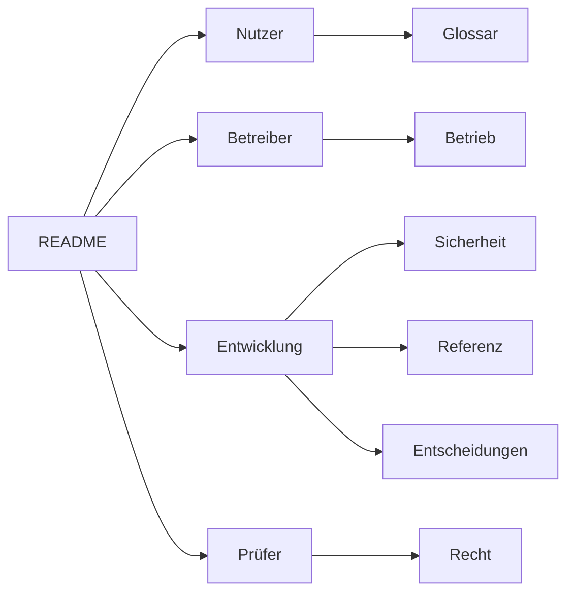

# Dokumentation: Deutsch

Englische Fassung: [docs/en](../en/README.md). Die Dateien in `docs/` sind die Quelle. Dieses Verzeichnis ordnet sie nach Zielgruppe und Thema und enthält die Seiten, die es noch nicht gab (Architektur, Abläufe, Glossar). Ältere Dokumente liegen weiter direkt unter `docs/`; sie werden später umbenannt und hierher einsortiert.

## Einstieg nach Zielgruppe

| Ich bin ... | Ich will ... | Start |
|---|---|---|
| Hörerin oder Hörer | die App nutzen | [README, Für Hörer](../../README.md#für-hörer), [Barrierefreiheit](../../.github/ACCESSIBILITY.md) |
| Betreiber (LineFM Studios) | Konten einrichten, freigeben, ausliefern | [Einrichtung](../EINRICHTUNG.md), [Freigabe-Checkliste](../FREIGABE-CHECKLISTE.md), [Bauen und Starten](../BAUEN-UND-STARTEN.md) |
| Entwickler oder Admin | bauen, testen, erweitern, hosten | [Entwicklung](../ENTWICKLUNG.md), [Architektur](architektur.md), [Hosting](../hosting-uebersicht.md) |
| Presse, Partnersender, Prüfer | Stand, Datenschutz, Prüfbarkeit | [Datenfluss der Einwilligung](datenfluss-einwilligung.md), [Release prüfen](../RELEASE-VERIFIZIEREN.md), [Standards und Konformität](../../README.md#standards-und-konformität) |

## Gliederung

| Modul | Inhalt | Dokumente |
|---|---|---|
| Nutzer | Funktionen, Barrierefreiheit | [README](../../README.md), [ACCESSIBILITY.md](../../.github/ACCESSIBILITY.md), [Barrierefreiheit](../BARRIEREFREIHEIT.md) |
| Betreiber | Konten, Konfiguration, Bauen, Stores, Freigabe | [Einrichtung](../EINRICHTUNG.md), [Konfiguration](../KONFIGURATION.md), [Sender verwalten](../SENDER-VERWALTEN.md), [Bauen und Starten](../BAUEN-UND-STARTEN.md), [Store-Pipelines](../stores-pipelines.md), [Secrets](../secrets.md) |
| Entwicklung | Aufbau, Tests, Plattformen | [Entwicklung](../ENTWICKLUNG.md), [Architektur](architektur.md), [Performance](../PERFORMANCE.md), [Gerätetests](../GERAETETESTS.md) |
| Betrieb | Hosting, Überwachung, Notfall | [Hosting](../hosting-uebersicht.md), [Telemetrie](../telemetry.md) |
| Sicherheit | Prüfung von Releases | [Release prüfen](../RELEASE-VERIFIZIEREN.md), [SECURITY.md](../../SECURITY.md) |
| Recht | Datenschutz, Lizenzen, Store-Angaben | [Verarbeitungsverzeichnis](../VERARBEITUNGSVERZEICHNIS.md), [Store-Datenschutzangaben](../STORE-DATENSCHUTZANGABEN.md), [Lizenzen Dritter](../LIZENZEN-DRITTE.md), [Unterlagen für den Anwalt](../ANWALT-UNTERLAGEN.md) |
| Referenz | Store-Richtlinien, Wettbewerb | [Store-Richtlinien](../STORE-RICHTLINIEN.md), [Store-Texte](../STORE-TEXTE.md), [Wettbewerb](../WETTBEWERB.md) |
| Entscheidungen | ADRs | [Übersicht](../adr/README.md) |
| Neu in diesem Verzeichnis | Abläufe und Begriffe | [Architektur](architektur.md), [Datenfluss der Einwilligung](datenfluss-einwilligung.md), [Release-Fluss](release-fluss.md), [Glossar](glossar.md) |

Betriebsdokumente (Runbook, Vorfall, Bedrohungsmodell) liegen unter `docs/betrieb/` und werden in einem eigenen Schritt eingeordnet. Was noch fehlt, steht in der [Bestandsaufnahme](bestandsaufnahme.md).
