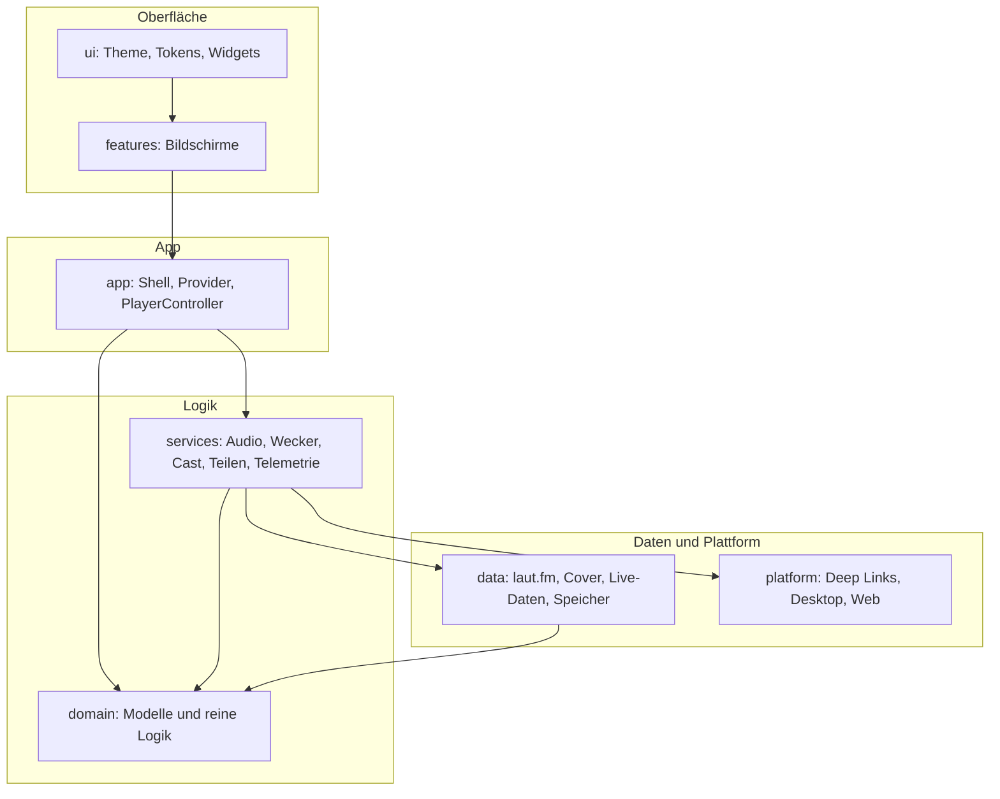
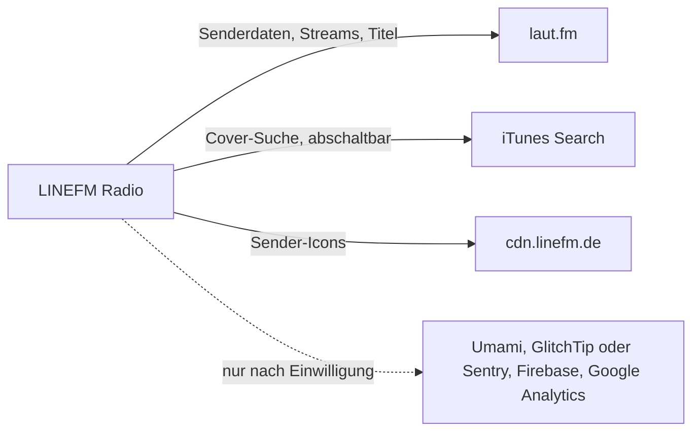

# Architektur

Kurzfassung der Schichten. Die Ordnerliste, die Provider und das Vorgehen für neue Funktionen stehen in [Entwicklung](../ENTWICKLUNG.md#architektur-im-überblick).

## Schichten

Regel: `domain/` kennt kein Flutter. Dienste sind Schnittstellen mit einer echten Umsetzung und einem Fake für Tests. `main()` tauscht die Standardwerte (Stubs ohne Netzwerk) über `productionOverrides` gegen die echten Dienste.

## Externe Dienste

Es gibt kein eigenes Backend und keine Konten ([ADR 0001](../adr/0001-kein-backend-keine-konten.md)). Favoriten, Verlauf und Einstellungen liegen auf dem Gerät.

## Plattformen

| Plattform | Wiedergabe | Besonderheiten |
|---|---|---|
| Android | just_audio, audio_service | Widget, Android Auto, Chromecast |
| iOS, macOS | just_audio, audio_service | AirPlay und CarPlay vorbereitet |
| Windows, Linux | just_audio mit media_kit | Tray, Mini-Fenster, Tastenkürzel; Windows mit Mediensteuerung |
| Web | just_audio | Links mit `?station=`, Rechtsseiten unter `/impressum/` und `/datenschutz/` |

Begründung der Audio-Wahl: [ADR 0007](../adr/0007-audio-just-audio-audio-service-media-kit.md).
