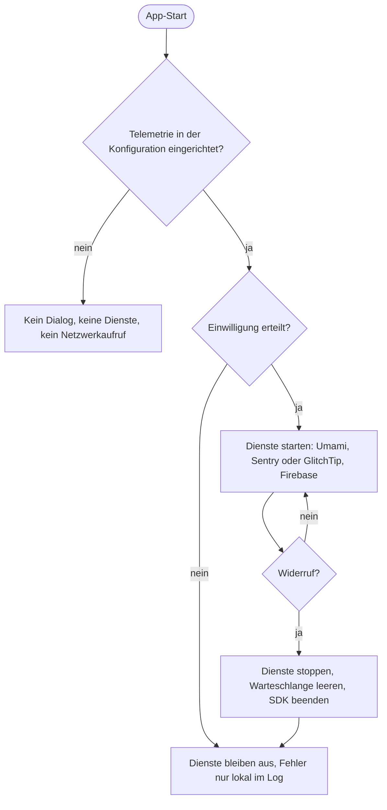

# Datenfluss der Einwilligung

Statistik und Absturzberichte sind optional und nur mit Einwilligung aktiv. Konfiguration und Hosting: [Telemetrie](../telemetry.md). Entscheidung: [ADR 0006](../adr/0006-telemetrie-austauschbar-mit-einwilligung.md).

## Was lokal bleibt

| Daten | Ort | Bedingung |
|---|---|---|
| Favoriten, Verlauf, Einstellungen | Gerät | erst nach bestätigtem Speicher-Hinweis |
| Gewählte Sprache, „Cover laden: aus“ | Gerät | sofort, auch ohne Bestätigung (begründete Ausnahmen) |

## Was nach Einwilligung gesendet wird

Ereignisse wie App-Start, Bildschirmaufrufe, Wiedergabe mit Sender und grober Hörzeit, Favoriten, Teilen, Export und Stream-Fehler. Die IP-Adresse geht technisch immer mit. Die vollständige Liste und die Hinweise zum Server-Log stehen in [Telemetrie](../telemetry.md). Im Web kommt optional Google Analytics hinzu, mit gesonderter Einwilligung.
