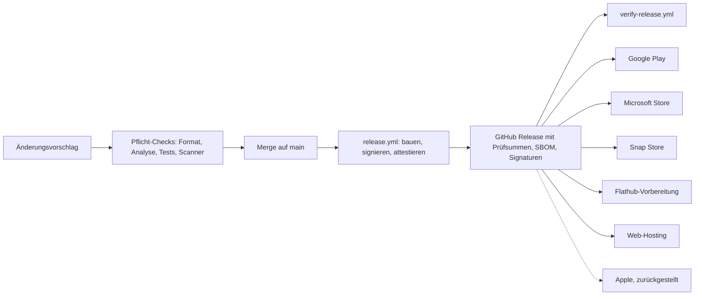

# Release-Fluss

Von der Änderung bis zum Download. Die Prüfung der Dateien: [Release-Dateien prüfen](../RELEASE-VERIFIZIEREN.md). Store-Abläufe im Detail: [Store-Pipelines](../stores-pipelines.md).

- Jeder Merge auf `main` erzeugt eine signierte Vorabversion (`0.1.0-alpha.N`).
- Vorabversionen gehen in keinen Store und nicht ins Web. Das passiert erst ab `1.0.0`, nach Freigabe des Betreibers.
- Jede Store-Pipeline läuft nur, wenn ihre Secrets gesetzt sind, und überspringt sonst sauber ([Secrets](../secrets.md)).
- Jede Release-Datei hat eine Prüfsumme, eine GitHub-Attestierung und eine cosign-Signatur.
