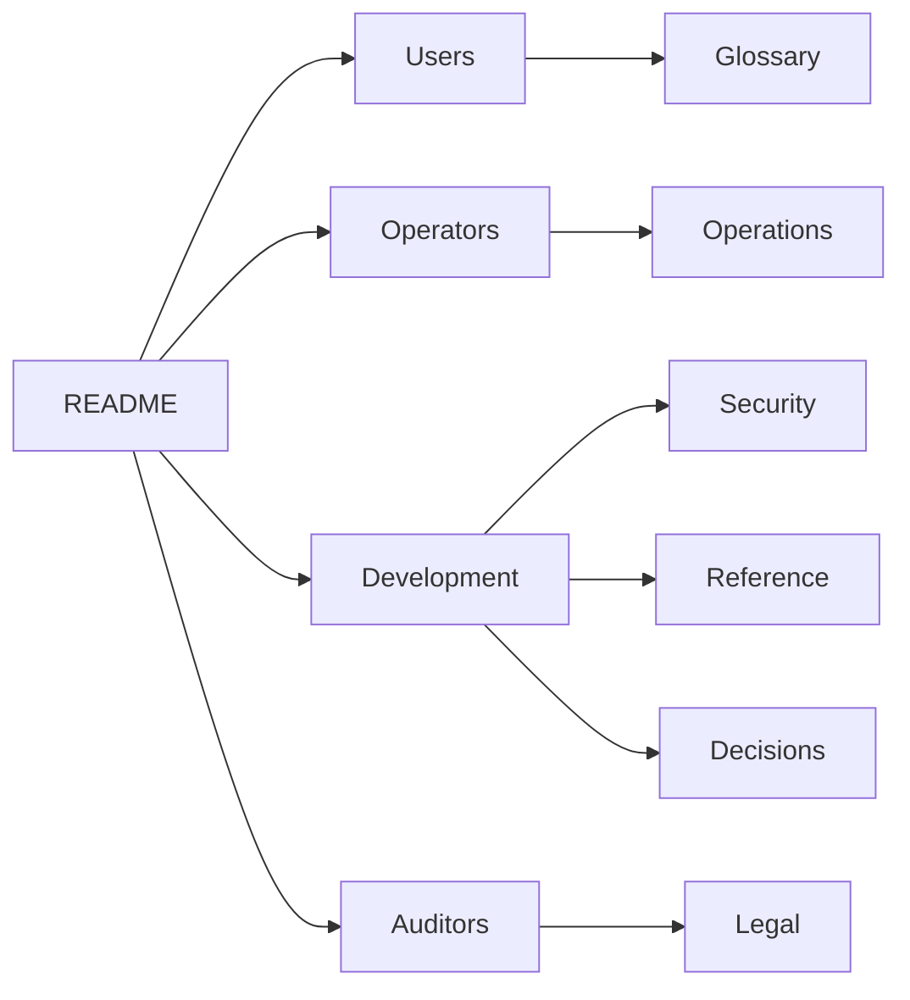

# Documentation: English

German version: [docs/de](../de/README.md). The files in `docs/` are the source. This directory sorts them by audience and topic and holds the pages that did not exist before (architecture, flows, glossary). Most older documents are still German and sit directly under `docs/`; they will be renamed and moved here later. Links to them are marked (German).

## Start by audience

| I am ... | I want to ... | Start |
|---|---|---|
| A listener | use the app | [README, For listeners](../../README.en.md#for-listeners), [Accessibility](../../.github/ACCESSIBILITY.md) |
| The operator (LineFM Studios) | set up accounts, approve, ship | [Setup](../EINRICHTUNG.md) (German), [Release checklist](../FREIGABE-CHECKLISTE.md) (German), [Build and run](../BAUEN-UND-STARTEN.md) (German) |
| A developer or admin | build, test, extend, host | [Development](../ENTWICKLUNG.md) (German), [Architecture](architecture.md), [Hosting](../hosting-uebersicht.md) (German) |
| Press, partner station, auditor | state, privacy, verifiability | [Consent data flow](consent-data-flow.md), [Verify a release](../RELEASE-VERIFIZIEREN.md) (German), [Standards and compliance](../../README.en.md#standards-and-compliance) |

## Structure

| Module | Content | Documents |
|---|---|---|
| Users | Features, accessibility | [README](../../README.en.md), [ACCESSIBILITY.md](../../.github/ACCESSIBILITY.md), [Accessibility statement](../BARRIEREFREIHEIT.md) (German) |
| Operators | Accounts, configuration, build, stores, approval | [Setup](../EINRICHTUNG.md), [Configuration](../KONFIGURATION.md), [Manage stations](../SENDER-VERWALTEN.md), [Build and run](../BAUEN-UND-STARTEN.md), [Store pipelines](../stores-pipelines.md), [Secrets](../secrets.md) (all German) |
| Development | Structure, tests, platforms | [Development](../ENTWICKLUNG.md), [Architecture](architecture.md), [Performance](../PERFORMANCE.md), [Device tests](../GERAETETESTS.md) |
| Operations | Hosting, monitoring, emergencies | [Hosting](../hosting-uebersicht.md), [Telemetry](../telemetry.md) (German) |
| Security | Verifying releases | [Verify a release](../RELEASE-VERIFIZIEREN.md) (German), [SECURITY.md](../../SECURITY.md) |
| Legal | Privacy, licenses, store disclosures | [Record of processing](../VERARBEITUNGSVERZEICHNIS.md), [Store privacy disclosures](../STORE-DATENSCHUTZANGABEN.md), [Third-party licenses](../LIZENZEN-DRITTE.md), [Material for the lawyer](../ANWALT-UNTERLAGEN.md) (all German) |
| Reference | Store policies, competition | [Store policies](../STORE-POLICIES.md) (English), [Store texts](../STORE-TEXTE.md), [Competition](../WETTBEWERB.md) (German) |
| Decisions | ADRs | [Index](../adr/README.md) (German) |
| New in this directory | Flows and terms | [Architecture](architecture.md), [Consent data flow](consent-data-flow.md), [Release flow](release-flow.md), [Glossary](glossary.md) |

Operations documents (runbook, incident, threat model) live in `docs/betrieb/` and are filed in a separate step. What is still missing is listed in the [inventory](inventory.md).
