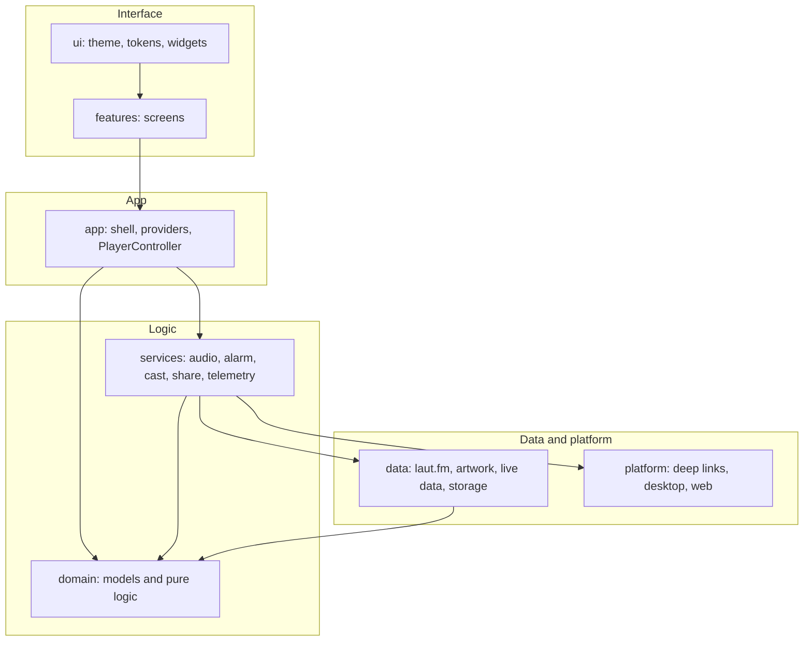
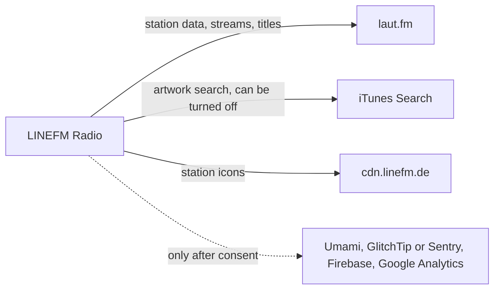

# Architecture

Short version of the layers. The folder list, the providers and the steps for a new feature are in [Development](../ENTWICKLUNG.md#architektur-im-überblick) (German).

## Layers

Rule: `domain/` knows nothing about Flutter. Services are interfaces with a real implementation and a fake for tests. `main()` replaces the defaults (stubs without network) with the real services through `productionOverrides`.

## External services

There is no backend of our own and there are no accounts ([ADR 0001](../adr/0001-kein-backend-keine-konten.md), German). Favorites, history and settings stay on the device.

## Platforms

| Platform | Playback | Notes |
|---|---|---|
| Android | just_audio, audio_service | widget, Android Auto, Chromecast |
| iOS, macOS | just_audio, audio_service | AirPlay and CarPlay prepared |
| Windows, Linux | just_audio with media_kit | tray, mini window, shortcuts; Windows with media controls |
| Web | just_audio | links with `?station=`, legal pages at `/impressum/` and `/datenschutz/` |

Why this audio stack: [ADR 0007](../adr/0007-audio-just-audio-audio-service-media-kit.md) (German).
