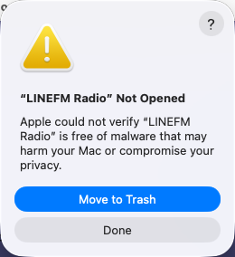
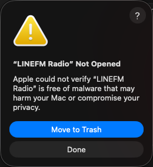
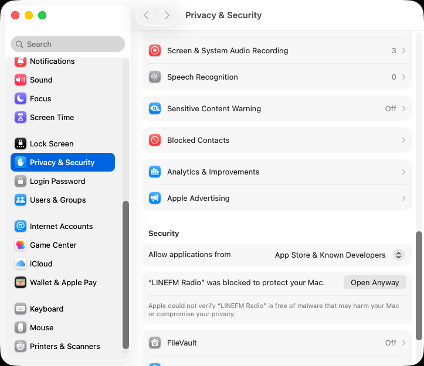
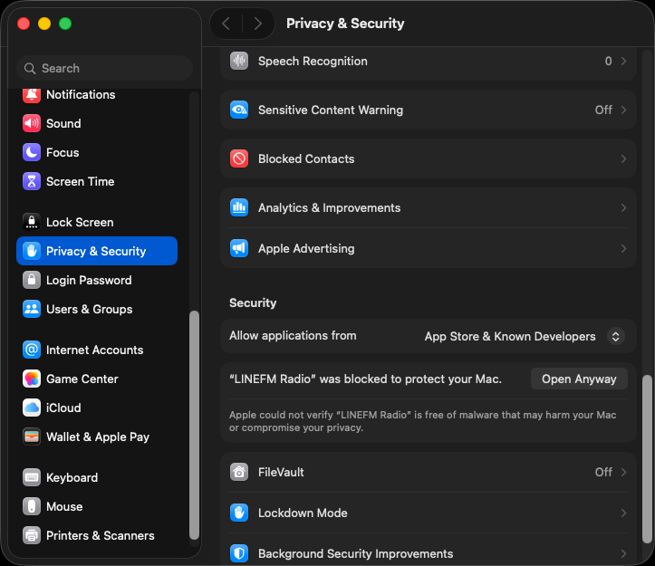

# Build and run (English): macOS first launch

This page is the English counterpart of the macOS passage in [BAUEN-UND-STARTEN.md](../BAUEN-UND-STARTEN.md). The German guide is the complete version; this page covers the macOS first launch, including the CI screenshots.

## macOS

The DMG is neither signed nor checked by Apple ("notarized"). For this reason macOS warns at the first launch. This is expected. The same instructions are also inside the DMG as `README.txt`.

1. Open the DMG with a double click and drag **LINEFM Radio** into **Applications**. The background of the DMG window shows these steps as a picture ([source](../../packaging/macos/dmg-background.svg)).
2. Start the app from the Applications folder. A warning appears. Close it with **Done**.
3. Open **System Settings > Privacy & Security**.
4. Scroll to **Security**. It says that "LINEFM Radio" was blocked. Click **Open Anyway** and confirm with your password or Touch ID.
5. From now on the app starts normally.

Screenshots of steps 2 to 4, created automatically on a macOS runner of the CI:

| | Light | Dark |
|---|---|---|
| Warning at the first launch (step 2) |  |  |
| System Settings, Privacy & Security (steps 3 and 4) |  |  |

GitHub does not document whether Gatekeeper is switched on for the runner. If an image shows no warning dialog, the reason is in `gatekeeper.txt` in the artifact `desktop-evidence-macos`.

Up to macOS 14, a right click on the app and **Open** was enough. From macOS 15 on, it only works through System Settings. Source: [packaging/macos/README.txt](../../packaging/macos/README.txt). This has not yet been replayed on a real Mac in this project.

## Fetching the screenshots from the CI

The four Gatekeeper images above live in `docs/assets/macos/`. They come from a real CI run (artifact `gatekeeper-screenshots`, run 46147813021 of 2026-11-28). To regenerate and update them:

```bash
gh workflow run widget-evidence.yml --ref main
gh run download <run-id> -n gatekeeper-screenshots -D docs/assets/macos
```
