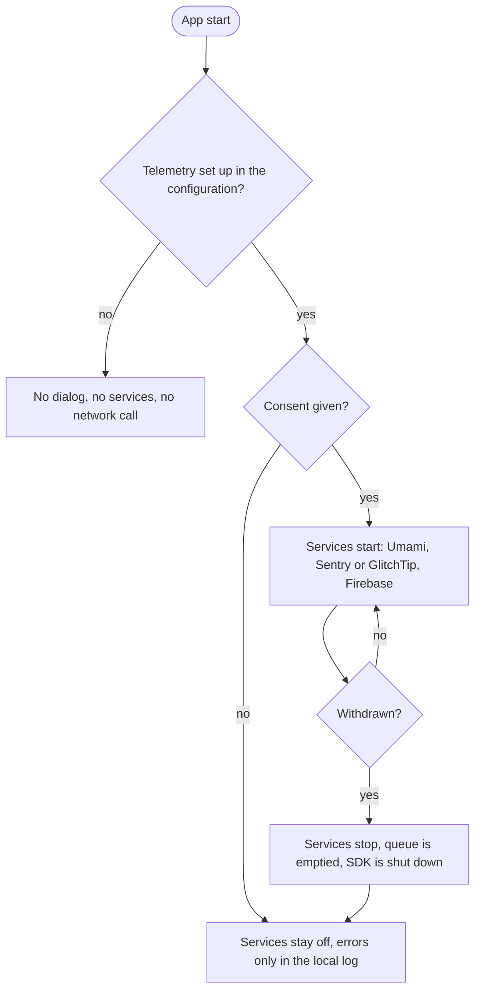

# Consent data flow

Statistics and crash reports are optional and active only with consent. Configuration and hosting: [Telemetry](../telemetry.md) (German). Decision: [ADR 0006](../adr/0006-telemetrie-austauschbar-mit-einwilligung.md) (German).

## What stays local

| Data | Where | Condition |
|---|---|---|
| Favorites, history, settings | device | only after the storage notice is confirmed |
| Chosen language, "Load artwork: off" | device | saved at once, even without confirmation (justified exceptions) |

## What is sent after consent

Events such as app start, screen views, playback with station and a rough listening time, favorites, sharing, export and stream errors. The IP address is always transmitted technically. The full list and the notes on the server log are in [Telemetry](../telemetry.md) (German). On the web, Google Analytics can be added, with separate consent.
