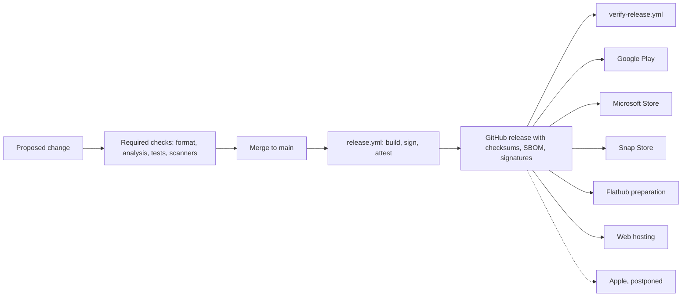

# Release flow

From a change to the download. Checking the files: [Verify release files](../RELEASE-VERIFIZIEREN.md) (German). Store flows in detail: [Store pipelines](../stores-pipelines.md) (German).

- Every merge to `main` produces a signed pre-release (`0.1.0-alpha.N`).
- Pre-releases go to no store and not to the web. That starts with `1.0.0`, after the operator's approval.
- Each store pipeline runs only when its secrets are set and skips cleanly otherwise ([Secrets](../secrets.md), German).
- Every release file has a checksum, a GitHub attestation and a cosign signature.
