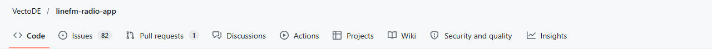

# Setup guide for LineFM Studios (English)

This page is the English counterpart of the passages added to the German setup guide [EINRICHTUNG.md](../EINRICHTUNG.md). The German guide is the complete and authoritative version with all steps, numbering and checkboxes. This page covers the introduction, the first day, the extra explanations and the glossary entries. Step numbers (1.1, 1.2, 1.7, ...) refer to the German guide.

## Introduction

This list contains everything you, as the operator, need to know, obtain and enter so that LINEFM Radio appears in the stores and on the web and runs flawlessly. Everything else is prepared. You need no programming knowledge. Where a developer has to do something, it is stated next to the task.

Start at section 1 and work through the "Arbeitsreihenfolge" (working order) table in the German guide from top to bottom. Starting today means: step 1.1 (create a GitHub account), then 1.7 (mailboxes) and 1.2 (password manager).

GitHub is the website where the app's code lives and is built automatically. The repository (repo for short) is the app's project folder there: <https://github.com/VectoDE/linefm-radio-app>. Unknown words are listed alphabetically in appendix F. Appendices A to D and F are reference lists for you. Appendix G is for the developer. Appendix E is at the very end of the file and only documents the sources.

## Finding your open tasks

You do not trigger a release. You make it possible by completing your open tasks. "Open" means there are still tickets in the repository that describe these tasks. You find them on the repository's start page in the tab "Issues" (the tickets, that is the list of tasks and bugs), the second from the left, right next to "Code". The developer explains the current state. Apple is not part of the first scope (section 15).

This is how the bar looks without signing in. When you are signed in and have rights on the repository, the "Settings" tab appears on the right.

## Additions to individual steps

- Step 1.1 (GitHub account): After creating the account, switch on two-factor sign-in. At sign-in, GitHub then also asks for a code from an app on your phone. Click your profile picture at the top right, then "Settings" > "Password and authentication".
- Step 1.2 (password manager): Besides the encrypted offline copy of the vault on a USB stick, print the emergency codes (replacement codes you use to sign in when your phone is missing). In Bitwarden, first set up the second sign-in step. You then find the code in the web vault under "Settings" > "Security" > "Two-step login" > "View recovery code" (enter the master password, "Continue"). Source: <https://bitwarden.com/help/two-step-recovery-code/>. Keep both in a second place, for example a safe or a lockable drawer.
- Step 2.1 (GEMA and GVL confirmation from laut.fm): Without an answer, the release lock stays in place. This is a rule in the release checklist: as long as a prerequisite is missing, nothing is published. Telemetry and store submission stay locked.
- Accessibility statement: The generator (the developer's program that creates the legal texts) checks the file for open placeholders in strict mode (`--strict`).
- Step 4.5 (SPF and DMARC): There is neither a TXT record for the main domain nor `_dmarc.linefm.de` yet. The MX record is the record that says which server accepts the domain's mail, here `webmail.linefm.de`.
- Questions to the project: On the repository start page, open the tab "Issues" (second from the left, next to "Code") and click the green button "New issue", or go to "Discussions" (<https://github.com/VectoDE/linefm-radio-app/discussions>, button "New discussion"). The repository is public, so do not write confidential details there.

## Glossary additions

| Term | Meaning |
|---|---|
| MX record, nameserver | MX record: DNS record that says which server accepts a domain's mail. Nameserver: the servers that answer all DNS records of a domain |
| SPF, DKIM, DMARC | Three sender checks for email: SPF defines which servers may send mail for a domain, DKIM is a digital signature on the mail, DMARC tells recipients what to do with forged mail |
| Tickets | Entries in the repository's list of bugs and tasks on GitHub, reached via the second tab from the left |
